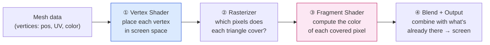
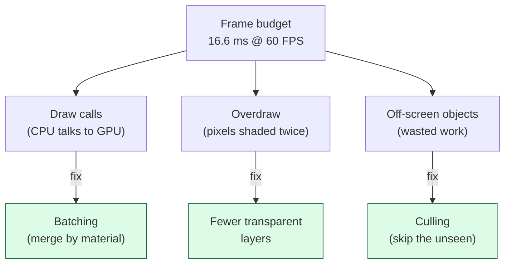

# Level 1 — The Rendering Pipeline

| | |
|---|---|
| 🎚️ **Difficulty** | 🟡 Medium |
| ⏱️ **Estimated time** | 30 minutes |
| ⭐ **XP reward** | 100 (Quest) + 25 (Quiz) |

[← Prev](../README.md) · [↑ Phase Home](../README.md) · [→ Next](02-shaders-and-materials.md)

---

## 📖 Story

> *"New world, new desk-mate — that's me, Lena, tech artist. Kenji's handing you over for a bit. Ashfall *plays* great now: the AI fights back, combat feels mean. But Maya's right that it looks flat — like a tech demo, not a game. Before we make it pretty, you need to understand the machine that draws every single frame, because 'pretty' that tanks your framerate is worthless. Here's the thing Unity hides from you: every frame, your CPU writes a to-do list of 'draw this, draw that' and hands it to the GPU, which turns triangles into colored pixels through a fixed assembly line — the **rendering pipeline**. Every engine on earth — Unity, Unreal, Godot, your own — runs this same pipeline; the GPU doesn't care which one you used. The single biggest performance lever in 2D isn't the GPU at all — it's how many times the CPU says 'hey GPU, draw something' (a **draw call**). Today you learn the pipeline, learn what a frame *costs*, and audit Ashfall's draw calls. Then we earn the right to write shaders. Let me show you. — Lena"*

---

## 🎯 Goal

- Understand the **CPU/GPU split**: who builds the work, who does the drawing
- Walk the **rendering pipeline** from first principles: vertices → rasterization → fragments → pixels
- Define a **draw call** and explain why their *count* dominates 2D performance
- Know the three classic frame-killers — **overdraw**, too many **draw calls**, missed **culling** — and their fixes (**batching**, **culling**)
- Move Ashfall onto a modern render pipeline (URP) and **audit its draw calls** with the Frame Debugger

---

## 🧠 Concepts

### Two processors, one frame

A frame is built by **two** processors that work very differently:

- The **CPU** (your C# game logic) decides *what* to draw: which sprites, where, with which material. It packages that into commands and sends them over.
- The **GPU** is a massively parallel machine that turns those commands into colored pixels. It's brilliant at doing the *same* small calculation on millions of things at once (every pixel, every vertex) — and terrible at being interrupted with new instructions.

The expensive part is often not the drawing — it's the **conversation**. Every time the CPU tells the GPU "draw this batch now," that's a **draw call**, and each one has overhead (state changes, validation, a trip across the driver). A 2D game that issues 3,000 draw calls a frame can be CPU-bound and stuttering even though the GPU is bored.

### The pipeline: triangles in, pixels out

Everything you see — even a 2D sprite — is **triangles**. A sprite is a quad: two triangles, four corners (**vertices**). The GPU runs every frame's geometry through a fixed sequence of stages:



1. **Vertex shader** — runs once per *vertex*. Its job: take a corner's position and transform it into where it lands on screen (model → world → camera → clip space). For a sprite, this is what positions, rotates, and scales the quad.
2. **Rasterizer** — fixed hardware (you don't program it). It figures out *which screen pixels* each triangle covers and generates a **fragment** (a candidate pixel) for each.
3. **Fragment shader** (a.k.a. pixel shader) — runs once per *fragment*. Its job: compute the final color of that pixel — sample the sprite's texture, tint it, apply lighting. This is where most shader "magic" lives. It runs *millions* of times per frame, so it must be cheap.
4. **Blending + output** — combines the fragment's color with whatever is already in that pixel (opaque overwrites; transparent blends — more on this in Lesson 3) and writes it to the screen.

The two **programmable** stages — vertex and fragment — are the shaders you'll write in Lesson 2. The rest is fixed-function hardware.

### What a frame costs — and the three killers

You have a **frame budget**. 60 FPS means 16.6 milliseconds per frame for *everything* — game logic, physics, AI, *and* rendering. Blow it and the game stutters. Three classic things blow the rendering half of that budget:

- **Too many draw calls** (CPU-bound). Each sprite drawn separately = one call. Fix: **batching** — merge many sprites that share a material/texture into one draw call. The CPU says "draw all 500 floor tiles" *once*.
- **Overdraw** (GPU-bound). The same pixel gets shaded multiple times because transparent things stack (smoke over fog over a tinted floor). The fragment shader runs for every layer. Fix: fewer overlapping transparent layers; smaller particles; opaque where possible.
- **Drawing things you can't see** (wasted everything). Fix: **culling** — don't even submit objects outside the camera's view (frustum culling) or fully hidden.



The golden rule for 2D: **sprites that share the same texture/material batch together**. That's why studios pack many sprites into one **sprite atlas** (one big texture) — same texture means one draw call for the whole atlas.

### Why this exists

You can't tune what you can't see. Engines hide the pipeline so well that programmers blame "the GPU" for stutters that are really *the CPU drowning in draw calls*. Knowing the pipeline tells you **where** a frame is spent and therefore **which** fix applies: a CPU-bound frame wants batching/atlasing; a GPU-bound frame wants less overdraw and cheaper fragment shaders. This is the foundation for every later lesson — shaders run *in* this pipeline (Lesson 2), lighting adds *fragment* cost and *blending* (Lesson 3), and particles/post-processing are *overdraw* machines you must budget (Lesson 4).

This is **completely engine-agnostic**. Vertex → raster → fragment → blend is how Unreal, Godot, WebGL, and a hand-rolled engine all draw; draw-call overhead and overdraw are properties of GPUs, not of Unity. Unity's **URP** (Universal Render Pipeline) is just one configurable implementation of this pipeline, tuned for 2D and mobile. See **RESOURCES.md** for this world (The Book of Shaders, Catlike Coding) for deep dives on the pipeline.

---

## 🛠️ Hands-on Lab

> 💻 Goal: get Ashfall onto **URP** (so Lessons 2–4 have shaders/lighting/post available), then *measure* its draw calls. We measure first — optimization without measurement is superstition.

### Step 1 — Install URP and create a pipeline asset

1. **Window → Package Manager → Unity Registry**, install **Universal RP**.
2. **Assets → Create → Rendering → URP Universal Renderer (2D)** (or "2D Renderer"). This creates a **Renderer** asset.
3. **Assets → Create → Rendering → URP Asset (with 2D Renderer)**. This creates the **Pipeline** asset; point its renderer field at the 2D Renderer from step 2.
4. **Edit → Project Settings → Graphics**, set the **Scriptable Render Pipeline Settings** to your new URP asset. (Also set it in **Project Settings → Quality** for each level.)

> If existing sprites turn pink, their material uses a built-in shader URP can't run. Select them and assign **Sprite-Lit-Default** or **Sprite-Unlit-Default** (URP shaders). We use those from here on.

### Step 2 — Read the frame counter

Enter Play mode, open the **Stats** overlay (top-right of the Game view). The two numbers that matter today:

- **Batches** — roughly how many draw calls go out per frame.
- **SetPass calls** — how many times the GPU had to switch shader/material state (the *expensive* kind of draw-call overhead).

Write down the current numbers. That's your baseline.

### Step 3 — Open the Frame Debugger (see every draw call)

**Window → Analysis → Frame Debugger → Enable.** It pauses on a frame and lets you step through **every single draw call** in order. Click through them: you'll see each sprite/UI/tilemap submission and *why* a new call started (usually "different material/texture"). This is the single most useful tool in this world — it shows you the conversation between CPU and GPU, command by command.

### Step 4 — Make batching pay off with a sprite atlas

```csharp
// There is no "batching script" — batching is data-driven. The win comes from
// making sprites SHARE a texture/material so the engine merges them. The lever:
//
//   1. Sprite Atlas: Assets → Create → 2D → Sprite Atlas. Drag in your dungeon
//      tiles / props sprites. One atlas = one texture = one draw call for all of them.
//   2. Same Material: keep batchable sprites on the SAME material (e.g. Sprite-Lit-Default).
//      A different material = a SetPass call = a batch break.
//
// Verify in code that you understand the cost model — this helper counts how many
// DISTINCT materials are in a scene, i.e. a lower bound on your sprite SetPass calls:

using UnityEngine;
using System.Collections.Generic;

public class DrawCallAuditor : MonoBehaviour
{
    void Start()
    {
        var materials = new HashSet<Material>();
        foreach (var r in FindObjectsOfType<SpriteRenderer>())
            materials.Add(r.sharedMaterial);   // sharedMaterial: don't instantiate a copy!

        Debug.Log($"[Audit] {FindObjectsOfType<SpriteRenderer>().Length} sprites " +
                  $"using {materials.Count} distinct materials. " +
                  $"Fewer materials/textures = fewer batch breaks.");
    }
}
```

> ⚠️ Reading `renderer.material` (not `sharedMaterial`) **clones** the material at runtime — instantly breaking batching for that object and leaking a material. Use `sharedMaterial` unless you truly want a per-object copy.

### Step 5 — Confirm culling is working

Move the camera so half the dungeon is off-screen. Watch **Batches** in the Stats overlay drop — that's **frustum culling** automatically skipping off-screen sprites. You didn't write it; the pipeline does it for free. (You *can* break it by parenting everything under one giant always-visible object — don't.)

---

## 🎮 Mini Challenge

Ashfall's dungeon floor is 600 tiles. Maya's HUD adds 12 UI elements on top, each a different icon texture. The Stats overlay shows **batches climbing every time the player walks into a new room**. You suspect the floor. You open the Frame Debugger and see the 600 floor tiles drawing in **one** batch — but **SetPass calls** are high. Where's the real cost, and what's the one change that helps most?

<details>
<summary>💡 Reveal answer</summary>

The **floor is fine** — 600 tiles in one batch means they already share a texture/material (a tilemap or atlas is doing its job). The cost is the **12 HUD icons**: 12 different textures = up to **12 SetPass calls + 12 batches**, because each unique texture forces the GPU to switch state.

The single most effective fix: **pack the 12 UI icons into one Sprite Atlas** so they share a texture. Same-texture UI sprites then batch into (ideally) one call. The lesson generalizes: *unique textures*, not *number of objects*, drive draw-call count — 600 same-texture tiles are cheaper than 12 different-texture icons. Always read the Frame Debugger before guessing.
</details>

---

## 📦 Project Mission

Move Ashfall to URP and establish a draw-call baseline you'll defend across this world.

1. Convert the Ashfall project to **URP with the 2D Renderer** (Lab Steps 1) and fix any pink materials by switching sprites to **Sprite-Lit-Default / Sprite-Unlit-Default**.
2. Add `Assets/Scripts/Rendering/DrawCallAuditor.cs` (Step 4) to a scene object; record the logged sprite/material counts.
3. With the **Stats** overlay open, record baseline **Batches** and **SetPass calls** for a typical dungeon room. Save these numbers in a comment or a `RENDERING_NOTES.md` in your project — this is the budget you'll protect when you add shaders, lights, and particles.
4. Create a **Sprite Atlas** for your dungeon tiles and props; re-measure and confirm **SetPass calls drop**.
5. Use the **Frame Debugger** to step through one frame and identify your top batch-breaker (likely UI or a one-off material). Note it.
6. Commit:
   ```bash
   cd ~/projects/ashfall
   git switch -c feature/urp-render-pipeline
   git add Assets ProjectSettings RENDERING_NOTES.md
   git commit -m "feat: migrate Ashfall to URP 2D + draw-call baseline and atlas"
   git switch main && git merge feature/urp-render-pipeline && git push
   ```

🎯 **Mission complete when:** Ashfall **runs on URP's 2D renderer** with no pink materials, you can **read Batches and SetPass calls** from the Stats overlay and **step through draw calls** in the Frame Debugger, and you have a **recorded baseline** plus an **atlas** that demonstrably **lowered SetPass calls** — the measured foundation for the rest of World 7.

---

## ⚠️ Common Mistakes

| Mistake | What happens | Fix |
|--------|--------------|-----|
| Optimizing before measuring | You "fix" the wrong thing; no gain | Read Stats + Frame Debugger first; fix the actual hotspot |
| Assuming object *count* = draw calls | Panic over 600 batched tiles | It's *distinct textures/materials* that cost; batch by sharing them |
| Using `renderer.material` | Clones the material → breaks batching, leaks | Use `sharedMaterial` unless you need a per-object copy |
| Each UI icon its own texture | Many SetPass calls from a tiny HUD | Pack UI/sprites into a **Sprite Atlas** (shared texture) |
| Heavy overlapping transparency | GPU-bound from overdraw, not draw calls | Fewer transparent layers; profile GPU vs CPU separately |
| Forgetting to set the URP asset in Graphics settings | Pipeline features (lights/shaders) silently don't run | Assign the URP asset in Project Settings → Graphics **and** Quality |

---

## 🤔 Reflection Questions

1. A frame is running slow. How would you decide whether it's **CPU-bound** (too many draw calls) or **GPU-bound** (too much overdraw / heavy fragment shaders) — and what fix does each diagnosis point to?
2. Why does a **sprite atlas** reduce draw calls, and why is "600 same-texture tiles" cheaper than "12 different-texture icons"? Tie it to *SetPass calls*.
3. The vertex shader runs once per vertex; the fragment shader runs once per covered pixel. For a full-screen sprite, which runs vastly more often — and what does that imply about where you should and shouldn't put expensive math?

---

## 📝 Quiz

1. **A "draw call" is…**
   - a) the GPU computing a single pixel's color
   - b) the CPU instructing the GPU to draw a batch of geometry (overhead per call)
   - c) the number of triangles in a mesh
2. **In a 2D game, the most common cause of being CPU-bound is…**
   - a) too many distinct textures/materials forcing many draw calls
   - b) the monitor's refresh rate
   - c) using too few vertices
3. **The fragment (pixel) shader runs…**
   - a) once per object
   - b) once per vertex
   - c) once per covered screen pixel (so it must be cheap)

<details>
<summary>✅ Answers</summary>

1: **b** · 2: **a** · 3: **c**
</details>

---

## ✅ Completion Checklist

- [ ] Ashfall runs on URP's 2D renderer with no pink materials
- [ ] I can read Batches and SetPass calls in the Stats overlay
- [ ] I stepped through a frame in the Frame Debugger and found my top batch-breaker
- [ ] I recorded a draw-call baseline and lowered SetPass calls with a Sprite Atlas
- [ ] I can explain vertex → raster → fragment → blend in one breath
- [ ] I passed the quiz
- [ ] Added **+125 XP** to [PROGRESS.md](../../../PROGRESS.md)

---

[← Prev](../README.md) · [↑ Phase Home](../README.md) · [→ Next](02-shaders-and-materials.md)
