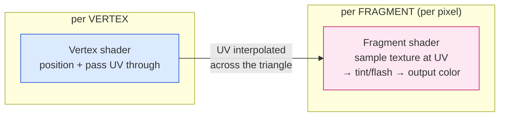
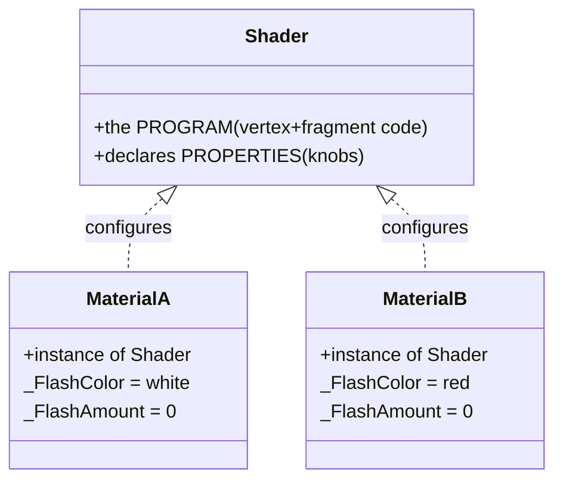

# Level 2 — Shaders & Materials

| | |
|---|---|
| 🎚️ **Difficulty** | 🔴 Hard |
| ⏱️ **Estimated time** | 35 minutes |
| ⭐ **XP reward** | 100 (Quest) + 25 (Quiz) |

[← Prev](01-the-rendering-pipeline.md) · [↑ Phase Home](../README.md) · [→ Next](03-2d-lighting-and-shadows.md)

---

## 📖 Story

> *"Now we write code that runs on the GPU. A **shader** scares people, but it's just a small program — the catch is it runs *millions* of times in parallel, once per pixel, with no memory of the pixel next door. Maya's first concrete ask: when an enemy gets hit, it should **flash white** for a beat — that universal 'you connected' feedback. You could swap the sprite's color in C#… and it'd look cheap and clip the art. The *right* way is a **fragment shader** that takes the sprite's normal color and lerps it toward white by an amount you control. While we're in there, you'll learn the difference everyone fumbles: a **shader** is the *program*; a **material** is an *instance* of that program with its knobs (color, flash amount, textures) set — like a class vs an object. Master that and the rest of this world opens up: lighting and dissolve are just more fragment-shader math. I'll give you a hand-written HLSL version *and* show how Shader Graph does the same thing with nodes, so you understand what the nodes actually compile to. Let me show you. — Lena"*

---

## 🎯 Goal

- Understand what a **shader** *is*: a program that runs on the GPU, in parallel, per vertex and per fragment
- Distinguish the **vertex** shader (where) from the **fragment** shader (what color)
- Learn **UVs** (texture coordinates) and how the fragment shader samples a sprite's texture
- Nail the **shader vs material** distinction — program vs configured instance — and what **properties/uniforms** are
- Write a real **hit-flash** shader (ShaderLab/HLSL) and drive it from C# for Ashfall's combat feedback

---

## 🧠 Concepts

### A shader is a tiny program that runs per-pixel, in parallel

The fixed pipeline from Lesson 1 has two **programmable** stages. A shader fills them in:

- The **vertex shader** runs once per corner — it decides *where on screen* that vertex lands.
- The **fragment shader** runs once per covered pixel — it decides *what color* that pixel is.

The mental model that trips everyone up: a fragment shader has **no loops over pixels and no neighbors**. You write the code for **one** pixel; the GPU runs that same code on all of them simultaneously. You get inputs (this pixel's UV, the time, your knobs), you output one color. That's it. The parallelism is why it's fast and why "just sample the pixel to my left" is hard (that's why blur/lighting need special tricks).



### UVs: the map from pixel to texture

A sprite is a quad with a texture stretched over it. **UV coordinates** are how the GPU knows *which part of the texture* a given pixel should sample. UVs run `(0,0)` at one corner to `(1,1)` at the opposite — a normalized address into the texture, independent of its resolution. The vertex shader assigns a UV to each corner; the rasterizer **interpolates** them smoothly across the triangle, so each fragment arrives with its own UV. The fragment shader then does `tex2D(myTexture, uv)` to fetch that texel's color. Everything textured — sprites, dissolve masks, normal maps next lesson — rides on UVs.

### Shader vs Material: program vs instance

This is the distinction that makes everything click:



- A **shader** is the *code* — it declares **properties** (`_Color`, `_FlashAmount`, `_MainTex`): the knobs it accepts.
- A **material** is an *instance* of a shader with those properties **set to values**. Two materials can run the *same* shader with different colors.
- Those property values, once uploaded to the GPU each frame, are called **uniforms** — "uniform" because they're the *same* for every pixel in that draw call (unlike UVs, which vary per pixel).

It's class vs object. You write one hit-flash shader; every enemy uses a material instance of it, and you animate each material's `_FlashAmount` independently.

### Why this exists

The CPU can't touch individual pixels at 60 FPS — there are millions of them. Shaders move per-pixel work onto the GPU's parallel hardware, which is the *only* place effects like flashes, dissolves, lighting, water, and post-processing can run affordably. The shader/material split exists for the same reason classes/objects do: write the logic once, reuse it with different data, and (critically) let *materials sharing a shader+texture batch together* — tying straight back to Lesson 1's draw-call rules. Get this lesson and Lessons 3 (lighting = fragment math + blending) and 4 (post-processing = a full-screen fragment shader) are just variations on a theme.

This is **engine-agnostic**. Unreal uses HLSL + its material graph; Godot uses its own shading language; WebGL uses GLSL — but all of them are "small program, runs per vertex/per fragment, configured by an instance with uniforms." The *syntax* changes; the model doesn't. See **RESOURCES.md** for this world — **The Book of Shaders** (GLSL fundamentals) and **Catlike Coding** (Unity HLSL) are the canonical free deep-dives.

---

## 🛠️ Hands-on Lab

> 💻 You'll write a real hit-flash shader for URP sprites, make a material, and drive the flash from C# on damage.

### Step 1 — A minimal URP sprite shader (ShaderLab + HLSL)

Create `Assets/Shaders/SpriteHitFlash.shader`. ShaderLab is the wrapper; the actual GPU code is the HLSL inside `HLSLPROGRAM`.

```hlsl
Shader "Ashfall/SpriteHitFlash"
{
    Properties
    {
        [PerRendererData] _MainTex ("Sprite Texture", 2D) = "white" {}
        _Color ("Tint", Color) = (1,1,1,1)
        _FlashColor ("Flash Color", Color) = (1,1,1,1)
        _FlashAmount ("Flash Amount", Range(0,1)) = 0   // 0 = normal, 1 = full flash
    }

    SubShader
    {
        Tags { "RenderType"="Transparent" "Queue"="Transparent" "RenderPipeline"="UniversalPipeline" }
        Blend SrcAlpha OneMinusSrcAlpha   // standard alpha blending for sprites
        Cull Off ZWrite Off

        Pass
        {
            HLSLPROGRAM
            #pragma vertex vert
            #pragma fragment frag
            #include "Packages/com.unity.render-pipelines.universal/ShaderLibrary/Core.hlsl"

            // --- per-pixel-varying inputs (UVs, color) flow vertex -> fragment ---
            struct Attributes { float4 positionOS : POSITION; float2 uv : TEXCOORD0; float4 color : COLOR; };
            struct Varyings   { float4 positionHCS : SV_POSITION; float2 uv : TEXCOORD0; float4 color : COLOR; };

            // --- uniforms: SAME for every pixel in the draw call (the material's knobs) ---
            TEXTURE2D(_MainTex); SAMPLER(sampler_MainTex);
            float4 _Color, _FlashColor;
            float  _FlashAmount;

            // VERTEX SHADER: place the vertex, pass UV/color along.
            Varyings vert (Attributes IN)
            {
                Varyings OUT;
                OUT.positionHCS = TransformObjectToHClip(IN.positionOS.xyz); // model -> clip space
                OUT.uv = IN.uv;
                OUT.color = IN.color;
                return OUT;
            }

            // FRAGMENT SHADER: runs once per pixel. Sample sprite, tint, then lerp toward flash.
            half4 frag (Varyings IN) : SV_Target
            {
                half4 tex = SAMPLE_TEXTURE2D(_MainTex, sampler_MainTex, IN.uv) * IN.color * _Color;
                // Lerp RGB toward the flash color by _FlashAmount; keep the sprite's own alpha
                // so the flash respects the silhouette (no white box around the sprite).
                tex.rgb = lerp(tex.rgb, _FlashColor.rgb, _FlashAmount);
                return tex;
            }
            ENDHLSL
        }
    }
}
```

The two lines that *are* the effect: `SAMPLE_TEXTURE2D(...)` (get the sprite's real color at this pixel's UV) and `lerp(tex.rgb, _FlashColor.rgb, _FlashAmount)` (blend toward white by the knob). Keeping `tex.a` untouched means the flash hugs the sprite's shape instead of flashing a rectangle.

### Step 2 — Make a material from the shader

1. **Assets → Create → Material**, name it `Mat_EnemyFlash`.
2. In its inspector, set **Shader → Ashfall/SpriteHitFlash**.
3. Leave `_FlashColor` white, `_FlashAmount` at 0. Assign this material to an enemy's `SpriteRenderer`.

Same shader, one material per enemy *type* (so they share + batch); we animate the **amount** per-instance in code via a property block.

### Step 3 — Drive the flash from C# on damage

```csharp
using System.Collections;
using UnityEngine;

// Plug into the World 5 damage pipeline: call Flash() when this entity takes a hit.
[RequireComponent(typeof(SpriteRenderer))]
public class HitFlash : MonoBehaviour
{
    [SerializeField] float duration = 0.12f;          // a short, snappy flash
    static readonly int FlashAmount = Shader.PropertyToID("_FlashAmount");

    SpriteRenderer _sr;
    MaterialPropertyBlock _mpb;                        // per-renderer override = NO batch break
    Coroutine _running;

    void Awake() { _sr = GetComponent<SpriteRenderer>(); _mpb = new MaterialPropertyBlock(); }

    public void Flash()
    {
        if (_running != null) StopCoroutine(_running);
        _running = StartCoroutine(FlashRoutine());
    }

    IEnumerator FlashRoutine()
    {
        float t = 0f;
        while (t < duration)
        {
            t += Time.deltaTime;
            // Snap to full flash, then fade out: punchy on impact, eases back to normal.
            float amount = 1f - (t / duration);
            SetFlash(amount);
            yield return null;
        }
        SetFlash(0f);
        _running = null;
    }

    void SetFlash(float amount)
    {
        _sr.GetPropertyBlock(_mpb);
        _mpb.SetFloat(FlashAmount, amount);           // override just THIS renderer's uniform
        _sr.SetPropertyBlock(_mpb);
    }
}
```

> 💡 `MaterialPropertyBlock` is the pro move: it overrides a property **per renderer** *without* cloning the material — so every enemy can flash independently *and* still batch (Lesson 1's rule survives). Never do `_sr.material.SetFloat(...)` here — that clones and breaks batching.

### Step 4 — Wire it to the hit

In your damage handler (World 5's `TakeDamage`/`IDamageable`), after applying damage:

```csharp
GetComponent<HitFlash>()?.Flash();   // visual feedback rides on the existing combat event
```

### Step 5 — The Shader Graph equivalent (for reference)

If you prefer nodes: **Create → Shader Graph → URP → Sprite Lit/Unlit Shader Graph**. The whole effect is:

```
Sample Texture 2D(_MainTex) ─► [RGB] ─► Lerp(A: texRGB, B: _FlashColor, T: _FlashAmount) ─► Base Color
                              └► [A]  ───────────────────────────────────────────────────► Alpha
```

Expose `_FlashColor` (Color) and `_FlashAmount` (Float, 0–1) as **Blackboard properties** — those become the material's knobs, exactly the `Properties` block from Step 1. Same math, visual editor. Understanding Step 1 means you know what every node *compiles to*.

---

## 🎮 Mini Challenge

A teammate writes the flash in pure C# instead: on hit, `spriteRenderer.color = Color.white;` then back to normal after 0.1s. It "works" in a quick test, but Lena vetoes it. Give **two** concrete reasons the shader approach is correct, and one case where the C# version visibly breaks.

<details>
<summary>💡 Reveal answer</summary>

**Reason 1 — Control & blending.** `SpriteRenderer.color` *multiplies* the sprite; setting it to white doesn't push the sprite *toward* white, and you can't smoothly `lerp` the amount or pick a partial flash. The shader's `lerp(tex, flash, amount)` gives a tunable 0→1 blend you can fade.

**Reason 2 — It scales to real effects.** The C# trick is a dead end — you can't add a dissolve, an outline, or hue shift to a `.color` field. The shader is the same place all later effects (dissolve, lighting) live, so this is the architecture, not a one-off.

**Where it visibly breaks:** a **dark or black** enemy sprite. `color = white` with the default sprite shader *multiplies* texel × white = the texel unchanged on bright pixels and barely-changed on dark ones — so a dark enemy **doesn't flash white at all**, it just looks slightly off. The `lerp`-to-white shader forces every pixel toward white regardless of its base color. (It also clones/loses batching if you touch `.material`.)
</details>

---

## 📦 Project Mission

Give Ashfall a real, shader-driven **hit-flash** on every damageable entity.

1. Add `Assets/Shaders/SpriteHitFlash.shader` (Step 1) and create `Mat_EnemyFlash` / `Mat_PlayerFlash` materials from it (Step 2).
2. Add `Assets/Scripts/Rendering/HitFlash.cs` (Step 3) to the player and every enemy/boss; assign the flash material to their `SpriteRenderer`.
3. Hook `HitFlash.Flash()` into the **World 5 damage pipeline** so any successful hit flashes the victim (Step 4).
4. Use a **`MaterialPropertyBlock`** so each entity flashes independently **without breaking batching** — confirm in the Frame Debugger that your SetPass count from Lesson 1 didn't balloon.
5. Tune the flash: short (~0.1s), snap-in then fade-out, white for enemies. Confirm a **dark** enemy still flashes clearly (the shader, not `.color`, guarantees this).
6. Commit:
   ```bash
   cd ~/projects/ashfall
   git switch -c feature/hit-flash-shader
   git add Assets/Shaders Assets/Scripts/Rendering
   git commit -m "feat: GPU hit-flash shader + MaterialPropertyBlock-driven combat feedback"
   git switch main && git merge feature/hit-flash-shader && git push
   ```

🎯 **Mission complete when:** every damageable entity in Ashfall **flashes white on hit via a hand-written fragment shader** (lerp-to-flash, alpha preserved), the flash is **driven per-renderer by a `MaterialPropertyBlock`** (independent flashes, **no batch break**), and it reads clearly **even on dark sprites** — proving you understand shader-vs-material, UVs, and per-pixel work.

---

## ⚠️ Common Mistakes

| Mistake | What happens | Fix |
|--------|--------------|-----|
| Confusing shader with material | "Why do all enemies flash together?" | Shader = program; material = instance. Override per-renderer |
| Using `_sr.material.SetFloat` | Clones the material → breaks batching, leaks | Use a `MaterialPropertyBlock` (`Set/GetPropertyBlock`) |
| Overwriting alpha in the flash | White rectangle around the sprite | Lerp only `tex.rgb`; keep `tex.a` from the texture |
| Using built-in (non-URP) shader on URP | Pink / errors | Use a URP sprite shader with the `UniversalPipeline` tag |
| Putting heavy math in the vertex shader expecting per-pixel detail | Looks blocky / wrong | Per-pixel effects belong in the **fragment** shader |
| Faking the flash with `SpriteRenderer.color` | Doesn't work on dark sprites; not extensible | Drive `_FlashAmount` in the fragment shader |

---

## 🤔 Reflection Questions

1. Explain shader vs material to a new teammate using the class/object analogy — and why two enemies can share one shader+material yet flash at different times.
2. A **uniform** is the same for every pixel in a draw call; a **UV** varies per pixel. Why does `_FlashAmount` have to be a uniform but the sampled texture color does not — and how does that shape *where* each value comes from?
3. The fragment shader runs per pixel with no knowledge of neighboring pixels. Why does that make a hit-flash trivial but a *blur* (which needs neighbors) hard — and what does that foreshadow about how post-processing works in Lesson 4?

---

## 📝 Quiz

1. **A shader is…**
   - a) a texture file applied to a sprite
   - b) a program that runs on the GPU (per vertex and per fragment)
   - c) a material with its colors set
2. **The difference between a shader and a material is…**
   - a) none — they're synonyms
   - b) the shader is the program; the material is a configured *instance* of it (properties set)
   - c) the material runs on the CPU, the shader on the GPU
3. **UV coordinates are…**
   - a) the screen position of a pixel
   - b) normalized texture coordinates telling the fragment shader where to sample the texture
   - c) the RGBA color of a fragment

<details>
<summary>✅ Answers</summary>

1: **b** · 2: **b** · 3: **b**
</details>

---

## ✅ Completion Checklist

- [ ] I wrote a URP sprite fragment shader and understand its vertex/fragment split
- [ ] I can explain shader vs material (program vs instance) and what a uniform is
- [ ] Every damageable entity flashes on hit via the shader, wired to the W5 damage pipeline
- [ ] Flashes are driven by a `MaterialPropertyBlock` — independent, no batch break
- [ ] The flash reads clearly even on dark sprites (alpha preserved)
- [ ] I passed the quiz
- [ ] Added **+125 XP** to [PROGRESS.md](../../../PROGRESS.md)

---

[← Prev](01-the-rendering-pipeline.md) · [↑ Phase Home](../README.md) · [→ Next](03-2d-lighting-and-shadows.md)
