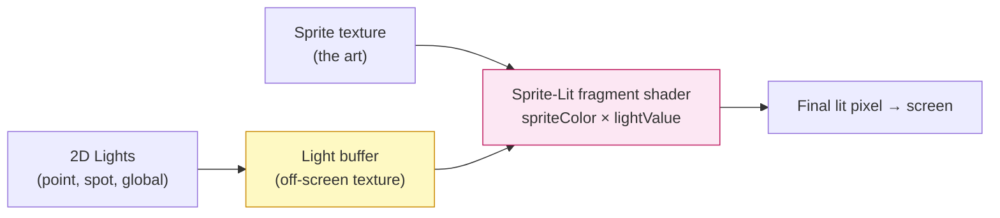
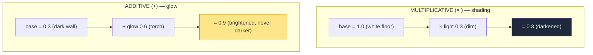

# Level 3 — 2D Lighting & Shadows

| | |
|---|---|
| 🎚️ **Difficulty** | 🟡 Medium |
| ⏱️ **Estimated time** | 32 minutes |
| ⭐ **XP reward** | 100 (Quest) + 25 (Quiz) |

[← Prev](02-shaders-and-materials.md) · [↑ Phase Home](../README.md) · [→ Next](04-particles-postprocessing-and-juice.md)

---

## 📖 Story

> *"This is the lesson where Ashfall stops looking flat. Right now every pixel is at full brightness — a dungeon lit like an office. Maya wants *mood*: a torch that pools warm light, a player who carries a soft glow into the dark, shadows that hide what's around the corner. Here's the secret 2D lighting hides: there's no 3D geometry to catch light, so a 2D light is really just **another texture that gets multiplied or added onto your sprites in the fragment shader**. 'Lit' sprites read a **light buffer** the renderer builds from your lights; 'additive' lights *add* glow on top. And to make a flat sprite respond to a light's *direction* — bright on the side facing the torch, dark on the far side — we hand the shader a **normal map**: a texture that fakes surface direction per pixel. Then shadow casters block light to carve out darkness. It's all the same fragment-shader-and-blending machinery from Lessons 1 and 2, pointed at atmosphere. Light the dungeon right and people will say the art got better — even though you only changed the light. Let me show you. — Lena"*

---

## 🎯 Goal

- Understand how 2D lighting actually works: a **light buffer** multiplied/added onto sprites in the fragment shader
- Know the 2D **light types** (Global / Point / Spot / Freeform) and when to use each
- Understand **additive vs multiplicative** blending and why glow uses *additive*
- Use **normal maps** to give flat sprites fake surface direction so they react to light angle
- Use **shadow casters** to block light, and build a **lit, atmospheric** Ashfall dungeon (torches, player glow, day vs dungeon mood)

---

## 🧠 Concepts

### A 2D light is a texture you blend onto sprites

In 3D, light bounces off geometry. In 2D there's no geometry — so the URP **2D Renderer** fakes it: it draws all your **2D lights** into an off-screen **light buffer** (a texture where bright areas = lit, dark areas = unlit, tinted by light color). Then every **Sprite-Lit** material, in its fragment shader, **multiplies** its texel by the light value at that pixel. No light → multiply by black → darkness. Torch overhead → multiply by warm orange → glow.



That's the whole trick: lighting in 2D is **fragment-shader multiplication against a light texture**. A sprite on an **Unlit** material ignores the buffer entirely (good for UI and full-bright FX).

### Additive vs multiplicative: the two ways to combine light

Blending (the final pipeline stage from Lesson 1) decides how a new color combines with what's behind it. Two modes dominate lighting:



- **Multiplicative** (`× light`) = *shading*. It can only darken (multiplying by <1) — perfect for ambient/main light that decides overall brightness.
- **Additive** (`+ glow`, `Blend One One`) = *emission/glow*. It only ever brightens and never darkens, so it can't make something black — perfect for torches, fire, magic, and the player's aura. Additive light over additive light *stacks* (two torches overlap = brighter), which is exactly how real light feels.

This is why a glow effect set to *multiply* looks wrong (it darkens) and the same effect set to *additive* looks like light.

### Normal maps: faking surface direction on a flat sprite

A flat sprite has no "which way am I facing," so a light can't shade it directionally — it just gets uniformly brighter. A **normal map** fixes that: it's a second texture where each pixel's **RGB encodes a 3D direction** (the surface normal) — that lavender-blue look. The lit shader compares each pixel's normal against the **direction to the light** (a dot product — your World 2 math!) to decide how lit that pixel is. Result: the side of a rock facing the torch is bright, the far side is dark, on a totally flat sprite. You author/generate a normal map per sprite and plug it into the **Sprite-Lit-Default** material's *Normal Map* slot.

### Shadows: casters block the light buffer

A **Shadow Caster 2D** component on a sprite (with a shape) tells lights "I'm solid — don't let your light pass through me." When a point light renders into the buffer, casters carve **dark wedges** behind them. That's how a pillar throws a shadow across the floor and how you hide what's around a corner. Shadows are pure light-buffer occlusion — no extra shaders from you.

### Why this exists

Lighting is the cheapest, highest-impact way to make 2D art read as a *place* instead of a sprite sheet. Mood, focus (the eye goes to the brightest thing), readability (a torch tells you where to go), and tension (darkness hides threats) all come from light, not new art. And it's not magic — it's the exact pipeline you already know: lights become a texture, sprites multiply it in their fragment shader, additive blending makes glow, normal maps add direction via a dot product, casters occlude. Lesson 4's bloom will *feed on* the bright additive pixels you create here.

This is **engine-agnostic**. Godot's 2D lights, Unreal's 2D/Paper rigs, and every custom 2D engine do the same thing: render lights to a buffer, blend it onto sprites, use normal maps for direction, occlude for shadows. URP's components are one implementation. See **RESOURCES.md** for this world for normal-map generation tools and the lighting deep-dives (The Book of Shaders covers light math from scratch).

---

## 🛠️ Hands-on Lab

> 💻 Requires URP 2D from Lesson 1. We'll light a dungeon room: ambient + a torch + a player glow + a pillar shadow + a normal-mapped wall.

### Step 1 — Add a Global Light (ambient base)

1. **GameObject → Light → Global Light 2D.** This is the room's base brightness, applied everywhere.
2. Set its **Intensity** low (e.g. `0.15`) and a cool color (deep blue) for a dungeon. *Now the room is dark* — that's the canvas. (For a daytime scene you'd set intensity ~1 and a warm white.)

> Sprites must be on **Sprite-Lit-Default** (or a Sprite Lit Shader Graph) to receive lights. Unlit sprites stay full-bright.

### Step 2 — A torch (Point Light + additive glow)

1. **GameObject → Light → Point Light 2D**, place it at a torch.
2. **Color** warm orange; **Intensity** ~`1.2`; **Inner/Outer Radius** to size the pool; **Falloff** for a soft edge.
3. Set its **Blend Style** to an **Additive** style (Project Settings → 2D Renderer → Light Blend Styles) so the torch *adds* glow over the ambient instead of just multiplying.

### Step 3 — Flicker the torch in C# (life in the light)

```csharp
using UnityEngine;
using UnityEngine.Rendering.Universal;   // Light2D lives here

[RequireComponent(typeof(Light2D))]
public class TorchFlicker : MonoBehaviour
{
    [SerializeField] float baseIntensity = 1.2f;
    [SerializeField] float flicker = 0.25f;      // how much it wavers
    [SerializeField] float speed = 8f;           // how fast

    Light2D _light;
    float _seed;

    void Awake() { _light = GetComponent<Light2D>(); _seed = Random.value * 100f; }

    void Update()
    {
        // Perlin noise = smooth, organic wobble (not jittery random). 0..1 -> centered.
        float n = Mathf.PerlinNoise(_seed, Time.time * speed) - 0.5f;
        _light.intensity = baseIntensity + n * 2f * flicker;
    }
}
```

> Perlin noise gives a *believable* flicker — smooth and continuous, unlike `Random.value` which looks like static. Same trick works for a candle, a failing neon sign, or magic.

### Step 4 — Player glow that follows the player

1. Add a soft **Point Light 2D** as a *child* of the player (so it follows automatically). Low intensity, gentle radius, slightly warm.
2. This does double duty: atmosphere *and* readability — the player carries a small bubble of visibility into the dark, which is the core feel of a dungeon crawler.

### Step 5 — Normal-map a wall so it reacts to light direction

1. Get/generate a **normal map** for a wall sprite (see RESOURCES.md for a free generator like Laigter, or paint one). It looks lavender-blue.
2. On the wall's **Sprite-Lit-Default** material, assign it to the **Normal Map** slot.
3. Move the torch past the wall in Play mode: the lit side brightens and the far side stays dark — directional shading on a flat sprite, courtesy of the per-pixel dot product inside the lit shader.

### Step 6 — Cast a shadow from a pillar

1. Add a **Shadow Caster 2D** component to a pillar/wall sprite. Give it a shape (auto from the sprite or a custom path).
2. On the **Point Light 2D**, enable **Shadows**.
3. The pillar now throws a shadow wedge across the floor as the torch lights it — hiding what's behind it.

### Step 7 — Switch mood from code (day ↔ dungeon)

```csharp
using UnityEngine;
using UnityEngine.Rendering.Universal;

// Crossfade the GLOBAL light between a bright/warm "surface" mood and a dark/cool
// "dungeon" mood. Same scene, different feeling — pure lighting, no new art.
public class MoodController : MonoBehaviour
{
    [SerializeField] Light2D global;
    [SerializeField] float dayIntensity = 1.0f;
    [SerializeField] Color  dayColor    = new(1f, 0.96f, 0.85f);   // warm white
    [SerializeField] float dungeonIntensity = 0.15f;
    [SerializeField] Color  dungeonColor    = new(0.3f, 0.4f, 0.7f); // cool blue

    public void SetMood(bool dungeon, float t)   // call each frame while transitioning, t = 0..1
    {
        global.intensity = Mathf.Lerp(global.intensity,
            dungeon ? dungeonIntensity : dayIntensity, t);
        global.color = Color.Lerp(global.color,
            dungeon ? dungeonColor : dayColor, t);
    }
}
```

---

## 🎮 Mini Challenge

You add a glowing magic rune to the dungeon floor. You make it a Point Light 2D on the **default (multiplicative)** blend style, crank intensity, and… it makes the floor under it look **dimmer and muddy**, not glowing. Why, and what's the one-setting fix?

<details>
<summary>💡 Reveal answer</summary>

A **multiplicative** light *multiplies* the sprite by the light value — and multiplying can only **darken** (any factor below 1) or leave unchanged (factor 1). It's a *shading* operation, meant to set overall brightness, not to emit. So your "glow" is really just shading the floor, and against the bright-ish floor it reads as muddy, never as added light.

The fix: switch the rune light's **Blend Style to Additive** (`Blend One One`). Additive *adds* the light's color on top of whatever's there, so it can only ever **brighten** — that's what glow is. Rule of thumb from the concepts: **shading → multiplicative; glow/emission → additive.** (Bonus: those bright additive pixels are exactly what Lesson 4's bloom will catch and bloom.)
</details>

---

## 📦 Project Mission

Light Ashfall's dungeon for atmosphere — mood, focus, and tension from light alone.

1. Move dungeon sprites onto **Sprite-Lit-Default** materials; add a dim, cool **Global Light 2D** as the dungeon base (Step 1).
2. Place **torch Point Lights** (warm, additive blend) at sconces and add `Assets/Scripts/Rendering/TorchFlicker.cs` (Step 3) for organic flicker.
3. Give the player a **child Point Light** glow that follows them into the dark (Step 4).
4. **Normal-map** at least one wall/prop so it shades directionally as torches pass (Step 5), and add **Shadow Caster 2D** to pillars/walls with **shadows enabled** on a light (Step 6).
5. Add `Assets/Scripts/Rendering/MoodController.cs` (Step 7) and prove you can crossfade the **global light** from a bright surface mood to the dark dungeon mood — same scene, different feeling.
6. Watch the **Stats** overlay (Lesson 1): note lighting adds passes/overdraw; keep the frame within budget. Commit:
   ```bash
   cd ~/projects/ashfall
   git switch -c feature/2d-lighting
   git add Assets/Scripts/Rendering Assets
   git commit -m "feat: URP 2D lighting — ambient, flickering torches, player glow, normals + shadows"
   git switch main && git merge feature/2d-lighting && git push
   ```

🎯 **Mission complete when:** the Ashfall dungeon is **lit for mood** — a dim cool **global** base, **additive flickering torches**, a **player glow** that carries visibility into the dark, at least one **normal-mapped** surface that shades directionally, and **shadow casters** that occlude light — and you can **crossfade between a day and a dungeon mood from code**, all within your Lesson 1 frame budget.

---

## ⚠️ Common Mistakes

| Mistake | What happens | Fix |
|--------|--------------|-----|
| Sprites on Unlit material | Lights do nothing; scene stays full-bright | Use **Sprite-Lit-Default** for anything that should react to light |
| Glow on multiplicative blend | Light darkens/muddies instead of glowing | Use an **Additive** blend style for emissive lights |
| No normal map, expecting directional shading | Sprite just brightens uniformly, looks flat-lit | Add a **normal map** so the dot-product shading has a direction |
| Global light at full intensity in a dungeon | No contrast, no mood, no focus | Drop global intensity low; let torches/player glow carry it |
| Too many large overlapping lights | Heavy overdraw on the light buffer; frame drops | Fewer/smaller lights; watch Stats (Lesson 1 budget) |
| Forgetting Shadow Caster shape | Shadows don't appear or look wrong | Add **Shadow Caster 2D** with a correct shape; enable shadows on the light |

---

## 🤔 Reflection Questions

1. In 2D there's no geometry to catch light — so what *is* a 2D light, concretely, in terms of the fragment shader and a buffer? Tie it back to the multiply step.
2. Additive blending can only brighten; multiplicative can only darken. Explain why **glow** must be additive and **ambient shading** is multiplicative — and what goes wrong if you swap them.
3. A normal map adds no new art detail to the *color* of a sprite, yet it makes a flat sprite look three-dimensional under a moving light. How does the dot product from World 2 turn a lavender texture into directional shading?

---

## 📝 Quiz

1. **In URP's 2D renderer, a lit sprite reacts to lights because its fragment shader…**
   - a) raytraces the scene
   - b) multiplies its texel by a value sampled from a light buffer the renderer built
   - c) reads the CPU's light list every pixel
2. **You want a torch to *glow* (brighten) over the scene. The right blend is…**
   - a) multiplicative (it darkens) 
   - b) additive (it only brightens, and stacks)
   - c) alpha blend with zero alpha
3. **A normal map lets a flat sprite shade directionally because it…**
   - a) adds extra triangles to the sprite
   - b) stores a per-pixel surface direction the shader dots against the light direction
   - c) makes the sprite emit its own light

<details>
<summary>✅ Answers</summary>

1: **b** · 2: **b** · 3: **b**
</details>

---

## ✅ Completion Checklist

- [ ] Dungeon sprites are lit (Sprite-Lit) with a dim cool global base
- [ ] Additive, flickering torches and a player-following glow are in place
- [ ] At least one surface uses a normal map and shades directionally
- [ ] Shadow casters occlude light and hide what's around corners
- [ ] I can crossfade between a day mood and a dungeon mood from code
- [ ] The lit scene stays within my Lesson 1 frame budget
- [ ] I passed the quiz
- [ ] Added **+125 XP** to [PROGRESS.md](../../../PROGRESS.md)

---

[← Prev](02-shaders-and-materials.md) · [↑ Phase Home](../README.md) · [→ Next](04-particles-postprocessing-and-juice.md)
