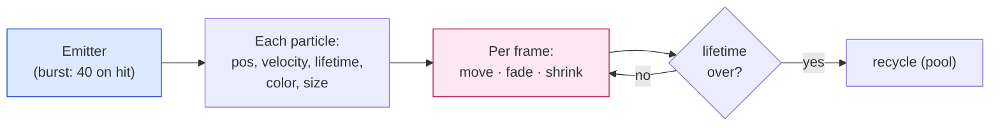
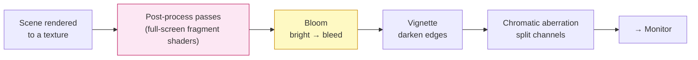
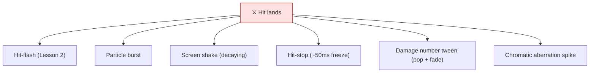

# Level 4 — Particles, Post-Processing & Juice

| | |
|---|---|
| 🎚️ **Difficulty** | 🟡 Medium |
| ⏱️ **Estimated time** | 35 minutes |
| ⭐ **XP reward** | 100 (Quest) + 25 (Quiz) |

[← Prev](03-2d-lighting-and-shadows.md) · [↑ Phase Home](../README.md) · [→ Next](../boss-battle.md)

---

## 📖 Story

> *"Last lesson of the look-world, and it's the dessert. Ashfall is lit and shaded now — but hits still feel like two sprites politely overlapping. Today we add **juice**: the layer of feedback that makes an action feel *impactful* even though the underlying numbers don't change. A sword hit becomes a burst of **particles**, a **screen shake**, a 50-millisecond **hit-stop** (the whole game freezes for a frame — that's the secret sauce of every game that feels 'crunchy'), a flash (you built that in Lesson 2), and a damage number that **tweens** up and fades. Over the whole scene, a **post-processing** stack adds **bloom** (your bright additive lights now *bleed* light), a **vignette** (darkened edges that focus the eye), and a touch of **chromatic aberration** on impact. Here's the mindset Maya drilled into me: juice is *non-destructive feedback* — it changes nothing about the simulation, only how it *feels*. The same 10 damage, juiced, feels twice as satisfying. Get this right and Ashfall finally reads as a real, shipped game. Then it's off to World 8 to play it with a friend. Let me show you. — Lena"*

---

## 🎯 Goal

- Understand **particle systems** from first principles: many cheap, short-lived sprites driven by emitter rules (and their **overdraw** cost)
- Build a **post-processing** stack (URP **Volume**): **bloom**, **vignette**, **chromatic aberration** — full-screen fragment effects
- Implement the core **game-feel** tools: **screen shake**, **hit-stop** (time freeze), and **tweening**
- Internalize **juice** as *non-destructive feedback* — feel without changing the simulation
- Add impact/death particles + a post stack + shake + hit-stop to **Ashfall combat**

---

## 🧠 Concepts

### Particles: a swarm of cheap, short-lived sprites

A **particle system** is an **emitter** that spawns many tiny **particles** — each a sprite with a position, velocity, lifetime, color, and size — and updates them by simple rules every frame (move by velocity, fade over lifetime, shrink, die). One impact spark is unconvincing; *fifty* of them bursting and fading reads as an explosion. The emitter doesn't simulate physics deeply — it's cheap rules × many particles. The cost to watch (Lesson 1) is **overdraw**: particles are transparent and overlap heavily, so the fragment shader runs many times per pixel. Budget them: fewer, smaller, shorter-lived particles, and an **additive** material so they read as light/energy (and feed bloom).



### Post-processing: a fragment shader over the whole screen

After the scene is rendered to a texture, **post-processing** runs full-screen fragment shaders on that image before it hits the monitor — image filters, exactly like the per-pixel work from Lesson 2 but with *every pixel of the final frame* as input. In URP you don't write them; you drop a **Volume** with **overrides**:

- **Bloom** — bright pixels (above a threshold) bleed glow into neighbors. This is what makes Lesson 3's **additive lights and particles** look *luminous*. The single highest-impact post effect for a stylized 2D game.
- **Vignette** — darkens the screen edges, pulling the eye to the center (the action). Subtle = cinematic; heavy = horror/tension.
- **Chromatic aberration** — splits R/G/B channels slightly at the edges (a lens artifact). A tiny constant amount adds grit; a **spike on impact** sells a big hit.



### Juice: non-destructive feedback

**Juice** (a.k.a. game feel) is everything that makes an action *feel good* without changing what it *does*. The damage is still 10; juice changes only the *experience* of dealing it. The big three beyond particles and flash:

- **Screen shake** — a brief random camera offset on impact. Says "that hit had weight." Must **decay** to zero and stay small, or it's nausea.
- **Hit-stop** (a.k.a. hit-pause / freeze frame) — on a heavy hit, freeze the game for ~30–80 ms (set `Time.timeScale` near 0, then restore). The brain reads the micro-pause as *impact*. It's the single most underused, highest-impact feel tool — every "crunchy" action game uses it.
- **Tweening** — animating a value over time with an **easing curve** (e.g. a damage number popping up and fading, a chest scaling open). Eased motion (fast-out, slow-in) feels alive; linear feels robotic.



### Why this exists

Two games with identical mechanics can feel worlds apart — the difference is juice. It's the cheapest way to raise *perceived* quality because it adds feedback, not features: the player's brain craves a reaction to every input, and juice supplies it (impact, weight, consequence). Crucially it's **non-destructive** — you can tune or remove all of it without touching combat logic, which is why it's the *last* polish pass. It also closes World 7's loop: bloom feeds on Lesson 3's additive lights, particles ride Lesson 1's overdraw budget, the flash is Lesson 2, and shake/hit-stop reuse World 3's camera and the game loop's `Time` from World 0.

This is **engine-agnostic**. Particle emitters, full-screen post-process passes, camera shake, time-scale hit-stop, and eased tweens exist in Unreal (Niagara + post-process volumes), Godot, and every custom engine — the *concepts* are universal; only the components differ. See **RESOURCES.md** for this world for free particle/post references and the classic "juice it or lose it" talk.

---

## 🛠️ Hands-on Lab

> 💻 Requires URP from Lesson 1 (post-processing) and pairs with the lit scene from Lesson 3. We'll juice a hit end-to-end.

### Step 1 — An impact particle burst

1. **GameObject → Effects → Particle System.** Set it up as a one-shot burst:
   - **Looping** off; **Duration** ~`0.3`; **Start Lifetime** ~`0.3`; **Start Speed** ~`4`; **Start Size** small.
   - **Emission → Bursts**: one burst of ~`30` at time 0.
   - **Shape → Circle** (sparks fly outward); **Color over Lifetime** fading to transparent; **Size over Lifetime** shrinking.
   - **Renderer → Material**: an **additive** particle material (reads as energy, feeds bloom).
2. Save it as a **prefab** `ImpactBurst`.

### Step 2 — Spawn the burst on hit (pooled)

```csharp
using UnityEngine;

// Plays an impact particle burst at a world position. Pool it (World 9 will formalize
// pooling) so frequent hits don't allocate/GC every frame.
public class ImpactVFX : MonoBehaviour
{
    [SerializeField] ParticleSystem burstPrefab;
    readonly System.Collections.Generic.Queue<ParticleSystem> _pool = new();

    public void Play(Vector3 worldPos)
    {
        var ps = _pool.Count > 0 ? _pool.Dequeue()
                                 : Instantiate(burstPrefab, transform);
        ps.transform.position = worldPos;
        ps.Clear();
        ps.Play();
        // Return to the pool after it finishes (duration + max lifetime).
        float life = ps.main.duration + ps.main.startLifetime.constantMax;
        StartCoroutine(Recycle(ps, life));
    }

    System.Collections.IEnumerator Recycle(ParticleSystem ps, float delay)
    {
        yield return new WaitForSeconds(delay);
        _pool.Enqueue(ps);
    }
}
```

### Step 3 — The post-processing stack (URP Volume)

1. Ensure **Post Processing** is enabled on your **Camera** (checkbox) and the camera's renderer.
2. **GameObject → Volume → Global Volume.** On its **Volume Profile**, **Add Override**:
   - **Bloom** — set a **Threshold** so only bright (additive) pixels bloom; modest **Intensity**. Watch your torches and sparks light up.
   - **Vignette** — small **Intensity** for cinematic edge darkening.
   - **Chromatic Aberration** — tiny baseline **Intensity** (e.g. `0.05`); we'll spike it on impact in code.

### Step 4 — Screen shake (decaying camera offset)

```csharp
using UnityEngine;

// Add to the camera (or a camera holder). Call Shake() on impact. Trauma decays to 0,
// and offset scales with trauma^2 so small hits barely shake, big hits punch.
public class ScreenShake : MonoBehaviour
{
    [SerializeField] float maxOffset = 0.4f;
    [SerializeField] float decay = 1.8f;     // trauma units lost per second
    [SerializeField] float frequency = 25f;

    float _trauma;
    Vector3 _basePos;
    float _seedX, _seedY;

    void Awake() { _basePos = transform.localPosition; _seedX = Random.value*9; _seedY = Random.value*9; }

    public void Shake(float amount) => _trauma = Mathf.Clamp01(_trauma + amount);

    void LateUpdate()
    {
        if (_trauma <= 0f) { transform.localPosition = _basePos; return; }
        float shake = _trauma * _trauma;     // square: feels punchier, ignores tiny taps
        float t = Time.unscaledTime * frequency;
        Vector3 offset = new(
            (Mathf.PerlinNoise(_seedX, t) - 0.5f) * 2f,
            (Mathf.PerlinNoise(_seedY, t) - 0.5f) * 2f, 0f);
        transform.localPosition = _basePos + offset * (shake * maxOffset);
        _trauma = Mathf.Max(0f, _trauma - decay * Time.unscaledDeltaTime);
    }
}
```

> Use **unscaled** time so shake keeps moving during hit-stop (Step 5), and **Perlin** noise so it's smooth, not jittery. Squaring trauma is the trick that makes small hits subtle and big hits slam.

### Step 5 — Hit-stop (the crunch)

```csharp
using System.Collections;
using UnityEngine;

// Freezes time briefly for impact. Uses a coroutine driven by UNSCALED time so it can
// un-freeze itself even while timeScale is ~0.
public class HitStop : MonoBehaviour
{
    Coroutine _running;

    public void Stop(float durationSeconds, float scale = 0.02f)
    {
        if (_running != null) StopCoroutine(_running);
        _running = StartCoroutine(Routine(durationSeconds, scale));
    }

    IEnumerator Routine(float duration, float scale)
    {
        Time.timeScale = scale;                          // near-freeze
        yield return new WaitForSecondsRealtime(duration); // real seconds, not scaled
        Time.timeScale = 1f;                             // restore
        _running = null;
    }
}
```

> ~0.05s is plenty. Hit-stop on the *attacker and victim's* heavy hits only — everywhere = sluggish. This is why fighting games feel "crunchy."

### Step 6 — A tweened damage number + impact CA spike

```csharp
using System.Collections;
using UnityEngine;
using UnityEngine.Rendering;                         // Volume
using UnityEngine.Rendering.Universal;               // ChromaticAberration

public class ImpactJuice : MonoBehaviour
{
    [SerializeField] ScreenShake shake;
    [SerializeField] HitStop hitStop;
    [SerializeField] ImpactVFX vfx;
    [SerializeField] Volume postVolume;

    // One call from the damage pipeline juices the whole hit.
    public void OnHit(Vector3 pos, float heaviness)  // heaviness 0..1
    {
        vfx.Play(pos);
        shake.Shake(0.2f + heaviness * 0.5f);
        if (heaviness > 0.5f) hitStop.Stop(0.05f);   // crunch only on heavy hits
        StartCoroutine(CASpike());
    }

    // Tween chromatic aberration up then back down for a punchy lens kick.
    IEnumerator CASpike()
    {
        if (!postVolume.profile.TryGet<ChromaticAberration>(out var ca)) yield break;
        float t = 0f, dur = 0.18f;
        while (t < dur)
        {
            t += Time.unscaledDeltaTime;
            float k = 1f - (t / dur);                 // ease out
            ca.intensity.value = 0.05f + k * 0.5f;    // baseline + spike
            yield return null;
        }
        ca.intensity.value = 0.05f;
    }
}

// EASING helper: smoothstep-style ease for tweens (fast-out, slow-in feels alive).
public static class Ease
{
    public static float OutCubic(float t) { t = Mathf.Clamp01(t); float u = 1f - t; return 1f - u*u*u; }
}
```

### Step 7 — Wire it all to one hit

In your World 5 damage handler, after damage is applied:

```csharp
impactJuice.OnHit(hitPosition, isHeavyAttack ? 1f : 0.3f);  // particles+shake+hitstop+CA
GetComponent<HitFlash>()?.Flash();                          // Lesson 2 flash
```

One call, full juice. Notice: **none** of this changes the damage — it's pure feel.

---

## 🎮 Mini Challenge

A junior dev makes combat feel "more impactful" by setting screen shake to a big constant offset that **doesn't decay** and adding hit-stop to **every** hit including rapid auto-attacks. Playtesters report nausea and that the game feels **sluggish and unresponsive**. Diagnose both problems and give the fix for each.

<details>
<summary>💡 Reveal answer</summary>

**Problem 1 — Non-decaying shake = nausea.** A shake that doesn't return to zero means the camera never settles; the eyes have no stable frame. Fix: shake must be **trauma-based and decay to 0** quickly (Step 4), and stay **small** (sub-pixel-ish). Squaring trauma also keeps minor hits from shaking at all.

**Problem 2 — Hit-stop on every hit = sluggish.** Hit-stop freezes time; doing it on rapid auto-attacks means the game is *constantly* micro-frozen, which reads as input lag / unresponsiveness. Fix: apply hit-stop **only to heavy/impactful hits** (e.g. `heaviness > 0.5`) and keep it **short** (~50ms). Juice is *seasoning* — the right amount on the right moment. More is not better; **targeted** is better.
</details>

---

## 📦 Project Mission

Juice Ashfall's combat into something that *feels* like a shipped game — without changing a single damage number.

1. Build the `ImpactBurst` particle prefab (additive, one-shot) and add `Assets/Scripts/Rendering/ImpactVFX.cs` (Steps 1–2), pooled.
2. Add a **Global Volume** post stack: **Bloom** (thresholded so it catches Lesson 3's additive lights/particles), **Vignette**, and a small baseline **Chromatic Aberration** (Step 3).
3. Add `ScreenShake.cs`, `HitStop.cs`, and `ImpactJuice.cs` under `Assets/Scripts/Rendering/` (Steps 4–6); put shake on the camera (using **unscaled** time so it survives hit-stop).
4. Wire `ImpactJuice.OnHit(...)` + the Lesson 2 `HitFlash.Flash()` into the **World 5 damage pipeline** so one hit fires particles + shake + (heavy-only) hit-stop + CA spike + flash (Step 7).
5. Add **death particles** for enemies/the boss (a bigger burst on death) and confirm the boss's heavy attacks (World 6) trigger hit-stop + strong shake.
6. **Tune & budget:** shake decays and is subtle; hit-stop only on heavy hits; watch **Stats/Frame Debugger** (Lesson 1) — particle **overdraw** and post passes must stay within your frame budget. Commit:
   ```bash
   cd ~/projects/ashfall
   git switch -c feature/juice-and-postfx
   git add Assets/Scripts/Rendering Assets
   git commit -m "feat: combat juice — impact/death particles, post stack, screen shake, hit-stop, CA spike"
   git switch main && git merge feature/juice-and-postfx && git push
   ```

🎯 **Mission complete when:** a single Ashfall hit fires **impact particles, decaying screen shake, a chromatic-aberration spike, and the Lesson 2 flash**, with **hit-stop on heavy hits only**; the scene runs a **bloom + vignette + CA post stack** that makes the lit dungeon glow; enemies/boss have **death particles**; and **none of it changes combat numbers** — it's all non-destructive feel, kept within your Lesson 1 frame budget. Ashfall now reads as a real game, ready for World 8.

---

## ⚠️ Common Mistakes

| Mistake | What happens | Fix |
|--------|--------------|-----|
| Screen shake that never decays / is too big | Motion sickness, unreadable | Trauma-based, decays to 0, small offset, square the trauma |
| Hit-stop on every hit | Game feels sluggish/unresponsive | Hit-stop only heavy hits, short (~50ms) |
| Shake/hit-stop using scaled `Time.deltaTime` | Shake freezes during hit-stop | Use **unscaled** time for feel effects |
| Bloom with no threshold | Whole screen blooms into mush | Set a threshold so only bright (additive) pixels bloom |
| Particles too many/large/long-lived | Overdraw tanks the GPU (Lesson 1) | Fewer, smaller, shorter; additive; pool them |
| Instantiating particles every hit | GC spikes, frame hitches | **Pool** particle systems (reuse, don't allocate) |
| Juice that changes damage/logic | "Feel" entangled with simulation | Keep juice **non-destructive** — feedback only |

---

## 🤔 Reflection Questions

1. Juice is "non-destructive feedback." Explain what that means with the hit example — and why being non-destructive is exactly why juice is the *last* polish pass, not the first.
2. Post-processing runs full-screen fragment shaders on the rendered frame. Connect bloom back to Lesson 3: *why* do your additive torches and additive particles bloom while a flat-lit floor doesn't?
3. Hit-stop literally makes the game *slower* for a moment, yet it makes combat feel *more* responsive and impactful. Resolve that paradox — what is the player's brain actually reading from the micro-freeze?

---

## 📝 Quiz

1. **A particle system is best described as…**
   - a) a single big animated sprite
   - b) an emitter spawning many cheap, short-lived sprites updated by simple rules
   - c) a post-processing effect
2. **Bloom makes a 2D scene glow by…**
   - a) adding more lights to the scene
   - b) a full-screen pass that bleeds bright (above-threshold) pixels into their neighbors
   - c) increasing every sprite's alpha
3. **Hit-stop improves game feel by…**
   - a) permanently slowing the game down
   - b) briefly freezing time on impact so the brain reads weight/impact
   - c) increasing damage on heavy hits

<details>
<summary>✅ Answers</summary>

1: **b** · 2: **b** · 3: **b**
</details>

---

## ✅ Completion Checklist

- [ ] Impact and death particles fire on hits/kills (additive, pooled)
- [ ] A URP post stack (thresholded bloom, vignette, baseline CA) is live
- [ ] Decaying, subtle screen shake fires on impact (unscaled time)
- [ ] Hit-stop triggers on heavy hits only and self-restores
- [ ] One damage event drives particles + shake + CA spike + flash, changing no combat numbers
- [ ] Particle overdraw + post passes stay within my Lesson 1 frame budget
- [ ] I passed the quiz
- [ ] Added **+125 XP** to [PROGRESS.md](../../../PROGRESS.md)

---

[← Prev](03-2d-lighting-and-shadows.md) · [↑ Phase Home](../README.md) · [→ Next](../boss-battle.md)
