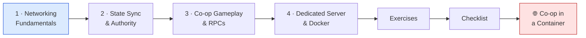
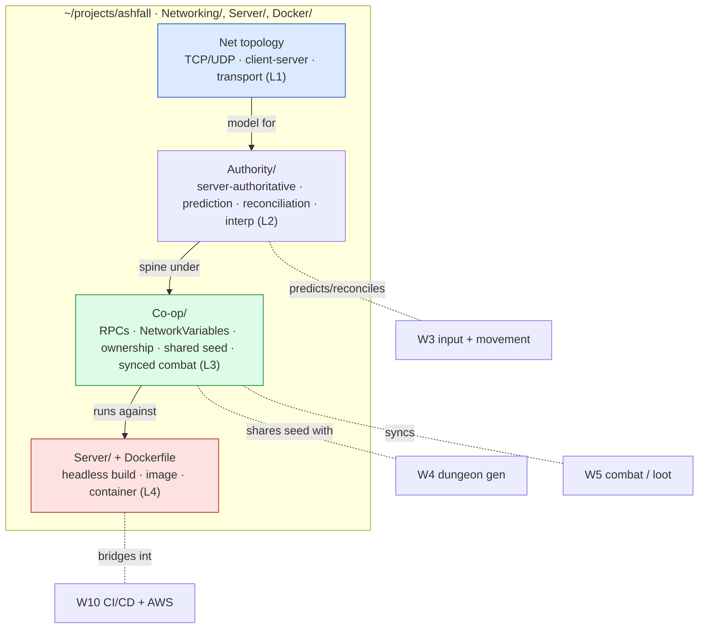

# 🌐 World 8 — Networking & Multiplayer

> Ashfall *looks and feels* like a shipped game now (World 7) — lit, shaded, juiced, and locked at 60 FPS. But it's a game you play **alone**. Every demo ends the same way: someone watches, grins, and asks "can my friend join?" — and the answer is no. This world makes the answer **yes**. You'll learn networking from first principles (TCP vs UDP, latency, packets, client-server vs peer-to-peer), make the server the **authority** with client **prediction + reconciliation** so movement is smooth *and* cheat-resistant, sync real co-op gameplay (RPCs, network variables, ownership, a shared dungeon seed), and finally build a **headless dedicated server** and run it inside a **Docker container** — the moment Ashfall stops being a thing on your laptop and becomes a server you can run *anywhere*. This is also where the bootcamp bridges into **cloud / DevOps**: containers are the unit clouds deploy, and W10 will take this exact image to AWS.

[↑ Home](../../README.md) · [🗺️ Roadmap](../../ROADMAP.md) · [📊 Progress](../../PROGRESS.md)

---

## 📨 Your ticket

```
From:    Theo <theo@pixelforge.studio>
To:      You <new-hire@pixelforge.studio>
Cc:      Priya <priya@pixelforge.studio>, Maya <maya@pixelforge.studio>

Subject: [W8-NET] Players are BEGGING for co-op. Let's give it to them — the right way.

I've watched a dozen people play the new build. Every single one of them,
the second the juice landed, said the same thing: "this would be amazing
with a friend." We're leaving the best feature on the table.

So: co-op. Two players, one Ashfall dungeon, over the network. But I don't
want a duct-taped peer-to-peer hack that desyncs the first time someone's
WiFi hiccups, and I REFUSE to ship something a cheater can break in an hour.
Do it properly. I've put Priya on this with you — she's our DevOps/backend
person and she's done netcode before. Listen to her.

Priya's plan, in her words:

  - LEARN THE WIRE FIRST. TCP vs UDP, latency, packet loss, why games use
    UDP, client-server vs peer-to-peer. Pick our topology on purpose, not by
    accident. No code until you can draw the model.
  - SERVER IS THE TRUTH. Server-authoritative movement with client
    PREDICTION and RECONCILIATION so it feels instant but the server has
    final say. That's how you get smooth AND cheat-resistant. Interpolate
    remote players so they don't teleport.
  - SYNC THE GAME, NOT JUST DOTS. RPCs, network variables, ownership.
    Spawn both players, share ONE dungeon seed so we generate the same map,
    sync combat and loot. Real co-op, not two cursors.
  - THEN CONTAINERIZE IT. Build a HEADLESS dedicated server, write a
    Dockerfile, and run the server in a Docker container. Containers are
    reproducible servers — same image on your laptop, on mine, and (next
    season) on AWS. This is the bridge to the cloud half of your job.

Cost note from Priya: everything this world is FREE and LOCAL — Netcode for
GameObjects, Docker Desktop, two clients on your own machine. No cloud bills
yet. We turn on AWS in World 10; keep the billing alarm in mind for then.

Boss check ("Co-op in a Container"): two clients play one dungeon together,
server-authoritative with prediction — and the server runs in a Docker
container they both connect to. No tutorial; you'll have all four lessons.

Land this and World 9 — tearing the engine down to ECS-lite and real
serialization — is yours.

— Theo (for Priya)
```

This is World 8 of 13. Everything you build advances the **one growing Ashfall project** in `~/projects/ashfall`. You arrive with a beautiful **single-player** action-roguelite (W7); you leave with **2-player co-op** running against a **Dockerized dedicated server**.

---

## 🎯 What you'll achieve in this world

- 🔌 Understand networking from **first principles** — TCP vs UDP, latency, packets, packet loss, client-server vs peer-to-peer — and choose Ashfall's **net topology** on purpose
- 🛡️ Make the **server the authority** with client **prediction + reconciliation** and remote-player **interpolation**, so movement is *instant to feel* and *impossible to cheat* — plus the anti-cheat basics that follow for free
- 🤝 Build **real 2-player co-op** — RPCs, **network variables**, ownership, spawning, a **shared dungeon seed**, and synced combat/loot — two players in *one* dungeon, not two screens
- 📦 Build a **headless dedicated server** and run it in a **Docker container** (image, container, `Dockerfile`) — understand *why* containers are reproducible servers
- 🌉 See the **bridge into cloud / DevOps**: the container you build here is the exact unit World 10 ships to AWS

---

## 🗺️ Level map

| Level | Lesson | Difficulty | XP |
|------:|--------|:----------:|---:|
| 1 | [Networking Fundamentals](lessons/01-networking-fundamentals.md) | 🟢 Easy | 125 |
| 2 | [State Sync & Authority](lessons/02-state-sync-and-authority.md) | 🟡 Medium | 125 |
| 3 | [Co-op Gameplay & RPCs](lessons/03-co-op-gameplay-and-rpcs.md) | 🟡 Medium | 125 |
| 4 | [Dedicated Server & Docker](lessons/04-dedicated-server-and-docker.md) | 🔴 Hard | 125 |
| 🌐 | [Boss Battle — Co-op in a Container](boss-battle.md) | 🔴 Hard | 500 |

➕ Extra reps: [exercises.md](exercises.md) · ✅ Ready to advance? [checklist.md](checklist.md)

---

## 🧭 Recommended order



Go in order — each lesson is the foundation the next one stands on. **Fundamentals** (L1) come first: you can't reason about authority, prediction, or why a packet arrived late until you know TCP vs UDP, what latency *is*, and the difference between client-server and peer-to-peer — so you draw Ashfall's topology before you write a line of netcode. **Authority** (L2) is the spine of everything: server-authoritative movement with client prediction + reconciliation is the model the rest of the world plugs into, and it only makes sense once you know the wire. **Co-op gameplay** (L3) then layers the *game* onto that spine — RPCs, network variables, ownership, a shared seed, synced combat — because syncing real gameplay assumes the authority model already exists. **Docker** (L4) comes last because you containerize a server that already *works*: you build it headless, then wrap it in an image. The boss battle is all four at once — co-op with prediction, running in a container.

---

## 📦 Ashfall project status

**Entering World 8:** a *beautiful, complete* single-player action-roguelite. Procedurally generated dungeons (W4) with A\* pathing; a full combat game (W5) — data-driven items/abilities, inventory, a damage pipeline, status effects, loot — all persisted (W3); enemies that think (W6) — FSM, perception, steering, behavior trees, a multi-phase boss; and a rendering layer (W7) that's lit, shaded, juiced, and locked at 60 FPS. It plays — and looks — like a shipped game. But it is strictly **single-player**: one process, one player, no concept of a remote anything.

**Leaving World 8:** the same game, now **co-op**. Two players join **one** Ashfall dungeon over the network; the **server is authoritative** while each client **predicts + reconciles** its own movement and **interpolates** the other player; gameplay — spawning, a **shared dungeon seed**, combat, loot — syncs via **RPCs and network variables** with clear **ownership**; and the whole thing runs against a **headless dedicated server** packaged in a **Docker container** you can run anywhere. Ashfall is no longer a thing on your laptop — it's a client *and* a server.



You hand this to **World 9 — Game Engine Architecture**, where you'll tear Ashfall's growing codebase down to an **ECS-lite** core with real **serialization** — and the network state you just learned to send over the wire is exactly the state that benefits from a clean, serializable data model.

---

## 🌐 Boss teaser

**"Co-op in a Container"** — Theo wants proof that two people can actually play Ashfall together, the *right* way. Get **2-player co-op** working in one dungeon with **server authority + client prediction**, then build the **headless dedicated server**, write a **Dockerfile**, run the server **in a Docker container**, and connect **two clients** to it. No tutorial — you'll fuse all four lessons into one running session: two players, one shared dungeon, one containerized server. Win to earn the **🌐 Netcode Engineer** badge, a +250 world-complete bonus, and unlock World 9.

---

## 📚 Resources

Don't go link-hunting — the curated free list lives in [RESOURCES.md](../../RESOURCES.md). For this world, the standouts are Unity's free **Netcode for GameObjects (NGO)** docs (NetworkObject, NetworkVariable, RPCs, ownership, the dedicated-server/headless build target), the all-time-classic **Gaffer On Games** networking articles and the **Valve / Source multiplayer networking** write-up (the canonical first-principles "why" for UDP, client prediction, lag compensation, and interpolation — L1/L2), and the official **Docker** "get started" docs plus **Docker Desktop** (free) for images, containers, and writing your first `Dockerfile` (L4). Above all, internalize the one idea this whole world turns on: **the server is the single source of truth, and the client only *predicts* — every engine and every multiplayer game, from a tiny indie co-op to an MMO, is some version of that.**

---

[↑ Home](../../README.md) · [🗺️ Roadmap](../../ROADMAP.md) · [📊 Progress](../../PROGRESS.md) · [➡️ Next World: Game Engine Architecture](../phase-09-engine-architecture/README.md) · [▶️ Start Level 1 →](lessons/01-networking-fundamentals.md)
