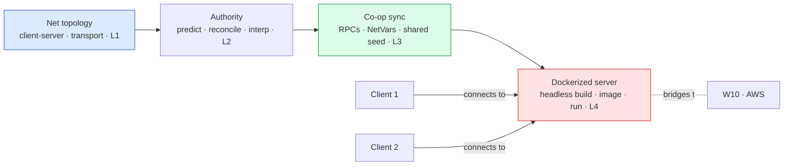
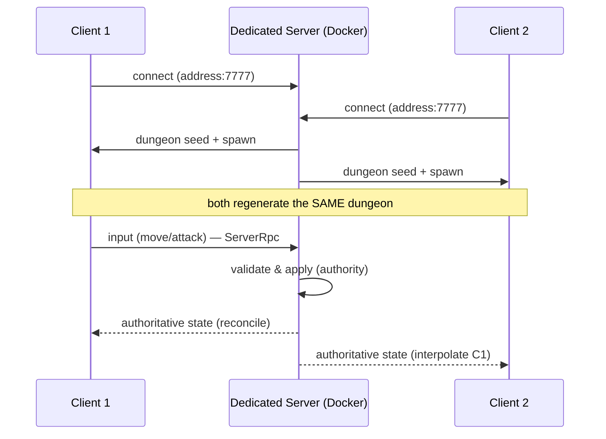

# 🌐 Boss Battle — Co-op in a Container

| | |
|---|---|
| 🎚️ **Difficulty** | 🔴 Hard |
| ⏱️ **Estimated time** | 150 minutes |
| ⭐ **XP reward** | 500 |
| 🔓 **Unlocks** | World 9 — Game Engine Architecture |

[← Checklist](checklist.md) · [↑ Phase Home](README.md) · [↑ Home](../../README.md)

---

## 📨 The incident

```
From:    Theo <theo@pixelforge.studio>
To:      You <new-hire@pixelforge.studio>
Cc:      Priya <priya@pixelforge.studio>, Maya <maya@pixelforge.studio>

Subject: [W8-BOSS] Two players. One dungeon. One container. Show me.

The publisher call moved up — they want to SEE co-op, not hear about it.
I don't need matchmaking or a fancy lobby. I need the real thing, proven:
two clients playing one Ashfall dungeon together, the server calling the
shots, and the server running in a container so we can point it at the
cloud next season without rebuilding anything.

That's your boss this world. No tutorial — you've got all four lessons.
Priya's acceptance criteria, exactly as she wrote them:

  - SERVER IS THE AUTHORITY. Movement is server-authoritative with client
    prediction + reconciliation. If I can teleport by editing a local value,
    you failed. The client predicts; the server decides.
  - TWO PLAYERS, ONE DUNGEON. Both clients spawn into the SAME dungeon from
    a shared server seed. Remote players interpolate (no teleporting). Combat
    and loot sync — if I hit something on my screen, it's hit on yours.
  - IN A CONTAINER. Build the headless dedicated server, write a Dockerfile,
    build the image, and run the server IN DOCKER. Then connect TWO clients
    to that container — not host mode, not peer-to-peer. A real server, in a
    real container, with the port mapped.

The line I will not move on: the server runs in the container and BOTH
clients connect to it. "It works in host mode on my laptop" is not the
deliverable — that's the thing we already had. The container is the point,
because the container is what goes to AWS in World 10.

Cost note: this is all FREE and LOCAL — Docker Desktop, two clients on your
own machine, no cloud. We turn on AWS (and the billing alarm) in World 10.

Land this and World 9 — ECS-lite and real serialization — is yours.

— Theo (for Priya)
```

> 🌐 **Boss Battle rules:** No tutorials, no copying lesson files wholesale. **Apply** World 8: choose the topology, make the server authoritative with prediction + reconciliation + interpolation, sync real gameplay via RPCs / network variables off a shared seed, build the headless server, write the `Dockerfile`, and run it in a container yourself — then connect two clients to it. You win when every victory condition is met **and you can explain which layer owns each job** (wire → authority → gameplay sync → container) **and trace one keypress from prediction to authoritative state.**

---

## 🎯 Your mission

Get **2-player co-op** working in one Ashfall dungeon with **server authority + client prediction**, then **build and run the dedicated server in a Docker container** and **connect two clients to it**. This is the capstone that fuses every lesson:





Build it from these pieces (at minimum):

1. **Topology & transport (L1):** Ashfall on **Netcode for GameObjects** in a **client-server** model — a real server clients connect to, not peer-to-peer and not (for the final test) host mode.
2. **Authority (L2):** **server-authoritative** movement; the client **predicts** its own input, **reconciles** against server state, and **interpolates** the remote player so nobody teleports.
3. **Co-op gameplay (L3):** both players **spawn** into **one** dungeon from a **shared server seed**; combat and loot **sync** via **RPCs / network variables** with correct **ownership**.
4. **Headless server (L4):** a **dedicated/headless** server build (no graphics) that runs the simulation and the network only.
5. **Docker (L4):** a **`Dockerfile`** that packages the server into an **image**, run as a **container** with the port **mapped** (`-p 7777:7777/udp`).
6. **The connect test:** start the **container**, then connect **two separate clients** to it — both spawn into the same dungeon and play together.

---

## 🏆 Victory conditions

- [ ] Ashfall runs on a **client-server** topology (Netcode for GameObjects) — a real server clients connect to
- [ ] Movement is **server-authoritative** — the server has final say; a client editing a local value **cannot** move/teleport illegitimately
- [ ] The client **predicts** its own movement (feels instant) and **reconciles** with the server's authoritative state (snaps back on mismatch)
- [ ] The **remote player interpolates** smoothly — no teleporting/stuttering across the screen
- [ ] **Both players spawn into the same dungeon** generated from a **shared server seed**
- [ ] Gameplay **syncs**: combat/loot via **RPCs / network variables** with correct **ownership** — a hit/pickup on one screen is reflected on the other
- [ ] A **headless dedicated server** build exists (no graphics/audio) — it runs the sim + network only
- [ ] A **`Dockerfile`** builds the server into an **image**, and the server **runs in a Docker container** with the port **mapped**
- [ ] **Two separate clients connect to that container** (not host mode, not peer-to-peer) and play one dungeon together
- [ ] I can name which layer owns each job (wire → authority → gameplay sync → container) and **trace one keypress** from client prediction to authoritative server state

---

## 🧪 How you'll know you won

```bash
cd ~/projects/ashfall
ls Networking Server Docker
# → NetworkManager config, ServerAuthoritativeMovement.cs, PlayerSpawner.cs,
#   DungeonSeedSync.cs, Dockerfile, build-server.sh ...

# Build the headless server image and run it in a container:
docker build -t ashfall-server .
docker run --rm -p 7777:7777/udp ashfall-server
# → server boots headless, logs "Listening on 0.0.0.0:7777", waiting for clients
```

Then run the real test — **two clients, one container:**
- **Start the container** — it logs that the dedicated server is up and listening, with no window and no rendering. It's a server, not a game.
- **Launch Client 1**, point it at the container's address:port, connect — it spawns into a freshly generated dungeon. **Launch Client 2**, connect to the *same* address — it spawns into the **same** dungeon (same seed, same layout).
- **Move Client 1** — it responds **instantly** (prediction); on Client 2's screen, Player 1 **glides** smoothly (interpolation), never teleports.
- **Attack an enemy on Client 1** — it takes damage **on both screens** (synced via the authoritative server); grab loot on Client 2 and it's **gone for Client 1 too**.
- **Try to cheat** — edit a local position value on a client; the server **snaps you back** (authority + reconciliation). You can't lie to the server.
- **Kill the container** (`Ctrl+C`) — both clients disconnect cleanly. Re-run the container, reconnect — same flow. The server is **reproducible**.

If two clients play one dungeon together against a Dockerized server, with the server holding authority and clients predicting/interpolating, you've won.

<details>
<summary>🔎 Reference solution — only after you've tried! (high-level sketch + key code)</summary>

**The shape of it (each layer owns one job):**

| Layer | Job | Lesson |
|---|---|---|
| Topology + transport | a real client-server connection over the wire | L1 |
| Server authority + prediction/reconcile/interp | server decides; client feels instant; nobody teleports | L2 |
| RPCs / NetworkVariables / shared seed | sync the *game* — spawn, dungeon, combat, loot | L3 |
| Headless build + Dockerfile + run | a reproducible server, in a container, two clients connect | L4 |

**Server-authoritative movement: client sends input, server moves, client reconciles (L2):**

```csharp
public class ServerAuthoritativeMovement : NetworkBehaviour
{
    [ServerRpc] void SubmitInputServerRpc(Vector2 input, int tick)
    {
        transform.position += (Vector3)(input * speed * Time.fixedDeltaTime); // SERVER applies
        ServerState.Value = new State { pos = transform.position, tick = tick }; // authoritative
    }

    NetworkVariable<State> ServerState = new();

    void FixedUpdate()
    {
        if (!IsOwner) return;
        var input = ReadInput();
        transform.position += (Vector3)(input * speed * Time.fixedDeltaTime); // PREDICT locally now
        pending.Add((tick, input));                                           // remember for reconcile
        SubmitInputServerRpc(input, tick++);
    }

    void OnServerState(State s)   // reconcile: snap to server, replay un-acked inputs
    {
        transform.position = s.pos;
        pending.RemoveAll(p => p.tick <= s.tick);
        foreach (var p in pending) transform.position += (Vector3)(p.input * speed * Time.fixedDeltaTime);
    }
}
```

```csharp
// Remote players: don't predict — INTERPOLATE the last two snapshots, ~100 ms in the past.
void Update() {
    if (IsOwner) return;
    transform.position = Vector3.Lerp(prevSnap.pos, lastSnap.pos, InterpAlpha()); // smooth, no teleport
}
```

**Shared dungeon seed: server owns it, clients regenerate (L3):**

```csharp
// Server picks ONE seed; clients regenerate the SAME dungeon from it. Only the seed crosses the wire.
public class DungeonSeedSync : NetworkBehaviour {
    NetworkVariable<int> Seed = new();
    public override void OnNetworkSpawn() {
        if (IsServer) Seed.Value = new System.Random().Next();   // authority chooses
        DungeonGenerator.Generate(Seed.Value);                   // W4 gen, identical on every client
    }
}
```

**Synced combat: ask the server, server validates, server tells everyone (L3):**

```csharp
[ServerRpc] void AttackServerRpc(ulong targetId) {        // client requests
    if (!CanAttack(targetId)) return;                     // server VALIDATES (anti-cheat)
    var t = GetEnemy(targetId);
    t.Health.Value -= damage;                             // NetworkVariable → replicates to all
    PlayHitClientRpc(targetId);                           // ClientRpc → everyone sees the effect
}
```

**Headless build + Dockerfile (L4):**

```dockerfile
# Package the Linux headless server build into a reproducible image.
FROM ubuntu:22.04
WORKDIR /app
COPY ServerBuild/ /app/                       # the Dedicated Server / headless build output
EXPOSE 7777/udp
ENTRYPOINT ["./AshfallServer", "-batchmode", "-nographics", "-port", "7777"]
```

```bash
# Build the Linux dedicated-server target in Unity (Dedicated Server platform, headless),
# output to ServerBuild/, then:
docker build -t ashfall-server .
docker run --rm -p 7777:7777/udp ashfall-server          # server in a container, port mapped
# Two clients → SetConnectionData(<host address>, 7777) → StartClient()
```

**Why each layer is the right tool:**
- **Client-server (L1)** gives you a single source of truth and a place to validate — the only topology where "a cheater can't break it" and "I can deploy a server" are both true.
- **Authority + prediction (L2)** is the whole trick of feeling instant *and* being secure: the client predicts so input is responsive, the server decides so it's correct, reconciliation keeps prediction honest, and interpolation makes the player you *don't* control look smooth.
- **RPCs / NetworkVariables / shared seed (L3)** sync the *game*, not just dots — and sending a tiny seed instead of a whole map is the same "send the minimum, regenerate the rest" instinct that good netcode runs on.
- **Docker (L4)** turns "works on my laptop" into "works anywhere": the same image runs on your machine, a teammate's, and (W10) a Kubernetes node on AWS — the container *is* the deploy unit.

Two players, one dungeon, one container — that's all of World 8 in a single running session.
</details>

---

## 🎁 Rewards

- 🏆 **+500 XP**
- 🏅 Achievement unlocked: **🌐 Netcode Engineer** — you made Ashfall *multiplayer* the right way: server-authoritative co-op with client prediction, reconciliation, and interpolation, real gameplay synced off a shared seed, and a headless dedicated server running in a Docker container that two clients connect to
- 🔓 **World 9 — Game Engine Architecture** unlocks
- 📈 Update [PROGRESS.md](../../PROGRESS.md): mark World 8 ✅ and add the **+250 World Complete bonus**

> 🗒️ Reflection: multiplayer isn't "send positions back and forth" — it's a discipline built on one idea, *the server is the truth*, with prediction and interpolation hiding the latency that idea creates. And the moment you wrapped the server in a container, your job quietly changed: you stopped being only a gameplay programmer and became someone who ships *servers*. That's the bridge into the cloud half of the bootcamp. World 9 turns inward first — you'll rebuild Ashfall's growing codebase on an **ECS-lite** core with real **serialization** (the clean, data-oriented state that's exactly what you want to send over a wire) — and World 10 takes *this very container* to AWS.

---

[← Checklist](checklist.md) · [↑ Phase Home](README.md) · [↑ Home](../../README.md) · [🏗️ Enter World 9 →](../phase-09-engine-architecture/README.md)
