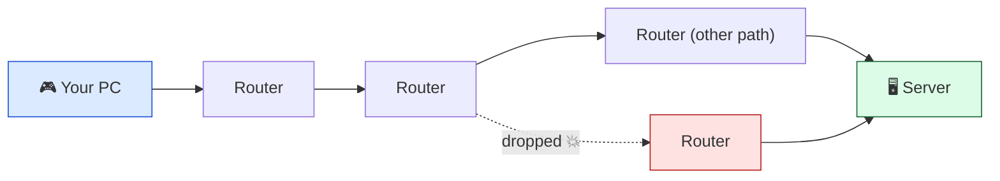
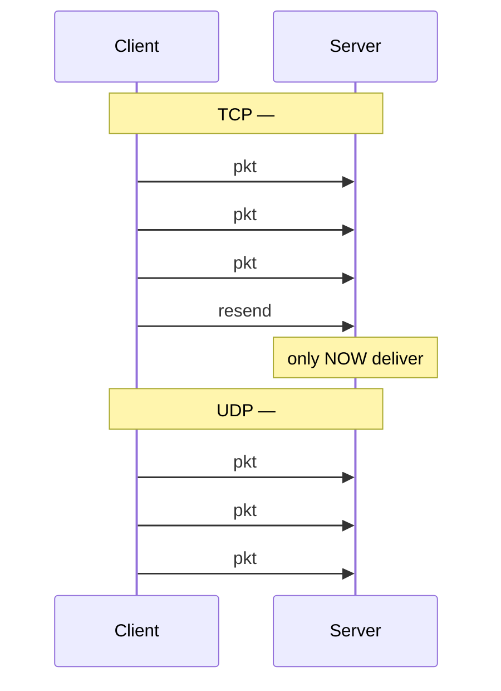
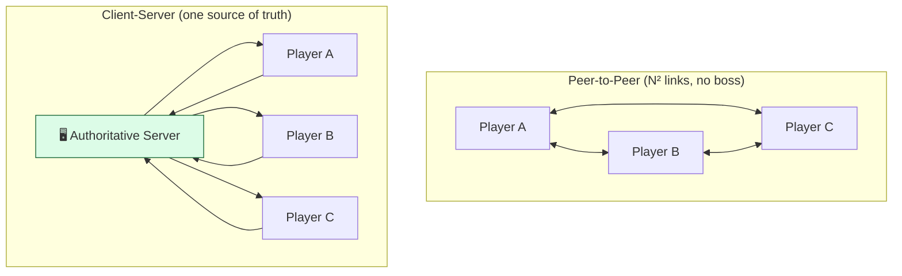
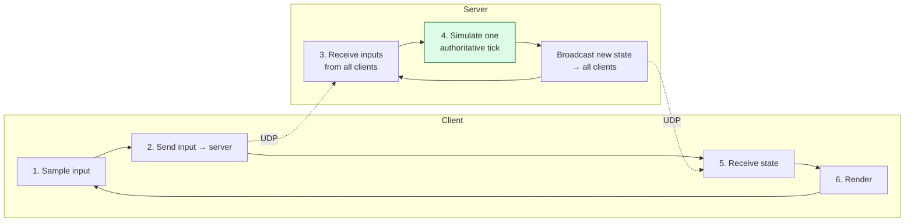

# Level 1 — Networking Fundamentals

| | |
|---|---|
| 🎚️ **Difficulty** | 🟡 Medium |
| ⏱️ **Estimated time** | 30 minutes |
| ⭐ **XP reward** | 100 (Quest) + 25 (Quiz) |

[← Prev](../README.md) · [↑ Phase Home](../README.md) · [→ Next](02-state-sync-and-authority.md)

---

## 📖 Story

> *"Welcome to my world. Maya's ticket says players want **co-op** — two people, one Ashfall dungeon, over the internet. Before you touch a single networking API, you need the mental model the whole world rests on, because multiplayer bugs aren't 'wrong code' — they're **physics**. Two machines, hundreds of kilometres apart, separated by a hostile, lossy, unpredictable network, trying to agree on where a sprite is. Light is slow. Packets vanish. Order isn't guaranteed. Today I'll teach you how the internet actually moves bytes — **packets**, **TCP vs UDP**, **latency**, **jitter**, **loss** — and why every realtime game you've ever played runs on UDP and a **client-server** model, not the 'just connect the two players directly' idea everyone has on day one. Get this model in your head and the next three lessons are just filling in detail. Kenji's seen me give this talk five times; he'll co-sign that it's the part juniors skip and then suffer for. Let me show you. — Priya"*

---

## 🎯 Goal

- Understand how the internet moves data as **packets**, and the three numbers that define a connection: **latency**, **jitter**, **packet loss**
- Know the real trade-off between **TCP** (reliable, ordered, slow to recover) and **UDP** (unreliable, unordered, fast) — and **why realtime games choose UDP**
- Compare **client-server** vs **peer-to-peer (P2P)** topologies and know when each is used
- Build the **engine-agnostic network loop** mental model: sample input → send → simulate → receive → render
- Choose Ashfall's network topology on paper, ready to implement next lesson

---

## 🧠 Concepts

### The internet moves packets, not "connections"

When you "send data" over a network, it doesn't travel as one continuous stream of water through a pipe. It's chopped into **packets** — small, independent envelopes (typically a few hundred to ~1500 bytes each). Each packet is addressed, dropped into the network, and **routed hop by hop** through routers it has never met before, possibly taking different paths than the packet before it. This is the foundational fact every other networking idea descends from:

- Packets can **arrive late** (they took a slow route).
- Packets can **arrive out of order** (a later one took a faster route).
- Packets can **vanish entirely** (a router was congested and dropped it).

There is no magic pipe. There is only a stream of best-effort envelopes that *mostly* show up. Three numbers describe how *well* they show up:

- **Latency (ping / RTT)** — how long a packet takes to travel. Usually measured as **round-trip time**: send → server → reply → back. ~20 ms is great, ~100 ms is playable, ~250 ms+ is rough. This has a hard floor set by the **speed of light**: you cannot ping Sydney from London faster than light can cross the planet, no matter how much money you spend.
- **Jitter** — the *variation* in latency. Pings of 50, 52, 49 ms are smooth. Pings of 30, 180, 45, 200 ms are *jittery* — and jitter is often worse for game feel than high-but-steady latency, because the game can't predict when the next update lands.
- **Packet loss** — the percentage of packets that never arrive. 0% is ideal; 1–2% is normal; 5%+ feels like teleporting and rubber-banding.



### TCP vs UDP: the two ways to use those packets

Both **TCP** and **UDP** sit on top of raw packets. They make opposite trade-offs:

| | **TCP** | **UDP** |
|---|---|---|
| Delivery | **Guaranteed** — retransmits lost packets | **Best-effort** — lost packets stay lost |
| Order | **Guaranteed** in-order | **No order** — you handle it |
| Connection | Handshake, persistent connection | "Fire and forget" datagrams |
| Cost of reliability | **Head-of-line blocking** + retransmit delay | None |
| Good for | Web pages, files, chat, logins | Realtime game state, voice, video |

The killer detail is **head-of-line blocking**. TCP guarantees order, so if packet #5 is lost, TCP **holds packets #6, #7, #8 hostage** — it won't hand them to your game until #5 is retransmitted and arrives, which takes at least one extra round trip. For a file download that's perfect (you need every byte, in order). For a 60 Hz shooter it's a disaster: by the time the re-sent #5 arrives, **you no longer care** — three newer position updates were sitting right behind it, and the freshest truth got stuck waiting for stale truth.

UDP just hands you whatever arrived, whenever it arrived, in whatever order. That sounds worse — and raw, it is — but it gives the *game* the power to decide what matters. For a player's position, you don't want the *reliable* update, you want the *latest* one. UDP lets you drop the stale one and use the fresh one.



> 🧠 Modern engines often run a **thin reliability layer on top of UDP** — reliable for the few things that *must* arrive (a chat message, "you died", a spawn), unreliable for the firehose of position updates. You get to choose, per message. That's why games pick UDP: **TCP forces one policy on everything; UDP lets you choose.**

### Client-server vs peer-to-peer

How do the players' machines connect? Two topologies:

- **Peer-to-peer (P2P):** every player connects directly to every other player. Simple for 2 players, cheap (no server to run). But it **scales badly** (N players = N² connections), exposes each player's IP, makes NAT/firewall traversal painful, and — fatally — there's **no single source of truth**, so it's wide open to cheating (each client claims its own state).
- **Client-server:** every player connects to one **authoritative server**. The server holds the *one true* game state; clients send input and receive results. Costs money to run, adds a hop of latency, but gives you **one source of truth** (anti-cheat), clean scaling, and players never see each other's IPs. This is what virtually every modern multiplayer game uses.



### The network loop (engine-agnostic)

A single-player game loop is: read input → simulate → render. A networked game wraps that in a send/receive cycle running every tick on **both** sides:



The server runs the simulation. Clients are (mostly) **input devices and renderers**. Everything in Lessons 2–4 is detail layered on this loop: Lesson 2 fixes the *feel* of the gap between "send input" and "receive state," Lesson 3 sends *gameplay* over it (RPCs, variables), and Lesson 4 packages that server so it can run anywhere.

### Why this exists

This model exists because **distance and unreliability are not bugs you can fix** — they're the medium you build on. You cannot make light faster or routers perfect, so multiplayer engineering is the art of *hiding* latency and *tolerating* loss while keeping every player agreeing on one truth. TCP-vs-UDP isn't trivia: it's the single decision that determines whether your game feels responsive or like wading through syrup. Client-server-vs-P2P determines whether your game can be trusted (anti-cheat) and whether it can scale. Pick wrong here and no amount of clever code downstream saves you.

This is **engine-agnostic**. Packets, TCP/UDP, latency/jitter/loss, and the client-server/P2P split are properties of *the internet*, identical in Unity (Netcode for GameObjects, Mirror), Unreal (its replication system runs on UDP), Godot (ENet, UDP-based), and any custom engine. The components differ; the physics never does. For the canonical free deep-dives (Glenn Fiedler's **Gaffer On Games** series on UDP, reliability, and game networking), see **RESOURCES.md** for this world.

---

## 🛠️ Hands-on Lab

> 💻 No engine yet — today you *feel* the network and write the model down. You'll measure real latency/loss and sketch Ashfall's topology. (Steps 1–2 use your terminal; Step 4 is a tiny C# UDP demo you can run with `dotnet`.)

### Step 1 — Measure your own latency and packet loss

```bash
# Round-trip time + loss to a well-known server (Ctrl-C to stop after ~10 pings)
ping -c 10 1.1.1.1
```

Read the summary line. You'll see something like `min/avg/max/stddev = 12.1/14.8/22.0/2.9 ms` and `0.0% packet loss`. That **avg** is your latency, the **stddev** is your jitter, and the **% packet loss** is loss. Now ping something far away (e.g. a server on another continent) and watch the avg climb — that's the speed of light taxing you.

### Step 2 — Watch the route your packets take (hop by hop)

```bash
# Each line is one router ("hop") your packets pass through
traceroute 1.1.1.1     # macOS/Linux  (use 'tracert' on Windows)
```

Every hop is a place a packet can be delayed or dropped. This is the "no magic pipe" lesson made visible — your data is physically relayed through a chain of strangers' routers.

### Step 3 — Decide Ashfall's topology (on paper)

Answer these for Ashfall co-op, then check your reasoning against Step 5's mission:

1. P2P or client-server? (Hint: Maya wants this to scale and be cheat-resistant later.)
2. TCP or UDP for the firehose of player/enemy positions? Which messages still need reliability?
3. Where does the *authoritative* dungeon simulation run?

### Step 4 — A minimal UDP echo, to feel "fire and forget"

UDP in C# is just `UdpClient`. This tiny pair shows the core truth: you send a datagram and *hope*. Put each in its own file and run with `dotnet run`.

```csharp
// server.cs — receives a UDP datagram and echoes it back. No connection, no handshake.
using System.Net;
using System.Net.Sockets;
using System.Text;

using var server = new UdpClient(9050);
Console.WriteLine("UDP server listening on :9050");
var anyClient = new IPEndPoint(IPAddress.Any, 0);

while (true)
{
    byte[] data = server.Receive(ref anyClient);          // blocks until a datagram arrives
    string msg = Encoding.UTF8.GetString(data);
    Console.WriteLine($"recv from {anyClient}: {msg}");
    byte[] reply = Encoding.UTF8.GetBytes($"echo: {msg}");
    server.Send(reply, reply.Length, anyClient);          // fire and forget — no guarantee it arrives
}
```

```csharp
// client.cs — sends one datagram, waits briefly for the echo. If it's lost, it's just gone.
using System.Net;
using System.Net.Sockets;
using System.Text;

using var client = new UdpClient();
var server = new IPEndPoint(IPAddress.Loopback, 9050);

byte[] payload = Encoding.UTF8.GetBytes("player_pos:12.3,4.5");
client.Send(payload, payload.Length, server);             // no ACK, no retransmit — pure UDP
Console.WriteLine("sent. waiting up to 1s for echo...");

client.Client.ReceiveTimeout = 1000;
try
{
    var from = new IPEndPoint(IPAddress.Any, 0);
    byte[] back = client.Receive(ref from);
    Console.WriteLine($"got: {Encoding.UTF8.GetString(back)}");
}
catch (SocketException)
{
    Console.WriteLine("no reply (this is what packet loss feels like)");  // UDP makes no promises
}
```

Run the server, then the client. You'll usually see the echo on `localhost` (loopback never drops). The point is the *shape* of the code: **no connection, no handshake, no retransmit** — you fling a datagram and the network may or may not deliver it. That's the substrate every realtime game is built on.

### Step 5 — Write the model down

In your Ashfall repo, create `docs/networking.md` and record your topology decision (client-server, UDP-with-selective-reliability, server-authoritative simulation) and a one-line justification for each. This is the contract the next three lessons implement.

---

## 🎮 Mini Challenge

A teammate says: *"Let's just use TCP for everything — it's reliable, so the game will be smoother and we'll never lose a position update."* They're wrong about "smoother." Explain precisely why TCP can make a fast-paced game feel **worse** than UDP, even though UDP loses packets.

<details>
<summary>💡 Reveal answer</summary>

Because of **head-of-line blocking**. TCP guarantees in-order delivery, so a single lost position packet forces TCP to **stall every newer packet behind it** until the lost one is retransmitted (an extra round trip minimum). In a fast game, by the time the stale re-sent packet arrives, several *fresher* position updates were already waiting — and the player only ever wanted the **newest** one anyway. So TCP's "reliability" actively delivers *outdated* truth while hiding the current truth. UDP loses the stale packet and immediately delivers the fresh one, which is exactly what you want for state that's overwritten constantly. Reliability is the wrong guarantee for data that's already obsolete by the time you'd resend it. (You still use a *reliable* channel for rare must-arrive events — spawns, deaths, chat — just not for the position firehose.)
</details>

---

## 📦 Project Mission

Give Ashfall a written network design — the blueprint Lessons 2–4 build against.

1. In `~/projects/ashfall`, create `docs/networking.md`.
2. Record and justify: **topology** (client-server), **transport** (UDP with selective reliability), and **authority** (the server runs the one true simulation; clients send input + render).
3. Draw Ashfall's topology — two clients, one authoritative server — as a Mermaid diagram in that doc (reuse the client-server diagram above as a starting point).
4. List which message types are **reliable** (player join/leave, spawn, death, loot pickup, chat) vs **unreliable** (player position, enemy position, animation state).
5. Commit it:
   ```bash
   cd ~/projects/ashfall
   git switch -c feature/net-design
   git add docs/networking.md
   git commit -m "docs: Ashfall network design — client-server, UDP, server-authoritative"
   git switch main && git merge feature/net-design && git push
   ```

🎯 **Mission complete when:** `docs/networking.md` exists in Ashfall with a chosen **client-server** topology, **UDP-with-selective-reliability** transport, a **server-authoritative** model, a Mermaid topology diagram, and a reliable-vs-unreliable message list — each with a one-line justification. Ashfall now has a network blueprint to build on.

---

## ⚠️ Common Mistakes

| Mistake | What happens | Fix |
|--------|--------------|-----|
| Using TCP for fast position updates | Head-of-line blocking → laggy, stale state | UDP for the position firehose; reliable channel only for must-arrive events |
| Assuming P2P "is simpler so use it" | Doesn't scale (N²), exposes IPs, no anti-cheat | Client-server with one authoritative server |
| Treating the network as a reliable pipe | Code breaks on real-world loss/reorder/latency | Design for loss, reorder, and delay from day one |
| Ignoring jitter, only watching avg ping | Game stutters even at "good" ping | Account for jitter (variance), not just average latency |
| Expecting "no packet loss" in production | Rubber-banding bugs you can't reproduce locally | Assume 1–5% loss; test with simulated loss |
| Confusing latency with bandwidth | "More Mbps" doesn't fix a 200 ms ping | Latency is *time-to-arrive*; bandwidth is *volume* — games care most about latency |

---

## 🤔 Reflection Questions

1. There's a hard physical floor on latency between two cities. What is it, and what does that imply about a global game with one server location? (Connect it to why big games run *regional* servers.)
2. UDP "loses packets and doesn't guarantee order" — that sounds strictly worse than TCP. Explain why, for a player's position, that's actually the *better* default. What few message types still need reliability?
3. Both P2P and client-server can run a 2-player co-op game. Maya wants Ashfall to grow and resist cheating. Which topology serves that, and which specific weaknesses of the other one are you avoiding?

---

## 📝 Quiz

1. **Latency, jitter, and packet loss describe, respectively…**
   - a) bandwidth, encryption, and compression
   - b) time-to-arrive, variation in that time, and the % of packets that never arrive
   - c) the number of players, servers, and routers
2. **Realtime games prefer UDP over TCP mainly because…**
   - a) UDP is encrypted and TCP is not
   - b) TCP's guaranteed in-order delivery causes head-of-line blocking, delaying fresh state behind stale retransmits
   - c) UDP guarantees delivery and TCP does not
3. **A client-server topology is chosen over peer-to-peer primarily for…**
   - a) lower cost, since no server is needed
   - b) one authoritative source of truth (anti-cheat) plus clean scaling
   - c) faster connections, since the server adds no latency

<details>
<summary>✅ Answers</summary>

1: **b** · 2: **b** · 3: **b**
</details>

---

## ✅ Completion Checklist

- [ ] I measured real latency/jitter/loss with `ping` and saw the route with `traceroute`
- [ ] I can explain TCP vs UDP and *why* games choose UDP (head-of-line blocking)
- [ ] I can contrast client-server vs P2P and justify the choice for Ashfall
- [ ] I ran the UDP echo demo and understand "fire and forget"
- [ ] I wrote `docs/networking.md` with topology, transport, authority, and a message list (Project Mission)
- [ ] I passed the quiz
- [ ] Added **+125 XP** to [PROGRESS.md](../../../PROGRESS.md)

---

[← Prev](../README.md) · [↑ Phase Home](../README.md) · [→ Next](02-state-sync-and-authority.md)
