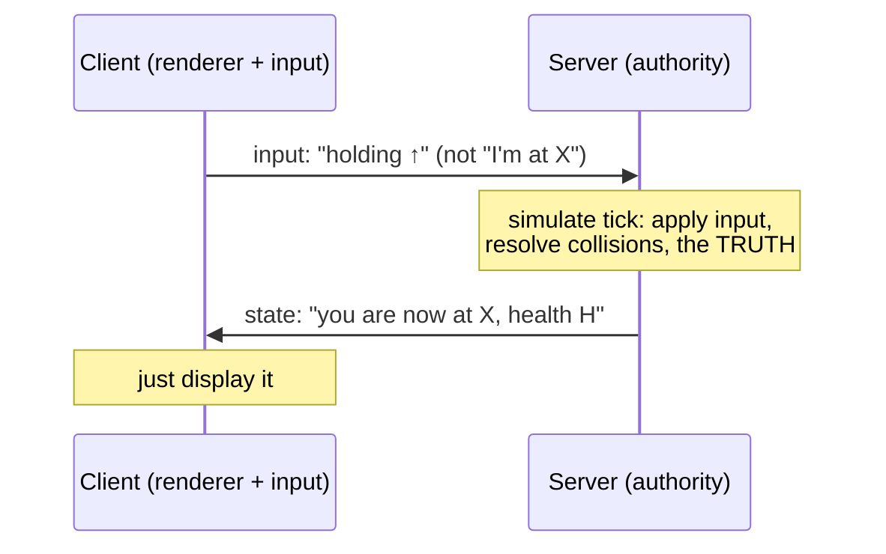
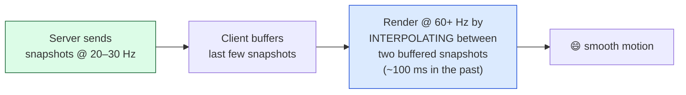
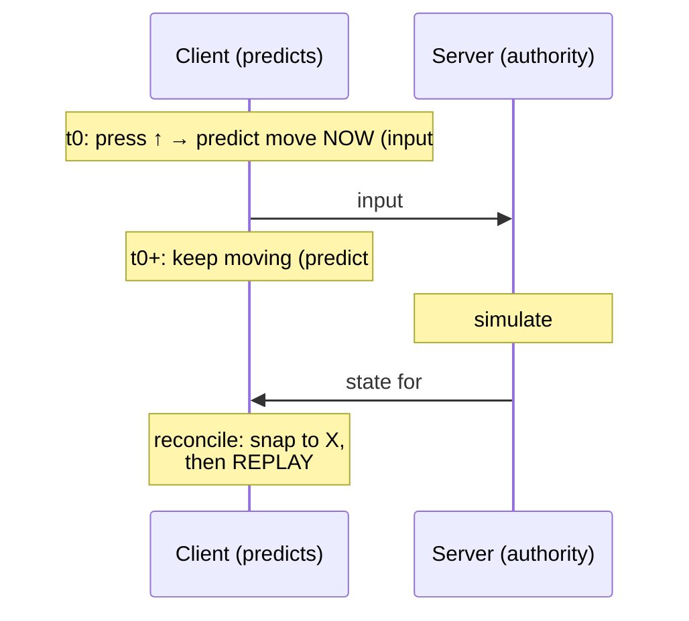

# Level 2 — State Sync & Authority

| | |
|---|---|
| 🎚️ **Difficulty** | 🔴 Hard |
| ⏱️ **Estimated time** | 35 minutes |
| ⭐ **XP reward** | 100 (Quest) + 25 (Quiz) |

[← Prev](01-networking-fundamentals.md) · [↑ Phase Home](../README.md) · [→ Next](03-co-op-gameplay-and-rpcs.md)

---

## 📖 Story

> *"You've got the model: client-server, UDP, server-authoritative. Now the hard part — making it *feel good*. Here's the cruel arithmetic: if input has to travel to the server and the result has to travel back, then at 100 ms ping your character would move **a tenth of a second after you press the key**. Unplayable. Every great multiplayer game solves this with the same four ideas, and today you learn all of them. **Server authority** (the server owns the truth, so nobody can cheat). **Snapshots + interpolation** (the server sends keyframes; clients smoothly play between them). **Client-side prediction** (the client *guesses* the result instantly instead of waiting). And **reconciliation** (when the server's real answer arrives and disagrees with the guess, the client quietly corrects itself). This is the deepest material in the world — Kenji and I will walk it slowly. Concepts first, on the whiteboard, then a real Netcode for GameObjects script. Get this and you understand how every shooter you've played hides 100 ms of lag from you. Let me show you. — Priya"*

---

## 🎯 Goal

- Understand **server authority** and *why* it's the foundation of anti-cheat
- Understand **replication** via **snapshots** and why clients **interpolate** between them
- Understand **client-side prediction** + **reconciliation** — how clients hide latency
- Understand **lag compensation** (rewinding time so shots feel fair)
- Implement **server-authoritative, predicted player movement** with **Netcode for GameObjects** (Mirror equivalent noted)

---

## 🧠 Concepts

### Server authority: the server owns the truth

In a server-authoritative model, the **server's copy of the game state is the only real one**. Clients never *set* state directly — they send **input** ("I'm holding the up arrow," "I pressed attack"), the server **simulates** the result, and clients **display** whatever the server reports. A client cannot say "I'm at position X with 9999 health"; it can only say "I'm pressing up," and the server decides what that does.

This is the entire basis of anti-cheat: if a hacked client lies, the server simply ignores the lie because the client was never allowed to assert state in the first place. Authority isn't a feature you add later — it's the *shape* of the whole system, and it's why Lesson 1 chose client-server over P2P.



### Replication: snapshots, not a constant stream

The server can't send the full game state on every single frame to every client — that's too much bandwidth. Instead it sends **snapshots**: periodic packages of the relevant state (each networked object's position, rotation, health, etc.), maybe **20–30 times per second**, not 60+. Sending only what *changed* (delta compression) keeps it lean.

But if the client only gets a new position 20 times a second and renders 60+ times a second, naive rendering would **teleport** objects in jerky steps. The fix is **interpolation**: the client keeps a small buffer of recent snapshots and renders other players/enemies **slightly in the past** (e.g. 100 ms behind), smoothly playing *between* the two snapshots it already has. You trade a tiny bit of "seeing others in the recent past" for buttery-smooth motion. Remote objects are *interpolated*; your *own* character is *predicted* (next section).



### Client-side prediction + reconciliation: hiding your own latency

Interpolation makes *other* objects smooth, but it still leaves **your own** character lagging — if you waited for the server to confirm every step, you'd feel 100 ms of input delay. The fix is **client-side prediction**: when you press a key, your client **immediately simulates the move locally** (using the *same* movement code the server runs) and shows it instantly. No waiting. It also **remembers** that input, tagged with a sequence number.

The server eventually processes that input and sends back its authoritative result. Now **reconciliation**: the client compares the server's answer to where its prediction *was* at that moment.

- **Match?** Great — prediction was right, do nothing.
- **Mismatch** (you got knocked back, blocked by a wall the client didn't know about, etc.)? Snap to the server's authoritative position, then **re-apply all the inputs you've sent since** that point (which the client still has buffered). This "rewind and replay" lands you at a corrected position *without* throwing away the inputs you made while waiting.



### Lag compensation: making shots fair

One more layer for hit detection. Because remote players are rendered ~100 ms in the past (interpolation) and your inputs took time to reach the server, "I clearly hit them on my screen" might be a miss on the server's newer truth. **Lag compensation** fixes this: when the server processes your shot, it **rewinds** the targets to where they were *on your screen* at the moment you fired (using the snapshot history + your latency), checks the hit *there*, then returns to the present. It's why you can trust your crosshair in a laggy shooter. (Ashfall is melee/roguelite, but the principle applies to any hit you want to feel fair.)

### Why this exists

All four ideas exist to solve **one** problem: the speed of light puts an unavoidable gap between *pressing a key* and *the server agreeing*. You can't remove the gap, so you **hide** it — predict locally so input feels instant, interpolate so others move smoothly, reconcile so the lie stays consistent with the truth, and lag-compensate so hits feel fair. And you do all of it *without surrendering authority*, because the server still owns the real state — prediction is just an educated guess that the server is always free to overrule. That combination (instant feel **and** cheat-proof truth) is the whole craft of netcode.

This is **engine-agnostic**. Authority, snapshots, interpolation, prediction/reconciliation, and lag compensation are *concepts*, implemented in Unity (Netcode for GameObjects, Mirror), Unreal (built-in replication + `Move`/`ServerMove` prediction), Source/Quake engines (where these techniques were invented), Godot, and any custom engine. The APIs change; the four ideas don't. For the definitive free write-ups (Gabriel Gambetta's "Fast-Paced Multiplayer," Valve's lag-compensation paper, Gaffer On Games), see **RESOURCES.md** for this world.

---

## 🛠️ Hands-on Lab

> 💻 Uses **Netcode for GameObjects** (NGO), Unity's official free netcode package. Install via **Package Manager → Unity Registry → "Netcode for GameObjects."** (A **Mirror** equivalent is noted at the end — the concepts are identical.) Drop a `NetworkManager` in your scene with the **Unity Transport** before starting.

### Step 1 — Make the player a networked object

1. On your Ashfall player prefab, add a **`NetworkObject`** component.
2. Register the prefab in the `NetworkManager` (the **Player Prefab** field) so the server spawns one per connecting client.
3. Remove (or disable) the old single-player movement script — we're replacing it with a networked one that runs on the right machine.

### Step 2 — A server-authoritative, owner-predicted move script

The key NGO ideas in code: `IsOwner` (this is *my* player), `IsServer` (I'm the authority), `ServerRpc` (client → server call), and a `NetworkVariable` the server writes and everyone reads.

```csharp
using Unity.Netcode;
using UnityEngine;

// Server-authoritative movement with client-side prediction for the owner.
// The OWNER predicts locally for instant feel; the SERVER is the authority and
// corrects the owner; NON-owners just interpolate toward the server's value.
public class NetworkedPlayerMovement : NetworkBehaviour
{
    [SerializeField] float speed = 6f;

    // Server writes this; all clients read it. This is the authoritative position.
    readonly NetworkVariable<Vector2> _netPos =
        new(writePerm: NetworkVariableWritePermission.Server);

    void Update()
    {
        if (IsOwner)
        {
            // Sample input on the machine that owns this player.
            Vector2 input = new(Input.GetAxisRaw("Horizontal"), Input.GetAxisRaw("Vertical"));
            Vector2 delta = input.normalized * speed * Time.deltaTime;

            // PREDICT: move locally NOW so it feels instant (don't wait for the server).
            transform.position += (Vector3)delta;

            // Tell the server what we did so it can authoritatively simulate it.
            SubmitMoveServerRpc(delta);
        }
        else
        {
            // NON-owners (the other player, on our screen): smoothly interpolate
            // toward the server's authoritative position (no jerky teleporting).
            transform.position = Vector3.Lerp(transform.position, _netPos.Value, 15f * Time.deltaTime);
        }
    }

    // Runs on the SERVER when an owning client calls it. The server is the authority:
    // it applies the move, could clamp/validate it (anti-cheat), and writes the truth.
    [ServerRpc]
    void SubmitMoveServerRpc(Vector2 delta)
    {
        // (In a fuller build: validate delta magnitude here to reject speed hacks.)
        transform.position += (Vector3)delta;   // server simulates the same move
        _netPos.Value = transform.position;     // publish authoritative position to everyone
    }
}
```

> 🧠 The owner *predicts* (moves instantly) **and** tells the server. The server *simulates the same code* and publishes the truth via the `NetworkVariable`. Non-owners *interpolate* (the `Lerp`) toward that truth so motion is smooth despite snapshots arriving only ~20×/s. This single script demonstrates authority + prediction + interpolation together.

### Step 3 — Add reconciliation (correct a bad guess)

Prediction is a guess; sometimes the server disagrees (a wall, a knockback). Subscribe to the authoritative value and, if the owner's predicted position has drifted too far from the truth, snap back.

```csharp
public override void OnNetworkSpawn()
{
    // When the server publishes a new authoritative position, the OWNER reconciles:
    // if our prediction drifted too far from the truth, correct it.
    _netPos.OnValueChanged += (oldVal, newVal) =>
    {
        if (!IsOwner) return;
        if (Vector2.Distance(transform.position, newVal) > 1.0f)  // tolerance
            transform.position = newVal;   // snap to authority (a fuller build replays buffered inputs)
    };
}
```

> A production reconciler also **replays the inputs sent since** that snapshot (Concepts section). The tolerance check above is the simplified, lesson-sized version — it shows the *idea*: the server can always overrule the client's guess.

### Step 4 — Run two instances and watch it sync

1. Build a standalone player, then run the **build + the Editor** at once (or use **ParrelSync** to clone the project — see RESOURCES.md).
2. In one instance click **Start Host** (server + a client); in the other click **Start Client**.
3. Move each player. Confirm: your own player feels **instant** (prediction), the other player moves **smoothly** (interpolation), and the **server** decides the real positions (authority).

### Step 5 — Feel the lag (and the fix)

In the **Unity Transport** component, set **Simulated Packet Delay** to ~150 ms and a little **Packet Drop** (e.g. 3%). Re-run. With prediction *off* (comment out the local `transform.position += delta`), your own movement now visibly lags. Turn it back on — instant again. That's the whole point of prediction, made tangible.

> **Mirror equivalent:** `NetworkBehaviour` + `isOwned`/`isServer`, `[Command]` (client→server, NGO's `ServerRpc`), `[ClientRpc]`, and `SyncVar` (NGO's `NetworkVariable`). Same four concepts, different names.

---

## 🎮 Mini Challenge

A junior ships co-op where the **client** sends its own position to the server ("I'm at X") and the server just trusts and rebroadcasts it. Movement feels great in testing. Name the two distinct disasters this causes in production, and state the one architectural rule that fixes both.

<details>
<summary>💡 Reveal answer</summary>

**Disaster 1 — cheating.** If the client asserts its own position, a hacked client can claim *any* position: teleport across the map, walk through walls, dodge every attack. The server has no truth to check against because it made the client the authority.

**Disaster 2 — inconsistency / no conflict resolution.** Two clients can claim contradictory states (both "I picked up the loot"), and there's no authority to adjudicate, so the game state diverges between players.

**The one rule that fixes both: server authority.** Clients send **input** ("holding ↑"), never **state** ("I'm at X"). The server simulates and owns the only real state; clients predict locally for feel but the server can always overrule them (reconciliation). Authority is the foundation — prediction and interpolation are comfort layers *on top* of it, never replacements for it.
</details>

---

## 📦 Project Mission

Make Ashfall's player movement server-authoritative and predicted — the backbone of trustworthy co-op.

1. Add a `NetworkObject` to the Ashfall player prefab and register it as the **Player Prefab** in `NetworkManager`.
2. Add `Assets/Scripts/Net/NetworkedPlayerMovement.cs` (Steps 2–3): owner-predicted local move, `ServerRpc` to the authority, server-published `NetworkVariable`, non-owner interpolation, and reconciliation on drift.
3. Run **Host + Client** (build + Editor, or ParrelSync) and verify: own player **instant**, other player **smooth**, server **authoritative**.
4. Add **simulated latency (150 ms) + 3% loss** in Unity Transport and confirm prediction keeps your own movement responsive; document what you observed in `docs/networking.md`.
5. Commit:
   ```bash
   cd ~/projects/ashfall
   git switch -c feature/net-authority
   git add Assets/Scripts/Net docs/networking.md
   git commit -m "feat: server-authoritative predicted player movement (NGO)"
   git switch main && git merge feature/net-authority && git push
   ```

🎯 **Mission complete when:** the Ashfall player replicates across **two instances** with **server authority** (clients send input, server owns position), the **owner's movement is predicted** (instant under simulated 150 ms latency), **non-owners interpolate** smoothly, and the owner **reconciles** to the server on drift — verified with simulated latency/loss and noted in `docs/networking.md`.

---

## ⚠️ Common Mistakes

| Mistake | What happens | Fix |
|--------|--------------|-----|
| Client sends its own *position* instead of *input* | Trivially cheatable; state diverges | Server authority — clients send input, server simulates & owns state |
| No prediction on the owner | Your own movement lags by a full RTT | Predict locally on the owner, reconcile to server |
| No interpolation on remote objects | Other players teleport/jitter between snapshots | Buffer snapshots and interpolate (~100 ms behind) |
| Snapshotting at full frame rate | Bandwidth blows up | Send snapshots ~20–30 Hz; render at 60+ via interpolation |
| Reconciliation snaps but discards buffered inputs | Predicted moves "rubber-band" away | Snap to authority, then **replay** inputs sent since that snapshot |
| Trusting client hit claims | Wall-hacks / aim cheats | Validate hits on the server; lag-compensate for fairness |
| Testing only on `localhost` | "It works" then breaks online (loopback never lags/drops) | Test with simulated latency + packet loss |

---

## 🤔 Reflection Questions

1. Server authority means clients send *input*, not *state*. Walk through exactly how that single rule defeats a player who hacks their client to teleport — what does the server do with the lie?
2. Your own character is **predicted**; other players are **interpolated**. Why the asymmetry — why not predict everyone, or interpolate everyone? What would each wrong choice feel like?
3. Reconciliation sometimes snaps your character back. Why is "snap to the server, then replay my buffered inputs" better than either (a) never correcting, or (b) snapping and discarding those inputs?

---

## 📝 Quiz

1. **In a server-authoritative model, clients send…**
   - a) their final position and health to the server
   - b) input (e.g. "holding up"), and the server simulates and owns the real state
   - c) nothing; the server reads their screen
2. **Clients render remote players slightly in the past and interpolate between snapshots in order to…**
   - a) save bandwidth by never sending position
   - b) turn jerky ~20 Hz snapshots into smooth 60+ Hz motion
   - c) give those players an unfair advantage
3. **Client-side prediction + reconciliation exists to…**
   - a) let the client overrule the server permanently
   - b) make the owner's input feel instant while still letting the server correct it
   - c) remove the need for a server

<details>
<summary>✅ Answers</summary>

1: **b** · 2: **b** · 3: **b**
</details>

---

## ✅ Completion Checklist

- [ ] Ashfall player has a `NetworkObject` and is registered as the Player Prefab
- [ ] Movement is **server-authoritative** (clients send input via `ServerRpc`)
- [ ] The **owner predicts** locally and **reconciles** to the server on drift
- [ ] **Non-owners interpolate** toward the authoritative position
- [ ] I verified sync across two instances under **simulated latency + loss**
- [ ] I can explain authority, snapshots/interpolation, prediction/reconciliation, and lag compensation
- [ ] I passed the quiz
- [ ] Added **+125 XP** to [PROGRESS.md](../../../PROGRESS.md)

---

[← Prev](01-networking-fundamentals.md) · [↑ Phase Home](../README.md) · [→ Next](03-co-op-gameplay-and-rpcs.md)
