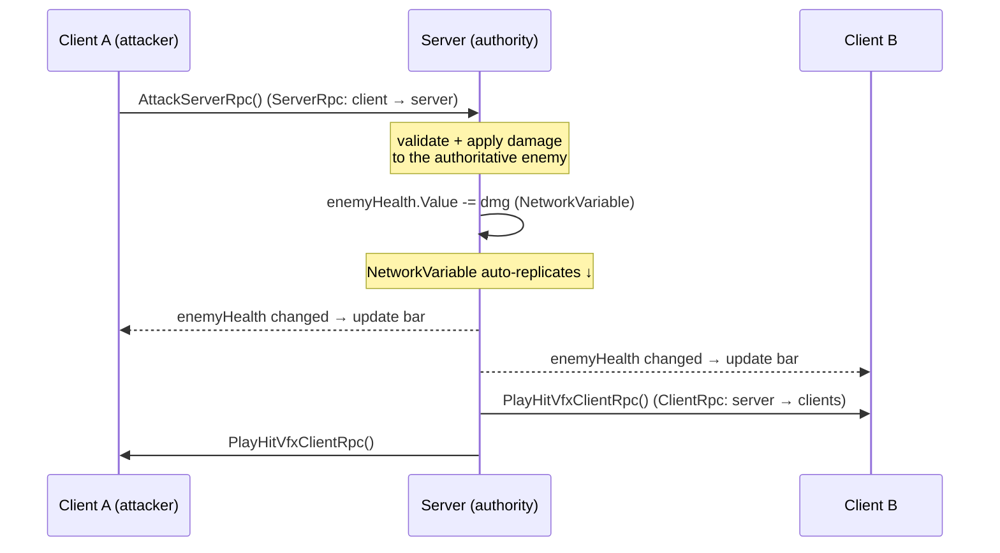
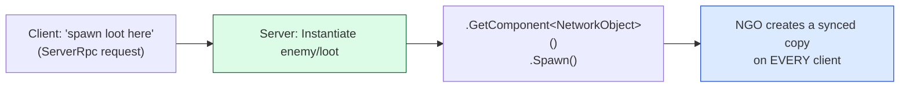

# Level 3 — Co-op Gameplay & RPCs

| | |
|---|---|
| 🎚️ **Difficulty** | 🔴 Hard |
| ⏱️ **Estimated time** | 35 minutes |
| ⭐ **XP reward** | 100 (Quest) + 25 (Quiz) |

[← Prev](02-state-sync-and-authority.md) · [↑ Phase Home](../README.md) · [→ Next](04-dedicated-server-and-docker.md)

---

## 📖 Story

> *"Movement syncs — but co-op isn't two cursors sliding around. It's two players in **one** dungeon: a shared enemy that both can hit, a health bar that updates on both screens, a 'player joined' moment, loot that can only be picked up once. That all comes down to three tools you'll learn today. **NetworkVariables** — state the server owns and everyone watches (an enemy's health, a player's name). **RPCs** — Remote Procedure Calls, the way one machine asks another to *run a function*: a client tells the server 'I attacked' (ServerRpc), the server tells all clients 'play the hit VFX' (ClientRpc). And **spawning** — the server creating networked objects (an enemy, a dropped item) that exist on every client. By the end you'll have a real synced enemy that two players can fight together in the same dungeon. This is where Ashfall becomes genuinely co-op. Kenji built the original single-player combat in World 5 — today we put it on the wire. Let me show you. — Priya"*

---

## 🎯 Goal

- Understand **`NetworkBehaviour`** as the base for networked gameplay scripts
- Use **`NetworkVariable`** for server-owned state that auto-replicates (health, names)
- Use **RPCs** correctly: **`ServerRpc`** (client → server) and **`ClientRpc`** (server → clients), and know which direction each goes
- **Spawn** networked objects from the server so they exist on every client
- Build a **synced enemy** two players can fight together in one Ashfall dungeon

---

## 🧠 Concepts

### NetworkBehaviour, NetworkVariable, RPCs — the three tools

Everything networked in NGO derives from **`NetworkBehaviour`** (instead of plain `MonoBehaviour`). It gives a script the awareness it needs: `IsServer`, `IsClient`, `IsOwner`, and lifecycle hooks like `OnNetworkSpawn`. On top of that base sit the two ways data moves:

- **`NetworkVariable<T>`** — a piece of **state** the server owns and the engine **automatically replicates** to every client whenever it changes. Use it for things that *persist and change over time*: an enemy's current health, a player's chosen name, a door's open/closed flag. Read it anywhere; only the authority (server) writes it. Clients can subscribe to `OnValueChanged` to react (update the health bar).
- **RPC (Remote Procedure Call)** — a way to make code **run on another machine**. Use it for **events / actions** that happen at a moment: "I attacked," "play this sound," "you took damage." Two directions:
  - **`ServerRpc`** — a **client asks the server** to run something. (Client → Server.) Example: "I pressed attack."
  - **`ClientRpc`** — the **server tells clients** to run something. (Server → Clients.) Example: "everyone play the hit flash."

The mental rule: **NetworkVariable for ongoing state; RPC for one-shot events. ServerRpc goes up to the authority; ClientRpc comes down to the clients.**



### Spawning networked objects

When the server creates a networked object that must exist on all clients (an enemy, a dropped loot item), it doesn't just `Instantiate` it — it `Instantiate`s **then calls `.Spawn()`** on the object's `NetworkObject`. That tells NGO to create a matching copy on every connected client and keep them in sync. Spawning is **server-only** — a client can't conjure authoritative objects (that would break Lesson 2's authority rule); it *asks* via a `ServerRpc`, and the server spawns. Likewise, the prefab must be registered in the `NetworkManager`'s network prefab list so every client knows how to build it.



### Ownership & the shared dungeon

Each networked object has an **owner** (often the server, or the client whose player it is). Ownership decides who may write owner-permission variables and call owner-only RPCs. For Ashfall co-op, the **server owns the enemy and the dungeon**, while each **client owns its own player**. The dungeon stays identical on both screens because both clients build it from the **same seed** (your World 4 procedural generator) sent at join — the server picks one seed, shares it, and both clients generate the exact same layout deterministically. No need to stream every tile; just sync the seed and let the deterministic generator do the rest.

### Why this exists

These tools exist because "the same game on two machines" is really **two synchronization problems with different shapes**, and using the wrong tool for each is the most common netcode mess. *State that lives over time* (health ticking down) wants automatic, latest-value replication — that's `NetworkVariable`; firing an RPC every frame to sync health would flood the network and still race. *Events that happen at an instant* (an attack, a sound, a spawn) want a one-shot call in a specific direction — that's an RPC; storing "an attack happened" in a variable is awkward and leaks. And **spawning** exists because authority must extend to *object existence*, not just object data — only the server may bring authoritative objects into the world, or clients could spawn themselves infinite loot. Match the tool to the problem and co-op becomes straightforward; mismatch them and you get races, floods, and cheats.

This is **engine-agnostic**. "Replicated variables" and "remote procedure calls in both directions" are universal: Unity NGO (`NetworkVariable`, `ServerRpc`/`ClientRpc`), Mirror (`SyncVar`, `[Command]`/`[ClientRpc]`), Unreal (Replicated `UPROPERTY`, `Server`/`Client`/`Multicast` UFUNCTIONs), Godot (`@rpc`), and custom engines all provide the same two primitives plus server-side spawning. Names differ; the up/down + state/event model is the same. See **RESOURCES.md** for this world.

---

## 🛠️ Hands-on Lab

> 💻 Builds on Lesson 2's NGO setup (NetworkManager + transport + networked player). We'll add a **synced enemy** with replicated health that both players can damage.

### Step 1 — A networked enemy with replicated health

Make the enemy a `NetworkBehaviour` with a server-owned health `NetworkVariable`. Add a `NetworkObject` to the enemy prefab and register it in the `NetworkManager` network prefab list.

```csharp
using Unity.Netcode;
using UnityEngine;

// A server-authoritative enemy. Health is a NetworkVariable the SERVER owns and
// all clients watch; damage flows in via a ServerRpc; hit feedback flows out via a ClientRpc.
public class NetworkedEnemy : NetworkBehaviour
{
    [SerializeField] int maxHealth = 100;

    // Server writes, everyone reads. Replicates automatically on every change.
    public readonly NetworkVariable<int> Health =
        new(writePerm: NetworkVariableWritePermission.Server);

    public override void OnNetworkSpawn()
    {
        if (IsServer) Health.Value = maxHealth;          // authority sets the initial truth
        Health.OnValueChanged += OnHealthChanged;        // every client reacts (e.g. health bar)
    }

    void OnHealthChanged(int oldHp, int newHp)
    {
        // Runs on ALL machines when the replicated value changes — update UI here.
        Debug.Log($"Enemy health: {newHp}");
    }
}
```

### Step 2 — Damage via a ServerRpc (client → server → authority)

A client can't subtract health directly (authority!). It **requests** damage with a `ServerRpc`; the server validates and applies it to the authoritative `NetworkVariable`.

```csharp
// Add to NetworkedEnemy. RequireOwnership = false lets ANY client (either player)
// request damage on this server-owned enemy — both co-op players can hit it.
[ServerRpc(RequireOwnership = false)]
public void TakeDamageServerRpc(int amount, ServerRpcParams rpc = default)
{
    if (!IsServer) return;
    Health.Value = Mathf.Max(0, Health.Value - amount);  // authoritative change → auto-replicates

    PlayHitVfxClientRpc();                                // tell everyone to show feedback

    if (Health.Value == 0)
    {
        // server-only despawn; a fuller build spawns loot here (Step 4)
        ulong who = rpc.Receive.SenderClientId;          // which player landed the kill
        Debug.Log($"Enemy killed by client {who}");
        GetComponent<NetworkObject>().Despawn();
    }
}

// Server → all clients: run hit feedback (flash/particles from World 7) on every screen.
[ClientRpc]
void PlayHitVfxClientRpc()
{
    GetComponent<HitFlash>()?.Flash();                   // World 7 juice, now synced
}
```

### Step 3 — The player's attack calls the enemy's ServerRpc

On the player's attack input, find the enemy you hit and request damage. The owner runs this; the call travels to the server.

```csharp
using Unity.Netcode;
using UnityEngine;

public class PlayerAttack : NetworkBehaviour
{
    [SerializeField] int damage = 20;
    [SerializeField] float range = 1.5f;

    void Update()
    {
        if (!IsOwner) return;                            // only the local player acts on input
        if (Input.GetButtonDown("Fire1"))
        {
            // simple melee: hit the nearest enemy in range
            var hit = Physics2D.OverlapCircle(transform.position, range, LayerMask.GetMask("Enemy"));
            if (hit && hit.TryGetComponent(out NetworkedEnemy enemy))
                enemy.TakeDamageServerRpc(damage);       // client → server (authority applies it)
        }
    }
}
```

### Step 4 — Spawning networked objects (the enemy, then loot)

Spawning is server-only. Spawn the enemy when the dungeon starts, and (bonus) spawn a loot item where the enemy died.

```csharp
using Unity.Netcode;
using UnityEngine;

// Server-only spawner. Call from the host once the dungeon is built.
public class EnemySpawner : NetworkBehaviour
{
    [SerializeField] NetworkObject enemyPrefab;
    [SerializeField] NetworkObject lootPrefab;

    public void SpawnEnemy(Vector3 pos)
    {
        if (!IsServer) return;                           // only the authority spawns
        NetworkObject e = Instantiate(enemyPrefab, pos, Quaternion.identity);
        e.Spawn();                                       // ← creates a synced copy on every client
    }

    public void SpawnLoot(Vector3 pos)
    {
        if (!IsServer) return;
        Instantiate(lootPrefab, pos, Quaternion.identity).Spawn();
    }
}
```

> 💡 Call `SpawnLoot(transform.position)` from the enemy's death branch in Step 2 (server-side) to drop synced loot. A loot pickup should itself go through a `ServerRpc` so only **one** player can claim it — the server decides who got there first.

### Step 5 — Sync the dungeon via a shared seed

Don't stream tiles. The host picks one seed and shares it; both clients run the **same** World 4 generator deterministically.

```csharp
// On the NetworkManager's connection flow: the server sets the seed, clients read it.
public readonly NetworkVariable<int> DungeonSeed =
    new(writePerm: NetworkVariableWritePermission.Server);

public override void OnNetworkSpawn()
{
    if (IsServer) DungeonSeed.Value = System.Environment.TickCount;  // host chooses the seed
    // Both host and clients generate the IDENTICAL dungeon from this seed:
    DungeonGenerator.Generate(DungeonSeed.Value);                    // your World 4 generator
}
```

### Step 6 — Play co-op

Run **Host + Client** (build + Editor, or ParrelSync). Both players spawn into the **same** dungeon (shared seed), both can hit the **same** enemy, its **health bar updates on both screens** (NetworkVariable), and **hit flashes play on both** (ClientRpc). That's real co-op.

> **Mirror equivalent:** `[Command]` = `ServerRpc`, `[ClientRpc]` = `ClientRpc`, `SyncVar` = `NetworkVariable`, `NetworkServer.Spawn(obj)` = `.Spawn()`. Same model.

---

## 🎮 Mini Challenge

A junior implements enemy health two ways and asks which is right: **(A)** the enemy stores health in a `NetworkVariable<int>` that the server decrements; or **(B)** every frame the server fires a `ClientRpc("setHealth", value)` to push the current health. They also let the **client** call `Spawn()` on loot directly so pickups feel instant. Identify what's wrong with **(B)** and with the client-spawn idea, and give the correct tool for each.

<details>
<summary>💡 Reveal answer</summary>

**(B) is wrong — RPC-per-frame for ongoing state.** Health is *state that changes over time*, which is exactly what `NetworkVariable` is for: it replicates the latest value automatically, only when it changes, and new/late-joining clients get the current value for free. Firing a `ClientRpc` every frame floods the network with redundant calls, wastes bandwidth, can arrive out of order, and a client that joins mid-fight has no idea of the current health until the next tick. **(A) is correct.** Rule: `NetworkVariable` for ongoing state, RPC for one-shot *events* (the *hit* itself, the death VFX).

**Client-spawning loot is wrong — it breaks authority over object existence.** If clients can call `Spawn()`, a hacked client spawns infinite loot, and two clients can both spawn/claim the same drop. **Only the server may spawn** authoritative objects. The client should send a `ServerRpc` ("I want to pick this up"), and the server decides — spawning, despawning, and awarding to exactly one player. Authority covers not just *data* but *which objects exist*.
</details>

---

## 📦 Project Mission

Turn Ashfall into true 2-player co-op: one shared dungeon, one shared enemy, fought together.

1. Make the enemy a `NetworkBehaviour` with a server-owned `Health` `NetworkVariable`; add a `NetworkObject` and register the prefab in `NetworkManager` (Step 1). Wire `OnValueChanged` to update a synced **health bar**.
2. Add `TakeDamageServerRpc` (any client may call) that applies authoritative damage and fires `PlayHitVfxClientRpc` so the World 7 **hit flash plays on both screens** (Step 2).
3. Add `PlayerAttack` so each owner's attack input calls the enemy's `ServerRpc` (Step 3).
4. Add `EnemySpawner` (server-only `.Spawn()`); spawn an enemy when the dungeon starts, and **drop synced loot** on death — pickup gated by a `ServerRpc` so only one player claims it (Step 4).
5. Sync the **dungeon seed** via a `NetworkVariable` so both clients deterministically generate the **same World 4 dungeon** (Step 5).
6. Verify with **Host + Client**: same dungeon, shared enemy, health bar + flash on both screens. Commit:
   ```bash
   cd ~/projects/ashfall
   git switch -c feature/coop-rpcs
   git add Assets/Scripts/Net
   git commit -m "feat: 2-player co-op — networked enemy, RPCs, spawning, shared dungeon seed"
   git switch main && git merge feature/coop-rpcs && git push
   ```

🎯 **Mission complete when:** two players join **one** Ashfall dungeon (shared seed), both can **damage the same server-authoritative enemy** via `ServerRpc`, its **health (`NetworkVariable`) and hit flash (`ClientRpc`) update on both screens**, the server **spawns** the enemy and **drops loot on death** that only one player can claim — real co-op, server-authoritative throughout.

---

## ⚠️ Common Mistakes

| Mistake | What happens | Fix |
|--------|--------------|-----|
| Using an RPC every frame to sync state (health) | Bandwidth flood, races, late-joiners desynced | Use `NetworkVariable` for ongoing state; RPC only for one-shot events |
| Using a `NetworkVariable` for a momentary event | Awkward, leaks "an attack happened" as state | Use an RPC for events (attack, sound, spawn) |
| Calling `Spawn()` from a client | Breaks authority — infinite/duplicate objects, cheats | Spawn server-only; clients request via `ServerRpc` |
| `ServerRpc` requiring ownership when both players hit one enemy | Only the owner can damage it | `[ServerRpc(RequireOwnership = false)]` for shared targets |
| Forgetting to register the prefab in `NetworkManager` | `Spawn()` fails — clients can't build the object | Add every networked prefab to the network prefab list |
| Streaming dungeon tiles over the network | Huge bandwidth, slow joins | Sync one **seed**; generate deterministically on each client |
| Applying damage on the client | Cheatable; desync between players | Apply on the server (authority) via the `ServerRpc` |

---

## 🤔 Reflection Questions

1. `NetworkVariable` vs RPC: give one Ashfall example that *must* be a `NetworkVariable` and one that *must* be an RPC, and explain why swapping them would be wrong.
2. `ServerRpc` goes up to the authority, `ClientRpc` comes down to clients. Trace a single sword hit through both — which call is which, and what does each accomplish?
3. Why is spawning server-only? Describe the exploit you'd enable by letting clients spawn networked objects directly, and how the `ServerRpc`-request pattern closes it.

---

## 📝 Quiz

1. **A `NetworkVariable` is the right tool for…**
   - a) a one-time "play this sound" event
   - b) ongoing server-owned state that changes over time (e.g. enemy health) and auto-replicates
   - c) spawning an object on all clients
2. **A `ServerRpc` is a call that goes…**
   - a) from the server down to all clients
   - b) from a client up to the server (the authority)
   - c) from one client directly to another client
3. **Spawning a networked enemy so it exists on every client is done by…**
   - a) any client calling `Instantiate` locally
   - b) the server calling `Instantiate` then `.Spawn()` on the `NetworkObject`
   - c) sending the enemy's full mesh over the network each frame

<details>
<summary>✅ Answers</summary>

1: **b** · 2: **b** · 3: **b**
</details>

---

## ✅ Completion Checklist

- [ ] The enemy is a `NetworkBehaviour` with a server-owned `Health` `NetworkVariable` (synced health bar)
- [ ] Both players damage it via `TakeDamageServerRpc` (`RequireOwnership = false`)
- [ ] A `ClientRpc` plays the hit flash on **both** screens
- [ ] The server **spawns** the enemy and **drops loot** on death (client pickup via `ServerRpc`)
- [ ] Both clients generate the **same dungeon from a shared seed**
- [ ] I verified real co-op across two instances
- [ ] I passed the quiz
- [ ] Added **+125 XP** to [PROGRESS.md](../../../PROGRESS.md)

---

[← Prev](02-state-sync-and-authority.md) · [↑ Phase Home](../README.md) · [→ Next](04-dedicated-server-and-docker.md)
