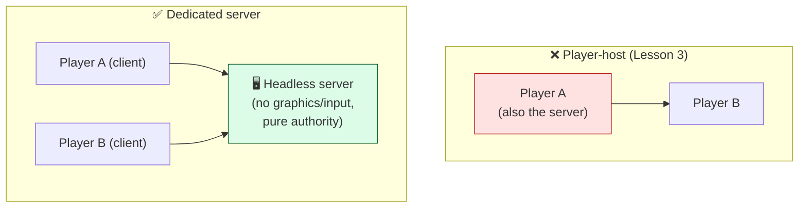
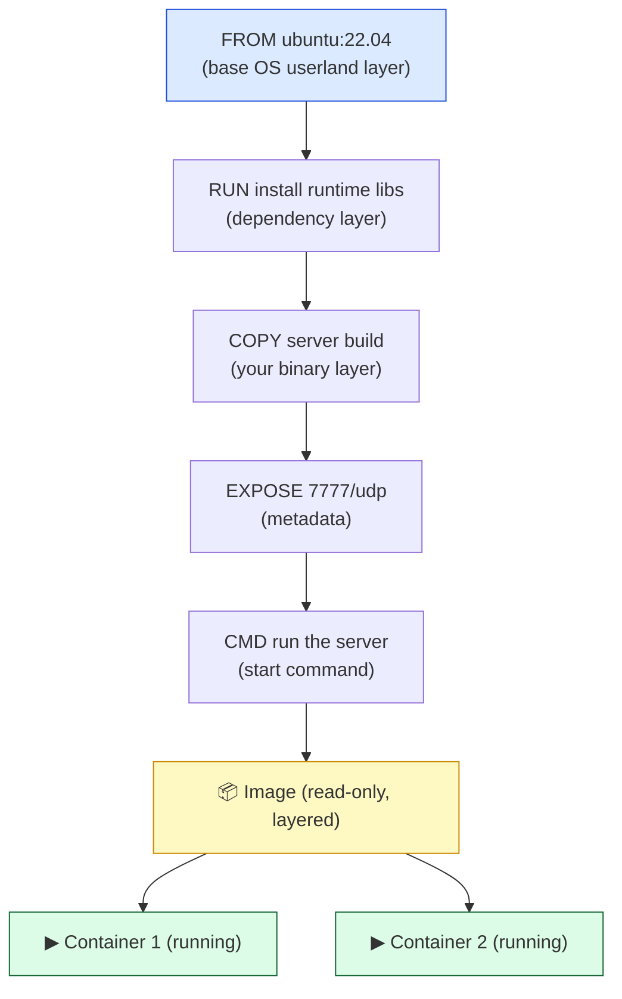

# Level 4 — Dedicated Server & Docker

| | |
|---|---|
| 🎚️ **Difficulty** | 🔴 Hard |
| ⏱️ **Estimated time** | 35 minutes |
| ⭐ **XP reward** | 100 (Quest) + 25 (Quiz) |

[← Prev](03-co-op-gameplay-and-rpcs.md) · [↑ Phase Home](../README.md) · [→ Next](../boss-battle.md)

---

## 📖 Story

> *"Co-op works — but right now one of the players is also the **host**. That means the authoritative server lives on a player's laptop: when they quit, the game dies; their machine has an unfair zero-latency advantage; and you can't run a match unless a human is sitting there. Real games run a **dedicated server** — a headless build with no graphics, no input, just the authoritative simulation — on hardware nobody is playing on. Today you'll make a **headless server build** of Ashfall, then meet the tool that ships servers everywhere: **Docker**. A container is your server *plus its entire environment* frozen into one portable image that runs identically on your laptop, a teammate's PC, and (in World 10) a cloud cluster. This is my home turf — DevOps. We'll write a real **Dockerfile** for the Ashfall dedicated server, build the image, run the container, and expose the port so a client can connect. When you finish, you'll have the exact artifact World 10 deploys to AWS. This is where gameplay meets infrastructure. Let me show you. — Priya"*

---

## 🎯 Goal

- Understand **headless / dedicated server builds** and *why* a dedicated server beats a player-host (authority, fairness, uptime, scale)
- Understand **containers from first principles**: image vs container, layers, and why they're reproducible
- Write a real **Dockerfile** for the Ashfall **dedicated server** build
- **Build** the image, **run** the container, and **expose the UDP port** so a client connects
- Produce the server image that **World 10** will push to a registry and deploy to the cloud

---

## 🧠 Concepts

### Headless / dedicated server builds

A normal game build renders graphics, plays audio, and reads input. A **headless build** strips all of that: no window, no rendering, no input — just the simulation loop and the network stack. Unity calls this the **Dedicated Server** build target (a real platform in **Build Settings**); it compiles out rendering so the binary is smaller, uses far less CPU/RAM, and runs on a machine with **no GPU and no display** (exactly what a server is).

The difference from Lesson 3's "host" matters:

- **Player-host:** one player's machine is *also* the authoritative server. It dies when they quit, gives that player a latency edge, and can't run unattended.
- **Dedicated server:** a separate headless process is the authority. Every player is just a client (fair, equal latency), the match survives any player leaving, and you can run many of them on server hardware. This is what "real multiplayer" runs on.



### Containers from first principles

You have a headless server binary. How do you run it *identically* on your laptop, a teammate's Linux box, and a cloud VM? The old answer — "install the right OS libraries, set the right env, hope versions match" — is the "**works on my machine**" curse. A **container** kills it.

A container packages your app **plus its entire environment** — the base OS userland, system libraries, runtime, your binary, config — into one **image**: a read-only, layered, portable blueprint. You then **run** that image to get a **container**: a live, isolated process. Key distinction:

- **Image** = the frozen blueprint (like a class). Built once, stored, shared.
- **Container** = a running instance of an image (like an object). Start many from one image.

Containers are *not* virtual machines: they don't ship a whole guest OS or boot a kernel — they share the host kernel and isolate at the process level, so they start in milliseconds and are far lighter than a VM. The image is built from a **Dockerfile** (a recipe), and each instruction adds a cached **layer**:



Each layer is cached: rebuild after changing only your binary, and Docker reuses the base + dependency layers and only rebuilds from the changed line down. Rule of thumb: **put what changes least near the top, what changes most near the bottom** (your game build changes constantly, so it's copied last).

### Why a dedicated server *plus* a container

A dedicated server gives you **authority, fairness, uptime, and scale**; a container gives you **reproducibility and portability**. Together they're the unit of modern game-server ops: a single immutable artifact that encodes "the Ashfall server and everything it needs to run," that you can spin up by the hundred, identically, anywhere — your laptop today, a Kubernetes cluster on AWS in World 10. Without the container, deploying to the cloud means hand-configuring every server (fragile, unrepeatable); with it, "deploy" is just "run this image." This is the bridge from *making a game* to *operating a service*.

### Why this exists

Containers exist because **the environment is part of the software** — a binary that needs library X version Y and env var Z isn't truly portable until that context travels with it. Before containers, that context lived in someone's head or a wiki, and "deploy" meant re-creating it by hand on each machine (slow, error-prone, irreproducible). A container makes the environment **code** (the Dockerfile, in your git repo) and the artifact **immutable** (the image), so the thing you tested is byte-for-byte the thing that runs in production. Dedicated servers exist because authority on a player's machine can't be trusted, can't stay up, and can't scale. Both are about turning fragile, manual, machine-specific setups into reproducible, automatable infrastructure.

This is **engine-agnostic** and **industry-standard**. Headless/dedicated server builds exist in Unity (Dedicated Server target), Unreal (`-server` builds), Godot (headless/server export), and any custom engine. Docker and the OCI image format are the universal way to ship *any* server — game or web — and World 10 will push this same image to a registry and run it on Kubernetes. The concepts (image/container, layers, port exposure) are identical everywhere. For free Docker references and the dedicated-server docs, see **RESOURCES.md** for this world.

---

## 🛠️ Hands-on Lab

> 💻 Requires **Docker Desktop** (free; install per RESOURCES.md) and your Lesson 2–3 networked Ashfall. We'll make a headless build, write a Dockerfile for it, and run it as a container.

### Step 1 — Make a headless dedicated server build

1. **Window → Package Manager:** ensure the **Dedicated Server** module is installed (Unity Hub → your editor → **Add Modules → Dedicated Server (Linux)** — we target Linux because that's what containers run).
2. **File → Build Settings → Platform: Dedicated Server**, **Target Platform: Linux**. Switch platform.
3. In code, start as a server when running headless (so the same project boots as a pure server, no UI):
   ```csharp
   using Unity.Netcode;
   using UnityEngine;

   // Boots Ashfall as a headless dedicated server: no graphics, no input — pure authority.
   public class ServerBootstrap : MonoBehaviour
   {
       void Start()
       {
   #if UNITY_SERVER
           Application.targetFrameRate = 30;            // servers don't need 60+; save CPU
           NetworkManager.Singleton.StartServer();      // authoritative server only (no local player)
           Debug.Log("Ashfall dedicated server started.");
   #endif
       }
   }
   ```
4. **Build** to a folder, e.g. `~/projects/ashfall/server-build/`. You'll get a Linux executable (e.g. `AshfallServer.x86_64`) plus its `_Data` folder — **no graphics, runs without a display.**

### Step 2 — Write the Dockerfile

In `~/projects/ashfall/`, create a file named exactly `Dockerfile`:

```dockerfile
# ---- Base: a minimal Linux userland for the headless server ----
FROM ubuntu:22.04

# ---- Install the few runtime libraries a Unity Linux server needs ----
# (Unity's Linux player links against these; without them the binary won't start.)
RUN apt-get update \
    && apt-get install -y --no-install-recommends ca-certificates libc6 \
    && rm -rf /var/lib/apt/lists/*

# ---- Set the working directory inside the image ----
WORKDIR /app

# ---- Copy the headless build output in (changes most → copied last for cache reuse) ----
COPY server-build/ ./

# ---- Make the server binary executable ----
RUN chmod +x ./AshfallServer.x86_64

# ---- Document the UDP port the game server listens on ----
EXPOSE 7777/udp

# ---- Default command: launch the dedicated server in batch/headless mode ----
CMD ["./AshfallServer.x86_64", "-batchmode", "-nographics", "-port", "7777"]
```

Why each line:
- **`FROM ubuntu:22.04`** — a trusted, minimal Linux base. The server runs on Linux even though you build the image on macOS/Windows (Docker handles it).
- **`RUN apt-get ... libc6`** — installs the runtime libs the Unity Linux player needs; `--no-install-recommends` and clearing `apt` lists keep the image small. This is the dependency layer — it changes rarely, so it's near the top.
- **`COPY server-build/ ./`** — brings in your headless build. It changes every build, so it's **last** before runtime config, maximizing layer-cache reuse on rebuilds.
- **`EXPOSE 7777/udp`** — documents the **UDP** port (Lesson 1: games use UDP). It's informational; the actual mapping happens at `docker run`.
- **`CMD [...]`** — exec form (a JSON array, handles signals correctly). `-batchmode -nographics` runs Unity with no window/rendering.

### Step 3 — Add a `.dockerignore`

So `COPY` doesn't drag in junk and bloat the image. Create `.dockerignore` next to the Dockerfile:

```dockerignore
.git
.gitignore
Library/
Temp/
Logs/
Assets/
ProjectSettings/
*.csproj
*.sln
Dockerfile
.dockerignore
```

> 💡 We only need the **`server-build/`** output inside the image — not the entire Unity project (`Library/`, `Assets/`, etc.), which would make the image huge and is irrelevant to running the compiled server.

### Step 4 — Build the image

```bash
cd ~/projects/ashfall
# Build an image named "ashfall-server" tagged "v1" from the Dockerfile here (".")
docker build -t ashfall-server:v1 .
```

Watch the layers build (and on a rebuild, watch most say `CACHED`). Confirm it exists:

```bash
docker images | grep ashfall-server
```

### Step 5 — Run the container and expose the port

```bash
# -p maps host UDP port 7777 → container UDP port 7777 (so clients can reach it)
# --rm removes the container when it stops; --name lets us refer to it
docker run --rm --name ashfall -p 7777:7777/udp ashfall-server:v1
```

You should see your `"Ashfall dedicated server started."` log. The server is now running **inside a container**, reachable on your machine's UDP port **7777**. Useful checks in another terminal:

```bash
docker ps                 # see the running container
docker logs ashfall       # view its output
docker stop ashfall       # stop it
```

### Step 6 — Connect a client to the containerized server

In the Unity client's **Unity Transport**, set the address to `127.0.0.1` and port `7777`, then **Start Client** (no more "Start Host" — the authority is the container now). Your client connects to the dedicated server running in Docker. Run a second client and you have **co-op against a containerized, headless, dedicated server** — exactly the World 8 boss-battle architecture, and the artifact World 10 deploys to the cloud.

---

## 🎮 Mini Challenge

A teammate writes a Dockerfile that does `COPY server-build/ ./` **before** the `RUN apt-get install ...` line, and uses `EXPOSE 7777` (no `/udp`). They also run it with `docker run ashfall-server:v1` (no `-p`). Three things are off — identify each and the fix.

<details>
<summary>💡 Reveal answer</summary>

**1 — Wrong layer order (`COPY` before `RUN apt-get`).** The dependency install changes rarely; the server build changes every time. Copying the build first means *every* rebuild invalidates the copy layer **and everything below it**, forcing `apt-get install` to re-run on every build. Fix: install dependencies first (top, rarely changes), copy the build last (bottom, changes constantly) — least-changing near the top.

**2 — `EXPOSE 7777` without `/udp`.** Games use UDP (Lesson 1). `EXPOSE` defaults to TCP, so this documents the wrong protocol. Fix: `EXPOSE 7777/udp` (and map `/udp` at run time).

**3 — `docker run` with no `-p`.** `EXPOSE` is only documentation; it does **not** actually publish the port. Without `-p 7777:7777/udp`, the container's port isn't reachable from the host, so no client can connect. Fix: `docker run -p 7777:7777/udp ashfall-server:v1`.
</details>

---

## 📦 Project Mission

Containerize the Ashfall dedicated server — the deployable artifact World 10 ships to the cloud.

1. Add `ServerBootstrap.cs` (Step 1) so the project boots as a headless server under `UNITY_SERVER`; make a **Dedicated Server / Linux** build into `~/projects/ashfall/server-build/`.
2. Write the **`Dockerfile`** (Step 2) for the server build — correct layer order, runtime libs, `EXPOSE 7777/udp`, headless `CMD` — and a **`.dockerignore`** (Step 3) that ships only the build.
3. **Build** the image (`docker build -t ashfall-server:v1 .`) and **run** it with the UDP port published (`docker run --rm -p 7777:7777/udp ashfall-server:v1`) (Steps 4–5).
4. **Connect a client** (and a second one) to `127.0.0.1:7777` and play co-op against the **containerized** server (Step 6).
5. Commit the Dockerfile + `.dockerignore` (they're part of the repo now; the build output stays git-ignored):
   ```bash
   cd ~/projects/ashfall
   git switch -c feature/dedicated-server-docker
   echo "server-build/" >> .gitignore
   git add Dockerfile .dockerignore .gitignore Assets/Scripts/Net/ServerBootstrap.cs
   git commit -m "feat: headless dedicated server + Dockerfile (containerized Ashfall server)"
   git switch main && git merge feature/dedicated-server-docker && git push
   ```

🎯 **Mission complete when:** a **headless Dedicated Server (Linux)** build of Ashfall runs inside a **Docker container** built from a committed `Dockerfile` (correct layer order, `EXPOSE 7777/udp`), the container is launched with the **UDP port published**, and **two clients connect to it and play co-op** — no player-host. You now hold the exact server image World 10 deploys to AWS.

---

## ⚠️ Common Mistakes

| Mistake | What happens | Fix |
|--------|--------------|-----|
| Shipping a normal (graphical) build as the server | Needs a GPU/display; wasteful or won't start headless | Use the **Dedicated Server (Linux)** target + `-batchmode -nographics` |
| `COPY` the build before installing deps | Every rebuild re-runs `apt-get`; slow builds | Install deps first (top), copy the build last (bottom) |
| `EXPOSE 7777` without `/udp` | Documents TCP; games use UDP | `EXPOSE 7777/udp` |
| Forgetting `-p` on `docker run` | Port isn't published; clients can't connect | `docker run -p 7777:7777/udp ...` |
| No `.dockerignore` (or copying the whole project) | Huge image; `Library/`/`Assets/` leak in | `.dockerignore` everything but `server-build/` |
| Keeping a player as the host in "production" | Server dies when they quit; latency advantage | Run the **dedicated** server as the authority; all players are clients |
| Treating a container like a VM | Confusion about weight/boot/kernel | Container = isolated process sharing host kernel, not a full guest OS |

---

## 🤔 Reflection Questions

1. A player-host *also* works for co-op — so why does every shipped multiplayer game run a separate dedicated server? Give the four concrete advantages (authority, fairness, uptime, scale) in Ashfall's terms.
2. "Image vs container" is like "class vs object." Explain the analogy precisely, and why immutability of the image matters for getting the *same* server in dev and production.
3. The Dockerfile copies the server build **last**, after installing dependencies. Tie this to layer caching: what re-runs (and what doesn't) when you rebuild after only changing your game code?

---

## 📝 Quiz

1. **A headless / dedicated server build differs from a normal build because it…**
   - a) renders at a higher frame rate
   - b) strips graphics/audio/input and runs the authoritative simulation with no display
   - c) only runs on the player's own machine
2. **A Docker *image* vs a Docker *container* is best described as…**
   - a) the same thing with different names
   - b) the image is the read-only blueprint; the container is a running instance of it
   - c) the container is the file you build; the image is what runs
3. **`EXPOSE 7777/udp` plus `docker run -p 7777:7777/udp` together…**
   - a) encrypt the game traffic
   - b) document the UDP port and actually publish it so a client can connect
   - c) make the server use TCP instead of UDP

<details>
<summary>✅ Answers</summary>

1: **b** · 2: **b** · 3: **b**
</details>

---

## ✅ Completion Checklist

- [ ] I made a **headless Dedicated Server (Linux)** build that boots via `ServerBootstrap`
- [ ] I wrote a valid `Dockerfile` (correct layer order, runtime libs, `EXPOSE 7777/udp`, headless `CMD`)
- [ ] I added a `.dockerignore` that ships only `server-build/`
- [ ] I built the image and ran the container with `-p 7777:7777/udp`
- [ ] **Two clients connected to the containerized server** and played co-op (no player-host)
- [ ] I committed the `Dockerfile` + `.dockerignore` (build output git-ignored)
- [ ] I passed the quiz
- [ ] Added **+125 XP** to [PROGRESS.md](../../../PROGRESS.md)

---

[← Prev](03-co-op-gameplay-and-rpcs.md) · [↑ Phase Home](../README.md) · [→ Next](../boss-battle.md)
