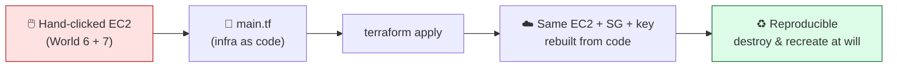
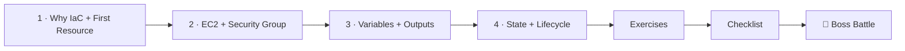

# 🏗️ World 8 — Terraform

> *"Clicking in the AWS console doesn't scale and isn't reproducible. If that EC2 box dies, can you rebuild it exactly? Right now the answer is 'uhh, let me remember which buttons I clicked.' We need Infrastructure as Code. — Priya, DevOps Lead"*



---

## 📨 Your ticket

```
From:    Priya (DevOps Lead) <priya@cloudforge.inc>
To:      You <you@cloudforge.inc>
Subject: [TICKET-008] TaskFlow infra needs to be code, not clicks

Hey — solid work getting TaskFlow onto EC2 (World 6) and auto-deploying
it (World 7). But here's my problem: that server only exists because
*you clicked the right buttons one afternoon*. Nobody can reproduce it.
If it gets terminated, we're reconstructing it from memory and screenshots.

That's not engineering. That's archaeology.

I want our infrastructure defined the same way we treat application code:
in a file, in version control, reviewable, repeatable. The tool is
Terraform. Here's the job:

  1. Install Terraform and write your first resource from code.
  2. Define TaskFlow's EC2 instance + security group + key pair in HCL.
  3. Parametrize it with variables; output the public IP.
  4. Understand state — it's the thing that makes Terraform safe (and
     dangerous if you ignore it).

Then prove it: tear the whole environment down and rebuild it from the
.tf files alone. If you can do that, our infra is truly reproducible.

⚠️ Same free-tier rules as World 6: t2.micro / t3.micro ONLY, and run
   `terraform destroy` when you're done so we don't pay for idle servers.
   Terraform itself is free and open-source — the cost risk is the AWS
   resources it creates.

— Priya
```

This world is the moment your infrastructure stops being a thing you *remember* and becomes a thing you *declare*. The same EC2 box from World 6 — but now born from a file you can read, review, and rerun.

---

## 🎯 What you'll achieve in this world

- ✅ Understand **declarative Infrastructure as Code** and why clicking doesn't scale
- ✅ Install **Terraform** and write your first resource (`init` → `plan` → `apply` → `destroy`)
- ✅ Define TaskFlow's **EC2 instance + security group + key pair** in HCL, with an **AMI data source**
- ✅ Parametrize with **variables** and surface results with **outputs** (the public IP)
- ✅ Understand **state** (`terraform.tfstate`), drift, and why you never hand-edit it
- ✅ **Rebuild TaskFlow's entire environment from nothing** — destroy and recreate from code

By the end, you can hand Priya a folder of `.tf` files and say: *"That IS our infrastructure. Run `terraform apply` and it exists."*

---

## 🗺️ Level map

| Level | Lesson | Difficulty | Time | XP |
|------:|--------|:----------:|:----:|---:|
| 1 | [Why IaC + Your First Resource](lessons/01-why-iac-first-resource.md) | 🟢 Easy | 20 min | 125 |
| 2 | [Defining EC2 + Security Group in Code](lessons/02-ec2-and-security-group-in-code.md) | 🟡 Medium | 25 min | 125 |
| 3 | [Variables & Outputs](lessons/03-variables-and-outputs.md) | 🟡 Medium | 20 min | 125 |
| 4 | [State & the Lifecycle](lessons/04-state-and-lifecycle.md) | 🟡 Medium | 20 min | 125 |
| 👹 | [Boss Battle — Rebuild From Nothing](boss-battle.md) | 🟡 Medium | 45 min | 500 |

➕ Extra reps: [exercises.md](exercises.md) · ✅ Ready to advance? [checklist.md](checklist.md)

---

## 🧭 Recommended order



**Do Level 1 first.** It installs Terraform and teaches the four commands (`init`/`plan`/`apply`/`destroy`) you'll repeat in every lesson. Everything after assumes that muscle memory.

---

## 💸 Cost safety in this world

> **Terraform is free.** The danger is the AWS resources your `.tf` files create — they're the same real, billable EC2 instances from World 6.
>
> Three habits keep you at $0.00:
> 1. **Only `t2.micro` / `t3.micro`** in `instance_type` — free-tier eligible.
> 2. **`terraform destroy`** the moment you finish a lab. Terraform makes cleanup a single command — *use it*.
> 3. **Keep your World 6 billing alarm on.** IaC doesn't change the bill; it just changes how you create the things that produce it.
>
> Every lesson ends with a `terraform destroy` reminder. We are not kidding about this.

---

## 📦 Project status after this world

**Coming in:** TaskFlow runs on a **hand-clicked EC2 instance** (World 6) with an **auto-deploy pipeline** (World 7). The server exists, but only because you clicked it into being.

**Going out:** That same EC2 instance, security group, and key pair are **defined in Terraform** (`main.tf`, `variables.tf`, `outputs.tf`). The whole environment is **reproducible from code** — `terraform apply` builds it, `terraform destroy` removes it, and the public IP comes out as an output. World 9 will take this infrastructure mindset to Kubernetes.

---

[↑ Back to README](../../README.md)  ·  [🗺️ Roadmap](../../ROADMAP.md)  ·  [▶️ Start Level 1 →](lessons/01-why-iac-first-resource.md)
