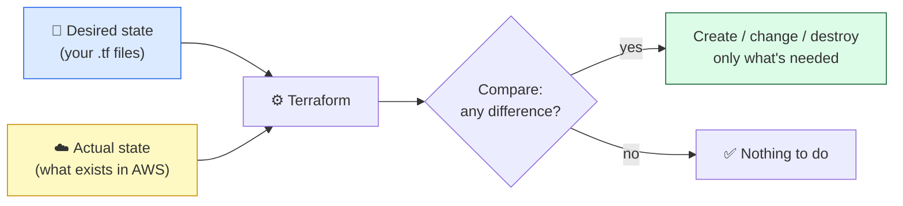

# Level 1 — Why IaC + Your First Resource

| | |
|---|---|
| 🎚️ **Difficulty** | 🟢 Easy |
| ⏱️ **Estimated time** | 20 minutes |
| ⭐ **XP reward** | 100 (Quest) + 25 (Quiz) |

[← World Home](../README.md) · [↑ Phase Home](../README.md) · [→ Next: EC2 + Security Group in Code](02-ec2-and-security-group-in-code.md)

---

## 📖 Story

Priya leans over your desk holding a sticky note covered in scribbles.

> *"This is how we 'document' the TaskFlow server. Region. Instance type. Which ports I opened. The AMI ID I picked. If that box dies tonight, you're rebuilding it from this sticky note and your memory of which buttons you clicked three weeks ago."*

She crumples it and drops it in the bin.

> *"From now on, the server is a file. You read the file, you know exactly what exists. You run one command, it exists. That's Infrastructure as Code. Let's get you your first resource."*

---

## 🎯 Goal

By the end of this lesson you will:
- Explain **why hand-clicking infrastructure doesn't scale or reproduce**
- Understand **declarative** IaC — you describe the *desired state*, Terraform makes it real
- **Install Terraform** and confirm it runs
- Write a minimal **provider block** + your **first resource**, then run the full loop: `init` → `plan` → `apply` → `destroy`

---

## 🧠 Concepts

### The problem with clicking

In World 6 you built TaskFlow's server by clicking through the AWS console. It worked — once. But clicking has three fatal flaws:

- **Not reproducible.** Could you recreate that *exact* box — same ports, same AMI, same type — in another region without missing a step?
- **Not reviewable.** A teammate can't review "I clicked some buttons." They *can* review a file in a pull request.
- **Not scalable.** Ten servers = ten rounds of clicking, with ten chances to fumble a setting.

**Infrastructure as Code (IaC)** fixes all three: your infrastructure lives in text files you commit to Git, just like application code.

### Declarative: describe the destination, not the directions

Terraform is **declarative**. You don't write step-by-step instructions ("click here, then there"). You write the **desired end state** — "I want one t2.micro instance with these ports open" — and Terraform figures out how to get there. Every run, it compares your desired state to what *actually* exists and makes only the changes needed to close the gap.



This is the opposite of a bash script (**imperative** — "do this, then this"). With Terraform you state the *what*; it owns the *how*.

### The two building blocks

Every Terraform config starts with two ideas:

- **Provider** — *who* Terraform talks to. For us that's `aws`. The provider is the plugin that knows how to create AWS resources.
- **Resource** — *what* you want to exist. An S3 bucket, an EC2 instance, a security group. Each resource has a type (`aws_s3_bucket`) and a name you choose (`notes`).

### Why this exists

A cloud team might run hundreds of servers across multiple regions. Nobody remembers every click. When infrastructure is code, you get **version history** (who changed the firewall, and when?), **code review** (catch the mistake before it ships), and **disaster recovery** (the data center burned down? `terraform apply` rebuilds it elsewhere). The sticky note becomes a file the whole team can trust.

---

## 🛠️ Hands-on Lab

> 🐧 Run everything inside **Ubuntu (WSL2)**, the environment from World 0. You'll need the AWS credentials you configured in World 6 (Terraform reads the same `~/.aws/credentials`).

### Step 1 — Install Terraform

```bash
# Add HashiCorp's official apt repository, then install
wget -O- https://apt.releases.hashicorp.com/gpg | \
  sudo gpg --dearmor -o /usr/share/keyrings/hashicorp-archive-keyring.gpg

echo "deb [signed-by=/usr/share/keyrings/hashicorp-archive-keyring.gpg] \
https://apt.releases.hashicorp.com $(lsb_release -cs) main" | \
  sudo tee /etc/apt/sources.list.d/hashicorp.list

sudo apt update && sudo apt install -y terraform

# Confirm it installed
terraform version
```

You should see something like `Terraform v1.x.x`. Terraform is a single binary — no runtime, no dependencies.

### Step 2 — Make a project folder

```bash
mkdir -p ~/projects/taskflow-infra
cd ~/projects/taskflow-infra
```

> 🗂️ Terraform reads **every `.tf` file** in the current folder and treats them as one config. The file *names* don't matter to Terraform — but they matter to humans, so we use conventional names like `main.tf`.

### Step 3 — Write the provider + your first resource

Create `main.tf`. We'll start with a tiny, safe, **free** resource — an S3 bucket — just to learn the loop before touching EC2 in Level 2.

```hcl
# main.tf

# The provider block: tell Terraform we're using AWS, and where.
provider "aws" {
  region = "us-east-1"
}

# Your first resource: an S3 bucket.
# Syntax:  resource "<TYPE>" "<LOCAL_NAME>" { ... }
resource "aws_s3_bucket" "notes" {
  # Bucket names must be globally unique across ALL of AWS,
  # so append something random. Change this to your own suffix.
  bucket = "taskflow-iac-notes-7f3a9c"

  tags = {
    Project   = "TaskFlow"
    ManagedBy = "Terraform"
  }
}
```

> 💡 `aws_s3_bucket` is the **type** (defined by the AWS provider). `notes` is the **local name** *you* pick — it's how you'll refer to this bucket elsewhere in your code (`aws_s3_bucket.notes`). It is **not** the bucket's real name; the `bucket` argument is.

### Step 4 — Run the loop

```bash
# 1. init: download the AWS provider plugin into this folder (run once per project)
terraform init

# 2. plan: preview what Terraform WILL do — creates nothing yet
terraform plan

# 3. apply: actually create the bucket (type 'yes' when prompted)
terraform apply

# 4. destroy: tear it down so you owe nothing (type 'yes' when prompted)
terraform destroy
```

Read each output:
- `init` prints *"Terraform has been initialized!"* and creates a hidden `.terraform/` folder.
- `plan` shows a `+` next to the bucket — a green plan of resources to **add**. `Plan: 1 to add, 0 to change, 0 to destroy.`
- `apply` does the work and prints `Apply complete! Resources: 1 added.`
- `destroy` removes it: `Destroy complete! Resources: 1 destroyed.`

You just created and deleted real cloud infrastructure **without touching the console**.

---

## 🎮 Mini Challenge

Without re-running anything, predict: after a successful `apply`, if you run `terraform plan` **again immediately** (before destroying), what does the plan say?

<details>
<summary>💡 Reveal answer</summary>

It says **`No changes. Your infrastructure matches the configuration.`** (`Plan: 0 to add, 0 to change, 0 to destroy.`)

This is the heart of declarative IaC: Terraform compared your desired state (the file) to the actual state (the bucket already exists) and found **no difference**, so there's nothing to do. Running `apply` ten times in a row creates the bucket *once* — this property is called **idempotence**.
</details>

---

## 📦 Project Mission

Start TaskFlow's infrastructure repo. You'll grow this same folder across the whole world.

```bash
cd ~/projects/taskflow-infra

# Initialize it as its own git repo (infra lives in version control!)
git init

# Tell git to NEVER commit Terraform's downloaded plugins or state
cat > .gitignore <<'EOF'
# Terraform
.terraform/
*.tfstate
*.tfstate.*
EOF
```

Keep the `main.tf` from the lab (the S3 bucket) for now — Level 2 will add the real EC2 resources alongside it. Confirm your loop works end-to-end:

```bash
terraform init
terraform apply    # type yes
terraform destroy  # type yes — leave nothing running
```

🎯 **Mission complete when:** `~/projects/taskflow-infra` is a git repo with a `.gitignore` and a working `main.tf`, and you've run `apply` then `destroy` successfully (final state: nothing in AWS, $0.00).

---

## ⚠️ Common Mistakes

| Mistake | What happens | Fix |
|--------|--------------|-----|
| Skipping `terraform init` | `plan`/`apply` error: "provider not installed" | Run `terraform init` once per project (and after adding new providers) |
| Reusing an existing S3 bucket name | `apply` fails: "BucketAlreadyExists" | Bucket names are globally unique — change the random suffix |
| No AWS credentials configured | `apply` fails: "No valid credential sources" | Reuse World 6 setup: `aws configure` (Terraform reads `~/.aws/credentials`) |
| Committing `.tfstate` or `.terraform/` to git | Secrets leak; huge binary plugins in repo | Add them to `.gitignore` (done in the Mission) |
| Forgetting `terraform destroy` | Idle resources may accrue charges | Destroy after every lab; verify in the console |

---

## 🤔 Reflection Questions

1. In your own words, what does **declarative** mean, and how is it different from a bash script that runs `aws ec2 run-instances`?
2. Why does running `terraform apply` twice in a row create only **one** bucket?
3. Priya wants to review your infrastructure change before it ships. Why is IaC easier to review than "I clicked some buttons"?

---

## 📝 Quiz

1. **A Terraform configuration is "declarative" because…**
   - a) you write step-by-step commands to run in order
   - b) you describe the desired end state and Terraform figures out how to reach it
   - c) it only works on declared holidays
2. **What does `terraform init` do?**
   - a) Creates all your resources immediately
   - b) Downloads the provider plugin(s) the config needs into the project
   - c) Deletes your state file
3. **You run `terraform apply` three times without changing `main.tf`. How many buckets exist?**
   - a) Three
   - b) One (Terraform is idempotent)
   - c) Zero

<details>
<summary>✅ Answers</summary>

1: **b** · 2: **b** · 3: **b**
</details>

---

## ✅ Completion Checklist

- [ ] I can explain why hand-clicking infrastructure doesn't scale or reproduce
- [ ] Terraform is installed (`terraform version` prints a version)
- [ ] I wrote a `provider` block and a first `resource`
- [ ] I ran `init` → `plan` → `apply` → `destroy` and read each output
- [ ] I completed the Mini Challenge and can explain idempotence
- [ ] `~/projects/taskflow-infra` is a git repo with a `.gitignore` (Project Mission)
- [ ] I ran `terraform destroy` — nothing is left running ($0.00)
- [ ] I passed the quiz
- [ ] I added **+125 XP** to [PROGRESS.md](../../../PROGRESS.md)

---

[← World Home](../README.md) · [↑ Phase Home](../README.md) · [→ Next: EC2 + Security Group in Code](02-ec2-and-security-group-in-code.md)
