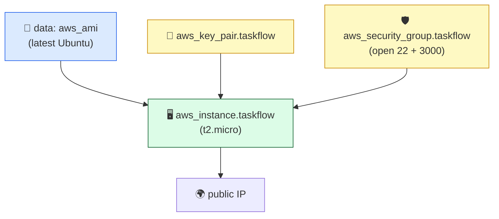

# Level 2 — Defining EC2 + Security Group in Code

| | |
|---|---|
| 🎚️ **Difficulty** | 🟡 Medium |
| ⏱️ **Estimated time** | 25 minutes |
| ⭐ **XP reward** | 100 (Quest) + 25 (Quiz) |

[← Prev: Why IaC + First Resource](01-why-iac-first-resource.md) · [↑ Phase Home](../README.md) · [→ Next: Variables & Outputs](03-variables-and-outputs.md)

---

## 📖 Story

Priya pulls up the World 6 server in the console.

> *"Okay, you've got the loop down with a toy bucket. Now the real thing. This —"* she points at the running TaskFlow EC2 instance *"— is what I need in code. The instance, the security group that opens SSH and the app port, and the key pair you SSH in with. All of it, in HCL, so that if I `terraform destroy` it and `terraform apply` again, I get the **exact same box** back."*

> *"And don't hardcode the AMI ID off a sticky note. Look it up from code. AMIs change; your config shouldn't break when they do."*

---

## 🎯 Goal

By the end of this lesson you will:
- Define an **`aws_instance`** (t2.micro / t3.micro — free tier only)
- Define an **`aws_security_group`** opening SSH (22) and the TaskFlow app port (3000)
- Register your **key pair** (`aws_key_pair`) so you can SSH in
- Use an **AMI data source** instead of hardcoding an image ID
- Understand how Terraform builds a **resource graph** and creates things in the right order

---

## 🧠 Concepts

### Resources reference each other

In Level 1 your bucket stood alone. Real infrastructure is **connected**: the instance needs a security group; the security group needs to exist first; the instance needs a key pair to allow SSH. In Terraform you express these links by **referencing one resource's attributes from another**:

```hcl
vpc_security_group_ids = [aws_security_group.taskflow.id]
```

That `aws_security_group.taskflow.id` is a reference. Terraform reads it and *knows* the security group must be created **before** the instance. You never specify the order — Terraform derives it.

### The resource graph

Terraform builds a **dependency graph** from those references and walks it, creating independent resources in parallel and dependent ones in sequence.



### Data sources: look it up, don't hardcode

A **resource** is something Terraform *creates*. A **data source** is something Terraform *reads* — information that already exists in AWS. The AMI (the OS image for your instance) is a perfect case: instead of pasting an ID like `ami-0abc123...` that goes stale, you ask AWS "give me the latest Ubuntu image" at apply time:

```hcl
data "aws_ami" "ubuntu" { ... }
# then reference it:  ami = data.aws_ami.ubuntu.id
```

### Security groups = cloud firewalls (from World 6, now in code)

You met security groups in World 6 by clicking. They're stateful firewalls around your instance. In code, `ingress` rules say what can come **in** (SSH on 22, app on 3000), `egress` says what can go **out** (usually everything, so the box can download packages).

### Why this exists

The whole point of World 8 is that this lesson's file *is* TaskFlow's server. Click-built infrastructure lives only in AWS's memory and your own. Code-built infrastructure lives in a file you can read, diff, review, and rerun. When the AMI lookup is a data source, your config keeps working even as Ubuntu ships new images — no sticky-note maintenance.

---

## 🛠️ Hands-on Lab

> 🔑 **Before you start:** you need an SSH key on your machine. If you already made `~/.ssh/id_ed25519.pub` in earlier worlds, reuse it. Otherwise: `ssh-keygen -t ed25519 -C "taskflow"` (press Enter through the prompts).

### Step 1 — Replace `main.tf` with the real infrastructure

Open `~/projects/taskflow-infra/main.tf` and replace its contents (you can drop the practice S3 bucket now):

```hcl
# main.tf

provider "aws" {
  region = "us-east-1"
}

# --- AMI data source: latest Ubuntu 22.04 image, looked up at apply time ---
data "aws_ami" "ubuntu" {
  most_recent = true
  owners      = ["099720109477"] # Canonical's official AWS account ID

  filter {
    name   = "name"
    values = ["ubuntu/images/hvm-ssd/ubuntu-jammy-22.04-amd64-server-*"]
  }

  filter {
    name   = "virtualization-type"
    values = ["hvm"]
  }
}

# --- Key pair: register your local public key so you can SSH in ---
resource "aws_key_pair" "taskflow" {
  key_name   = "taskflow-key"
  public_key = file("~/.ssh/id_ed25519.pub")
}

# --- Security group: TaskFlow's cloud firewall ---
resource "aws_security_group" "taskflow" {
  name        = "taskflow-sg"
  description = "Allow SSH and the TaskFlow app port"

  ingress {
    description = "SSH"
    from_port   = 22
    to_port     = 22
    protocol    = "tcp"
    cidr_blocks = ["0.0.0.0/0"] # ⚠️ open to the world; fine for learning, lock down in prod
  }

  ingress {
    description = "TaskFlow app"
    from_port   = 3000
    to_port     = 3000
    protocol    = "tcp"
    cidr_blocks = ["0.0.0.0/0"]
  }

  egress {
    description = "All outbound"
    from_port   = 0
    to_port     = 0
    protocol    = "-1" # -1 means all protocols
    cidr_blocks = ["0.0.0.0/0"]
  }

  tags = {
    Project   = "TaskFlow"
    ManagedBy = "Terraform"
  }
}

# --- The EC2 instance itself ---
resource "aws_instance" "taskflow" {
  ami                    = data.aws_ami.ubuntu.id
  instance_type          = "t2.micro" # FREE TIER — do not change to anything bigger
  key_name               = aws_key_pair.taskflow.key_name
  vpc_security_group_ids = [aws_security_group.taskflow.id]

  tags = {
    Name      = "taskflow-server"
    Project   = "TaskFlow"
    ManagedBy = "Terraform"
  }
}
```

> 💡 Notice you wrote **zero order instructions**. The instance references the SG, the key pair, and the AMI data source — Terraform reads those references and builds the dependency graph for you.

### Step 2 — Plan it

```bash
cd ~/projects/taskflow-infra
terraform init    # re-run: the AWS provider may need a refresh
terraform plan
```

Read the plan carefully. You should see `Plan: 3 to add` (key pair, security group, instance). The `data.aws_ami.ubuntu` is **read**, not added — data sources don't count as resources to create.

### Step 3 — Apply it

```bash
terraform apply   # review the plan, then type 'yes'
```

After a minute or two: `Apply complete! Resources: 3 added.` You now have the *exact same kind of server from World 6* — built entirely from this file.

### Step 4 — Confirm it's real

```bash
# Ask Terraform what it built
terraform show | grep -A1 "public_ip"
```

Note the public IP. (In Level 3 you'll make this a clean output instead of grepping.) You could SSH in just like World 6 — but for now, the point is proven: **the file built the box**.

### Step 5 — Tear it down (mandatory)

```bash
terraform destroy   # type 'yes'
```

`Destroy complete! Resources: 3 destroyed.` Back to $0.00. You'll rebuild from this same file whenever you like — that's the magic.

---

## 🎮 Mini Challenge

You add a second instance that **also** uses `aws_security_group.taskflow`. Without changing anything else, will Terraform create two security groups, and in what order will it create the instances and the SG?

<details>
<summary>💡 Reveal answer</summary>

**One** security group — both instances reference the *same* `aws_security_group.taskflow`, which is a single resource. Terraform creates the **security group first** (both instances depend on it), then creates the two **instances in parallel** (they don't depend on each other). This ordering comes straight from the dependency graph — you never specify it. That's the resource graph doing its job.
</details>

---

## 📦 Project Mission

Make TaskFlow's server fully code-defined. Using the lab above, your `~/projects/taskflow-infra/main.tf` should define:

- `data "aws_ami" "ubuntu"` — looked-up image, no hardcoded ID
- `aws_key_pair.taskflow` — your real public key
- `aws_security_group.taskflow` — SSH (22) **and** app (3000) open, plus egress
- `aws_instance.taskflow` — **t2.micro**, wired to the SG, AMI, and key

Then prove the round-trip:

```bash
cd ~/projects/taskflow-infra
terraform apply    # 3 resources created — this IS your server
terraform show | grep public_ip
terraform destroy  # tear it down to stay free
```

Commit the config (state is git-ignored from Level 1):

```bash
git add main.tf .gitignore
git commit -m "Define TaskFlow EC2 + security group + key pair in Terraform"
```

🎯 **Mission complete when:** `terraform apply` builds the instance + SG + key pair from `main.tf` (3 resources added), `terraform show` reveals a public IP, and `terraform destroy` cleanly removes everything ($0.00). The server now lives in a committed file.

---

## ⚠️ Common Mistakes

| Mistake | What happens | Fix |
|--------|--------------|-----|
| Hardcoding an AMI ID | Breaks when the image is deprecated; wrong region | Use the `aws_ami` data source to look it up |
| `instance_type` bigger than `t2.micro`/`t3.micro` | Leaves the free tier — real charges | Keep it `t2.micro` or `t3.micro` |
| Wrong path / missing public key file | `apply` errors on `file("~/.ssh/...")` | Generate a key (`ssh-keygen`) and point at the `.pub` file |
| Forgetting the SSH (22) ingress rule | You can't connect to the box | Add an ingress rule for port 22 |
| Forgetting egress | Instance can't reach the internet to install packages | Keep the all-protocols (`-1`) egress rule |
| Skipping `terraform destroy` | Idle EC2 instance accrues charges | Always destroy after the lab; verify in the console |

---

## 🤔 Reflection Questions

1. You never told Terraform "make the security group before the instance." How does it know the order?
2. What's the difference between a **resource** (`aws_instance`) and a **data source** (`aws_ami`)?
3. Why is looking up the AMI better than pasting the ID Priya had on her sticky note?

---

## 📝 Quiz

1. **In `vpc_security_group_ids = [aws_security_group.taskflow.id]`, the reference tells Terraform…**
   - a) nothing special; it's just a string
   - b) that the instance depends on the security group, so create the SG first
   - c) to create two security groups
2. **A `data` source (like `aws_ami`)…**
   - a) creates a new resource in AWS
   - b) reads existing information from AWS without creating anything
   - c) destroys resources
3. **Which `instance_type` keeps you on the free tier?**
   - a) `t2.micro`
   - b) `m5.large`
   - c) `c6g.4xlarge`

<details>
<summary>✅ Answers</summary>

1: **b** · 2: **b** · 3: **a**
</details>

---

## ✅ Completion Checklist

- [ ] My `main.tf` defines `aws_instance`, `aws_security_group`, `aws_key_pair`, and an `aws_ami` data source
- [ ] `instance_type` is `t2.micro` (or `t3.micro`) — free tier
- [ ] Security group opens **22** and **3000** ingress, plus egress
- [ ] `terraform apply` created 3 resources; `terraform show` revealed a public IP
- [ ] I completed the Mini Challenge and can explain the resource graph
- [ ] I committed `main.tf` (Project Mission)
- [ ] I ran `terraform destroy` — nothing is left running ($0.00)
- [ ] I passed the quiz
- [ ] I added **+125 XP** to [PROGRESS.md](../../../PROGRESS.md)

---

[← Prev: Why IaC + First Resource](01-why-iac-first-resource.md) · [↑ Phase Home](../README.md) · [→ Next: Variables & Outputs](03-variables-and-outputs.md)
