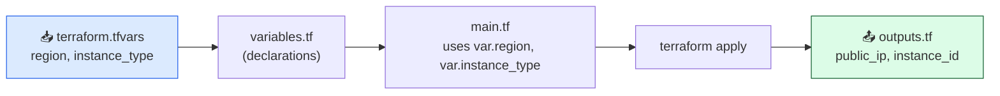

# Level 3 — Variables & Outputs

| | |
|---|---|
| 🎚️ **Difficulty** | 🟡 Medium |
| ⏱️ **Estimated time** | 20 minutes |
| ⭐ **XP reward** | 100 (Quest) + 25 (Quiz) |

[← Prev: EC2 + Security Group in Code](02-ec2-and-security-group-in-code.md) · [↑ Phase Home](../README.md) · [→ Next: State & the Lifecycle](04-state-and-lifecycle.md)

---

## 📖 Story

Priya reviews your `main.tf` and frowns at one line.

> *"`region = "us-east-1"`, hardcoded. And `instance_type = "t2.micro"`, hardcoded. What happens when we want a staging copy in `eu-west-1`? You'd edit the file every time and risk committing the wrong region. Pull those out into **variables**."*

> *"And every time you build the box I watch you `grep` for the public IP. That's an **output** — Terraform should just hand it to you. Clean inputs, clean results. Let's parametrize."*

---

## 🎯 Goal

By the end of this lesson you will:
- Declare input **variables** (`variables.tf`) for region and instance type
- Supply values with a **`terraform.tfvars`** file
- Expose results with **outputs** (`outputs.tf`) — the public IP and instance ID
- Explain **why parametrizing** beats hardcoding

---

## 🧠 Concepts

### Variables = the knobs on your config

A **variable** is a named input you can set without editing the resource code. You *declare* it once (with a type and optional default), then *use* it as `var.<name>`. Now `region` and `instance_type` are knobs you turn from outside.

### Outputs = the results your config hands back

An **output** is a value Terraform prints after `apply` and stores for you to query. Instead of digging through `terraform show`, you declare `output "public_ip"` and get it cleanly — and other tools (or humans) can read it.



### Three files, one config

Terraform merges every `.tf` file in the folder, so we **split by purpose** for readability:
- `variables.tf` — *what* inputs exist (declarations)
- `terraform.tfvars` — *what values* to use (Terraform loads this automatically)
- `outputs.tf` — *what results* to surface

### Why this exists

Hardcoded values are a copy-paste trap: to make a staging environment you'd clone the file and hand-edit every value, inviting mistakes. Variables let **one config** produce many environments — change `region` in `terraform.tfvars` and re-apply. Outputs turn Terraform into a clean interface: the public IP isn't buried in state, it's a labeled result your pipeline (World 7!) can consume.

---

## 🛠️ Hands-on Lab

> 🗂️ You'll add two new files alongside `main.tf` in `~/projects/taskflow-infra`, then edit `main.tf` to use the variables.

### Step 1 — Declare variables in `variables.tf`

```hcl
# variables.tf

variable "region" {
  description = "AWS region to deploy TaskFlow into"
  type        = string
  default     = "us-east-1"
}

variable "instance_type" {
  description = "EC2 instance size (free tier only!)"
  type        = string
  default     = "t2.micro"

  # Guardrail: refuse anything that isn't free-tier eligible
  validation {
    condition     = contains(["t2.micro", "t3.micro"], var.instance_type)
    error_message = "Free tier only: instance_type must be t2.micro or t3.micro."
  }
}
```

> 🛡️ That `validation` block is a safety net: if anyone sets `instance_type = "m5.large"`, `terraform plan` **fails immediately** with your error message — before any money is spent.

### Step 2 — Use the variables in `main.tf`

Edit `main.tf`: replace the hardcoded values with `var.` references.

```hcl
provider "aws" {
  region = var.region        # was "us-east-1"
}

resource "aws_instance" "taskflow" {
  ami                    = data.aws_ami.ubuntu.id
  instance_type          = var.instance_type   # was "t2.micro"
  key_name               = aws_key_pair.taskflow.key_name
  vpc_security_group_ids = [aws_security_group.taskflow.id]

  tags = {
    Name      = "taskflow-server"
    Project   = "TaskFlow"
    ManagedBy = "Terraform"
  }
}
```

(Leave the AMI data source, key pair, and security group as they were.)

### Step 3 — Set values in `terraform.tfvars`

```hcl
# terraform.tfvars  (Terraform auto-loads this file)

region        = "us-east-1"
instance_type = "t2.micro"
```

> 💡 You declared **defaults** in `variables.tf`, so this file is optional here — but it's the conventional place to set per-environment values, and it makes intent explicit. A `staging.tfvars` with a different region could be applied via `terraform apply -var-file=staging.tfvars`.

### Step 4 — Surface results in `outputs.tf`

```hcl
# outputs.tf

output "public_ip" {
  description = "Public IP of the TaskFlow server"
  value       = aws_instance.taskflow.public_ip
}

output "instance_id" {
  description = "EC2 instance ID"
  value       = aws_instance.taskflow.id
}

output "app_url" {
  description = "Where TaskFlow will be reachable"
  value       = "http://${aws_instance.taskflow.public_ip}:3000"
}
```

### Step 5 — Apply and read the outputs

```bash
cd ~/projects/taskflow-infra
terraform plan     # confirm: still 3 to add, now using variables
terraform apply    # type 'yes'
```

After apply, Terraform prints your outputs:

```
Outputs:

app_url     = "http://54.x.x.x:3000"
instance_id = "i-0abc123def456"
public_ip   = "54.x.x.x"
```

Query a single output any time without re-applying:

```bash
terraform output public_ip
terraform output -raw app_url   # -raw drops the quotes, handy for scripts
```

### Step 6 — Destroy (mandatory)

```bash
terraform destroy   # type 'yes' — back to $0.00
```

---

## 🎮 Mini Challenge

You run `terraform apply -var="instance_type=m5.large"` to try a bigger box. What happens, and why is that a good thing?

<details>
<summary>💡 Reveal answer</summary>

It **fails before creating anything** with your validation error: *"Free tier only: instance_type must be t2.micro or t3.micro."* The `-var=` flag overrides the tfvars value, but the `validation` block in `variables.tf` rejects it. This is a good thing: your guardrail caught a costly mistake at *plan* time, not after a `$$$` instance was already running. Variables aren't just convenience — they're where you encode safety rules.
</details>

---

## 📦 Project Mission

Refactor TaskFlow's infra into clean, parametrized files. Your `~/projects/taskflow-infra` should now contain:

- `main.tf` — uses `var.region` and `var.instance_type` (no hardcoded values)
- `variables.tf` — declares `region` and `instance_type` (with the free-tier validation)
- `terraform.tfvars` — sets the values
- `outputs.tf` — outputs `public_ip`, `instance_id`, and `app_url`

Prove it and commit:

```bash
cd ~/projects/taskflow-infra
terraform apply               # type yes
terraform output app_url      # clean URL, no grepping
terraform destroy             # stay free

git add main.tf variables.tf terraform.tfvars outputs.tf
git commit -m "Parametrize region/instance_type; output public IP + app URL"
```

🎯 **Mission complete when:** the config builds from variables, `terraform output app_url` prints `http://<ip>:3000` after apply, your free-tier validation rejects oversized instances, and `terraform destroy` leaves nothing running ($0.00).

---

## ⚠️ Common Mistakes

| Mistake | What happens | Fix |
|--------|--------------|-----|
| Using a variable without declaring it | `plan` errors: "Reference to undeclared input variable" | Declare it in `variables.tf` first |
| Putting secrets in `terraform.tfvars` and committing it | Secrets leak into git | Don't commit secret tfvars; use env vars / a secrets manager |
| Outputting nothing useful | You still `grep` `terraform show` | Add an `output` block for values you keep looking up |
| Expecting `outputs.tf` to take input | Confusing the two | Variables are inputs (`var.x`); outputs are results (`value = ...`) |
| Naming the values file something Terraform won't auto-load | Values ignored | Use `terraform.tfvars` (auto) or pass `-var-file=name.tfvars` |
| Skipping `terraform destroy` | Idle instance accrues charges | Destroy after the lab |

---

## 🤔 Reflection Questions

1. Why is a variable with a `validation` block safer than a comment that says "free tier only"?
2. How would you use this same config to deploy a staging copy in a different region **without editing `main.tf`**?
3. World 7's pipeline needs TaskFlow's public IP. How does an `output` make that cleaner than parsing `terraform show`?

---

## 📝 Quiz

1. **A Terraform `variable` is…**
   - a) a result Terraform prints after apply
   - b) a named input you can set without editing the resource code
   - c) the state file
2. **Which file does Terraform load automatically for variable values?**
   - a) `values.json`
   - b) `terraform.tfvars`
   - c) `secrets.env`
3. **An `output` block is for…**
   - a) feeding values *into* the config
   - b) surfacing results (like the public IP) *out of* the config
   - c) storing AWS credentials

<details>
<summary>✅ Answers</summary>

1: **b** · 2: **b** · 3: **b**
</details>

---

## ✅ Completion Checklist

- [ ] `variables.tf` declares `region` and `instance_type` (with free-tier validation)
- [ ] `main.tf` uses `var.region` and `var.instance_type` (no hardcoded values)
- [ ] `terraform.tfvars` sets the values
- [ ] `outputs.tf` outputs `public_ip`, `instance_id`, and `app_url`
- [ ] `terraform output app_url` printed `http://<ip>:3000` after apply
- [ ] I completed the Mini Challenge and saw validation reject an oversized type
- [ ] I committed the four files (Project Mission)
- [ ] I ran `terraform destroy` — nothing is left running ($0.00)
- [ ] I passed the quiz
- [ ] I added **+125 XP** to [PROGRESS.md](../../../PROGRESS.md)

---

[← Prev: EC2 + Security Group in Code](02-ec2-and-security-group-in-code.md) · [↑ Phase Home](../README.md) · [→ Next: State & the Lifecycle](04-state-and-lifecycle.md)
