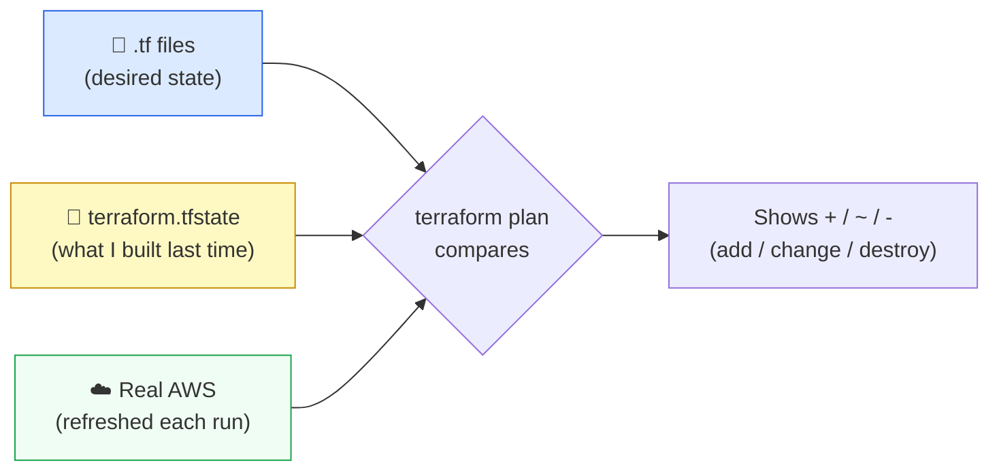

# Level 4 — State & the Lifecycle

| | |
|---|---|
| 🎚️ **Difficulty** | 🟡 Medium |
| ⏱️ **Estimated time** | 20 minutes |
| ⭐ **XP reward** | 100 (Quest) + 25 (Quiz) |

[← Prev: Variables & Outputs](03-variables-and-outputs.md) · [↑ Phase Home](../README.md) · [→ Boss Battle: Rebuild From Nothing](../boss-battle.md)

---

## 📖 Story

Priya catches you about to do something reckless.

> *"Whoa — you were about to open `terraform.tfstate` in your editor and change an IP by hand. Stop. That file is Terraform's **memory** of what it built. Edit it wrong and Terraform either tries to destroy a server it thinks it owns, or loses track of one entirely and you get a ghost instance billing you forever."*

> *"Before the boss battle, you need to understand state cold — what it is, why `plan` reads it, what **drift** is, and why nobody touches it by hand. This is the lesson that keeps you from making a $300 mistake."*

---

## 🎯 Goal

By the end of this lesson you will:
- Explain what **`terraform.tfstate`** is and why Terraform needs it
- Trace how **plan / apply / destroy** each use state
- Recognize **drift** (when reality diverges from state) and how Terraform detects it
- Know why you **never hand-edit state** — and what **remote state** is for teams

---

## 🧠 Concepts

### State = Terraform's memory

When `apply` creates a server, AWS hands back real IDs (`i-0abc...`, the public IP, the SG ID). Terraform records all of it in a JSON file: **`terraform.tfstate`**. This is the **mapping** between your code (`aws_instance.taskflow`) and the real object in AWS (`i-0abc123`).

Without state, Terraform couldn't answer the only question it ever asks: *"What do I already own, and how does it differ from the desired state?"* State is how it remembers.



### The lifecycle, in terms of state

| Command | What it does with state |
|---------|-------------------------|
| `terraform plan` | Reads state + refreshes real AWS, compares to your code, prints the diff. **Changes nothing.** |
| `terraform apply` | Executes the diff, then **updates state** to match the new reality. |
| `terraform destroy` | Destroys everything **recorded in state**, then empties it. |

Notice: `destroy` works off **state**, not your code. It removes what Terraform *remembers building*. (That's exactly what makes the boss battle's clean teardown possible.)

### Drift: when reality wanders off

**Drift** is when something changes the real infrastructure *outside* Terraform — say a teammate opens a port in the console by hand. Now reality ≠ state. The next `terraform plan` **refreshes** the real state, notices the difference, and shows it to you (often offering to *revert* it back to what your code says). Terraform's job is to keep reality matching your code; drift is the gap it constantly closes.

### Never hand-edit state

State contains resource IDs Terraform relies on. Edit it manually and you break the mapping:
- Delete an entry → Terraform forgets a resource → a **ghost** instance keeps billing you, untracked.
- Change an ID → Terraform tries to modify/destroy the wrong thing.

If you must surgically change state, use the **commands** (`terraform state list`, `terraform state rm`, `terraform import`) — never a text editor.

### Remote state (for teams)

So far your state is a **local file**. That's fine solo. But on a team, two people running `apply` from their own laptops have **two different state files** — a recipe for conflicting, corrupted infrastructure. The fix is **remote state**: store `terraform.tfstate` in a shared backend (commonly an **S3 bucket** with **DynamoDB locking**) so everyone shares one source of truth and only one `apply` runs at a time. You don't need to set it up today — just know it exists and why.

### Why this exists

State is what lets Terraform be *declarative and safe*. Because it remembers what it built, it can make the **minimal** change to reach your desired state, detect drift, and tear down exactly what it owns. The state file is precious — treat it like the production database it effectively is: never edit by hand, always git-ignore it (it can contain secrets), and on a team, keep it remote and locked.

---

## 🛠️ Hands-on Lab

> 🔎 Read-only exploration plus one deliberate drift experiment. You'll create the infra, inspect state, cause drift, and watch Terraform catch it.

### Step 1 — Build the infra and inspect state

```bash
cd ~/projects/taskflow-infra
terraform apply        # type yes — builds your 3 resources from Level 2/3

# List everything Terraform is tracking in state
terraform state list

# Inspect one resource's recorded attributes (note the real instance ID + IP)
terraform state show aws_instance.taskflow
```

`terraform state list` prints the resources Terraform *remembers*: `aws_instance.taskflow`, `aws_key_pair.taskflow`, `aws_security_group.taskflow`. That list comes from `terraform.tfstate` — open the file in a viewer if curious (**look, don't edit**):

```bash
# Peek at the raw state — DO NOT edit it
terraform show -json | head -c 400; echo
```

### Step 2 — Cause drift on purpose, then catch it

Change reality outside Terraform — add a tag straight from the AWS CLI (using the instance ID from Step 1):

```bash
# Grab the instance ID Terraform tracks
INSTANCE_ID=$(terraform output -raw instance_id)

# Make a change AWS-side that Terraform doesn't know about (drift!)
aws ec2 create-tags --resources "$INSTANCE_ID" \
  --tags Key=TouchedBy,Value=human-in-console
```

Now ask Terraform to compare:

```bash
terraform plan
```

Terraform **refreshes** the real instance, sees a tag that isn't in your code, and proposes to **remove it** — restoring reality to match your config. *That* is drift detection. (You can `terraform apply` to reconcile, or add the tag to your code if you meant it.)

### Step 3 — Destroy works off state

```bash
terraform destroy      # type yes
```

Watch the output: Terraform destroys exactly the 3 resources **recorded in state**, then reports `Resources: 3 destroyed.` Your state is now empty. Back to $0.00.

---

## 🎮 Mini Challenge

A teammate, in a panic, deletes the `terraform.tfstate` file (thinking it's just a cache) while the EC2 instance is still running. What happens on the next `terraform apply`, and why is this dangerous?

<details>
<summary>💡 Reveal answer</summary>

Terraform has **lost its memory**. With no state, it believes it owns *nothing*, so `plan` shows it wants to **create all the resources from scratch** — even though the real instance still exists in AWS. Apply that, and you get a **duplicate** instance (and the original becomes a **ghost** that Terraform can't manage and keeps billing you).

This is exactly why: (1) you **never delete or hand-edit state**, (2) state should be **remote and backed up** on a team, and (3) you can recover with `terraform import` to rebuild the state→resource mapping. State loss is one of the most expensive Terraform mistakes.
</details>

---

## 📦 Project Mission

Demonstrate you understand the lifecycle end to end on TaskFlow's infra:

```bash
cd ~/projects/taskflow-infra
terraform apply                       # build
terraform state list                  # prove state tracks all 3 resources
terraform state show aws_instance.taskflow   # inspect the recorded instance
terraform destroy                     # tear down off state — stay free
```

Then write a short note (for your own future self) in the repo:

```bash
cat > STATE_NOTES.md <<'EOF'
# Terraform state — reminders
- terraform.tfstate is Terraform's memory of what it built (resource <-> real ID map).
- plan: reads state + refreshes reality, shows the diff. Changes nothing.
- apply: makes the diff real, then updates state.
- destroy: removes what STATE records, then empties it.
- NEVER hand-edit state. Use `terraform state ...` commands.
- State is git-ignored (it can hold secrets). On a team: use remote state (S3 + lock).
EOF

git add STATE_NOTES.md
git commit -m "Document Terraform state and lifecycle"
```

🎯 **Mission complete when:** you can explain (in `STATE_NOTES.md` and out loud) what state is, how plan/apply/destroy use it, what drift is, and why you never hand-edit state — and `terraform destroy` has left nothing running ($0.00).

---

## ⚠️ Common Mistakes

| Mistake | What happens | Fix |
|--------|--------------|-----|
| Hand-editing `terraform.tfstate` | Broken code↔resource mapping; ghosts or wrong deletes | Use `terraform state` commands, never a text editor |
| Committing `terraform.tfstate` to git | Secrets leak; team conflicts | Keep it git-ignored; use remote state for teams |
| Deleting the state file | Terraform forgets everything → duplicates + ghosts | Back up state; recover via `terraform import` |
| Assuming `destroy` reads your `.tf` files | It destroys what **state** records, not the code | Understand destroy operates on state |
| Changing infra in the console, then ignoring drift | Next apply silently reverts your console change | Run `plan` to see drift; reconcile in code |
| Two people applying with separate local states | Conflicting/corrupted infra | Use **remote state** (S3 + DynamoDB lock) |

---

## 🤔 Reflection Questions

1. Why does Terraform need a state file at all — couldn't it just ask AWS what exists every time?
2. What is **drift**, and how does `terraform plan` surface it?
3. Your team is about to grow from you to four engineers. What changes about how you store state, and why?

---

## 📝 Quiz

1. **`terraform.tfstate` is…**
   - a) a cache you can safely delete anytime
   - b) Terraform's record mapping your code to real AWS resources
   - c) where your AWS password is stored intentionally for convenience
2. **`terraform destroy` removes…**
   - a) everything in your AWS account
   - b) the resources recorded in state
   - c) only the state file, leaving servers running
3. **Drift is…**
   - a) when your code is reformatted
   - b) when real infrastructure changes outside Terraform, diverging from state
   - c) a type of EC2 instance

<details>
<summary>✅ Answers</summary>

1: **b** · 2: **b** · 3: **b**
</details>

---

## ✅ Completion Checklist

- [ ] I can explain what `terraform.tfstate` is and why Terraform needs it
- [ ] I used `terraform state list` and `terraform state show`
- [ ] I caused drift and watched `terraform plan` detect it
- [ ] I can explain why hand-editing or deleting state is dangerous
- [ ] I know what remote state is and why teams use it
- [ ] I wrote `STATE_NOTES.md` and committed it (Project Mission)
- [ ] I ran `terraform destroy` — nothing is left running ($0.00)
- [ ] I passed the quiz
- [ ] I added **+125 XP** to [PROGRESS.md](../../../PROGRESS.md)

---

[← Prev: Variables & Outputs](03-variables-and-outputs.md) · [↑ Phase Home](../README.md) · [→ Boss Battle: Rebuild From Nothing](../boss-battle.md)
