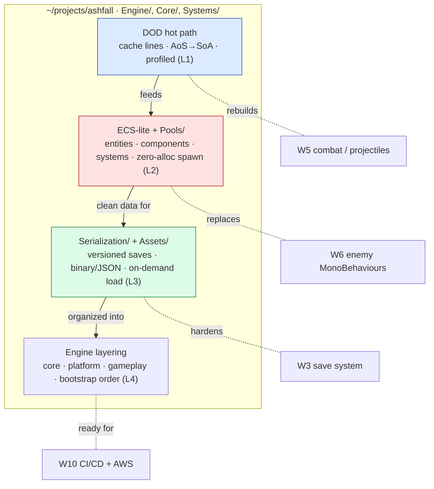

# 🏗️ World 9 — Game Engine Architecture

> Ashfall is *feature-complete* now (World 8): a lit, juiced, co-op action-roguelite running against a Dockerized server. But it was built **feature by feature**, the way real games are — and it shows the second you push it. Spawn a few hundred bullets and enemies and the frame rate tanks: the GC stutters, the cache thrashes, and your beautiful 60 FPS collapses into a slideshow. This world turns *inward*. You'll stop adding features and start re-architecting the **hot paths** that everything runs on: **data-oriented design** (lay data out the way the CPU wants to read it), an **ECS-lite** core with **object pooling** (so spawning a thousand things allocates *nothing*), robust **serialization** and an **asset pipeline** (versioned saves, references that load on demand), and a clean **subsystem layering** (core/platform/gameplay, a sane bootstrap order) — what the word "engine" actually means. Same game, rebuilt to *scale*.

[↑ Home](../../README.md) · [🗺️ Roadmap](../../ROADMAP.md) · [📊 Progress](../../PROGRESS.md)

---

## 📨 Your ticket

```
From:    Kenji <kenji@pixelforge.studio>
To:      You <new-hire@pixelforge.studio>
Cc:      Maya <maya@pixelforge.studio>, Theo <theo@pixelforge.studio>

Subject: [W9-ARCH] We want hundreds of enemies on screen — but the frame rate tanks. Let's fix the engine, not the game.

Loved the co-op build. So did Maya — which is the problem. She wants a
"swarm" room: hundreds of enemies and a bullet-hell finale, the kind of
moment that sells a trailer. I tried it. At ~300 entities we drop below
30 FPS and the profiler lights up with GC spikes every couple of frames.

Here's the thing: nothing is "broken." We built Ashfall the way you build
a game — a MonoBehaviour per enemy, a `new` here, a LINQ query there, an
Update() on every object. That's fine at 30 entities. At 1000 it's death
by a thousand allocations. The bottleneck isn't the gameplay. It's the
ARCHITECTURE underneath it. So this world we don't add a feature — we
rebuild the foundation so the features we already have can scale.

My plan, in order:

  - DATA-ORIENTED FIRST. Stop thinking in objects, start thinking in
    arrays. The CPU reads memory in cache lines; AoS (array of structs /
    objects scattered on the heap) thrashes the cache, SoA (struct of
    arrays, tight and contiguous) flies. Profile the projectile loop,
    then rebuild it data-oriented. Measure, don't guess.
  - ECS-LITE + POOLING. Entities, components, systems — data and behavior
    split apart, processed in bulk. And POOL everything: spawning a bullet
    must reuse a dead one, never `new`. Zero per-frame allocation is the
    target. The GC can't spike on garbage you never created.
  - SERIALIZATION YOU TRUST. Now that state is clean data, make saving it
    bulletproof: versioned saves (so an old save loads in a new build),
    binary vs JSON on purpose, and an asset pipeline that loads content
    on demand instead of holding everything in memory.
  - LAYER THE ENGINE. Finally, draw the lines a real engine has: core /
    platform / gameplay, a deliberate bootstrap order, service locator vs
    DI. This is what makes the codebase something W10 can automate and
    deploy without surprises.

No cloud bills this world — it's all local profiling and refactoring.
(We turn AWS back on in World 10; keep the billing alarm in mind for then.)

Boss check ("1000 Entities at 60 FPS"): render and update 1000+ entities
at a locked 60 FPS, zero per-frame GC allocation, proven on the profiler.
No tutorial — you'll have all four lessons.

Land this and World 10 — CI/CD, profiling, and shipping to the cloud — is
yours.

— Kenji
```

This is World 9 of 13. Everything you build advances the **one growing Ashfall project** in `~/projects/ashfall`. You arrive with a **feature-complete but heavy** game (W8); you leave with the **same game rebuilt on data-oriented hot paths, pooling, clean serialization, and layered subsystems** — ready to scale.

---

## 🎯 What you'll achieve in this world

- 🧮 Think **data-oriented** from first principles — cache lines, **AoS vs SoA**, why OOP-heavy loops thrash the cache — and rebuild Ashfall's projectile hot path as a profiled **struct-of-arrays** loop
- 🧩 Build an **ECS-lite** core (entities / components / systems) with **object pooling** so spawning bullets and enemies reuses dead ones and allocates **nothing** per frame — killing the GC spikes
- 💾 Make **serialization** bulletproof — **versioned** saves, **binary vs JSON** chosen on purpose — and add an **asset pipeline** (references / addressables) that loads content on demand
- 🏛️ **Layer the engine** — core / platform / gameplay, **service locator vs DI**, a deliberate **bootstrap order** — so Ashfall is a clean, modular codebase instead of a pile of features
- 📏 **Measure, don't guess:** profile before and after every change, and prove the win with frame time and the **memory profiler**

---

## 🗺️ Level map

| Level | Lesson | Difficulty | XP |
|------:|--------|:----------:|---:|
| 1 | [Data-Oriented Design](lessons/01-data-oriented-design.md) | 🟡 Medium | 125 |
| 2 | [ECS-lite & Object Pooling](lessons/02-ecs-lite-and-object-pooling.md) | 🔴 Hard | 125 |
| 3 | [Serialization & Asset Pipeline](lessons/03-serialization-and-asset-pipeline.md) | 🟡 Medium | 125 |
| 4 | [Subsystems & Engine Layering](lessons/04-subsystems-and-engine-layering.md) | 🟡 Medium | 125 |
| 🏗️ | [Boss Battle — 1000 Entities at 60 FPS](boss-battle.md) | 🔴 Hard | 500 |

➕ Extra reps: [exercises.md](exercises.md) · ✅ Ready to advance? [checklist.md](checklist.md)

---

## 🧭 Recommended order


Go in order — each lesson is the foundation the next one stands on. **Data-oriented design** (L1) comes first because it's the *mindset shift* everything else assumes: until you think in contiguous arrays instead of scattered objects, ECS won't make sense and pooling won't have anywhere clean to live — so you profile the projectile loop and rebuild it SoA before anything else. **ECS-lite & pooling** (L2) is the architecture that mindset produces: entities/components/systems processed in bulk, with pools so spawning allocates nothing — this is where the GC spikes actually die. **Serialization & the asset pipeline** (L3) comes next because once your state is *clean data*, it's finally cheap and safe to save (versioned) and to load content on demand. **Subsystem layering** (L4) is last because you can only draw the core/platform/gameplay lines and fix the bootstrap order once the pieces inside them — DOD hot paths, ECS, serialization — exist to be organized. The boss battle is all four at once: a thousand entities, pooled and data-oriented, at a locked 60 FPS.

---

## 📦 Ashfall project status

**Entering World 9:** a *feature-complete* co-op action-roguelite — procedurally generated dungeons with A\* (W4), a full data-driven combat game with inventory and loot (W5), enemies that think with FSMs and behavior trees plus a multi-phase boss (W6), a lit/shaded/juiced render layer (W7), and 2-player co-op against a Dockerized dedicated server (W8). It plays beautifully — *at modest entity counts*. But it was built feature-by-feature: a MonoBehaviour and an `Update()` per object, `new` allocations in hot loops, OOP-scattered data. Push it to hundreds of bullets and enemies and it **buckles** — GC spikes, cache misses, frame rate in free fall. It's heavy.

**Leaving World 9:** the *same game*, rebuilt to scale. The projectile and enemy hot paths are **data-oriented** (struct-of-arrays, cache-friendly, profiled); an **ECS-lite** core processes entities in bulk with **object pools** so spawning a thousand things allocates **nothing** per frame (no more GC spikes); saves are **versioned and serialized on purpose**, and content loads through an **asset pipeline** instead of all-at-once; and the whole codebase is **layered** — core / platform / gameplay with a deliberate bootstrap order. Ashfall went from "a game that runs" to "an engine that scales."



You hand this to **World 10 — Production Engineering & Cloud**, where the clean, layered, profilable codebase you just built becomes something you can **automate and deploy**: CI/CD on every push, a profiling pass you can trust, and the W8 server shipped to AWS on Kubernetes via Terraform.

---

## 🏗️ Boss teaser

**"1000 Entities at 60 FPS"** — Maya wants her swarm room, and Kenji wants proof the engine can take it. Make Ashfall **render and update 1000+ entities** (bullets and enemies) at a **stable, locked 60 FPS** — using **data-oriented design**, **object pooling**, and your **ECS-lite** core — with **zero per-frame GC allocation**, and *prove it on the profiler*. No tutorial — you'll fuse all four lessons into one brutal stress test: a thousand things alive at once, the frame timer pinned at 16.6 ms, and a flat GC line. Win to earn the **🏗️ Engine Architect** badge, a +250 world-complete bonus, and unlock World 10.

---

## 📚 Resources

Don't go link-hunting — the curated free list lives in [RESOURCES.md](../../RESOURCES.md). For this world, the standouts are Mike Acton's **"Data-Oriented Design and C++"** talk and the **Data-Oriented Design book** (the canonical first-principles "why" for cache lines and SoA — L1), Unity's free docs on the **Profiler** and **Memory Profiler** (your truth-teller all world — measure before and after every change), Unity's **object pooling** guide and **`ObjectPool<T>`** (L2), the **Entitas** open-source ECS as a readable reference implementation of entities/components/systems (L2), Unity's **serialization** docs plus **`JsonUtility`** / `System.IO.BinaryWriter` and the **Addressables** package for the asset pipeline (L3), and Robert Nystrom's free **Game Programming Patterns** (Service Locator, Object Pool, Update Method, Game Loop — L1/L2/L4). Above all, internalize the one idea this whole world turns on: **performance is a data-layout problem, not a cleverness problem — lay your data out the way the CPU reads it, never allocate in the hot loop, and the frame rate takes care of itself.**

---

[↑ Home](../../README.md) · [🗺️ Roadmap](../../ROADMAP.md) · [📊 Progress](../../PROGRESS.md) · [➡️ Next World: Production Engineering & Cloud](../phase-10-production-and-cloud/README.md) · [▶️ Start Level 1 →](lessons/01-data-oriented-design.md)
