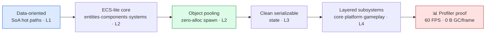
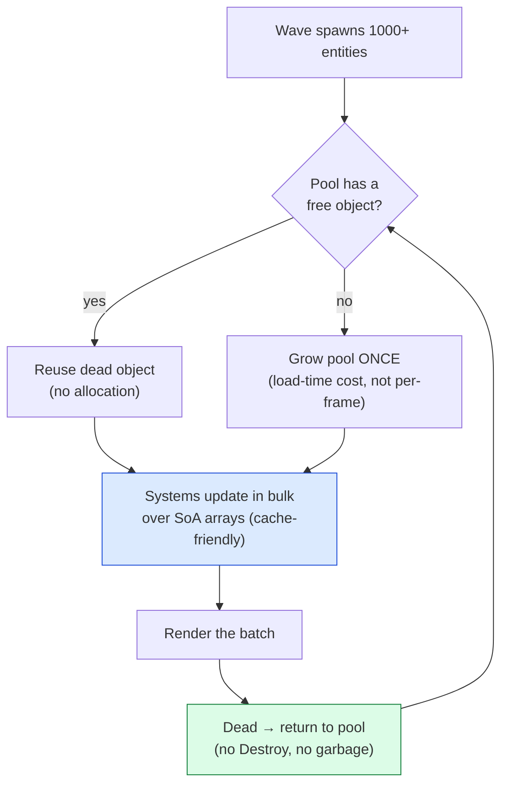

# 🏗️ Boss Battle — 1000 Entities at 60 FPS

| | |
|---|---|
| 🎚️ **Difficulty** | 🔴 Hard |
| ⏱️ **Estimated time** | 150 minutes |
| ⭐ **XP reward** | 500 |
| 🔓 **Unlocks** | World 10 — Production Engineering & Cloud |

[← Checklist](checklist.md) · [↑ Phase Home](README.md) · [↑ Home](../../README.md)

---

## 📨 The incident

```
From:    Kenji <kenji@pixelforge.studio>
To:      You <new-hire@pixelforge.studio>
Cc:      Maya <maya@pixelforge.studio>, Theo <theo@pixelforge.studio>

Subject: [W9-BOSS] The swarm room. 1000 entities. 60 FPS. No excuses.

Maya built the swarm room — a bullet-hell finale with waves of enemies and
walls of projectiles. It's the best-looking moment in the game. It also runs
at 22 FPS and hitches like a dying hard drive. Last season that would've
sunk us. Not anymore — you spent this whole world rebuilding the foundation
for exactly this. Time to cash it in.

This is your boss. No tutorial — you've got all four lessons. Here's the bar,
and it is not negotiable:

  - 1000+ ENTITIES, ALIVE AT ONCE. Bullets and enemies, rendered AND updated
    every frame. Not 1000 sitting idle — 1000 moving, colliding, doing their
    thing. Make the swarm room real.
  - LOCKED 60 FPS. ~16.6 ms a frame, stable, no dips into the 50s when the
    wave peaks. A flat frame-time graph. If it stutters when it matters, you
    failed.
  - ZERO PER-FRAME GC ALLOCATION. This is the line I will not move on. Open
    the memory profiler, point it at the swarm, and show me the GC Alloc
    column reading ~0 B per frame and a flat GC line. No spikes. You spawn a
    thousand bullets and the collector has NOTHING to do, because you pooled
    everything and you don't allocate in the hot loop.
  - PROVE IT. I don't want "it feels smooth." I want the profiler open: frame
    time pinned at 60, GC Alloc at zero, entity count north of 1000. The
    evidence, not the vibe.

Do it with the real tools: data-oriented hot paths (SoA), the ECS-lite core,
and object pooling. The architecture you built IS the solution — apply it.

Cost note: all local, no cloud. We turn AWS back on in World 10.

Land this and World 10 — CI/CD, profiling, and shipping the server to the
cloud — is yours.

— Kenji
```

> 🏗️ **Boss Battle rules:** No tutorials, no copying lesson files wholesale. **Apply** World 9: lay the hot-path data out struct-of-arrays so the cache works for you, run entities through your ECS-lite core in bulk, pool every bullet and enemy so spawning allocates nothing, and then *prove* the result on the profiler — 1000+ entities, locked 60 FPS, ~0 B GC alloc per frame. You win when every victory condition is met **and you can explain which technique buys which result** (SoA → cache hits · ECS → bulk processing · pooling → zero allocation) **and read the profiler well enough to back every claim with a graph.**

---

## 🎯 Your mission

Make Ashfall **render and update 1000+ entities at a stable, locked 60 FPS with zero per-frame GC allocation**, and prove it on the profiler. This is the capstone that fuses every lesson:





Build it from these pieces (at minimum):

1. **Data-oriented hot paths (L1):** the per-frame work on bullets/enemies (position integration, collision, lifetime) runs over **struct-of-arrays** data walked linearly — no pointer-chasing scattered objects.
2. **ECS-lite (L2):** entities are ids, components are data, systems process them in **bulk** once per frame — not a MonoBehaviour `Update()` per object.
3. **Object pooling (L2):** bullets and enemies come from **pools** — spawning reactivates a dead one, despawning returns it. **No `new`/`Instantiate`/`Destroy` in the per-frame loop.**
4. **Clean serializable state (L3):** the entity state is plain data — the same clean shape that serializes cleanly (you'll lean on this in W10's deploys).
5. **Layered subsystems (L4):** the spawn/sim/render systems live in the right layers with a sane bootstrap order — the swarm room is gameplay sitting on a core that doesn't care it exists.
6. **The proof:** the **Profiler** and **Memory Profiler** open during the stress test — frame time pinned at ~16.6 ms, entity count > 1000, and GC Alloc ~0 B/frame.

---

## 🏆 Victory conditions

- [ ] Ashfall can **spawn and sustain 1000+ entities** (bullets and enemies) alive and updating at once — the swarm room is real, not 1000 idle objects
- [ ] The frame rate holds a **stable, locked 60 FPS** (~16.6 ms/frame) at peak — no dips when the wave crests, a flat frame-time graph
- [ ] The per-frame hot paths are **data-oriented** (struct-of-arrays, walked linearly) — cache-friendly, no pointer-chasing
- [ ] Entities run through the **ECS-lite** core — systems process components in **bulk**, not an `Update()` per object
- [ ] **Object pooling** drives all spawning/despawning — **zero `new`/`Instantiate`/`Destroy` in the per-frame loop**
- [ ] Per-frame **GC allocation is ~0 B**, demonstrated on the **memory profiler** — a flat GC line, no collection spikes during the swarm
- [ ] I can **prove it on the profiler**: a capture showing entity count > 1000, frame time ~16.6 ms, and GC Alloc ~0 B/frame at once
- [ ] I can name which technique buys which result (**SoA → cache hits · ECS → bulk processing · pooling → zero allocation**) and read the profiler to back each claim

---

## 🧪 How you'll know you won

```bash
cd ~/projects/ashfall
ls Engine Core Systems Pools
# → SoA hot paths, ECS-lite (Entity/Component/System), ObjectPool<T>,
#   BulletSystem.cs, EnemySystem.cs, SwarmSpawner.cs ...
```

Then run the real test — **the swarm room, profiler open:**
- **Trigger the swarm wave** — bullets and enemies pour in until **1000+** are alive and updating at once. The room is chaos; the game does not care.
- **Watch the frame-time graph** — it sits flat at **~16.6 ms (60 FPS)** through the peak. No staircase, no dips into the 50s, no hitches.
- **Watch the Memory Profiler / GC Alloc column** — **~0 B allocated per frame**, and the **GC line is flat**: no collection spikes even as a thousand bullets spawn and die, because you pool and don't allocate in the loop.
- **Disable pooling on purpose** (temporarily) and watch it break — `Instantiate`/`Destroy` per spawn makes GC Alloc jump and the spikes return. Re-enable it; the line goes flat again. *That* contrast is your proof pooling is the thing doing the work.
- **Sort the CPU profiler by time** — the entity systems are the top cost (as they should be) and they're cheap per entity because the loops are SoA and cache-friendly, not because there's little going on.

If 1000+ entities are alive at a locked 60 FPS with a flat GC line, and you can point at the graph and say *why*, you've won.

<details>
<summary>🔎 Reference solution — only after you've tried! (high-level sketch + key code)</summary>

**The shape of it (each technique owns one result):**

| Technique | Buys you | Lesson |
|---|---|---|
| Struct-of-arrays hot paths | cache hits — the loop streams contiguous data | L1 |
| ECS-lite (entity/component/system) | bulk processing — one tight loop, not N `Update()`s | L2 |
| Object pooling | zero per-frame allocation — no garbage, no GC spikes | L2 |
| Clean serializable state | the data is plain and portable (pays off in W10) | L3 |
| Layered subsystems + bootstrap | the swarm is gameplay on a core that doesn't know it | L4 |

**SoA hot path: one array per field, walked linearly (L1):**

```csharp
// NOT an array of bullet objects (AoS, cache-hostile). SoA: each field its own tight array.
class BulletData {
    public int count;
    public float2[] pos  = new float2[MAX];   // contiguous
    public float2[] vel  = new float2[MAX];   // contiguous
    public float[]  life = new float[MAX];     // contiguous
}

// The hot loop streams pos/vel densely — every cache line is 100% useful.
void Integrate(BulletData b, float dt) {
    for (int i = 0; i < b.count; i++) {
        b.pos[i]  += b.vel[i] * dt;            // no pointer-chasing, prefetcher-friendly
        b.life[i] -= dt;
    }
}
```

**ECS-lite: systems process components in bulk (L2):**

```csharp
// Entity = id. Components = data. System = behavior over all matching entities, once per frame.
public sealed class MovementSystem {
    public void Tick(World w, float dt) {
        var pos = w.Get<Position>(); var vel = w.Get<Velocity>();   // SoA component arrays
        for (int i = 0; i < w.Count; i++) pos[i].value += vel[i].value * dt;   // bulk, no per-object Update()
    }
}
```

**Object pooling: spawn = reuse, despawn = return — never `new` in the loop (L2):**

```csharp
public sealed class Pool<T> where T : new() {
    readonly Stack<T> free = new();
    public Pool(int prewarm) { for (int i = 0; i < prewarm; i++) free.Push(new T()); } // allocate ONCE, at load

    public T Spawn()      => free.Count > 0 ? free.Pop() : new T();  // reuse a dead one
    public void Despawn(T t) => free.Push(t);                        // return it — no Destroy, no garbage
}

// SwarmSpawner: a wave grabs 1000 bullets from the pool — zero allocation in the frame.
for (int i = 0; i < 1000; i++) { var b = bulletPool.Spawn(); /* set pos/vel from SoA slot */ }
```

**Proving zero per-frame allocation (the boss's hard line):**

```
Profiler (CPU) → sort by GC Alloc → the steady-state per-frame allocation reads ~0 B.
Memory Profiler → snapshot during the swarm → the GC line is flat, no Collect spikes.
Toggle pooling OFF to show the contrast: Instantiate/Destroy → GC Alloc jumps, spikes return.
Toggle it back ON → flat again. That A/B IS the evidence.
```

**Why each technique is the right tool:**
- **SoA (L1)** makes the hot loop cache-friendly: the CPU reads memory in 64-byte lines, and contiguous per-field arrays mean every fetched byte is used and the prefetcher reads ahead — the difference between cache-miss-bound and streaming.
- **ECS-lite (L2)** replaces N scattered virtual `Update()` calls with one tight bulk loop over contiguous data — fewer calls, better locality, and it's even parallelizable (see Side Quest 1).
- **Object pooling (L2)** is what actually kills the GC spikes: you allocate the pool once at load and never in the frame, so a thousand spawns produce zero garbage and the collector has nothing to do.
- **Clean serializable state (L3)** falls out for free — plain-data components are exactly what saves and (W10) deploys want.
- **Layered subsystems (L4)** keep the swarm room as gameplay sitting on a core that doesn't know it exists — which is what makes the whole thing maintainable and, next world, automatable.

1000 entities, 60 FPS, a flat GC line — that's all of World 9 in a single running stress test.
</details>

---

## 🎁 Rewards

- 🏆 **+500 XP**
- 🏅 Achievement unlocked: **🏗️ Engine Architect** — you turned Ashfall from "a game that runs" into "an engine that scales": data-oriented hot paths, an ECS-lite core, object pooling that allocates nothing per frame, clean serialization, and layered subsystems — proven at 1000+ entities and a locked 60 FPS on the profiler
- 🔓 **World 10 — Production Engineering & Cloud** unlocks
- 📈 Update [PROGRESS.md](../../PROGRESS.md): mark World 9 ✅ and add the **+250 World Complete bonus**

> 🗒️ Reflection: performance wasn't a cleverness problem — it was a **data-layout** problem. The frame rate didn't recover because you found a faster algorithm; it recovered because you laid the data out the way the CPU reads it (SoA), processed it in bulk (ECS), and stopped creating garbage in the hot loop (pooling). That's the difference between writing *a game* and writing *an engine*. And notice what you have now: a clean, layered, profilable codebase made of plain data — exactly the thing you can **automate and deploy**. World 10 turns outward again — CI/CD on every push, a profiling pass you can trust, and the W8 server shipped to AWS on Kubernetes via Terraform. The foundation is solid. Time to ship it.

---

[← Checklist](checklist.md) · [↑ Phase Home](README.md) · [↑ Home](../../README.md) · [🚀 Enter World 10 →](../phase-10-production-and-cloud/README.md)
