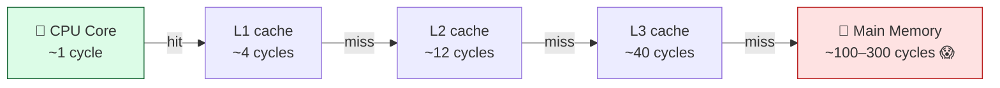
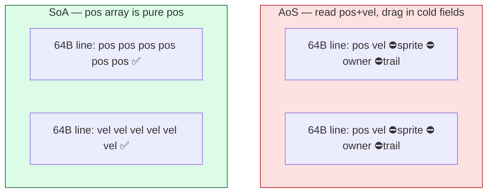

# Level 1 — Data-Oriented Design

| | |
|---|---|
| 🎚️ **Difficulty** | 🟡 Medium |
| ⏱️ **Estimated time** | 30 minutes |
| ⭐ **XP reward** | 100 (Quest) + 25 (Quiz) |

[← Prev](../README.md) · [↑ Phase Home](../README.md) · [→ Next](02-ecs-lite-and-object-pooling.md)

---

## 📖 Story

> *"Maya pushed a wave-spawner test last night and the frame graph fell off a cliff — 900 projectiles on screen and we're at 22 FPS with the profiler screaming about memory stalls. Here's the thing: it's **not** the math. We're doing a few multiplies per bullet — that's nothing for a modern CPU. The CPU is sitting idle, *waiting on memory*. Every `Projectile` is a class scattered somewhere on the heap, so updating 900 of them means 900 random trips to RAM, and RAM is glacially slow compared to the CPU. The fix isn't 'optimize the code' — it's **rethink how the data is laid out** so the CPU can scream through it. That mindset has a name: **data-oriented design**. Today we stop thinking about objects and start thinking about *bytes moving through cache*. Once you see it, you can't unsee it. Let me show you. — Kenji"*

---

## 🎯 Goal

- Understand the gap between **OOP thinking** ("an object is a thing") and **data-oriented design** ("a program transforms data")
- Understand **CPU cache lines** and why a **cache miss** can cost ~100× a cache hit
- Tell the difference between **Array of Structs (AoS)** and **Struct of Arrays (SoA)** memory layouts, and when SoA wins
- Adopt the **mechanical-sympathy** mindset: design code around how the hardware actually works
- **Measure** the difference in Ashfall's projectile hot path — don't guess

---

## 🧠 Concepts

### The CPU isn't slow — memory is

A modern CPU core runs billions of operations per second. Main memory (RAM) is *not* fast enough to feed it. To hide that gap, CPUs have tiny, ultra-fast **caches** (L1/L2/L3) between core and RAM. When the core needs a byte:

- If it's already in cache → a **cache hit** (~1–4 cycles). Basically free.
- If it isn't → a **cache miss**: the core stalls and waits while the data is fetched from RAM (~100–300 cycles). An eternity.

Crucially, the CPU never fetches one byte. It fetches a whole **cache line** — typically **64 bytes** — around the address you asked for. So when you touch one float, you "get" the 60-ish neighboring bytes *for free*. This is the single most important fact in performance work.



The lesson: **the CPU is fast; feeding it is the bottleneck.** Performance is mostly about keeping the data the CPU needs already sitting in cache. That's done by controlling **memory layout** — exactly what OOP hides from you.

### AoS vs SoA — the same data, two layouts

Say each projectile has a position, a velocity, and some cold fields (sprite ref, owner id, trail color…) it rarely touches in the update loop.

**Array of Structs (AoS)** — the OOP-default. Each object is one contiguous blob; you store an array of them:

```
[ pos vel sprite owner trail | pos vel sprite owner trail | ... ]
   └──── projectile 0 ─────┘    └──── projectile 1 ─────┘
```

To move all projectiles you read `pos` and `vel` from each — but the cache line you pull also drags in `sprite`, `owner`, `trail` (cold data you don't need this loop). You waste most of every 64-byte line on garbage, so you cache-miss far more often.

**Struct of Arrays (SoA)** — flip it inside out. One array *per field*:

```
positions:  [ p0 p1 p2 p3 p4 p5 ... ]   ← tightly packed, no cold data between them
velocities: [ v0 v1 v2 v3 v4 v5 ... ]
sprites:    [ s0 s1 ... ]  (cold — untouched in the move loop)
```

Now the move loop walks `positions` and `velocities` as dense, contiguous arrays. Every cache line is **100% useful data**. You touch far fewer lines, miss far less, and the CPU's hardware prefetcher (which loves linear access) streams the next lines in before you even ask. *And* with class objects there's pointer-chasing — `Projectile[]` of a **class** is an array of *references* to objects scattered across the heap, so even AoS-of-classes is a random walk through memory. SoA of value types is the opposite: one straight, predictable march.



> SoA isn't *always* the win — if a loop genuinely reads every field of every object, AoS keeps them together. The rule is: **lay data out for the access pattern of your hottest loop.** Hot fields together, cold fields elsewhere.

### Why this exists

OOP teaches you to model the *domain*: "a projectile is a thing with position, sprite, owner." That's great for human reasoning and terrible for the CPU, because it co-locates data by *concept* (everything about one bullet) instead of by *access pattern* (all the positions you're about to read). The hardware doesn't care about your `class Projectile` — it cares about which 64-byte lines you touch. **Data-oriented design** inverts the priority: start from "what data does this transformation read and write, in what order?" and lay memory out to make that march linear and dense. That's **mechanical sympathy** — designing software that works *with* the machine instead of against it.

This is **engine-agnostic and universal.** Cache lines, the memory wall, and the AoS/SoA trade-off are facts of CPU hardware, not of any engine. Unity's DOTS/Burst, Unreal's data layouts, and every high-performance custom engine are built on exactly this idea; SoA is also why GPUs and SIMD exist. You're learning the principle the whole industry's performance tooling is built on. For deeper reading, see **RESOURCES.md** for this world — *Game Engine Architecture* (memory & caches) and the *Data Locality* chapter of *Game Programming Patterns*.

---

## 🛠️ Hands-on Lab

> 💻 You can run all of this in a plain C# console project (`dotnet new console`) — no Unity needed. The point is to *measure* the layout effect on the same logic that lives in Ashfall's projectile update. Build in **Release** (optimizations on) or the numbers lie.

### Step 1 — Model both layouts

Create `Projectiles.cs`. Same data, same math, two layouts:

```csharp
using System.Numerics; // Vector2

// --- AoS: an array of objects (the OOP default). Note: this is a CLASS,
//     so the array holds references to heap-scattered objects. ---
public sealed class ProjectileObj
{
    public Vector2 Position;
    public Vector2 Velocity;
    // "Cold" fields: present in real game data, untouched by the move loop.
    public int OwnerId;
    public int SpriteId;
    public uint TrailColor;
    public float Lifetime;
}

// --- SoA: one tightly packed array per HOT field. Cold fields live elsewhere. ---
public sealed class ProjectilesSoA
{
    public Vector2[] Positions;
    public Vector2[] Velocities;
    // Cold arrays kept separate so they never pollute the move loop's cache lines.
    public int[] OwnerIds;
    public int[] SpriteIds;
    public uint[] TrailColors;
    public float[] Lifetimes;

    public ProjectilesSoA(int n)
    {
        Positions = new Vector2[n];
        Velocities = new Vector2[n];
        OwnerIds = new int[n];
        SpriteIds = new int[n];
        TrailColors = new uint[n];
        Lifetimes = new float[n];
    }
}
```

### Step 2 — Write the identical hot loop for each

The transformation is the same: `position += velocity * dt` for every live projectile. Only the *layout it walks* differs.

```csharp
public static class Move
{
    // AoS: walk the array of object references; each step may jump anywhere in the heap.
    public static void Aos(ProjectileObj[] arr, float dt)
    {
        for (int i = 0; i < arr.Length; i++)
        {
            var p = arr[i];                       // pointer-chase to a heap object
            p.Position += p.Velocity * dt;        // also pulls cold fields into cache
        }
    }

    // SoA: walk two dense, contiguous arrays — pure linear streaming.
    public static void Soa(ProjectilesSoA s, float dt)
    {
        var pos = s.Positions;
        var vel = s.Velocities;
        for (int i = 0; i < pos.Length; i++)
            pos[i] += vel[i] * dt;               // every cache line is 100% useful
    }
}
```

### Step 3 — Fill, then benchmark both

In `Program.cs`, build both with the same data and time many update ticks:

```csharp
using System.Diagnostics;
using System.Numerics;

const int N = 200_000;        // ~Ashfall worst case, scaled up so the effect is visible
const int Ticks = 500;        // simulate 500 update frames
const float Dt = 1f / 60f;

var rng = new Random(1);
Vector2 RandV() => new((float)rng.NextDouble(), (float)rng.NextDouble());

// AoS data
var aos = new ProjectileObj[N];
for (int i = 0; i < N; i++)
    aos[i] = new ProjectileObj { Position = RandV(), Velocity = RandV() };

// SoA data (identical values)
var soa = new ProjectilesSoA(N);
for (int i = 0; i < N; i++) { soa.Positions[i] = aos[i].Position; soa.Velocities[i] = aos[i].Velocity; }

long Bench(Action tick)
{
    tick();                                   // warm up JIT + caches once
    var sw = Stopwatch.StartNew();
    for (int t = 0; t < Ticks; t++) tick();
    sw.Stop();
    return sw.ElapsedMilliseconds;
}

long aosMs = Bench(() => Move.Aos(aos, Dt));
long soaMs = Bench(() => Move.Soa(soa, Dt));

Console.WriteLine($"AoS (objects): {aosMs} ms");
Console.WriteLine($"SoA (arrays):  {soaMs} ms");
Console.WriteLine($"SoA is ~{(double)aosMs / soaMs:0.0}x faster");
```

### Step 4 — Run it (Release!) and read the numbers

```bash
dotnet run -c Release
```

You'll typically see SoA come out **several times faster** (often 3–8×, hardware-dependent) doing *byte-for-byte the same math*. The only thing that changed is **how the data is laid out in memory.** That delta is cache misses you eliminated. This is data-oriented design in one experiment.

> 💡 If the gap looks small, you forgot `-c Release`, or `N` is small enough to fit entirely in cache (then there are no misses to fix — try bumping `N`). The effect *requires* a working set bigger than cache, which is exactly the "hundreds of entities" regime Ashfall hits.

---

## 🎮 Mini Challenge

Add a **cold-field read** to each loop — e.g. also do `p.Lifetime -= dt;` in the AoS loop and `s.Lifetimes[i] -= dt;` in the SoA loop. Predict what happens to each timing *before* you run it, then run it.

<details>
<summary>💡 Reveal answer</summary>

**AoS barely changes.** `Lifetime` lives *inside* the same object you already pointer-chased to, and it's almost certainly on a cache line you already paid to load. You're using data that was being wasted anyway — nearly free.

**SoA gets a bit slower.** `Lifetimes` is a *separate* array, so now you're streaming **three** arrays instead of two — more cache lines touched per element. SoA is still typically faster overall, but the gap narrows.

The takeaway is the whole lesson: **layout should follow the access pattern.** If a field is *always* read together with position/velocity, maybe it belongs in the hot set (or even back inside an AoS hot struct). If it's truly cold, keep it out so it never pollutes the hot loop's cache lines. There's no universally "right" layout — only the right layout *for your hottest loop's access pattern.*
</details>

---

## 📦 Project Mission

Profile and prove the layout problem in **Ashfall's** projectile system — the groundwork for the ECS-lite refactor next lesson.

1. Open Ashfall and find your current projectile representation (likely a `Projectile` **MonoBehaviour** or class spawned per bullet). Note that it's **AoS-of-objects** — exactly the slow layout.
2. In a scratch console project (or a Unity Editor test), reproduce **Steps 1–3** with Ashfall's *actual* projectile fields (position, velocity, plus your real cold fields like owner, sprite, lifetime). Run in Release.
3. **Record the measurement:** AoS ms, SoA ms, and the speedup factor, for an N near your worst-case bullet count. This is your **baseline** — the boss battle ("1000 entities at 60 FPS") will be judged against it.
4. Write a 3–4 line note in your repo (e.g. `docs/perf-notes.md`) describing *which* Ashfall loop is the hot path, *why* it cache-misses today (objects scattered on the heap + cold fields per bullet), and the SoA layout you'll move it to next lesson.
5. Commit the baseline:
   ```bash
   cd ~/projects/ashfall
   git switch -c feature/dod-baseline
   git add docs/perf-notes.md
   git commit -m "perf: measure AoS vs SoA baseline for projectile hot path (DOD)"
   git switch main && git merge feature/dod-baseline && git push
   ```

🎯 **Mission complete when:** you've **measured** Ashfall's projectile update under both AoS and SoA layouts, recorded a concrete speedup number as your baseline, and written down which loop is the hot path and *why* it cache-misses today — a measured problem statement, not a guess.

---

## ⚠️ Common Mistakes

| Mistake | What happens | Fix |
|--------|--------------|-----|
| Optimizing the math instead of the layout | You shave a few cycles while the CPU stalls hundreds waiting on RAM | Fix the **memory access pattern** first — that's where the time goes |
| Benchmarking in Debug | The JIT doesn't optimize; numbers are meaningless | Always measure in **Release** (`-c Release`) |
| Tiny `N` that fits in cache | No cache misses exist to fix, so SoA shows no gain | Use a working set bigger than cache (Ashfall's real "hundreds of entities" scale) |
| Putting cold fields in the hot array | Every cache line wastes bytes on data you don't read | Separate **hot** fields (read in the loop) from **cold** fields |
| Array of **class** objects ("but it's an array!") | The array holds references; objects are scattered → pointer-chasing | Use value-type **SoA** (or packed structs) for the hot path |
| Assuming SoA is always right | A loop that reads *every* field per item does better in AoS | Lay out for **your hottest loop's** access pattern, not dogma |
| Guessing where the time goes | You "optimize" cold code and the spike remains | **Measure first**, then change layout, then measure again |

---

## 🤔 Reflection Questions

1. A cache miss costs roughly 100× a cache hit, and the CPU fetches a whole 64-byte line at a time. In your own words, *why* does SoA produce fewer misses than AoS-of-objects for the projectile move loop?
2. Your teammate says "we're CPU-bound, let's simplify the per-bullet math." Why might that barely help, and what would you measure to find out where the time *actually* goes?
3. When is **AoS** actually the better layout? Describe a concrete Ashfall loop where keeping all of an entity's fields together would beat SoA.

---

## 📝 Quiz

1. **A "cache miss" is expensive primarily because…**
   - a) the CPU runs out of registers
   - b) the core stalls ~100s of cycles waiting for data to come from main memory
   - c) the garbage collector runs
2. **Compared to an array of class objects, Struct-of-Arrays (SoA) speeds up a move loop mainly by…**
   - a) doing less math per element
   - b) packing the hot fields contiguously so each 64-byte cache line is all useful data (and access is linear)
   - c) using more threads automatically
3. **Data-oriented design says you should lay out memory according to…**
   - a) the real-world concept each object represents
   - b) alphabetical field order
   - c) the access pattern of your hottest loop (hot fields together, cold fields apart)

<details>
<summary>✅ Answers</summary>

1: **b** · 2: **b** · 3: **c**
</details>

---

## ✅ Completion Checklist

- [ ] I can explain cache lines and why a cache miss costs ~100× a hit
- [ ] I can describe AoS vs SoA and when each wins
- [ ] I built and ran the AoS-vs-SoA benchmark in **Release** and saw SoA win
- [ ] I measured Ashfall's projectile hot path and recorded a **baseline** speedup number
- [ ] I wrote down which loop is the hot path and *why* it cache-misses today
- [ ] I committed the baseline note
- [ ] I passed the quiz
- [ ] Added **+125 XP** to [PROGRESS.md](../../../PROGRESS.md)

---

[← Prev](../README.md) · [↑ Phase Home](../README.md) · [→ Next](02-ecs-lite-and-object-pooling.md)
