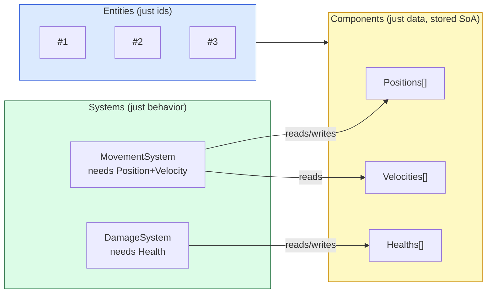
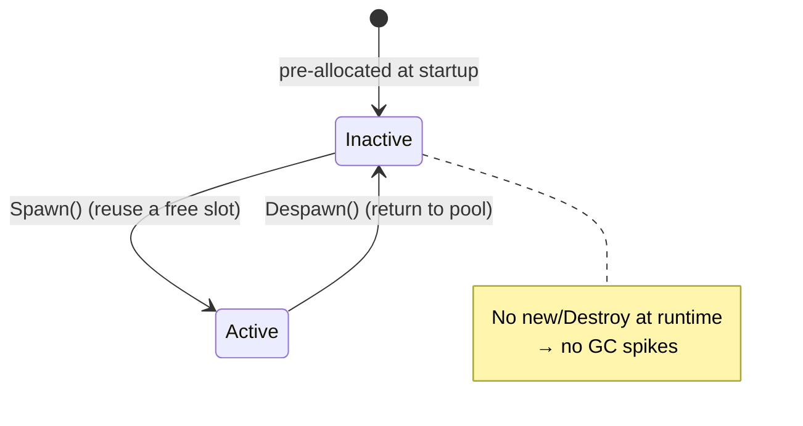

# Level 2 — ECS-lite & Object Pooling

| | |
|---|---|
| 🎚️ **Difficulty** | 🔴 Hard |
| ⏱️ **Estimated time** | 35 minutes |
| ⭐ **XP reward** | 100 (Quest) + 25 (Quiz) |

[← Prev](01-data-oriented-design.md) · [↑ Phase Home](../README.md) · [→ Next](03-serialization-and-asset-pipeline.md)

---

## 📖 Story

> *"Great baseline yesterday — now let's fix it for real. Two problems are killing us. One: every bullet is a `MonoBehaviour` we `Instantiate` and `Destroy`, so a wave spawns hundreds of objects and the **garbage collector** stalls the frame cleaning them up — that's the stutter Maya saw. Two: our update logic is tangled into those objects, so we can't lay data out the SoA way you proved is faster. The architecture that solves both is **ECS** — Entity, Component, System. Entities are just **ids**. Components are just **data**. Systems are just **behavior** that sweeps over the data. It sounds abstract until you build a tiny one yourself — then it clicks, because it's basically the SoA idea with a clean structure on top. We'll hand-roll an **ECS-lite** (no fancy library), add **object pooling** so we recycle bullets instead of allocating them, and convert Ashfall's projectiles and enemies. After this, hundreds of entities won't even make the GC blink. Let me show you. — Kenji"*

---

## 🎯 Goal

- Understand **ECS from first principles**: entities = ids, components = data, systems = behavior
- See why ECS is the *natural home* for the SoA layout from Lesson 1
- Build a tiny, **working hand-rolled ECS-lite** (no external library)
- Understand the **GC spike** problem and how **object pooling** eliminates runtime allocation
- Convert Ashfall's **projectiles and enemies** to pooled, ECS-lite updates

---

## 🧠 Concepts

### ECS: pull behavior out of the data

In OOP, a `Projectile` *is* its data **and** its behavior — `Update()` lives on the object. ECS splits those apart into three plain ideas:

- **Entity** — just an **id** (an integer). Not an object, not a class. "Entity 42 exists."
- **Component** — just **data**, no logic. `Position`, `Velocity`, `Health`. A component is attached to an entity id.
- **System** — just **behavior**: a loop that finds all entities with the components it cares about and transforms them. `MovementSystem` reads `Position`+`Velocity` and updates `Position`.



Why this is powerful: components are stored as **parallel arrays indexed by entity id** — that's **SoA from Lesson 1**, structurally enforced. A system is just the dense, cache-friendly loop you already proved is fast. Behavior is decoupled from data, so you can add `PoisonSystem` without touching the bullet "class," and you can reorganize memory freely because nothing owns its own data anymore. "ECS-lite" means we get these benefits with a few hundred lines of plain code, not a heavyweight framework.

### Object pooling: stop allocating in the hot path

The second killer is **garbage**. `Instantiate`/`new` allocates; `Destroy` makes garbage; the **garbage collector** periodically stops your game to clean it up — a visible **frame spike** exactly when a wave dies. The fix is ancient and simple: **don't allocate and free — recycle.** A **pool** pre-creates a fixed set of slots up front; "spawn" hands you a dormant slot, "despawn" returns it. Allocation count at runtime: **zero.**



Pooling and ECS fit together perfectly: in an ECS, an entity id *is* a slot index. "Spawn a bullet" = grab a free id and fill its component arrays. "Despawn" = mark the id free for reuse. The pool *is* the entity allocator.

### Why this exists

ECS exists because **the OOP object is the wrong unit for high-entity-count simulation.** Bundling data with behavior forces a memory layout (one blob per object) and an update model (call `Update()` on each, scattered) that both fight the cache (Lesson 1) and tangle features together. ECS separates the three things that change for different reasons — *what exists* (entities), *what's true about it* (components), *what happens to it* (systems) — so each can be optimized and extended independently. Object pooling exists because **allocation is not free and the GC is not your friend in a 16ms frame budget**; pre-allocating and recycling turns an unbounded, unpredictable cost into a fixed, known one.

This is **engine-agnostic.** Unity built an entire production ECS (DOTS/Entities) on exactly these primitives; Unreal, Godot, and bespoke AAA engines all use ECS or ECS-flavored designs for high-count systems; pooling is universal across every engine and language with a GC or an allocator. The pattern transfers directly. For the canonical treatments, see **RESOURCES.md** for this world — the *Object Pool* and *Component* chapters of *Game Programming Patterns*, and the runtime-systems chapters of *Game Engine Architecture*.

---

## 🛠️ Hands-on Lab

> 💻 This ECS-lite is plain C# — it runs in a console project *and* drops straight into Unity (it has no Unity dependencies). Build it standalone first to see it work, then wire it into Ashfall in the Mission.

### Step 1 — Components are plain data structs

No logic. Value types so they pack tightly in arrays (SoA).

```csharp
using System.Numerics; // Vector2

public struct Position { public Vector2 Value; }
public struct Velocity { public Vector2 Value; }
public struct Lifetime { public float Remaining; }
public struct Health   { public int Current; }
```

### Step 2 — A pooled entity allocator (the World)

Entities are ids. We keep a **free list** of recycled ids so spawning never allocates after warm-up. Components live in **parallel arrays indexed by entity id** (SoA).

```csharp
using System.Collections.Generic;

// A fixed-capacity ECS-lite "world". Entity = index into the component arrays.
public sealed class World
{
    public readonly int Capacity;
    public int Count { get; private set; }          // highest id ever used (the live window)

    // Component arrays (SoA) — index == entity id.
    public Position[] Positions;
    public Velocity[] Velocities;
    public Lifetime[] Lifetimes;
    public bool[] Alive;                              // is this slot currently a live entity?

    private readonly Stack<int> _free = new();        // recycled ids ready to reuse (the pool)

    public World(int capacity)
    {
        Capacity = capacity;
        Positions  = new Position[capacity];
        Velocities = new Velocity[capacity];
        Lifetimes  = new Lifetime[capacity];
        Alive      = new bool[capacity];
        // Pre-fill the free list so Spawn never allocates at runtime.
        for (int i = capacity - 1; i >= 0; i--) _free.Push(i);
    }

    // Grab a recycled id (pooling). Returns -1 if the pool is exhausted.
    public int Spawn()
    {
        if (_free.Count == 0) return -1;             // pool full → caller decides (drop/grow)
        int id = _free.Pop();
        Alive[id] = true;
        if (id >= Count) Count = id + 1;             // extend the scan window if needed
        return id;
    }

    // Return an id to the pool. No Destroy, no garbage — just recycling.
    public void Despawn(int id)
    {
        if (!Alive[id]) return;
        Alive[id] = false;
        _free.Push(id);
    }
}
```

### Step 3 — Systems are loops over the data

Each system sweeps the live window and transforms the components it cares about. Notice these are exactly the dense SoA loops from Lesson 1.

```csharp
using System.Numerics;

public static class MovementSystem
{
    public static void Run(World w, float dt)
    {
        var pos = w.Positions; var vel = w.Velocities; var alive = w.Alive;
        for (int i = 0; i < w.Count; i++)
        {
            if (!alive[i]) continue;                 // skip dead slots
            pos[i].Value += vel[i].Value * dt;       // contiguous, cache-friendly
        }
    }
}

public static class LifetimeSystem
{
    // Despawns entities whose lifetime ran out (recycles them — no GC).
    public static void Run(World w, float dt)
    {
        var life = w.Lifetimes; var alive = w.Alive;
        for (int i = 0; i < w.Count; i++)
        {
            if (!alive[i]) continue;
            life[i].Remaining -= dt;
            if (life[i].Remaining <= 0f) w.Despawn(i);
        }
    }
}
```

### Step 4 — A spawn helper and the simulation loop

```csharp
using System.Numerics;

public static class Spawner
{
    // Spawning = grab a pooled id, fill its component arrays. Zero allocation.
    public static int SpawnProjectile(World w, Vector2 pos, Vector2 vel, float life)
    {
        int id = w.Spawn();
        if (id < 0) return -1;                        // pool exhausted this frame
        w.Positions[id]  = new Position { Value = pos };
        w.Velocities[id] = new Velocity { Value = vel };
        w.Lifetimes[id]  = new Lifetime { Remaining = life };
        return id;
    }
}
```

```csharp
// Program.cs — prove it runs with hundreds of entities and no per-frame allocation.
using System.Numerics;

var world = new World(capacity: 2000);
var rng = new Random(1);
const float Dt = 1f / 60f;

// Fire a wave of 1000 projectiles.
for (int i = 0; i < 1000; i++)
    Spawner.SpawnProjectile(world,
        pos: Vector2.Zero,
        vel: new Vector2((float)rng.NextDouble() - .5f, (float)rng.NextDouble() - .5f) * 10f,
        life: 1f + (float)rng.NextDouble());          // 1–2s

// Simulate 300 frames. Watch entities recycle as lifetimes expire.
for (int frame = 0; frame < 300; frame++)
{
    MovementSystem.Run(world, Dt);
    LifetimeSystem.Run(world, Dt);                     // expired bullets return to the pool

    if (frame % 60 == 0)
    {
        int live = 0;
        for (int i = 0; i < world.Count; i++) if (world.Alive[i]) live++;
        Console.WriteLine($"frame {frame,3}: {live} live entities");
    }
}
Console.WriteLine("Done — no Instantiate/Destroy, no GC spikes.");
```

### Step 5 — Run it

```bash
dotnet run -c Release
```

You'll see the live count start at 1000 and **drop as lifetimes expire and ids recycle** — all with **zero runtime allocation** after the initial arrays. That's the whole pattern: pooled entities, SoA components, systems as loops. Spawn another wave mid-simulation and the recycled ids get reused instantly.

> 💡 In Unity you'd keep **this exact data model** for logic, and separately have a small pool of reusable `GameObject`/sprite views that you position from `Positions[]` each frame. Logic is data-oriented; only the *visuals* touch the engine — which is also Lesson 4's layering idea.

---

## 🎮 Mini Challenge

Right now `world.Count` only ever grows — once entity 1999 is used, every system scans all 2000 slots even if only 3 are alive, wasting time on `if (!alive[i]) continue`. How would you keep the scan tight without breaking id recycling? Sketch the idea (no full code needed).

<details>
<summary>💡 Reveal answer</summary>

The classic ECS fix is a **dense / packed array with swap-remove.** Instead of leaving holes, keep live entities packed `[0..liveCount)`:

- Maintain `liveCount`. Systems loop `for (i = 0; i < liveCount; i++)` — **no `alive` check, no holes** to skip.
- On **despawn(i)**: copy the last live entity's components into slot `i`, then `liveCount--`. The dead slot is overwritten by a live one, so the array stays packed.
- Keep an **id ↔ index** indirection (two small maps) so outside code can still refer to "bullet #42" even as its physical slot moves during swaps.

This is how real ECS storage works: systems iterate a contiguous, hole-free block (maximum cache efficiency), while a sparse-set / handle layer preserves stable ids. The free-list version in the lab is the *simple* teaching form; swap-remove packing is the *fast* production form. For Ashfall's scale either works, but packing is what gets you cleanly to 1000+ at 60 FPS in the boss battle.
</details>

---

## 📦 Project Mission

Convert Ashfall's **projectiles and enemies** to pooled, ECS-lite updates — killing the GC spikes from the story.

1. Add the ECS-lite (`World`, the component structs, `MovementSystem`, `LifetimeSystem`) to Ashfall under `Assets/Scripts/Ecs/`. It's plain C#, so it compiles as-is.
2. **Projectiles:** stop `Instantiate`/`Destroy` per bullet. Pre-create a pool of bullet **views** (sprite GameObjects) sized to your worst case. Each frame, run the systems on the `World`, then position each view from `Positions[]`; hide views for dead slots. Firing = `Spawner.SpawnProjectile`; expiry/hit = `world.Despawn(id)`.
3. **Enemies:** give them ECS components too (`Position`, `Velocity`, `Health`) and a pool of enemy views. A wave spawns by pulling pooled ids; death despawns (recycles), no `Destroy`.
4. **Verify the win:** open the profiler/GC view, spawn a big wave, and confirm **GC allocations per frame drop to ~0** during combat (vs. the spikes before). Re-run your Lesson 1 hot-path measurement — it should now also be SoA-fast.
5. Commit:
   ```bash
   cd ~/projects/ashfall
   git switch -c feature/ecs-lite-pooling
   git add Assets/Scripts/Ecs/
   git commit -m "feat: ECS-lite + object pooling for projectiles & enemies (no GC spikes)"
   git switch main && git merge feature/ecs-lite-pooling && git push
   ```

🎯 **Mission complete when:** Ashfall's projectiles **and** enemies run through the pooled ECS-lite (entities = pooled ids, components = SoA data, systems = loops), there is **no `Instantiate`/`Destroy` per bullet/enemy at runtime**, and the profiler shows **near-zero GC allocation per frame** during a heavy wave — the stutter Maya reported is gone.

---

## ⚠️ Common Mistakes

| Mistake | What happens | Fix |
|--------|--------------|-----|
| `Instantiate`/`Destroy` per bullet | GC spikes / frame stutter on every wave | **Pool** the views and recycle entity ids |
| Putting logic back on the component | You've reinvented the OOP object; ECS benefits vanish | Components = **data only**; behavior lives in **systems** |
| Components as `class` (reference type) | Arrays hold scattered refs → back to pointer-chasing | Use **structs** (value types) so component arrays pack tightly |
| Forgetting to return ids to the pool | Pool drains, `Spawn` starts failing/allocating | Always `Despawn` on death/expiry/hit |
| Scanning the whole array forever (`Count` only grows) | Systems waste time skipping dead slots | Use a **packed array + swap-remove** (mini-challenge) |
| Pool too small for the worst case | `Spawn` returns -1; bullets silently don't appear | Size the pool to peak concurrent count (or grow it deliberately) |
| Mixing engine view objects into the logic data | Logic can't be laid out SoA / tested standalone | Keep **data-oriented logic** separate from the **view** pool |

---

## 🤔 Reflection Questions

1. ECS splits a `Projectile` object into entity + components + system. Explain how that split is what *lets* you use the cache-friendly SoA layout from Lesson 1 — what couldn't you do while data and behavior lived together?
2. Object pooling and the GC: describe exactly *when* the spike happened before, and *why* recycling ids removes it. What is the runtime allocation count of a well-sized pool?
3. In an ECS, "spawn" and "the entity allocator" and "the pool" are basically the same thing. Explain why that unification falls out naturally from "entity = slot index."

---

## 📝 Quiz

1. **In ECS, an *entity* is fundamentally…**
   - a) a class with an `Update()` method
   - b) just an id that components are attached to
   - c) a prefab in the engine
2. **Object pooling removes GC frame spikes by…**
   - a) turning off the garbage collector
   - b) pre-allocating slots once and recycling them instead of `new`/`Destroy` at runtime
   - c) allocating on a background thread
3. **Storing components as parallel arrays indexed by entity id gives you…**
   - a) the AoS layout
   - b) the cache-friendly SoA layout, for free, from Lesson 1
   - c) automatic multithreading

<details>
<summary>✅ Answers</summary>

1: **b** · 2: **b** · 3: **b**
</details>

---

## ✅ Completion Checklist

- [ ] I can explain entities (ids), components (data), systems (behavior)
- [ ] I built and ran the hand-rolled ECS-lite standalone (it actually simulates)
- [ ] I understand the GC-spike problem and how pooling removes it
- [ ] Ashfall's **projectiles** run through pooled ECS-lite (no Instantiate/Destroy)
- [ ] Ashfall's **enemies** run through pooled ECS-lite too
- [ ] The profiler shows **near-zero GC allocation per frame** during a heavy wave
- [ ] I passed the quiz
- [ ] Added **+125 XP** to [PROGRESS.md](../../../PROGRESS.md)

---

[← Prev](01-data-oriented-design.md) · [↑ Phase Home](../README.md) · [→ Next](03-serialization-and-asset-pipeline.md)
