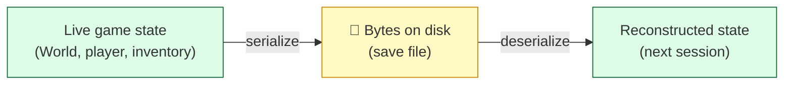
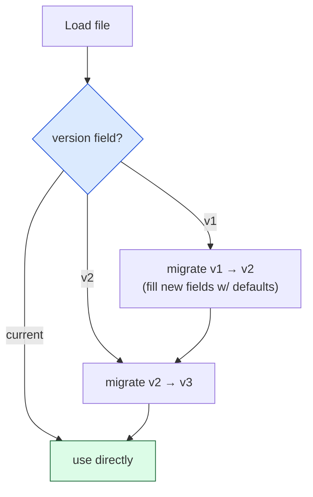
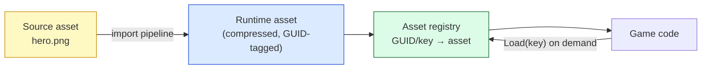

# Level 3 — Serialization & Asset Pipeline

| | |
|---|---|
| 🎚️ **Difficulty** | 🟡 Medium |
| ⏱️ **Estimated time** | 32 minutes |
| ⭐ **XP reward** | 100 (Quest) + 25 (Quiz) |

[← Prev](02-ecs-lite-and-object-pooling.md) · [↑ Phase Home](../README.md) · [→ Next](04-subsystems-and-engine-layering.md)

---

## 📖 Story

> *"Now that entities are clean data, we have to be able to **save and load** them — robustly. Two ticking bombs here. First, our World 3 save file: we wrote raw fields, no version stamp. The moment we add a field — which we just did, the whole ECS refactor — old saves either crash on load or load garbage. Players hate nothing more than a patch that eats their progress. We need **versioned saves** that can read old files and migrate them forward. Second, our assets. Right now things grab sprites and prefabs by direct reference, so renaming or moving a file silently breaks links, and we load everything up front whether we need it or not. Engines solve this with an **asset pipeline**: stable **GUID** references, an import step, and on-demand loading (Unity's flavor is **Addressables**). Today you'll build a clean serialization + asset layer for Ashfall that survives version changes and loads content on demand. Boring? It's the difference between a hobby project and something you can ship and patch. Let me show you. — Kenji"*

---

## 🎯 Goal

- Understand **serialization** from first principles: turning live objects into bytes and back
- Compare **text (JSON) vs binary** formats and know when each is the right call
- Understand **asset references via GUIDs** and why direct path/object references are fragile
- Understand the **import / asset pipeline** and the **Addressables** concept (load content on demand by key)
- Build **robust, versioned saves** (extending the World 3 save) with forward migration
- Ship a clean Ashfall **save + asset** layer

---

## 🧠 Concepts

### Serialization: live state ⇄ bytes

Your game state lives in RAM as objects, structs, arrays. To **save** it you must **serialize**: walk that state and write a flat sequence of bytes (to a file). To **load** you **deserialize**: read the bytes and rebuild the live state. The whole trick is agreeing on a **format** both sides understand.



**Text (JSON)** vs **binary**:

| | Text (JSON) | Binary |
|---|---|---|
| Human-readable / debuggable | ✅ yes | ❌ no |
| Diff-able in git, hand-editable | ✅ yes | ❌ no |
| File size & parse speed | ❌ larger / slower | ✅ smaller / faster |
| Good for | save files, configs, scenes during dev | huge asset payloads, shipped builds |

Rule of thumb: **JSON for things humans touch** (saves, configs — and Unity stores scenes/prefabs as text YAML for exactly this reason: it diffs in version control). **Binary for bulk, performance-critical, or shipped data.** Same data, different trade-off — just like AoS vs SoA.

### Versioned saves: the field you'll add tomorrow

The fatal mistake is writing your fields with **no version stamp**. The instant your data shape changes (and it always does), old files become unreadable or — worse — load *silently wrong*. The fix is one integer at the top of every save:



Read the version, then run **migrations** to bring any old file up to the current shape (new fields get sensible defaults; renamed fields get mapped). Old players' saves survive every patch. This is non-negotiable for anything you ship.

### Asset references: GUIDs, not paths

How does "this enemy uses *that* sprite" get stored? The naive way — store the **file path** or a direct object reference — is fragile: rename or move the file and every reference silently breaks. Engines instead give every asset a **stable GUID** (a globally unique id) recorded in a sidecar (Unity's `.meta` files). References store the **GUID**, not the path, so you can rename/move/reorganize assets freely and links never break — the engine resolves GUID → current location.

The **import / asset pipeline** is the step that turns *source* files (a `.png`, a `.wav`, an `.fbx`) into engine-ready runtime assets (compressed textures, mip-maps, platform formats), recording the GUID and import settings. **Addressables** (Unity's name for a near-universal concept) builds on this: you load content **by a stable key, on demand, possibly from a remote bundle** — instead of hard-linking everything and loading it all at startup. That's how you keep memory low, support DLC/patching, and avoid one giant up-front load.



### Why this exists

Serialization exists because **RAM is volatile and runtime objects can't outlive the process** — to persist or transmit state you must flatten it to bytes and rebuild it later, and a stable *format* is the contract that makes that round-trip reliable. **Versioning** exists because software *changes* but old data *persists*: without a version stamp and migrations, every schema change is a breaking change for everyone who already saved. **GUIDs and the asset pipeline** exist because content is authored as loose human files that get renamed, moved, and reprocessed constantly; a stable identity (GUID) plus an import step decouples "what an asset *is*" from "where its file currently lives" — so a 5,000-asset project doesn't collapse the first time someone reorganizes a folder. **Addressables/on-demand loading** exists because you can't fit (or afford to load) all content at once — you reference by key and stream what you need.

This is **engine-agnostic.** Every engine serializes scenes/assets (Unity YAML/binary, Unreal `.uasset`, Godot `.tscn`/`.res`), every engine uses stable asset ids (Unity GUIDs, Unreal/Godot paths-as-ids + redirectors), and every engine has on-demand content loading (Addressables, Unreal asset registry/PAK, Godot resource loader). The principles — format trade-offs, versioned migration, stable references, an import pipeline — are identical. For depth, see **RESOURCES.md** for this world — the *resources & file systems* chapters of *Game Engine Architecture*.

---

## 🛠️ Hands-on Lab

> 💻 Pure C# again (uses `System.Text.Json`, built into .NET) so you can run and test the save layer standalone, then drop it into Ashfall. We'll build a **versioned, migrating** save round-trip.

### Step 1 — A versioned save model

Every save starts with a **version**. Model the current shape, and keep the constant for "current."

```csharp
using System.Collections.Generic;

public sealed class SaveData
{
    public const int CurrentVersion = 2;     // bump this whenever the shape changes

    public int Version { get; set; } = CurrentVersion;

    // --- v1 fields (World 3 save) ---
    public string PlayerName { get; set; } = "Ash";
    public int Gold { get; set; }
    public List<string> Inventory { get; set; } = new();

    // --- v2 fields (added this world — old saves won't have these) ---
    public int PlayerLevel { get; set; } = 1;          // default for migrated v1 saves
    public float[] PlayerPosition { get; set; } = { 0f, 0f };
}
```

### Step 2 — Serialize / deserialize as JSON

Saves are human-touchable, so JSON. Write with indentation for debuggability.

```csharp
using System.IO;
using System.Text.Json;

public static class SaveIo
{
    private static readonly JsonSerializerOptions Opts = new() { WriteIndented = true };

    public static void Write(string path, SaveData data)
    {
        data.Version = SaveData.CurrentVersion;        // always stamp the current version
        File.WriteAllText(path, JsonSerializer.Serialize(data, Opts));
    }

    // Read raw JSON into a "loosely typed" doc first so we can inspect the version
    // BEFORE binding to the current model (old files may be missing new fields).
    public static SaveData Read(string path)
    {
        string json = File.ReadAllText(path);
        int version = ReadVersion(json);
        var data = JsonSerializer.Deserialize<SaveData>(json) ?? new SaveData();
        return Migrate(data, version);                 // bring old shapes up to current
    }

    private static int ReadVersion(string json)
    {
        using var doc = JsonDocument.Parse(json);
        return doc.RootElement.TryGetProperty("Version", out var v) ? v.GetInt32() : 1; // no stamp == v1
    }

    // ... Migrate() in Step 3
    public static SaveData Migrate(SaveData d, int fromVersion) => Migrations.Apply(d, fromVersion);
}
```

### Step 3 — The migration ladder

Each step upgrades one version to the next. Missing fields are already defaulted by the model, but migrations are where you do *real* fix-ups (renames, recomputes, derived data).

```csharp
public static class Migrations
{
    // Apply each migration in order until the data is current.
    public static SaveData Apply(SaveData d, int fromVersion)
    {
        int v = fromVersion;
        if (v == 1) { V1toV2(d); v = 2; }
        // future: if (v == 2) { V2toV3(d); v = 3; }
        d.Version = SaveData.CurrentVersion;
        return d;
    }

    // v1 had no PlayerLevel / PlayerPosition. Give old saves sensible values.
    private static void V1toV2(SaveData d)
    {
        d.PlayerLevel = 1;                              // everyone starts level 1
        d.PlayerPosition ??= new[] { 0f, 0f };         // spawn at origin if unknown
        // (a real rename would map old field → new field here)
    }
}
```

### Step 4 — Prove the round-trip *and* a real migration

```csharp
// Program.cs
using System.IO;

string path = Path.Combine(Path.GetTempPath(), "ashfall.save.json");

// 1) Save current-version data and load it back (sanity round-trip).
var save = new SaveData { PlayerName = "Ash", Gold = 120, PlayerLevel = 7,
                          Inventory = { "torch", "key" }, PlayerPosition = new[] { 3.5f, -2f } };
SaveIo.Write(path, save);
var loaded = SaveIo.Read(path);
Console.WriteLine($"Round-trip: {loaded.PlayerName}, gold {loaded.Gold}, lvl {loaded.PlayerLevel}");

// 2) Simulate an OLD v1 file (no version stamp, no v2 fields) and load it.
File.WriteAllText(path, "{ \"PlayerName\": \"OldHero\", \"Gold\": 40, \"Inventory\": [\"map\"] }");
var migrated = SaveIo.Read(path);
Console.WriteLine($"Migrated v1→v2: {migrated.PlayerName}, lvl {migrated.PlayerLevel} " +
                  $"(version now {migrated.Version}, pos [{migrated.PlayerPosition[0]},{migrated.PlayerPosition[1]}])");
```

```bash
dotnet run -c Release
```

The second load takes a **version-less old file** and brings it up to v2 with defaults — *no crash, no lost progress.* That's the entire robustness story in ~60 lines.

### Step 5 — Reference assets by stable key (Addressables mindset)

Don't hard-reference scattered assets; reference a **stable key** and resolve it through a registry/loader. This is the Addressables concept in miniature:

```csharp
using System.Collections.Generic;

// A tiny stand-in for an asset registry: stable key → asset (loaded on demand, cached).
public sealed class AssetRegistry<TAsset>
{
    private readonly Dictionary<string, TAsset> _cache = new();
    private readonly Func<string, TAsset> _loader;     // how to load by key (file, bundle, Addressables)

    public AssetRegistry(Func<string, TAsset> loader) => _loader = loader;

    // Load-on-demand + cache: first call loads, rest are free. Stable keys, not paths.
    public TAsset Get(string key)
    {
        if (!_cache.TryGetValue(key, out var asset))
            _cache[key] = asset = _loader(key);        // resolve key (in Unity: Addressables.LoadAssetAsync)
        return asset;
    }
}
```

In Ashfall (Unity), `_loader` wraps `Addressables.LoadAssetAsync<Sprite>(key)`; game code asks for `"enemy_skeleton_sprite"` by key and never knows or cares where the file lives. Rename the file, move it, ship it in a patch bundle — the key (backed by a GUID) is unchanged.

> 💡 Your **save** files should reference assets by these **stable keys/GUIDs too** — never by file path. A save that stored `"Assets/Art/skeleton.png"` breaks when you reorganize art; a save that stored the key `"enemy_skeleton_sprite"` doesn't.

---

## 🎮 Mini Challenge

You ship v2. Next patch you **rename** `Gold` to `Coins` in the model. A player loads their v2 save (which has `"Gold": 120`). What breaks, and what's the *minimal* correct fix using the migration ladder?

<details>
<summary>💡 Reveal answer</summary>

**What breaks:** the v2 file has a `"Gold"` property, but your new model only has `Coins`. Plain deserialization will leave `Coins` at its default (0) and ignore `"Gold"` — the player **silently loses their money.** No crash, which is *worse*, because it's invisible.

**Minimal fix:** bump `CurrentVersion` to 3 and add a `V2toV3` migration that maps the old name to the new one. Since the renamed field is gone from the model, read it from the raw JSON during migration:

- In `Apply`, add `if (v == 2) { V2toV3(d, rawJson); v = 3; }`.
- `V2toV3` parses the original JSON's `"Gold"` value (via `JsonDocument`) and assigns it to `d.Coins`.

The general rule: **a rename is a migration, not just an edit.** Never assume the serializer will "figure out" a field that changed name or shape — bump the version and write the mapping explicitly. This is exactly why the version stamp from Step 1 exists.
</details>

---

## 📦 Project Mission

Replace Ashfall's brittle World 3 save with a **versioned, migrating** save layer, and reference assets by **stable keys**.

1. Add the save layer (`SaveData`, `SaveIo`, `Migrations`) under `Assets/Scripts/Save/`. Set `CurrentVersion` above your World 3 version and include your real fields (player, inventory, gold, plus anything the ECS refactor added).
2. Write a **migration** from your old World 3 save shape to the current one (default any new fields, map any renamed ones). Test it: load a copy of an **actual old save** and confirm it upgrades without data loss.
3. Decide format per data: keep **saves/configs as JSON** (debuggable, git-diffable). If you have a bulk binary payload (e.g. a baked dungeon), note where binary would win — you don't have to convert it, just justify the choice in a comment.
4. Add the `AssetRegistry` (or wire **Addressables**): make enemies/projectiles/sprites load **by stable key on demand** instead of direct references, and ensure **saves store asset keys/GUIDs, not file paths.**
5. Commit:
   ```bash
   cd ~/projects/ashfall
   git switch -c feature/versioned-save-asset-layer
   git add Assets/Scripts/Save/ Assets/Scripts/Assets/
   git commit -m "feat: versioned saves with migration + key-based asset loading"
   git switch main && git merge feature/versioned-save-asset-layer && git push
   ```

🎯 **Mission complete when:** Ashfall saves carry a **version stamp**, an **old World 3 save loads and migrates forward with no data loss**, the save layer uses the right format per data type (JSON for human-touchable data), and assets are referenced by **stable keys/GUIDs (load-on-demand), never raw file paths** — saves and asset links survive renames and patches.

---

## ⚠️ Common Mistakes

| Mistake | What happens | Fix |
|--------|--------------|-----|
| No version field in saves | Any schema change breaks or silently corrupts old saves | Stamp a `Version` and run **migrations** on load |
| Treating a rename as a free edit | The renamed field deserializes to default → silent data loss | A rename is a **migration**: bump version, map old→new |
| Storing asset **file paths** in data | Renaming/moving a file breaks every reference | Reference by **stable GUID/key** the engine resolves |
| Loading all content at startup | Long loads, high memory, no patch/DLC story | Load **on demand by key** (Addressables concept) |
| Binary saves "for speed" during dev | Can't diff, debug, or hand-fix; pain for little gain | **JSON** for human-touchable data; binary only for bulk |
| Migrating without testing a real old file | "It compiles" but live players still lose data | Load an **actual old save** in a test and verify |
| Catching no errors on load | A corrupt/older file crashes to desktop | Read version defensively; default missing fields |

---

## 🤔 Reflection Questions

1. A teammate ships a save format with no version stamp "to keep it simple." Walk through exactly what happens to existing players the next time a field is added — and why a single integer prevents it.
2. Why is storing an asset's **file path** in a save (or a reference) a time bomb, but storing its **GUID/key** is safe? What does the engine do with the GUID that a path can't give you?
3. JSON vs binary for the same data is a trade-off like AoS vs SoA. Give one Ashfall data type where JSON is clearly right and one where binary is clearly right, and justify each.

---

## 📝 Quiz

1. **The single most important thing a robust save format includes is…**
   - a) compression
   - b) a version stamp plus migrations so old files load forward
   - c) encryption
2. **Referencing an asset by a stable GUID instead of its file path means…**
   - a) the asset loads faster
   - b) you can rename/move the file without breaking the reference
   - c) the asset is automatically compressed
3. **The Addressables concept (load content by key, on demand) primarily helps you…**
   - a) avoid loading all content up front and support patching/DLC
   - b) make JSON smaller
   - c) skip the import pipeline

<details>
<summary>✅ Answers</summary>

1: **b** · 2: **b** · 3: **a**
</details>

---

## ✅ Completion Checklist

- [ ] I can explain serialization and the JSON-vs-binary trade-off
- [ ] I built a **versioned** save round-trip in plain C#
- [ ] I migrated a **version-less old file** forward with no data loss
- [ ] Ashfall's save layer carries a version stamp and a real World-3 → current migration
- [ ] Assets are referenced by **stable key/GUID** (load-on-demand), not file paths
- [ ] Saves store asset **keys/GUIDs**, not file paths
- [ ] I passed the quiz
- [ ] Added **+125 XP** to [PROGRESS.md](../../../PROGRESS.md)

---

[← Prev](02-ecs-lite-and-object-pooling.md) · [↑ Phase Home](../README.md) · [→ Next](04-subsystems-and-engine-layering.md)
