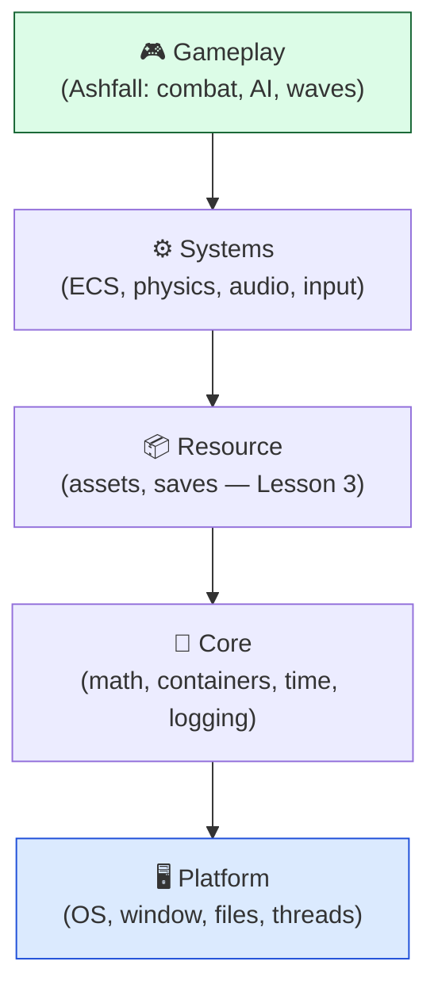
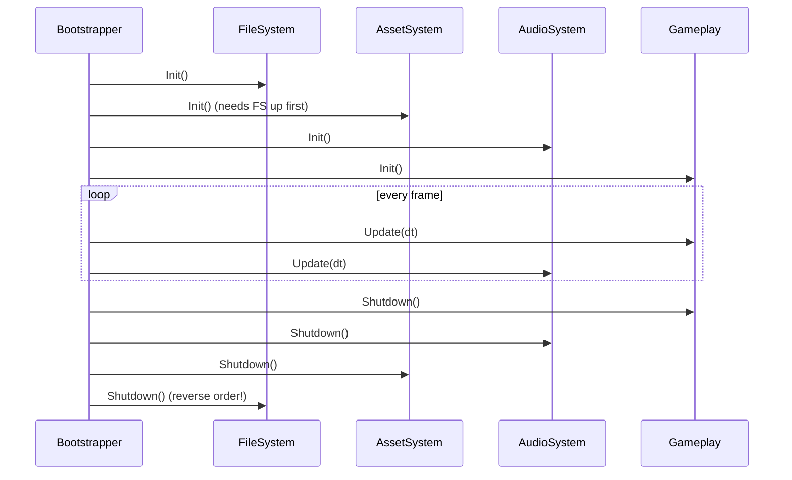

# Level 4 — Subsystems & Engine Layering

| | |
|---|---|
| 🎚️ **Difficulty** | 🔴 Hard |
| ⏱️ **Estimated time** | 35 minutes |
| ⭐ **XP reward** | 100 (Quest) + 25 (Quiz) |

[← Prev](03-serialization-and-asset-pipeline.md) · [↑ Phase Home](../README.md) · [→ Next](../boss-battle.md)

---

## 📖 Story

> *"Last piece of the refactor — and it's the one that makes Ashfall feel like an *engine* instead of a pile of scripts. Right now systems reach into each other directly: the spawner finds the audio manager, which finds the save system, which finds… it's a web. So nothing boots in a defined order, nothing can be tested in isolation, and a tweak in one corner breaks three others. Real engines are built in **layers**: a stable foundation (platform, core, resources) that gameplay sits *on top of* and depends *downward* — never up. Each capability is a **subsystem** with a clean boot and shutdown, started in the right **order** (you can't load assets before the file system is up). And systems talk through **interfaces**, not concrete types, so any one can be swapped or faked. Today we write a **bootstrapper** that starts Ashfall's subsystems in order, ticks them each frame, and shuts them down cleanly — and we decouple them behind interfaces. After this, Ashfall has a spine. Then: the boss battle. Let me show you. — Kenji"*

---

## 🎯 Goal

- Understand how a real engine is **layered**: platform → core → resource → systems → gameplay
- Understand the **dependency rule**: higher layers depend on lower; never the reverse
- Understand **subsystems**: a capability with a defined **boot** and **shutdown**, plus a per-frame **update**
- Get **boot/shutdown order** right (and shut down in reverse)
- **Decouple** subsystems via **interfaces** (and know service locator vs dependency injection)
- Refactor Ashfall behind a clean **bootstrapper**

---

## 🧠 Concepts

### Engines are layered, and dependencies point down

An engine isn't one big blob — it's a stack of **layers**, each depending only on the ones below it:



The **dependency rule**: a layer may use the layers **below** it, never **above**. Gameplay uses the audio system; the audio system must never know about Ashfall's wave logic. The platform layer must never reach up into gameplay. Why? Because the lower you are, the more stable and reusable you should be — core math and the file system shouldn't change when you tweak a boss fight. Break the rule (gameplay code baked into your audio system) and you've welded a reusable engine to one specific game. This is the same "dependencies point inward/downward" idea you met in World 1's clean architecture — applied to the whole engine.

### Subsystems: boot, update, shutdown

Each capability is a **subsystem** with a small, uniform lifecycle. The simplest contract:



Two rules fall out of the layering:
- **Boot in dependency order** — you can't initialize the asset system before the file system it reads through. Lower layers come up first.
- **Shut down in reverse** — tear down high to low, so a subsystem still has its dependencies alive while it cleans up (audio can flush to disk only while the file system is still open).

A **bootstrapper** is the one place that owns this order. Everything else stops worrying about "who starts first."

### Decoupling via interfaces (and how systems find each other)

If gameplay holds a concrete `AudioManager`, it's welded to that implementation — can't swap it, can't fake it in a test, can't run headless without it. Instead, gameplay depends on an **interface** (`IAudioService`) and receives *some* implementation. Two common ways to deliver it:

- **Dependency Injection (DI):** dependencies are **handed in** (via constructor/initializer). Explicit, testable, no hidden globals — preferred. "Tell, don't ask."
- **Service Locator:** a central registry you **ask** for a service by type (`Services.Get<IAudioService>()`). Convenient, but it's a semi-global — easy to overuse and hides dependencies. Fine in moderation (Unity's `GetComponent`/singletons are basically this).

Either way the win is the same: gameplay talks to `IAudioService`, so you can swap a real audio system for a **null/stub** one (headless server — remember World 8!), or a fake for tests, without touching gameplay. **Program to the interface, not the implementation.**

### Why this exists

Layering and subsystems exist because **a codebase where everything can touch everything is unshippable.** Without the dependency rule, you get cyclic dependencies, undefined boot order, and changes that ripple unpredictably — the "web" from the story. Layers impose a one-directional flow so each piece can be understood, tested, reused, and stabilized on its own; the most-reused code (math, files) sits at the bottom where it changes least. **Defined boot/shutdown order** exists because subsystems have real dependencies on each other's *live state* — initializing or tearing down in the wrong order is a class of crash and resource-leak bug that a bootstrapper makes structurally impossible. **Interfaces/DI** exist because hardcoding concrete dependencies makes code rigid and untestable; depending on abstractions lets you swap implementations (real vs stub vs mock) — which is exactly what lets the *same* Ashfall code run as a full client or a headless server.

This is **engine-agnostic and exactly how real engines are built.** Unreal has explicitly named subsystems with init/teardown and module load phases; Godot has servers/autoloads and a defined `_ready`/`_process`/exit lifecycle; every custom engine in *Game Engine Architecture* opens with this exact layer diagram and a startup/shutdown chapter. The dependency rule, ordered boot, reverse shutdown, and interface-based decoupling are universal. See **RESOURCES.md** for this world — the *engine subsystem startup & shutdown* chapter of *Game Engine Architecture* and the *Service Locator* chapter of *Game Programming Patterns*.

---

## 🛠️ Hands-on Lab

> 💻 Plain C# again — the bootstrapper, the subsystem contract, and the service registry have no Unity dependencies, so you can run the whole boot→tick→shutdown cycle in a console and watch the order, then drive it from Unity in the Mission.

### Step 1 — The subsystem contract and service interfaces

One uniform lifecycle for every subsystem; gameplay depends on **interfaces**, not concretes.

```csharp
// Every subsystem boots, optionally ticks each frame, and shuts down.
public interface ISubsystem
{
    string Name { get; }
    void Init();
    void Update(float dt);
    void Shutdown();
}

// Capability interfaces gameplay depends on (decoupling). Implementations vary.
public interface IFileSystem  { void Write(string path, string contents); }
public interface IAssetSystem { object Load(string key); }
public interface IAudioSystem { void Play(string clipKey); }
```

### Step 2 — A tiny service registry (service locator)

A central place to register and resolve services by interface, so subsystems find each other without hardcoding concrete types.

```csharp
using System;
using System.Collections.Generic;

public sealed class Services
{
    private readonly Dictionary<Type, object> _map = new();

    public void Register<T>(T impl) where T : class => _map[typeof(T)] = impl;

    public T Get<T>() where T : class =>
        _map.TryGetValue(typeof(T), out var s) ? (T)s
        : throw new InvalidOperationException($"Service {typeof(T).Name} not registered — boot order wrong?");
}
```

### Step 3 — Concrete subsystems (lower layers first)

Each implements both `ISubsystem` (lifecycle) and its capability interface. Note the **layering**: the asset system *depends on* the file system, so it must boot after it.

```csharp
using System;

public sealed class FileSystem : ISubsystem, IFileSystem
{
    public string Name => "FileSystem";
    public void Init()        => Console.WriteLine("  [FS] open");
    public void Update(float dt) { }                     // nothing per frame
    public void Shutdown()    => Console.WriteLine("  [FS] flush & close");
    public void Write(string path, string contents) => Console.WriteLine($"  [FS] wrote {path}");
}

public sealed class AssetSystem : ISubsystem, IAssetSystem
{
    private readonly IFileSystem _fs;                     // dependency INJECTED (DI) — points downward
    public AssetSystem(IFileSystem fs) => _fs = fs;
    public string Name => "AssetSystem";
    public void Init()        => Console.WriteLine("  [Assets] index content (via FS)");
    public void Update(float dt) { }
    public void Shutdown()    => Console.WriteLine("  [Assets] release content");
    public object Load(string key) => $"asset:{key}";
}

public sealed class AudioSystem : ISubsystem, IAudioSystem
{
    public string Name => "AudioSystem";
    public void Init()        => Console.WriteLine("  [Audio] open device");
    public void Update(float dt) { }
    public void Shutdown()    => Console.WriteLine("  [Audio] stop & close device");
    public void Play(string clipKey) => Console.WriteLine($"  [Audio] play {clipKey}");
}

// Gameplay: top layer. Depends ONLY on interfaces (never concrete subsystems).
public sealed class Gameplay : ISubsystem
{
    private readonly IAudioSystem _audio;
    private readonly IAssetSystem _assets;
    public Gameplay(IAudioSystem audio, IAssetSystem assets) { _audio = audio; _assets = assets; }
    public string Name => "Gameplay";
    public void Init()    { _assets.Load("level_1"); Console.WriteLine("  [Game] level ready"); }
    public void Update(float dt) { /* run ECS systems from Lesson 2 here */ }
    public void Shutdown() => Console.WriteLine("  [Game] save & exit");
}
```

### Step 4 — The bootstrapper: ordered boot, tick, reverse shutdown

The single owner of lifecycle order. Add subsystems **low→high**; it shuts them down **high→low** automatically.

```csharp
using System.Collections.Generic;

public sealed class Bootstrapper
{
    private readonly List<ISubsystem> _systems = new();  // kept in boot order
    public Services Services { get; } = new();

    // Register in dependency order (lowest layer first).
    public Bootstrapper Add<TInterface>(ISubsystem sys, TInterface service) where TInterface : class
    {
        _systems.Add(sys);
        Services.Register(service);                       // expose it to higher layers
        return this;
    }
    public Bootstrapper Add(ISubsystem sys) { _systems.Add(sys); return this; }

    public void Boot()
    {
        System.Console.WriteLine("BOOT (low → high):");
        foreach (var s in _systems) { System.Console.WriteLine($" init {s.Name}"); s.Init(); }
    }

    public void Tick(float dt)
    {
        foreach (var s in _systems) s.Update(dt);        // update in boot order each frame
    }

    public void Shutdown()
    {
        System.Console.WriteLine("SHUTDOWN (high → low):");
        for (int i = _systems.Count - 1; i >= 0; i--)    // REVERSE order
        { System.Console.WriteLine($" shutdown {_systems[i].Name}"); _systems[i].Shutdown(); }
    }
}
```

### Step 5 — Wire it up and run the lifecycle

```csharp
// Program.cs — boot the "engine", tick a few frames, shut down cleanly.
var fs    = new FileSystem();
var assets = new AssetSystem(fs);                         // assets depend on fs (injected)
var audio = new AudioSystem();
var game  = new Gameplay(audio, assets);                  // gameplay depends on interfaces only

var boot = new Bootstrapper()
    .Add<IFileSystem>(fs, fs)                             // layer: platform/core
    .Add<IAssetSystem>(assets, assets)                    // layer: resource (needs FS)
    .Add<IAudioSystem>(audio, audio)                      // layer: systems
    .Add(game);                                           // layer: gameplay (top)

boot.Boot();                                             // FS → Assets → Audio → Game
for (int f = 0; f < 3; f++) boot.Tick(1f / 60f);
boot.Shutdown();                                         // Game → Audio → Assets → FS (reverse)
```

```bash
dotnet run -c Release
```

The output shows subsystems coming up **in dependency order** and tearing down in **exact reverse** — the file system opens first and closes last, so everything above it always has it available. That ordered, owned lifecycle is the "spine" of an engine.

> 💡 **Headless win:** to run Ashfall as the World 8 dedicated server, register a **`NullAudioSystem`** (implements `IAudioSystem`, does nothing) instead of the real one. Gameplay depends on `IAudioSystem`, so it doesn't notice — no rendering/audio device needed. That's the whole point of interfaces.

---

## 🎮 Mini Challenge

A teammate adds a `SaveSystem` that, in its `Shutdown()`, writes the final save **through the file system**. They register it *before* `FileSystem` in the bootstrapper. The game runs fine — until exit, when saving crashes. Why, and what's the fix (be specific about order)?

<details>
<summary>💡 Reveal answer</summary>

**Why it crashes:** boot is low→high and shutdown is the **reverse**. If `SaveSystem` is registered *before* `FileSystem`, then at shutdown `SaveSystem` is torn down **after** `FileSystem` (reverse order). So when `SaveSystem.Shutdown()` tries to write the final save, the file system it depends on has **already closed** — null/closed-handle crash. It worked at boot only by luck (init order happened not to matter for it), but the dependency was backwards.

**The fix:** register subsystems in true **dependency order** — `FileSystem` first (it's a lower layer), `SaveSystem` after it (it depends on FS). Then:
- **Boot:** FileSystem.Init() → SaveSystem.Init() ✅ (FS is up before Save needs it)
- **Shutdown (reverse):** SaveSystem.Shutdown() → FileSystem.Shutdown() ✅ (Save flushes *while FS is still open*, then FS closes)

This is exactly why the bootstrapper owns order and shuts down in reverse: a higher layer must be able to use its lower-layer dependencies during *both* startup and teardown. Get the registration order right (low→high) and the reverse-shutdown rule does the rest for free.
</details>

---

## 📦 Project Mission

Refactor Ashfall behind a clean **bootstrapper** with ordered subsystems decoupled by interfaces — the spine that carries it into the boss battle and World 10.

1. Identify Ashfall's capabilities and assign each a **layer**: file system / save (resource — Lesson 3), assets (resource), input, audio, the ECS world + systems (Lesson 2), gameplay (combat/AI/waves) on top.
2. Define **interfaces** for the services gameplay uses (e.g. `IAudioService`, `IAssetService`, `ISaveService`) and make each subsystem implement `ISubsystem` (Init/Update/Shutdown) plus its capability interface.
3. Add the `Bootstrapper` and `Services` under `Assets/Scripts/Core/`. Register subsystems **low→high**; have a single entry point (a boot scene / `MonoBehaviour`) call `Boot()`, drive `Tick(dt)` from the game loop, and call `Shutdown()` on quit.
4. **Remove the web:** replace direct cross-references (spawner → audio manager singleton, etc.) with `Services.Get<IAudioService>()` (or constructor injection). Gameplay must depend on **interfaces only**.
5. **Prove decoupling:** register a `NullAudioService` and confirm the game still runs with no audio device — the headless path for the World 8 server.
6. Commit:
   ```bash
   cd ~/projects/ashfall
   git switch -c feature/subsystems-bootstrapper
   git add Assets/Scripts/Core/ Assets/Scripts/
   git commit -m "feat: layered subsystems + bootstrapper (ordered boot/shutdown, interface decoupling)"
   git switch main && git merge feature/subsystems-bootstrapper && git push
   ```

🎯 **Mission complete when:** Ashfall boots through a single **bootstrapper** that initializes subsystems in **dependency order** and shuts them down in **reverse**, gameplay depends on **interfaces** (no direct reach into concrete managers), and swapping in a **null audio service** runs the game with no errors — Ashfall now has the layered spine of a real engine, ready for the boss battle.

---

## ⚠️ Common Mistakes

| Mistake | What happens | Fix |
|--------|--------------|-----|
| Lower layer depends on a higher one | Cyclic deps; engine welded to one game | Dependencies point **down only** (gameplay→systems→core) |
| No defined boot order | Subsystem uses another that isn't up yet → crash | A **bootstrapper** inits low→high |
| Shutting down in boot order | A subsystem's dependency is already gone during teardown | Shut down in **reverse** order |
| Gameplay holds concrete managers | Can't swap, fake, or run headless | Depend on **interfaces**; inject or locate implementations |
| Service locator everywhere | Hidden global deps; hard to reason about/test | Prefer **DI**; use the locator sparingly |
| Singletons reaching across the codebase | The "web" — every change ripples | Route cross-cutting access through **interfaces**, owned by the bootstrapper |
| No null/stub implementations | Can't run a headless server or unit test | Provide `Null*`/fake services behind the interfaces |

---

## 🤔 Reflection Questions

1. State the **dependency rule** and explain, with an Ashfall example, why letting a lower layer (say audio) depend on gameplay would ruin the engine's reusability.
2. Boot order is forward, shutdown is reverse. Walk through a save-on-exit subsystem to show concretely why reverse shutdown is required, not just tidy.
3. Service locator vs dependency injection: what does each give up and gain? When is the locator's convenience worth its hidden-dependency cost in a game like Ashfall?

---

## 📝 Quiz

1. **The engine "dependency rule" says…**
   - a) every layer can call every other layer
   - b) higher layers may depend on lower layers, never the reverse
   - c) lower layers should depend on gameplay
2. **Subsystems should be shut down…**
   - a) in the same order they were initialized
   - b) in the reverse of their init order, so each still has its dependencies alive
   - c) all at once, order doesn't matter
3. **Gameplay depending on an `IAudioService` interface (not a concrete class) lets you…**
   - a) make audio louder
   - b) swap a real audio system for a null/stub one (e.g. headless server) without touching gameplay
   - c) skip the bootstrapper

<details>
<summary>✅ Answers</summary>

1: **b** · 2: **b** · 3: **b**
</details>

---

## ✅ Completion Checklist

- [ ] I can name the engine layers and state the dependency rule
- [ ] I built a bootstrapper that boots low→high and shuts down high→low
- [ ] My subsystems share an `Init/Update/Shutdown` contract
- [ ] Ashfall boots through one bootstrapper with ordered subsystems
- [ ] Gameplay depends on **interfaces**, not concrete managers (the "web" is gone)
- [ ] A **null audio service** runs the game with no errors (headless path proven)
- [ ] I passed the quiz
- [ ] Added **+125 XP** to [PROGRESS.md](../../../PROGRESS.md)

---

[← Prev](03-serialization-and-asset-pipeline.md) · [↑ Phase Home](../README.md) · [→ Next](../boss-battle.md)
