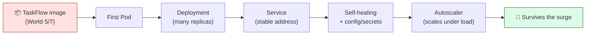
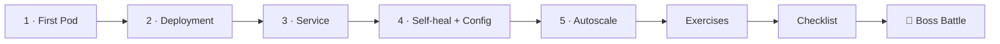

# ☸️ World 9 — Kubernetes

> *"Traffic doubled. One container on one server won't cut it — we need to scale and self-heal. Move TaskFlow to Kubernetes. — Priya, DevOps lead"*



---

## 📨 The ticket

```
From:    Priya <priya@cloudforge.inc>
To:      You <new-hire@cloudforge.inc>
Subject: [TICKET-090] Get TaskFlow onto Kubernetes

That product-launch tweet doubled our traffic overnight. Right now
TaskFlow is ONE container on ONE server. When it hiccups, we're down
until someone restarts it by hand — and one copy can't carry this load.

We're done babysitting containers. Move TaskFlow to Kubernetes:

  - run it as a Deployment with MULTIPLE replicas
  - put a Service in front for one stable, load-balanced address
  - prove it self-heals (kill a Pod, watch it come back)
  - add an autoscaler so it scales itself under load

Do it all on a LOCAL cluster (minikube or kind) — both free, no cloud
bill. The TaskFlow image is already in our registry from earlier work.

Survive the traffic surge and World 10 (launch) opens up.

— Priya
```

This world turns TaskFlow from a single fragile container into a **scaling, self-healing fleet** — the way real production runs.

---

## 🎯 What you'll achieve in this world

- ✅ Understand the scaling + self-healing problems **Docker alone** can't solve
- ✅ Run a **local Kubernetes cluster** (minikube/kind) + `kubectl` — all free
- ✅ Deploy TaskFlow as a **Deployment** with multiple **replicas**
- ✅ Expose it with a **Service** (stable address + load balancing)
- ✅ Watch **self-healing** in action; manage config via **ConfigMap/Secret**; add **probes**
- ✅ Add a **HorizontalPodAutoscaler** that scales under real load

---

## 🗺️ Level map

| Level | Lesson | Difficulty | Time | XP |
|------:|--------|:----------:|:----:|---:|
| 1 | [Why Kubernetes + Your First Pod](lessons/01-why-kubernetes-first-pod.md) | 🟡 Medium | 25 min | 125 |
| 2 | [Deployments & Scaling](lessons/02-deployments-and-scaling.md) | 🟡 Medium | 20 min | 125 |
| 3 | [Services & Networking](lessons/03-services-and-networking.md) | 🟡 Medium | 20 min | 125 |
| 4 | [Self-Healing, Config & Secrets](lessons/04-self-healing-and-config.md) | 🟡 Medium | 25 min | 125 |
| 5 | [Autoscaling Under Load](lessons/05-autoscaling.md) | 🔴 Hard | 25 min | 125 |
| 👹 | [Boss Battle — The Traffic Surge](boss-battle.md) | 🔴 Hard | 45 min | 500 |

➕ Extra reps: [exercises.md](exercises.md) · ✅ Ready to advance? [checklist.md](checklist.md)

---

## 🧭 Recommended order



Go in order — each lesson builds the manifest files (`deployment.yaml`, `service.yaml`, `hpa.yaml`) the Boss Battle expects.

---

## 📦 Project status

**Coming in:** TaskFlow is a Docker image in a registry (World 5/7), with infrastructure defined in Terraform (World 8).

**Going out:** TaskFlow runs on a **local Kubernetes cluster** as a **Deployment** (multiple replicas), exposed by a **Service**, configured via **ConfigMap + Secret** with **health probes**, and scaled by a **HorizontalPodAutoscaler** — self-healing and load-aware. The manifests live in `~/projects/taskflow/k8s/`, ready for the production push in World 10.

> 💸 **Free only:** minikube, kind, and kubectl are free and open-source and run on your machine — no cloud cost. Need a fallback? [killercoda.com](https://killercoda.com/kubernetes) gives free in-browser clusters. See [RESOURCES.md](../../RESOURCES.md).

---

[↑ Back to README](../../README.md)  ·  [🗺️ Roadmap](../../ROADMAP.md)  ·  [▶️ Start Level 1 →](lessons/01-why-kubernetes-first-pod.md)
