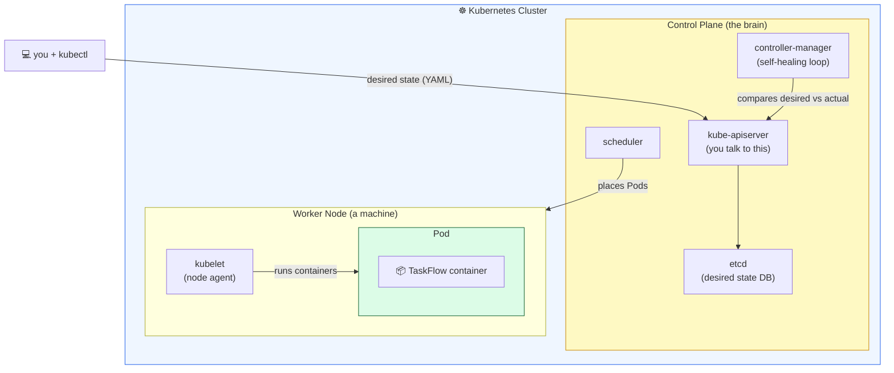

# Level 1 — Why Kubernetes + Your First Pod

| | |
|---|---|
| 🎚️ **Difficulty** | 🟡 Medium |
| ⏱️ **Estimated time** | 25 minutes |
| ⭐ **XP reward** | 100 (Quest) + 25 (Quiz) |

[← Prev: World Home](../README.md) · [↑ Phase Home](../README.md) · [→ Next: Deployments & Scaling](02-deployments-and-scaling.md)

---

## 📖 Story

> *"Traffic doubled overnight after that product launch tweet. Right now TaskFlow is **one container on one server**. When that container hiccups, the whole app is down until someone SSHes in and restarts it. That's not a system — that's a pager going off at 3am. We need something that runs many copies, restarts dead ones automatically, and scales when load spikes. We're moving to **Kubernetes**. — Priya, DevOps lead"*

You already have a Docker image (World 5) and infrastructure in Terraform (World 8). Now we hand the *running* of that image to an orchestrator that never sleeps.

---

## 🎯 Goal

- Understand the scaling + self-healing problems that **Docker alone** doesn't solve
- Install a **local Kubernetes cluster** (minikube **or** kind) and `kubectl` — all free
- Start the cluster and confirm it's healthy
- Run the **TaskFlow image as a Pod** and reach it

---

## 🧠 Concepts

A **container** is one running copy of your image. Docker can run a container — but it won't *watch* it, *replace* it when it dies, or run *ten* of it across machines. That job belongs to an **orchestrator**.

**Kubernetes (K8s)** is the orchestrator the whole industry standardized on. You tell it the *desired state* ("I want 3 healthy copies of TaskFlow"), and it works continuously to *make reality match* — restarting, rescheduling, and rebalancing without you.

The smallest thing K8s runs is a **Pod**: a wrapper around one (or a few tightly-coupled) containers. You rarely create Pods by hand in production — but creating one by hand first makes everything above it make sense.



### Why this exists

Docker answers *"how do I package and run this once?"* Kubernetes answers *"how do I keep N copies of this alive, reachable, and scaled — forever, across failures?"* When your launch tweet goes viral, you don't want a human in the loop deciding to restart a crashed container. You want a control loop that already did it. That control loop is the heart of K8s, and it's why Priya is moving TaskFlow there.

---

## 🛠️ Hands-on Lab

> 💸 **Free only:** `minikube`, `kind`, and `kubectl` are free, open-source, and run **on your own machine** — no cloud bill. Pick **one** of minikube or kind. Stuck installing? [killercoda.com](https://killercoda.com/kubernetes) gives you a free in-browser cluster as a fallback (see [RESOURCES.md](../../../RESOURCES.md)).

### Step 1 — Install `kubectl` (the K8s command-line tool)

Inside **Ubuntu (WSL2)**:

```bash
# Download the latest stable kubectl
curl -LO "https://dl.k8s.io/release/$(curl -L -s https://dl.k8s.io/release/stable.txt)/bin/linux/amd64/kubectl"

# Install it onto your PATH
sudo install -o root -g root -m 0755 kubectl /usr/local/bin/kubectl

# Confirm
kubectl version --client
```

### Step 2 — Install a local cluster tool (pick ONE)

**Option A — minikube** (a full single-node cluster in a VM/container):

```bash
curl -LO https://storage.googleapis.com/minikube/releases/latest/minikube-linux-amd64
sudo install minikube-linux-amd64 /usr/local/bin/minikube
minikube version
```

**Option B — kind** (Kubernetes IN Docker — lighter, needs Docker from World 5):

```bash
curl -Lo ./kind https://kind.sigs.k8s.io/dl/latest/kind-linux-amd64
sudo install ./kind /usr/local/bin/kind
kind version
```

### Step 3 — Start your cluster

```bash
# minikube:
minikube start

# OR kind:
kind create cluster --name taskflow
```

This takes a minute the first time (it pulls node images). When done, you have a running Kubernetes cluster on your laptop.

### Step 4 — Confirm the cluster is alive

```bash
# kubectl was auto-configured to talk to your new cluster
kubectl cluster-info

# List the node(s) — should show one node in STATUS "Ready"
kubectl get nodes

# What's running in the system namespace (K8s' own components)?
kubectl get pods -A
```

### Step 5 — Run the TaskFlow image as a Pod

We'll use the image you built/pushed in World 5/7. Replace `YOUR_USER` with your registry username (e.g. your GitHub username for `ghcr.io`).

```bash
# Create a single Pod from the TaskFlow image, naming it "taskflow"
kubectl run taskflow --image=ghcr.io/YOUR_USER/taskflow:latest --port=3000

# Watch it move from ContainerCreating -> Running
kubectl get pods -w
# (press Ctrl+C once it says Running)
```

> 🧪 **No registry image yet?** Test the mechanics with a public sample image: `kubectl run taskflow --image=nginxdemos/hello --port=80`. Swap in your real TaskFlow image when it's pushed.

### Step 6 — Reach the Pod

A Pod has an internal cluster IP, not reachable from your laptop directly. Use **port-forward** to tunnel to it:

```bash
# Map localhost:8080 on your machine -> port 3000 in the Pod
kubectl port-forward pod/taskflow 8080:3000
```

In another terminal (or your browser): `curl http://localhost:8080` — you should get a response from TaskFlow. 🎉

---

## 🎮 Mini Challenge

Without deleting it, find out **which node** your Pod landed on and **what its internal IP** is — in a single command.

<details>
<summary>💡 Reveal answer</summary>

```bash
kubectl get pod taskflow -o wide
```

The `-o wide` flag adds `NODE` and `IP` columns. The scheduler chose that node for you — you never had to. That placement decision is one of the jobs Docker alone never did.
</details>

---

## 📦 Project Mission

Get the real TaskFlow image running as a Pod on your local cluster and prove you can reach it.

```bash
# 1. Start your cluster (minikube start  OR  kind create cluster --name taskflow)
# 2. Run TaskFlow as a Pod (use your real image)
kubectl run taskflow --image=ghcr.io/YOUR_USER/taskflow:latest --port=3000

# 3. Confirm it's Running
kubectl get pods

# 4. Port-forward and hit it
kubectl port-forward pod/taskflow 8080:3000
#   then in another terminal:  curl http://localhost:8080
```

🎯 **Mission complete when:** `kubectl get pods` shows `taskflow` in `Running` status, and `curl http://localhost:8080` (with port-forward active) returns a TaskFlow response. You've run TaskFlow on Kubernetes for the first time.

---

## ⚠️ Common Mistakes

| Mistake | What happens | Fix |
|--------|--------------|-----|
| Forgetting to start the cluster | `kubectl` errors: `connection refused` | Run `minikube start` / `kind create cluster` first |
| Wrong image name or tag | Pod stuck in `ErrImagePull` / `ImagePullBackOff` | Check spelling; confirm the image exists in your registry |
| Private registry, no credentials | `ErrImagePull` even with right name | Make the image public, or add an `imagePullSecret` (covered later) |
| Expecting `localhost` to hit the Pod | Nothing loads in browser | Pods aren't exposed by default — use `kubectl port-forward` |
| Confusing `kubectl version` hanging | Waits forever | Use `kubectl version --client` to check only the local tool |

---

## 🤔 Reflection Questions

1. What does Docker *not* do that made Priya insist on Kubernetes?
2. In your own words, what is "desired state" and which component stores it?
3. Why couldn't you just open `localhost:3000` to reach your Pod?

---

## 📝 Quiz

1. **The smallest deployable unit in Kubernetes is a…**
   - a) Container
   - b) Pod
   - c) Node
2. **Kubernetes keeps your app healthy by…**
   - a) emailing you when something breaks
   - b) continuously reconciling actual state toward your declared desired state
   - c) running everything twice and hoping
3. **You ran a Pod but `curl localhost` fails. The most likely reason is…**
   - a) the image is broken
   - b) Pods aren't exposed to your laptop without port-forward or a Service
   - c) Kubernetes is down

<details>
<summary>✅ Answers</summary>

1: **b** · 2: **b** · 3: **b**
</details>

---

## ✅ Completion Checklist

- [ ] `kubectl version --client` prints a version
- [ ] My cluster is running (`kubectl get nodes` shows a `Ready` node)
- [ ] TaskFlow runs as a Pod (`kubectl get pods` → `Running`)
- [ ] I reached it via `kubectl port-forward` (Project Mission)
- [ ] I passed the quiz
- [ ] I added **+125 XP** to [PROGRESS.md](../../../PROGRESS.md)

---

[← Prev: World Home](../README.md) · [↑ Phase Home](../README.md) · [→ Next: Deployments & Scaling](02-deployments-and-scaling.md)
