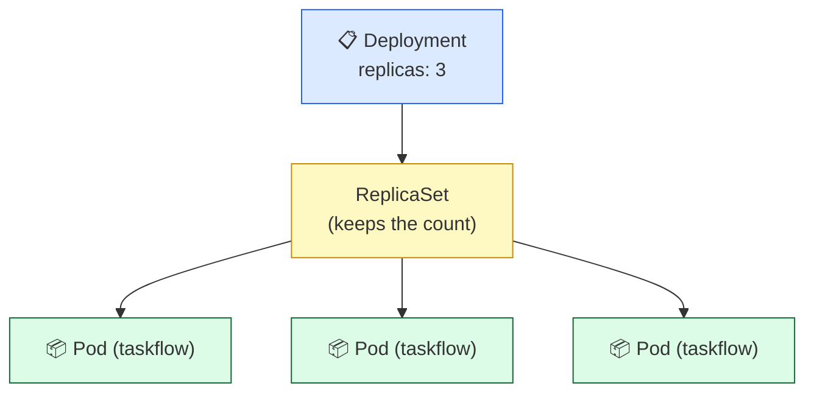

# Level 2 — Deployments & Scaling

| | |
|---|---|
| 🎚️ **Difficulty** | 🟡 Medium |
| ⏱️ **Estimated time** | 20 minutes |
| ⭐ **XP reward** | 100 (Quest) + 25 (Quiz) |

[← Prev: Why Kubernetes + Your First Pod](01-why-kubernetes-first-pod.md) · [↑ Phase Home](../README.md) · [→ Next: Services & Networking](03-services-and-networking.md)

---

## 📖 Story

> *"One Pod is a nice demo, but if it crashes we're still down — and a single copy can't handle the launch traffic. I don't want to babysit Pods by hand. Give me a **Deployment**: tell Kubernetes how many copies of TaskFlow to keep alive, and let it do the keeping. Then prove you can dial that number up when traffic spikes. — Priya"*

A lone Pod is fragile and manual. A **Deployment** turns "I want N healthy copies" into something Kubernetes guarantees.

---

## 🎯 Goal

- Understand why we almost never run bare Pods in production
- Write a **Deployment manifest** (`deployment.yaml`) with `replicas`
- `kubectl apply` it and watch multiple Pods appear
- Use `kubectl scale` to change the replica count on demand

---

## 🧠 Concepts

A **Deployment** is a controller that manages a set of identical Pods for you. You declare `replicas: 3`, and the Deployment (via a **ReplicaSet**) makes sure exactly 3 healthy Pods exist — recreating any that die, and adding or removing Pods when you change the number.



### Why this exists

If you run a bare Pod and it dies, it stays dead — nothing recreates it. A Deployment closes that gap: it's the control loop that *re-counts your Pods constantly* and fixes any drift. It's also the thing that makes **scaling** a one-word operation (`scale`) and, later, makes **rolling updates** safe. This is the workhorse object you'll use for almost everything.

---

## 🛠️ Hands-on Lab

### Step 1 — Clean up the bare Pod from Level 1

```bash
kubectl delete pod taskflow --ignore-not-found
```

### Step 2 — Write the Deployment manifest

Create `~/projects/taskflow/k8s/deployment.yaml`:

```bash
mkdir -p ~/projects/taskflow/k8s
```

```yaml
# ~/projects/taskflow/k8s/deployment.yaml
apiVersion: apps/v1
kind: Deployment
metadata:
  name: taskflow
  labels:
    app: taskflow
spec:
  replicas: 3                  # keep 3 healthy copies at all times
  selector:
    matchLabels:
      app: taskflow            # this Deployment owns Pods with this label
  template:                    # the Pod blueprint
    metadata:
      labels:
        app: taskflow          # must match the selector above
    spec:
      containers:
        - name: taskflow
          image: ghcr.io/YOUR_USER/taskflow:latest
          ports:
            - containerPort: 3000
```

> 🔑 The `selector.matchLabels` and `template.metadata.labels` **must match** — that label is how the Deployment recognizes "its" Pods.

### Step 3 — Apply it

```bash
# Create/update everything described in the file
kubectl apply -f ~/projects/taskflow/k8s/deployment.yaml

# Watch 3 Pods spin up
kubectl get pods -w
# Ctrl+C when all three are Running
```

### Step 4 — Inspect what you got

```bash
kubectl get deployments          # READY should read 3/3
kubectl get replicasets          # the ReplicaSet the Deployment created
kubectl get pods -l app=taskflow # list only TaskFlow Pods (by label)
```

### Step 5 — Scale up (traffic spike!) then back down

```bash
# Dial up to 5 copies
kubectl scale deployment/taskflow --replicas=5
kubectl get pods -l app=taskflow   # now 5 Pods

# Calm down to 2 after the spike
kubectl scale deployment/taskflow --replicas=2
kubectl get pods -l app=taskflow   # back to 2
```

> 💡 You can also change `replicas:` in the YAML and re-`apply`. Editing the file is the "declarative" way; `kubectl scale` is the quick imperative way. Both are valid.

---

## 🎮 Mini Challenge

Scale to 4 replicas, then **delete one Pod by name**. How many Pods exist a few seconds later, and why?

<details>
<summary>💡 Reveal answer</summary>

```bash
kubectl scale deployment/taskflow --replicas=4
kubectl get pods -l app=taskflow            # pick a name
kubectl delete pod <one-pod-name>
kubectl get pods -l app=taskflow            # still 4!
```

Still **4**. The Deployment's ReplicaSet noticed actual count (3) ≠ desired (4) and immediately created a replacement. That's self-healing — and it's exactly what Level 4 explores.
</details>

---

## 📦 Project Mission

Convert TaskFlow from a one-off Pod into a managed, scalable Deployment.

```bash
# 1. Apply your Deployment (3 replicas)
kubectl apply -f ~/projects/taskflow/k8s/deployment.yaml

# 2. Confirm 3/3 ready
kubectl get deployment taskflow

# 3. Simulate a traffic spike: scale to 5
kubectl scale deployment/taskflow --replicas=5
kubectl get pods -l app=taskflow

# 4. Scale back to 3 and re-confirm
kubectl scale deployment/taskflow --replicas=3
```

🎯 **Mission complete when:** `kubectl get deployment taskflow` shows `READY 3/3`, you successfully scaled to 5 and back, and `deployment.yaml` is saved in `~/projects/taskflow/k8s/`. TaskFlow now runs as a self-managed fleet.

---

## ⚠️ Common Mistakes

| Mistake | What happens | Fix |
|--------|--------------|-----|
| `selector` labels ≠ `template` labels | `apply` rejects the manifest | Make `matchLabels` and the Pod `labels` identical |
| Wrong `apiVersion` (e.g. `v1` for a Deployment) | `no matches for kind "Deployment"` | Deployments use `apps/v1` |
| Editing the file but forgetting to re-apply | Cluster doesn't change | Re-run `kubectl apply -f ...` after edits |
| `kubectl scale` then re-applying old YAML | Replica count jumps back | The YAML is the source of truth — update it too |
| Bad indentation in YAML | `error converting YAML` | YAML is space-sensitive; use 2 spaces, no tabs |

---

## 🤔 Reflection Questions

1. Why is a Deployment safer than a bare Pod for production?
2. What's the relationship between a Deployment, a ReplicaSet, and Pods?
3. What does the `selector` actually do, and why must it match the template labels?

---

## 📝 Quiz

1. **A Deployment keeps your Pod count correct by using a…**
   - a) Service
   - b) ReplicaSet
   - c) ConfigMap
2. **To go from 3 to 6 copies quickly, you run…**
   - a) `kubectl restart deployment/taskflow`
   - b) `kubectl scale deployment/taskflow --replicas=6`
   - c) `kubectl delete deployment/taskflow`
3. **The Deployment knows which Pods are "its own" because of…**
   - a) the Pod creation time
   - b) matching labels (selector ↔ template labels)
   - c) the node they run on

<details>
<summary>✅ Answers</summary>

1: **b** · 2: **b** · 3: **b**
</details>

---

## ✅ Completion Checklist

- [ ] `deployment.yaml` exists in `~/projects/taskflow/k8s/` with `replicas: 3`
- [ ] `kubectl apply -f` created the Deployment (`READY 3/3`)
- [ ] I scaled to 5 and back with `kubectl scale`
- [ ] I understand how Deployment → ReplicaSet → Pods relate
- [ ] I passed the quiz
- [ ] I added **+125 XP** to [PROGRESS.md](../../../PROGRESS.md)

---

[← Prev: Why Kubernetes + Your First Pod](01-why-kubernetes-first-pod.md) · [↑ Phase Home](../README.md) · [→ Next: Services & Networking](03-services-and-networking.md)
