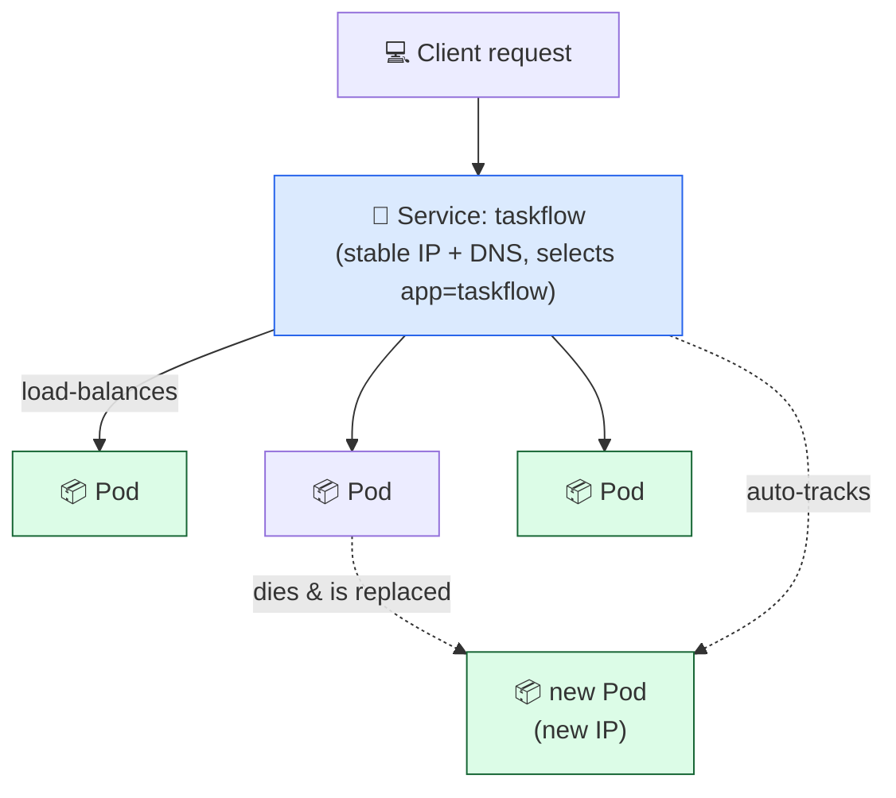

# Level 3 — Services & Networking

| | |
|---|---|
| 🎚️ **Difficulty** | 🟡 Medium |
| ⏱️ **Estimated time** | 20 minutes |
| ⭐ **XP reward** | 100 (Quest) + 25 (Quiz) |

[← Prev: Deployments & Scaling](02-deployments-and-scaling.md) · [↑ Phase Home](../README.md) · [→ Next: Self-Healing, Config & Secrets](04-self-healing-and-config.md)

---

## 📖 Story

> *"Nice, you've got 3 Pods. But here's my problem: each Pod has its own IP, and those IPs **change** every time a Pod restarts or reschedules. How is anything supposed to find TaskFlow when its address keeps moving? I need **one stable front door** that load-balances across all the copies. — Priya"*

Pods are cattle, not pets — they come and go, and their IPs go with them. A **Service** gives the herd one address that never changes.

---

## 🎯 Goal

- Understand why Pods need a **stable address** in front of them
- Create a **Service** (ClusterIP and NodePort) that load-balances across Pods
- Reach the app through the Service from inside *and* outside the cluster
- Know when to use `port-forward` vs a real Service

---

## 🧠 Concepts

A **Service** is a stable network endpoint that sits in front of a set of Pods (chosen by **label selector**). It gets a fixed virtual IP and DNS name, and it **load-balances** traffic across whichever matching Pods are currently healthy. When Pods die and new ones replace them, the Service just keeps routing — clients never notice.

Service types you'll meet:
- **ClusterIP** (default): reachable only *inside* the cluster. Perfect for Pod-to-Pod (e.g. API → database).
- **NodePort**: opens a fixed port on the node so you can reach it from *outside* (great for local dev).
- **LoadBalancer**: asks the cloud for a real external IP (we keep it local + free, so we use NodePort/port-forward instead).



### Why this exists

If clients had to hard-code Pod IPs, every restart would break them. The Service decouples *"who's calling"* from *"which exact Pods answer"*. It's service discovery + load balancing in one object — the stable contract on top of disposable Pods. This is the piece that makes a scaling, self-healing app actually *usable*.

---

## 🛠️ Hands-on Lab

> Make sure your Deployment from Level 2 is running (`kubectl get deployment taskflow` → `3/3`).

### Step 1 — Write the Service manifest

Create `~/projects/taskflow/k8s/service.yaml`:

```yaml
# ~/projects/taskflow/k8s/service.yaml
apiVersion: v1
kind: Service
metadata:
  name: taskflow
  labels:
    app: taskflow
spec:
  type: ClusterIP            # default; stable in-cluster address
  selector:
    app: taskflow            # routes to Pods with this label
  ports:
    - name: http
      port: 80               # the Service's port
      targetPort: 3000       # the container's port
```

### Step 2 — Apply and inspect

```bash
kubectl apply -f ~/projects/taskflow/k8s/service.yaml

kubectl get service taskflow          # note the CLUSTER-IP
kubectl describe service taskflow     # see "Endpoints" = the Pod IPs it routes to
```

> 🔎 The `Endpoints` line is the proof: those are the live Pod IPs the Service load-balances across. Delete a Pod and they update automatically.

### Step 3 — Reach it from *inside* the cluster (ClusterIP + DNS)

ClusterIP isn't reachable from your laptop directly, so test it from a throwaway Pod *inside* the cluster:

```bash
# Spin up a temporary Pod with curl and hit the Service by its DNS name
kubectl run tmp --rm -it --image=curlimages/curl --restart=Never -- \
  curl -s http://taskflow.default.svc.cluster.local:80
```

The DNS name pattern is `SERVICE.NAMESPACE.svc.cluster.local`. Inside the same namespace you can shorten it to just `taskflow`.

### Step 4 — Reach it from *outside* (NodePort, for local dev)

For local access, switch the type to **NodePort** (or add a second Service). Edit `service.yaml`:

```yaml
spec:
  type: NodePort            # opens a port on the node
  selector:
    app: taskflow
  ports:
    - name: http
      port: 80
      targetPort: 3000
      nodePort: 30080       # 30000–32767 range
```

```bash
kubectl apply -f ~/projects/taskflow/k8s/service.yaml

# minikube gives you a ready-to-open URL:
minikube service taskflow --url
#   -> open the printed URL in your browser

# kind: port-forward the Service instead (works for any type)
kubectl port-forward service/taskflow 8080:80
#   -> curl http://localhost:8080
```

### Step 5 — Prove load balancing

```bash
# Hit the Service repeatedly; requests fan out across Pods
for i in $(seq 1 6); do
  kubectl run tmp$i --rm -it --image=curlimages/curl --restart=Never -- \
    curl -s http://taskflow/healthz || true
done
```

---

## 🎮 Mini Challenge

Without `port-forward`, get the list of **actual Pod IPs** your Service currently routes to. What happens to that list if you delete one of those Pods?

<details>
<summary>💡 Reveal answer</summary>

```bash
kubectl get endpoints taskflow      # or: kubectl describe service taskflow
```

It lists the live Pod IPs. Delete one Pod and the Deployment replaces it; re-run the command and you'll see the **new** Pod's IP swapped in — the Service tracked the change with zero config from you.
</details>

---

## 📦 Project Mission

Put a stable front door on TaskFlow so it's reachable no matter which Pods are alive.

```bash
# 1. Apply the Service
kubectl apply -f ~/projects/taskflow/k8s/service.yaml

# 2. Confirm it has endpoints (the Pod IPs)
kubectl get endpoints taskflow

# 3. Reach TaskFlow through the Service
#    minikube:  minikube service taskflow --url   (open in browser)
#    kind:      kubectl port-forward service/taskflow 8080:80  ->  curl localhost:8080
```

🎯 **Mission complete when:** `kubectl get service taskflow` shows your Service, `kubectl get endpoints taskflow` lists multiple Pod IPs, and you reached TaskFlow *through the Service* (not a bare Pod). TaskFlow now has one stable, load-balanced address.

---

## ⚠️ Common Mistakes

| Mistake | What happens | Fix |
|--------|--------------|-----|
| Service `selector` ≠ Pod labels | `Endpoints: <none>`, nothing routes | Match the selector to the Deployment's Pod labels (`app: taskflow`) |
| `targetPort` ≠ container port | Connection refused | `targetPort` must equal the container's real port (3000) |
| Expecting ClusterIP from your laptop | Can't connect from browser | ClusterIP is in-cluster only; use NodePort, `port-forward`, or `minikube service` |
| `nodePort` outside 30000–32767 | `apply` rejected | Pick a port in the valid NodePort range |
| Forgetting `minikube tunnel`/forward | LoadBalancer stays `<pending>` locally | Use NodePort/port-forward locally to stay free |

---

## 🤔 Reflection Questions

1. Why can't clients just use a Pod's IP directly?
2. When would you choose ClusterIP vs NodePort?
3. How does the Service know which Pods to send traffic to — and how does it stay correct when Pods change?

---

## 📝 Quiz

1. **A Service gives a set of Pods…**
   - a) more CPU
   - b) one stable address + load balancing
   - c) a bigger disk
2. **Which Service type is reachable only *inside* the cluster?**
   - a) NodePort
   - b) LoadBalancer
   - c) ClusterIP
3. **A Service shows `Endpoints: <none>`. The likely cause is…**
   - a) the cluster is down
   - b) its selector doesn't match any Pod labels
   - c) the image is private

<details>
<summary>✅ Answers</summary>

1: **b** · 2: **c** · 3: **b**
</details>

---

## ✅ Completion Checklist

- [ ] `service.yaml` exists in `~/projects/taskflow/k8s/`
- [ ] `kubectl get service taskflow` shows the Service
- [ ] `kubectl get endpoints taskflow` lists multiple Pod IPs
- [ ] I reached TaskFlow *through the Service* (NodePort / port-forward / `minikube service`)
- [ ] I passed the quiz
- [ ] I added **+125 XP** to [PROGRESS.md](../../../PROGRESS.md)

---

[← Prev: Deployments & Scaling](02-deployments-and-scaling.md) · [↑ Phase Home](../README.md) · [→ Next: Self-Healing, Config & Secrets](04-self-healing-and-config.md)
