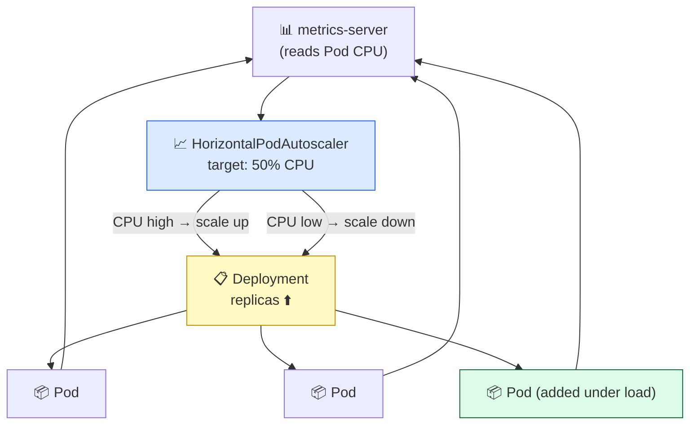

# Level 5 — Autoscaling Under Load

| | |
|---|---|
| 🎚️ **Difficulty** | 🔴 Hard |
| ⏱️ **Estimated time** | 25 minutes |
| ⭐ **XP reward** | 100 (Quest) + 25 (Quiz) |

[← Prev: Self-Healing, Config & Secrets](04-self-healing-and-config.md) · [↑ Phase Home](../README.md) · [→ Boss Battle: The Traffic Surge](../boss-battle.md)

---

## 📖 Story

> *"You can scale by hand with `kubectl scale` — but I'm not going to wake up to manually add Pods every time we trend. I want TaskFlow to scale **itself**: more Pods when CPU climbs, fewer when it calms down. Set up a HorizontalPodAutoscaler, throw load at it, and show me the Pod count rise on its own. That's the whole point of moving to Kubernetes. — Priya"*

Manual scaling is a person watching a graph. Autoscaling is the graph watching itself.

---

## 🎯 Goal

- Set **resource requests/limits** so K8s can reason about CPU usage
- Create a **HorizontalPodAutoscaler (HPA)** that targets CPU utilization
- Generate **load** and watch the HPA add Pods automatically
- Watch it scale back down when the load stops

---

## 🧠 Concepts

The **HorizontalPodAutoscaler** watches a metric (commonly CPU) across your Pods and adjusts the Deployment's replica count to hit a target. "Average CPU above 50%? Add Pods. Below it for a while? Remove them." It needs two things to work:

1. **Resource `requests`** on the container — the HPA computes utilization as *usage ÷ requested*. No request, no percentage, no autoscaling.
2. A **metrics source** (the `metrics-server`) so the HPA can read live CPU usage.



### Why this exists

Traffic isn't constant — it spikes for launches, sales, and viral moments, then drops. Static replica counts force a bad trade: too few and you fall over under load; too many and you burn money idling. The HPA closes that loop automatically, matching capacity to demand in real time. This is the self-driving scaling Priya moved to Kubernetes to get.

---

## 🛠️ Hands-on Lab

### Step 1 — Enable the metrics-server

The HPA can't autoscale without CPU metrics.

```bash
# minikube: enable the bundled addon
minikube addons enable metrics-server

# kind (or any cluster): install it, then patch for local/insecure kubelet TLS
kubectl apply -f https://github.com/kubernetes-sigs/metrics-server/releases/latest/download/components.yaml
kubectl patch deployment metrics-server -n kube-system --type='json' \
  -p='[{"op":"add","path":"/spec/template/spec/containers/0/args/-","value":"--kubelet-insecure-tls"}]'

# Wait a moment, then confirm metrics flow:
kubectl top nodes
kubectl top pods -l app=taskflow
```

### Step 2 — Add resource requests/limits to the Deployment

The HPA needs a CPU **request** to compute utilization. Add `resources` to the container in `deployment.yaml`:

```yaml
      containers:
        - name: taskflow
          image: ghcr.io/YOUR_USER/taskflow:latest
          ports:
            - containerPort: 3000
          resources:
            requests:          # the HPA divides usage by THIS
              cpu: "100m"      # 100 millicores = 0.1 CPU
              memory: "128Mi"
            limits:            # hard ceiling per Pod
              cpu: "500m"
              memory: "256Mi"
```

```bash
kubectl apply -f ~/projects/taskflow/k8s/deployment.yaml
```

### Step 3 — Write the HPA manifest

Create `~/projects/taskflow/k8s/hpa.yaml`:

```yaml
# ~/projects/taskflow/k8s/hpa.yaml
apiVersion: autoscaling/v2
kind: HorizontalPodAutoscaler
metadata:
  name: taskflow
spec:
  scaleTargetRef:
    apiVersion: apps/v1
    kind: Deployment
    name: taskflow            # the Deployment to scale
  minReplicas: 3
  maxReplicas: 10
  metrics:
    - type: Resource
      resource:
        name: cpu
        target:
          type: Utilization
          averageUtilization: 50   # add Pods when avg CPU > 50% of request
```

```bash
kubectl apply -f ~/projects/taskflow/k8s/hpa.yaml
kubectl get hpa taskflow        # TARGETS shows current% / 50%
```

### Step 4 — Generate load and watch it scale OUT

In one terminal, watch the HPA:

```bash
kubectl get hpa taskflow -w
```

In a **second** terminal, fire continuous requests at the Service from inside the cluster:

```bash
# A busybox Pod hammering the Service in a tight loop
kubectl run load --rm -it --image=busybox --restart=Never -- \
  /bin/sh -c "while true; do wget -q -O- http://taskflow; done"
```

Within a minute or two, the HPA's `TARGETS` CPU climbs past 50%, `REPLICAS` rises, and new Pods appear:

```bash
kubectl get pods -l app=taskflow   # more Pods than you started with
```

### Step 5 — Stop the load and watch it scale back IN

Stop the load generator (Ctrl+C in the second terminal — the `--rm` cleans it up). CPU drops, and after a cool-down window the HPA reduces replicas back toward `minReplicas`. (Scale-down is intentionally slower than scale-up, to avoid flapping.)

```bash
kubectl get hpa taskflow -w        # REPLICAS trends back down over a few minutes
```

---

## 🎮 Mini Challenge

Your HPA shows `TARGETS: <unknown>/50%` and never scales. Name the **two** most likely causes and how to check each.

<details>
<summary>💡 Reveal answer</summary>

1. **No metrics-server** — the HPA can't read CPU. Check with `kubectl top pods`; if that errors, the metrics-server isn't installed/ready (for kind, you likely need the `--kubelet-insecure-tls` patch from Step 1).
2. **No CPU `request` on the container** — utilization is `usage ÷ request`, so with no request there's nothing to divide by. Check with `kubectl describe deployment taskflow` and confirm `Requests: cpu`.
</details>

---

## 📦 Project Mission

Make TaskFlow scale itself under load.

```bash
# 1. metrics-server enabled and reporting
kubectl top pods -l app=taskflow

# 2. Deployment has CPU requests; HPA applied
kubectl apply -f ~/projects/taskflow/k8s/deployment.yaml
kubectl apply -f ~/projects/taskflow/k8s/hpa.yaml
kubectl get hpa taskflow

# 3. Generate load in another terminal (the busybox loop above),
#    then watch replicas rise:
kubectl get hpa taskflow -w

# 4. Stop the load; confirm replicas fall back toward minReplicas
```

🎯 **Mission complete when:** `kubectl get hpa taskflow` shows a real `TARGETS` percentage (not `<unknown>`), the Pod count **rises under load** and **falls afterward**, and `hpa.yaml` is saved in `~/projects/taskflow/k8s/`. TaskFlow now scales itself.

---

## ⚠️ Common Mistakes

| Mistake | What happens | Fix |
|--------|--------------|-----|
| No metrics-server | `TARGETS: <unknown>`, never scales | Enable addon (minikube) or install + patch (kind) |
| No CPU `requests` on container | HPA can't compute % | Add `resources.requests.cpu` |
| `maxReplicas` too low | Stops scaling under real load | Raise `maxReplicas` to a sane ceiling |
| Expecting instant scale-down | Replicas linger after load stops | Scale-down has a cool-down to prevent flapping — be patient |
| `limits` < `requests` | Pods rejected/throttled | Keep `limits` ≥ `requests` |

---

## 🤔 Reflection Questions

1. Why does the HPA *require* a CPU `request` to function?
2. Why is scale-down deliberately slower than scale-up?
3. What's the difference between `kubectl scale` and an HPA — and when do you want each?

---

## 📝 Quiz

1. **An HPA needs which of these to compute CPU utilization?**
   - a) a LoadBalancer
   - b) a CPU `request` on the container + a metrics source
   - c) a second cluster
2. **`averageUtilization: 50` for CPU means…**
   - a) cap each Pod at 50% CPU
   - b) add/remove Pods to keep average CPU near 50% of the requested CPU
   - c) use 50 Pods
3. **`kubectl get hpa` shows `TARGETS: <unknown>/50%`. First thing to check?**
   - a) the Service type
   - b) whether `kubectl top pods` works (metrics-server) and the container has a CPU request
   - c) the node's disk space

<details>
<summary>✅ Answers</summary>

1: **b** · 2: **b** · 3: **b**
</details>

---

## ✅ Completion Checklist

- [ ] `metrics-server` is running (`kubectl top pods` works)
- [ ] Deployment has CPU `requests` (and sane `limits`)
- [ ] `hpa.yaml` applied; `kubectl get hpa` shows a real `TARGETS` %
- [ ] I generated load and watched Pods scale **out**, then **in**
- [ ] I passed the quiz
- [ ] I added **+125 XP** to [PROGRESS.md](../../../PROGRESS.md)

---

[← Prev: Self-Healing, Config & Secrets](04-self-healing-and-config.md) · [↑ Phase Home](../README.md) · [→ Boss Battle: The Traffic Surge](../boss-battle.md)
