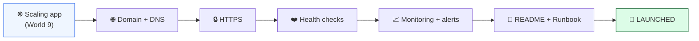
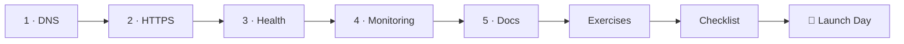

# 🚀 World 10 — Final Production Deployment

> *"This is it. Launch day. Make TaskFlow real — a domain people can type, HTTPS so it's trusted, health checks so it heals itself, and monitoring so we know before our users do. And write it down, so anyone on the team can run it. — Priya (DevOps) & the CEO"*



---

## 📨 Your final ticket

```
From:    Priya <priya@cloudforge.inc>, CEO <ceo@cloudforge.inc>
To:      You <engineer@cloudforge.inc>
Subject: [TICKET-LAUNCH] 🚀 Take TaskFlow to production

You did it — TaskFlow scales, self-heals, deploys itself, and the whole
stack is in Terraform. The board wants to use it Monday. That means it
has to stop being "the thing on the cluster" and become a real product:

  1. A name people can type — a domain (or free subdomain) + DNS
  2. HTTPS — a padlock, a valid cert, no scary browser warnings
  3. Health checks — so the platform knows when a Pod is sick
  4. Monitoring + alerts — so WE find out it's down, not Twitter
  5. Docs — a README and a runbook a teammate could operate at 3 AM

Everything stays FREE: Let's Encrypt for certs, a free subdomain, the
free tier of an uptime monitor. When you're done, ship it for real on
Launch Day. This is your graduation. Make it something you'd show a
recruiter.

— Priya & the CEO
```

This is the world where TaskFlow stops being a school project and becomes **a portfolio piece**. Everything you've learned across ten worlds converges here.

---

## 🎯 What you'll achieve in this world

- ✅ Point a **human-readable name** at your app with **DNS** (free domain/subdomain)
- ✅ Serve TaskFlow over **HTTPS** with a real, auto-renewing **Let's Encrypt** certificate
- ✅ Add a **`/health` endpoint** and wire **liveness/readiness probes** so the platform heals itself
- ✅ Set up **free uptime monitoring + alerts** so you're the first to know about an outage
- ✅ Write a production **README + runbook** — the capstone artifact of your whole journey

By the end, TaskFlow will be **reachable at a real URL, over HTTPS, health-checked, monitored, and documented**. That's production.

---

## 🗺️ Level map

| Level | Lesson | Difficulty | Time | XP |
|------:|--------|:----------:|:----:|---:|
| 1 | [Domains & DNS](lessons/01-domains-and-dns.md) | 🟢 Easy | 20 min | 125 |
| 2 | [HTTPS with Let's Encrypt](lessons/02-https-with-lets-encrypt.md) | 🟡 Medium | 25 min | 125 |
| 3 | [Health Checks & Probes](lessons/03-health-checks-and-probes.md) | 🟡 Medium | 20 min | 125 |
| 4 | [Monitoring & Alerts](lessons/04-monitoring-and-alerts.md) | 🟡 Medium | 25 min | 125 |
| 5 | [The Production README & Runbook](lessons/05-production-readme-and-runbook.md) | 🟢 Easy | 20 min | 125 |
| 👹 | [Boss Battle — Launch Day](boss-battle.md) | 🔴 Hard | 90 min | 500 |

➕ Extra reps: [exercises.md](exercises.md) · ✅ Ready to advance? [checklist.md](checklist.md)

---

## 🧭 Recommended order



Do them in order — each builds on the last. You can't get a valid HTTPS cert without DNS first, and monitoring is only meaningful once there's a real URL to monitor.

---

## 📦 Project status after this world

This is the final transformation:

| Coming in (from World 9) | Going out (after World 10) |
|--------------------------|----------------------------|
| TaskFlow on Kubernetes, scaling & self-healing | Same, plus a **public domain** |
| Reachable only by raw IP / `kubectl port-forward` | Reachable at **`https://taskflow.yourname.dev`** |
| HTTP only | **HTTPS** with an auto-renewing cert |
| No formal health signal | **`/health`** endpoint + liveness/readiness probes |
| You find out it's down when someone complains | **Monitoring alerts you** within minutes |
| Tribal knowledge | A **README + runbook** anyone can operate |

After this world, TaskFlow is **done** — a real, production-grade system you can put your name on. 🎓

---

## 🆓 Stay free

Everything here costs **$0**: Let's Encrypt (free certs forever), a free subdomain provider, and a free-tier uptime monitor. The only thing that can cost money is leftover **paid AWS resources** from earlier worlds — the Boss Battle reminds you to terminate anything you don't need. See [RESOURCES.md](../../RESOURCES.md) (World 10) for the four curated free links.

---

[↑ Back to README](../../README.md)  ·  [🗺️ Roadmap](../../ROADMAP.md)  ·  [▶️ Start Level 1 →](lessons/01-domains-and-dns.md)
