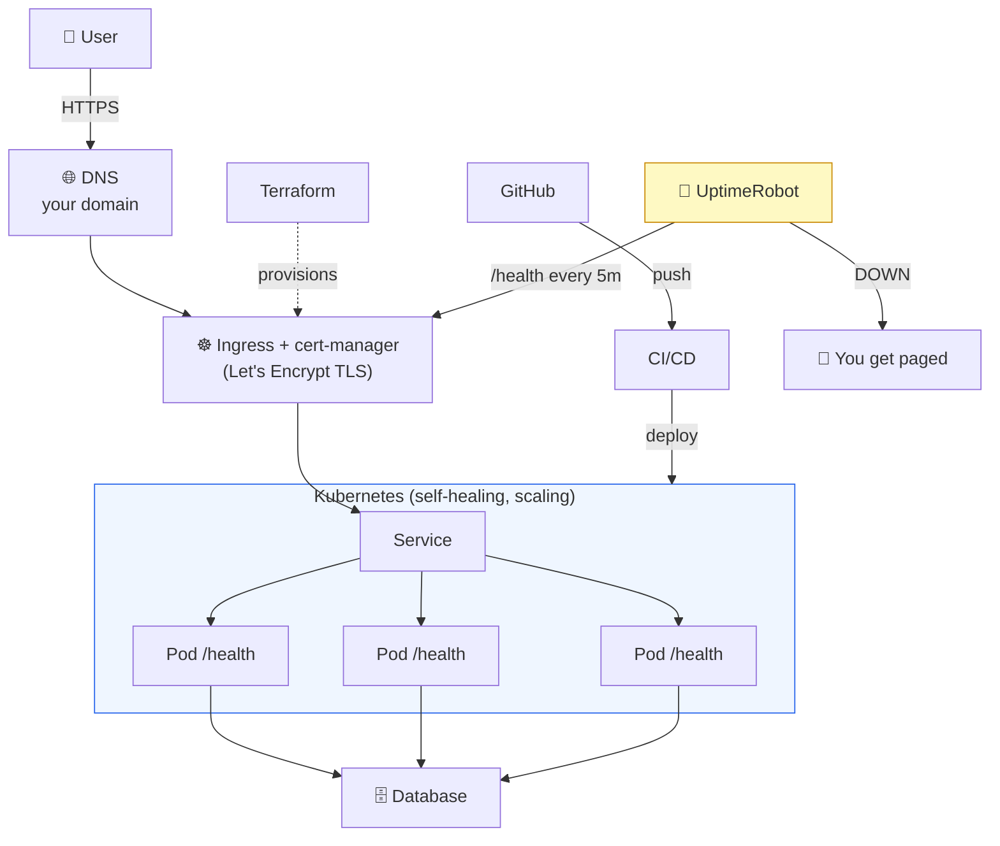

# 👹 Boss Battle — Launch Day

| | |
|---|---|
| 🎚️ **Difficulty** | 🔴 Hard — **FINAL BOSS** |
| ⏱️ **Estimated time** | ~90 minutes |
| ⭐ **XP reward** | 500 |
| 🔓 **Unlocks** | 🎓 **Graduation — you become a Cloud Engineer** |

[← Checklist](checklist.md) · [↑ Phase Home](README.md)

---

## 📨 The incident

```
From:    CEO <ceo@cloudforge.inc>, Priya <priya@cloudforge.inc>
To:      You <engineer@cloudforge.inc>
Subject: [LAUNCH] 🚀 Go live. Today.

This is it. The board is in the room. We're announcing TaskFlow in
90 minutes and I'm going to put the URL on the screen.

I need it REAL by then:
  • A domain people can type — and it has to resolve.
  • HTTPS. A padlock. If anyone sees "Not Secure" on that screen, we're done.
  • It has to heal itself — a Pod dying cannot become an outage.
  • If it goes down after I leave, I want a PHONE to buzz, not a tweet.
  • And a runbook, because you are NOT the only person who can fix this.

No hand-holding. You've done every piece of this across ten worlds.
Assemble it into one thing that works, end to end, in front of the board.

Make me proud. — The CEO & Priya
```

> ⚔️ **FINAL Boss rules:** No tutorials, no step-by-step. Pull together everything from Worlds 0–10. You win when every victory condition below is true **and you can explain the whole request path out loud** without notes.

---

## 🎯 Your mission

Ship TaskFlow for real — reachable at a domain, over HTTPS, health-checked, monitored, and documented — as **one coherent system**. This is not five separate exercises; it's the launch.

The full thing you're assembling:



---

## 🏆 Victory conditions

Tick every box. Each maps to a world you conquered.

- [ ] **DNS resolves** — `dig +short YOUR-DOMAIN` returns your app's address
- [ ] **Valid HTTPS** — `curl -I https://YOUR-DOMAIN/api/tasks` returns `200` with **no cert error**, and the browser shows the padlock
- [ ] **HTTP → HTTPS** — plain `http://YOUR-DOMAIN` redirects to HTTPS
- [ ] **App is healthy** — `kubectl get pods -l app=taskflow` shows all replicas `READY 1/1`; `/health/ready` returns 200
- [ ] **It self-heals** — deleting a Pod (`kubectl delete pod <name>`) does **not** cause an outage; the Service keeps serving
- [ ] **Readiness gates traffic** — breaking the DB connection flips a Pod to `0/1` **without** a crash loop, and it recovers automatically
- [ ] **Monitoring alerts work** — you scaled to 0, received a real **DOWN** alert, scaled back, received a real **UP** alert
- [ ] **Docs exist** — `README.md` (with architecture diagram + run/deploy steps) and `RUNBOOK.md` (restart, rollback, who-to-call) are committed and render on GitHub
- [ ] **You stay free** — no leftover **paid** AWS resources; billing alarm active
- [ ] **You can narrate the request path** end to end, from typed URL to rendered task list, without notes

---

## 🧪 How you'll know you won

Run this end-to-end smoke test. If it passes, you've launched:

```bash
DOMAIN=YOUR-DOMAIN

echo "1. DNS resolves:";        dig +short "$DOMAIN"
echo "2. HTTPS valid + 200:";   curl -sI "https://$DOMAIN/api/tasks" | head -1
echo "3. HTTP redirects:";      curl -sI "http://$DOMAIN" | grep -i location
echo "4. Health ready:";        curl -s -o /dev/null -w "%{http_code}\n" "https://$DOMAIN/health/ready"
echo "5. Pods healthy:";        kubectl get pods -l app=taskflow
echo "6. Cert ready:";          kubectl get certificate
```

Then the human checks: padlock in the browser, a real alert in your inbox/phone, and a README that renders with its diagram on GitHub.

<details>
<summary>🔎 Reference outline — only open after you've genuinely tried the whole thing</summary>

This is a **map, not a tutorial**. The "how" lives in Lessons 1–5; this is the order to assemble them.

1. **DNS (Lesson 1)** — point a free domain/subdomain at your ingress/load-balancer address. Verify with `dig`.
2. **Ingress + TLS (Lesson 2)** — ensure an ingress controller is running, install cert-manager, create a `letsencrypt-prod` ClusterIssuer, add a `tls:` block to TaskFlow's Ingress for your domain, enable `ssl-redirect`. Wait for `Certificate READY=True`.
3. **Health (Lesson 3)** — `/health/live` (cheap), `/health/ready` (checks DB), wire liveness/readiness/startup probes into the Deployment. Prove self-healing by deleting a Pod and by breaking readiness.
4. **Monitoring (Lesson 4)** — UptimeRobot monitor on `https://YOUR-DOMAIN/health` with a keyword check, an alert contact, down + recovery notifications. **Test it** (scale to 0 → back up).
5. **Docs (Lesson 5)** — commit `README.md` (architecture diagram, run/deploy, API table) and `RUNBOOK.md` (symptom → commands → expected; who-to-call).
6. **Stay free** — `kubectl`/Terraform/AWS console sweep: terminate any **paid** resources you no longer need (stray EC2, NAT gateways, RDS, idle load balancers). Keep the billing alarm on.

If a step fails, the **runbook you wrote in Lesson 5 is literally the debugging guide** — use it. That's the point of a runbook.
</details>

---

## 🎁 Rewards

- 🏆 **+500 XP**
- 🚀 **Achievement unlocked: Launch Commander** — you shipped a real product to production
- 📈 Update [PROGRESS.md](../../PROGRESS.md): mark World 10 ✅, add the **+250 World Complete bonus**, tick **🚀 Launch Commander**, and watch your rank hit **☁️ Cloud Engineer**

---

## 🎓 CONGRATULATIONS — You are now a Cloud Engineer

```
   🎓  GRADUATION  🎓
   CloudForge Inc. → Cloud Engineer
```

Stop for a second. Look at what you just did.

You started on **Day 1 (World 0)** unsure how to open a terminal. Today you put a real, HTTPS-secured, self-healing, monitored application **live on the internet** — and wrote the docs so a team can run it without you. That is not a tutorial. That is the job.

Here's the journey you actually completed:

```mermaid
flowchart LR
    W0["🖥️ 0 · Environment"] --> W1["🌐 1 · Internet"] --> W2["🐧 2 · Linux"] --> W3["🌿 3 · Git"]
    W3 --> W4["⚙️ 4 · Backend"] --> W5["🐳 5 · Docker"] --> W6["☁️ 6 · AWS"]
    W6 --> W7["🔁 7 · CI/CD"] --> W8["🏗️ 8 · Terraform"] --> W9["☸️ 9 · Kubernetes"] --> W10["🚀 10 · Production"]
    W10 --> Grad["🎓 Cloud Engineer"]
    style Grad fill:#dcfce7,stroke:#166534
```



- **Linux & the terminal** — you live in the shell now.
- **Networking** — you can trace a request from a typed URL to a rendered response.
- **Git** — version control is muscle memory.
- **Backend** — you built a real REST API with a database.
- **Docker** — you package apps that run anywhere.
- **AWS** — you deployed to real cloud infrastructure (and kept the bill at $0).
- **CI/CD** — your code ships itself.
- **Terraform** — your infrastructure is code, reproducible from nothing.
- **Kubernetes** — your app scales and heals.
- **Production** — domain, HTTPS, health, monitoring, docs. The whole craft.

### 📣 Now publish it

Your `taskflow` repo is a **portfolio piece** most bootcamp grads can't show. Use it:

- Pin the repo on your GitHub profile. Make sure the **README renders with its diagram**.
- Put the **live HTTPS URL** at the top of the README and in your CV/LinkedIn.
- In interviews, **walk them through the architecture diagram** and the request path — exactly the narration you practiced for this boss.
- Mention the operability story: health checks, monitoring, a runbook, infra-as-code. That's senior-flavoured thinking from a junior.

### 💸 Final housekeeping — don't get charged

You graduated for **free**. Keep it that way:

```bash
# Tear down anything paid you spun up across Worlds 6–10.
# If you provisioned infra with Terraform (World 8), the cleanest path:
terraform destroy        # removes everything Terraform created

# Then sanity-check the AWS console for stragglers:
#   • EC2 instances (stop/terminate)
#   • Load balancers / NAT gateways (these cost money even when idle!)
#   • RDS instances and snapshots
#   • Elastic IPs not attached to anything
# Keep your $1 billing alarm ON. Let's Encrypt, DuckDNS, and UptimeRobot
# free tier cost nothing — leave the *learning* stack running if you like.
```

> 🗒️ Final reflection: ten worlds ago, what would have stopped you cold? Almost all of it. You closed every one of those gaps. Whatever you build next — a bigger system, a new cloud, a new role — you now own the *shape* of how production software is run.
>
> Welcome to the profession. **You're a Cloud Engineer.** 🚀

---

[🏁 Return to base — you graduated](../../README.md) · [📊 Update your Progress](../../PROGRESS.md)
