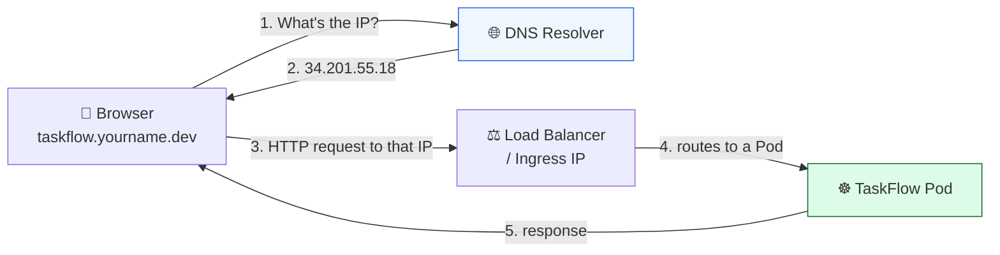

# Level 1 — Domains & DNS

| | |
|---|---|
| 🎚️ **Difficulty** | 🟢 Easy |
| ⏱️ **Estimated time** | 20 minutes |
| ⭐ **XP reward** | 100 (Quest) + 25 (Quiz) |

[← World Home](../README.md) · [↑ Phase Home](../README.md) · [→ Next: HTTPS with Let's Encrypt](02-https-with-lets-encrypt.md)

---

## 📖 Story

> *"Right now, the only way to reach TaskFlow is a URL like `http://34.201.55.18:30080`. I can't put **that** in the launch email. People need a name they can type, remember, and trust. Get us a real address — even a free one is fine for launch. — Priya"*

Nobody types IP addresses. The whole internet runs on **names** because humans can't remember numbers. Today you give TaskFlow a name.

---

## 🎯 Goal

By the end of this lesson you will:
- Understand how a typed name (`taskflow.yourname.dev`) becomes a request that reaches your app
- Know the DNS record types that matter (**A**, **AAAA**, **CNAME**)
- Get a **free domain or subdomain** and point it at your app's load balancer / ingress
- Confirm the name resolves with `dig` / `nslookup`

---

## 🧠 Concepts

When you type `taskflow.yourname.dev` into a browser, the browser has no idea where that is. It asks the **DNS** (Domain Name System) — the internet's phone book — to translate the name into an **IP address**. Only then can it open a connection.



**The record types you'll meet:**

| Record | Maps a name to… | Use it when… |
|--------|-----------------|--------------|
| **A** | an IPv4 address (`34.201.55.18`) | your app has a fixed IPv4 (most common) |
| **AAAA** | an IPv6 address | your load balancer hands you an IPv6 |
| **CNAME** | *another name* (`abc.elb.amazonaws.com`) | your cloud gives you a DNS name, not an IP |
| **TTL** | (not a record) how long resolvers cache the answer | lower it before a change so updates propagate fast |

> 💡 AWS load balancers (ELB) usually give you a **DNS name**, so you use a **CNAME**. A raw EC2/ingress IP uses an **A record**. You'll pick based on what your World 6/8/9 setup handed you.

### Why this exists

Two reasons. First, **humans**: `taskflow.dev` is memorable; `34.201.55.18` is not. Second, **stability**: IP addresses change (a Pod restarts, you re-create the load balancer, you move regions). A name is a layer of *indirection* — you update one DNS record and every user follows the name to the new IP without knowing anything changed. And critically: **you cannot get an HTTPS certificate without a domain name** (next lesson). DNS is the foundation everything else in this world stands on.

---

## 🛠️ Hands-on Lab

### Step 1 — Find your app's public address

You need the IP (or DNS name) your users will reach. Where it lives depends on your World 9 setup:

```bash
# If TaskFlow is exposed via a Kubernetes Service of type LoadBalancer:
kubectl get svc taskflow
# Look at the EXTERNAL-IP column. On AWS it may be a DNS name like
#   a1b2c3d4.us-east-1.elb.amazonaws.com  → you'll use a CNAME
# On a raw IP (e.g. minikube tunnel, or a NodePort + EC2 IP):
#   34.201.55.18                          → you'll use an A record

# If you're using an Ingress:
kubectl get ingress taskflow
# The ADDRESS column shows the IP or hostname to point DNS at.
```

> 🧪 Local-only? If you're on minikube/kind with no public IP, you can still practice DNS using a service like [nip.io](https://nip.io) — `34.201.55.18.nip.io` resolves to `34.201.55.18` automatically. Great for learning; for the real launch you'll use a free subdomain (below).

### Step 2 — Get a free domain or subdomain

Pick the free option that fits you (see [RESOURCES.md](../../../RESOURCES.md) → World 10):

- **Free subdomain providers** (e.g. a `*.is-a.dev`, `*.js.org`, or similar community subdomain) — usually a pull request to a GitHub repo where you add a JSON record.
- **A genuinely free TLD** for learning, or a cheap `.dev`/`.app` if you ever want a paid one later (optional, not required).
- **DuckDNS / nip.io style services** — instant free subdomains that map to an IP with zero signup friction (great for the bootcamp).

For this lab we'll use a **free dynamic-DNS subdomain** because it's instant and needs no payment. Example with DuckDNS:

1. Sign in at the provider with GitHub/Google (free).
2. Create a subdomain, e.g. `taskflow-yourname`.
3. Set its IP to your app's public IP from Step 1.

You now own `taskflow-yourname.duckdns.org` pointing at your app.

### Step 3 — Create the DNS record

If your provider gives you a full DNS panel (e.g. you're using a real domain), add the record yourself:

```text
# Your app has a raw IPv4 → use an A record
Type:  A
Name:  taskflow          (becomes taskflow.yourname.dev)
Value: 34.201.55.18      (your load balancer / ingress IP)
TTL:   300               (5 min — short, so changes propagate fast)
```

```text
# Your app has a DNS name (e.g. an AWS ELB) → use a CNAME
Type:  CNAME
Name:  taskflow
Value: a1b2c3d4.us-east-1.elb.amazonaws.com
TTL:   300
```

> ⚠️ A `CNAME` cannot live at the **root/apex** of a domain (`yourname.dev` itself). Use a subdomain (`taskflow.yourname.dev`) for CNAMEs, or use your provider's "ALIAS"/"ANAME" feature for the apex.

### Step 4 — Verify it resolves

DNS changes aren't instant — they propagate. Check from your own machine:

```bash
# Ask DNS to resolve your name. You should see your app's IP.
dig +short taskflow-yourname.duckdns.org

# Or, if dig isn't installed:
nslookup taskflow-yourname.duckdns.org

# Now actually hit the app through the name (still HTTP for now):
curl -i http://taskflow-yourname.duckdns.org/api/tasks
```

When `dig` returns your IP and `curl` returns TaskFlow's JSON, the name is live. 🎉

---

## 🎮 Mini Challenge

You add an A record but `dig +short` still returns nothing five minutes later. Name **two** likely reasons and how to check each.

<details>
<summary>💡 Reveal answer</summary>

1. **Propagation / caching** — your resolver or OS cached the old (empty) answer. The record's previous **TTL** governs how long that lasts. Check with `dig taskflow.yourname.dev` (full output shows the TTL) or query a public resolver directly: `dig @8.8.8.8 +short taskflow.yourname.dev`. Lowering TTL *before* a change reduces this pain.
2. **Wrong record name/zone** — you typed `taskflow.yourname.dev` in the *Name* field, which on many panels becomes `taskflow.yourname.dev.yourname.dev`. The *Name* should usually be just the subdomain label (`taskflow`), and the zone supplies the rest. Re-read the panel's example.

Bonus cause: the record points at a private IP, or the load balancer's security group / firewall blocks the port.
</details>

---

## 📦 Project Mission

Give TaskFlow a real, public name.

1. Get your app's public IP / hostname (Step 1).
2. Claim a **free subdomain** and point it at that address (Steps 2–3).
3. Verify with `dig` and reach TaskFlow's API through the **name**, not the IP.
4. Record your chosen domain in your project notes — you'll reuse it in every remaining lesson:

```bash
cd ~/projects/taskflow
echo "PRODUCTION_DOMAIN=taskflow-yourname.duckdns.org" >> .env.production
```

🎯 **Mission complete when:** `curl http://YOUR-DOMAIN/api/tasks` returns TaskFlow's task list — proving a human-typed name now reaches your running app.

---

## ⚠️ Common Mistakes

| Mistake | What happens | Fix |
|---------|--------------|-----|
| Putting a `CNAME` at the domain apex | Resolution fails / provider rejects it | Use a subdomain, or your provider's ALIAS/ANAME for the apex |
| Using an A record for an AWS ELB | The IP changes and your site breaks later | ELBs are DNS names → use a **CNAME** |
| Typing the full domain in the *Name* field | Record becomes `x.domain.domain` | Enter only the subdomain label (`taskflow`) |
| Expecting instant propagation | "It still doesn't work!" | Wait for TTL; query `@8.8.8.8` to bypass local cache |
| Pointing DNS at a private/internal IP | Resolves but unreachable | Point at the **public** IP / load balancer address |

---

## 🤔 Reflection Questions

1. Why is a domain name "a layer of indirection," and why does that make your system more resilient?
2. When would you choose a **CNAME** over an **A** record? Give a concrete example from your own stack.
3. What problem would you hit *next lesson* if you skipped DNS and tried to set up HTTPS on a bare IP?

---

## 📝 Quiz

1. **DNS translates…**
   - a) IP addresses into domain names only
   - b) domain names into IP addresses
   - c) HTTP into HTTPS
2. **Your AWS load balancer gives you `abc.elb.amazonaws.com`. Which record do you use?**
   - a) A record
   - b) AAAA record
   - c) CNAME record
3. **A low TTL (e.g. 300s) is useful because…**
   - a) it makes the site faster for users
   - b) DNS changes propagate sooner since resolvers cache the answer for less time
   - c) it encrypts the connection

<details>
<summary>✅ Answers</summary>

1: **b** · 2: **c** · 3: **b**
</details>

---

## ✅ Completion Checklist

- [ ] I found my app's public IP / hostname
- [ ] I claimed a free domain or subdomain
- [ ] I created the correct DNS record (A or CNAME) pointing at my app
- [ ] `dig`/`nslookup` returns my IP and `curl http://YOUR-DOMAIN` reaches TaskFlow
- [ ] I saved my domain to `.env.production`
- [ ] I passed the quiz
- [ ] I added **+125 XP** to [PROGRESS.md](../../../PROGRESS.md)

---

[← World Home](../README.md) · [↑ Phase Home](../README.md) · [→ Next: HTTPS with Let's Encrypt](02-https-with-lets-encrypt.md)
