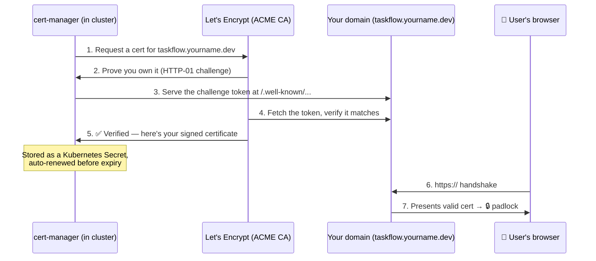

# Level 2 — HTTPS with Let's Encrypt

| | |
|---|---|
| 🎚️ **Difficulty** | 🟡 Medium |
| ⏱️ **Estimated time** | 25 minutes |
| ⭐ **XP reward** | 100 (Quest) + 25 (Quiz) |

[← Prev: Domains & DNS](01-domains-and-dns.md) · [↑ Phase Home](../README.md) · [→ Next: Health Checks & Probes](03-health-checks-and-probes.md)

---

## 📖 Story

> *"Marketing just opened the staging link and got a giant red 'Not Secure' warning. We can't launch like that — nobody trusts a site without the padlock, and browsers literally block logins on plain HTTP now. Get us a real certificate. And before you ask — yes, it has to be free, and yes, it has to renew itself. — Priya"*

Today TaskFlow gets the padlock. 🔒

---

## 🎯 Goal

By the end of this lesson you will:
- Understand what **TLS/HTTPS** actually does and why browsers demand it
- Know how **Let's Encrypt** issues free certificates via the **ACME** challenge
- Install **cert-manager** in your cluster and get an **auto-renewing** cert for your domain
- Serve TaskFlow over `https://YOUR-DOMAIN` with a valid, trusted certificate

---

## 🧠 Concepts

**HTTP** sends everything in plain text — anyone between the user and your server (coffee-shop WiFi, an ISP, an attacker) can read or modify it. **HTTPS** wraps the connection in **TLS**, which does two things: **encrypts** the traffic and **proves the server's identity** with a **certificate** signed by a trusted **Certificate Authority (CA)**.

**Let's Encrypt** is a free, automated CA. It proves you control the domain via the **ACME protocol**: it gives your server a challenge, your server answers it on the domain, Let's Encrypt verifies the answer and signs your cert. **cert-manager** is the Kubernetes controller that does this whole dance for you — and renews the cert automatically every ~60 days.



### Why this exists

Three hard reasons HTTPS is non-negotiable in production:

1. **Privacy & integrity** — passwords, tokens, and task data are readable on plain HTTP. TLS encrypts them.
2. **Trust** — browsers mark HTTP sites "Not Secure" and block features (geolocation, service workers, secure cookies). No padlock = no users.
3. **It's free and automatic now** — there's zero excuse. Before Let's Encrypt (2015), certs cost money and were renewed by hand; people forgot and sites broke. cert-manager + Let's Encrypt makes "valid cert, forever, for $0" the default.

---

## 🛠️ Hands-on Lab

> We'll use **cert-manager + Ingress** (the standard Kubernetes way). If you run TaskFlow behind a plain reverse proxy instead, the *Alternative* box at the end shows the Caddy / certbot path — same idea, simpler stack.

### Step 1 — Make sure you have an Ingress controller

Let's Encrypt's HTTP-01 challenge needs your domain reachable on **port 80**. An ingress controller routes that traffic. If you don't have one (ingress-nginx is the common free choice):

```bash
# Install the ingress-nginx controller (free, open source)
kubectl apply -f https://raw.githubusercontent.com/kubernetes/ingress-nginx/main/deploy/static/provider/cloud/deploy.yaml

# Wait for it, then grab its external IP/hostname
kubectl get svc -n ingress-nginx ingress-nginx-controller
```

➡️ Point your DNS record (from Lesson 1) at **this** ingress address.

### Step 2 — Install cert-manager

```bash
# Install cert-manager (CRDs + controller)
kubectl apply -f https://github.com/cert-manager/cert-manager/releases/latest/download/cert-manager.yaml

# Confirm its three pods are Running
kubectl get pods -n cert-manager
```

### Step 3 — Create a ClusterIssuer for Let's Encrypt

This tells cert-manager *how* to get certs. Start with **staging** (Let's Encrypt's test CA — generous rate limits, certs aren't browser-trusted) to avoid burning your production quota while you debug.

```yaml
# cluster-issuer.yaml
apiVersion: cert-manager.io/v1
kind: ClusterIssuer
metadata:
  name: letsencrypt-prod
spec:
  acme:
    server: https://acme-v02.api.letsencrypt.org/directory
    email: you@example.com          # gets expiry warnings
    privateKeySecretRef:
      name: letsencrypt-prod-account-key
    solvers:
      - http01:
          ingress:
            class: nginx
```

```bash
kubectl apply -f cluster-issuer.yaml
```

> 💡 For testing first, copy this file, change the `server` to `https://acme-staging-v02.api.letsencrypt.org/directory` and the names to `letsencrypt-staging`. Once a staging cert issues cleanly, switch your Ingress to `letsencrypt-prod`.

### Step 4 — Add TLS to your TaskFlow Ingress

Annotate the Ingress so cert-manager issues a cert and the controller serves it:

```yaml
# taskflow-ingress.yaml
apiVersion: networking.k8s.io/v1
kind: Ingress
metadata:
  name: taskflow
  annotations:
    cert-manager.io/cluster-issuer: letsencrypt-prod
spec:
  ingressClassName: nginx
  tls:
    - hosts:
        - taskflow.yourname.dev       # YOUR domain from Lesson 1
      secretName: taskflow-tls        # cert-manager creates/fills this
  rules:
    - host: taskflow.yourname.dev
      http:
        paths:
          - path: /
            pathType: Prefix
            backend:
              service:
                name: taskflow        # your existing Service
                port:
                  number: 80
```

```bash
kubectl apply -f taskflow-ingress.yaml
```

### Step 5 — Watch the certificate issue, then verify

```bash
# cert-manager creates a Certificate resource from the Ingress. Watch it:
kubectl get certificate
kubectl describe certificate taskflow-tls   # READY should become True

# If it's stuck, the Order/Challenge objects explain why:
kubectl get order,challenge

# Once READY=True, hit the site over HTTPS:
curl -I https://taskflow.yourname.dev/api/tasks
# Look for: HTTP/2 200  — and no certificate error.
```

Open the URL in a browser. You should see the **padlock** with no warning. 🔒✅

> 🔁 **Renewal is automatic.** cert-manager renews ~30 days before the 90-day expiry. You never touch it again.

<details>
<summary>🧰 Alternative — no Kubernetes ingress? Use Caddy (the easy mode)</summary>

If TaskFlow runs behind a single reverse proxy (e.g. on an EC2 box), **Caddy** gets HTTPS automatically with a two-line config:

```caddyfile
# Caddyfile — Caddy fetches & renews the Let's Encrypt cert for you
taskflow.yourname.dev {
    reverse_proxy localhost:3000   # your TaskFlow app
}
```

```bash
caddy run --config Caddyfile
```

That's it — Caddy handles ACME, the cert, *and* renewal. The certbot equivalent: `sudo certbot --nginx -d taskflow.yourname.dev`.
</details>

---

## 🎮 Mini Challenge

Your `kubectl describe certificate taskflow-tls` shows `READY: False` and a Challenge stuck in `pending`. What's the single most likely cause, and how would you confirm it?

<details>
<summary>💡 Reveal answer</summary>

The **HTTP-01 challenge can't be reached on port 80**. Let's Encrypt is trying to fetch `http://taskflow.yourname.dev/.well-known/acme-challenge/...` and failing. Most likely causes:

- DNS isn't pointing at your ingress yet (recheck `dig +short taskflow.yourname.dev` against your ingress IP from Lesson 1).
- Port 80 is blocked by a firewall / security group, or the ingress controller has no external IP.

**Confirm it:** `kubectl describe challenge` shows the exact error, and you can reproduce it yourself: `curl http://taskflow.yourname.dev/.well-known/acme-challenge/test` — if *you* can't reach it, neither can Let's Encrypt. Fix DNS/port 80 and the challenge clears within a minute.
</details>

---

## 📦 Project Mission

Give TaskFlow a real, trusted padlock.

1. Ensure an ingress controller is running and your DNS points at it.
2. Install cert-manager and create a `letsencrypt-prod` ClusterIssuer.
3. Add a `tls:` block to TaskFlow's Ingress referencing your domain.
4. Wait for the `Certificate` to reach `READY=True`.
5. Add a redirect so plain HTTP bounces to HTTPS (ingress-nginx does this with `nginx.ingress.kubernetes.io/ssl-redirect: "true"`).

🎯 **Mission complete when:** `curl -I https://YOUR-DOMAIN/api/tasks` returns `200` with **no certificate error**, and the browser shows the padlock. Bonus: `curl -I http://YOUR-DOMAIN` returns a `308` redirect to HTTPS.

---

## ⚠️ Common Mistakes

| Mistake | What happens | Fix |
|---------|--------------|-----|
| Testing against the **prod** ACME server repeatedly | You hit Let's Encrypt's rate limit and get blocked for hours | Debug on the **staging** issuer first, switch to prod once clean |
| DNS not pointing at the ingress | HTTP-01 challenge stays pending forever | Repoint DNS at the ingress IP; verify with `dig` and `curl /.well-known/...` |
| Port 80 blocked by firewall/security group | Challenge can't be fetched | Open port 80 (HTTP-01 needs it even though users use 443) |
| Wrong `host:` in Ingress vs. cert | Cert issued for the wrong name; browser warns | Make `tls.hosts`, `rules.host`, and your DNS name **identical** |
| Assuming you must renew manually | Cert expires in 90 days, site breaks | cert-manager / Caddy renew automatically — leave it alone |

---

## 🤔 Reflection Questions

1. TLS does two distinct jobs. What are they, and why does a site need *both*?
2. Why does Let's Encrypt make you prove you control the domain before issuing a cert? What attack does that prevent?
3. Before automated certs, sites went down because admins forgot to renew. How does cert-manager remove that entire class of incident?

---

## 📝 Quiz

1. **HTTPS (TLS) provides…**
   - a) faster page loads only
   - b) encryption of traffic *and* proof of the server's identity
   - c) a backup of your data
2. **Let's Encrypt's HTTP-01 challenge proves…**
   - a) you own a credit card
   - b) you control the domain (by serving a token on it)
   - c) your server is fast enough
3. **A key advantage of cert-manager is…**
   - a) it makes certs last 10 years
   - b) it issues *and auto-renews* free certs, so they never silently expire
   - c) it replaces your ingress controller

<details>
<summary>✅ Answers</summary>

1: **b** · 2: **b** · 3: **b**
</details>

---

## ✅ Completion Checklist

- [ ] An ingress controller is running and DNS points at it
- [ ] cert-manager is installed and its pods are Running
- [ ] A `letsencrypt-prod` ClusterIssuer exists
- [ ] My TaskFlow Ingress has a `tls:` block for my domain
- [ ] The `Certificate` shows `READY=True`
- [ ] `https://YOUR-DOMAIN` loads with a valid padlock and HTTP redirects to HTTPS
- [ ] I passed the quiz
- [ ] I added **+125 XP** to [PROGRESS.md](../../../PROGRESS.md)

---

[← Prev: Domains & DNS](01-domains-and-dns.md) · [↑ Phase Home](../README.md) · [→ Next: Health Checks & Probes](03-health-checks-and-probes.md)
