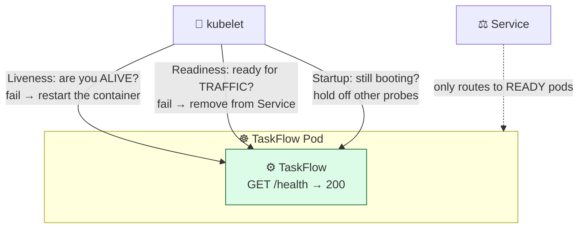

# Level 3 — Health Checks & Probes

| | |
|---|---|
| 🎚️ **Difficulty** | 🟡 Medium |
| ⏱️ **Estimated time** | 20 minutes |
| ⭐ **XP reward** | 100 (Quest) + 25 (Quiz) |

[← Prev: HTTPS with Let's Encrypt](02-https-with-lets-encrypt.md) · [↑ Phase Home](../README.md) · [→ Next: Monitoring & Alerts](04-monitoring-and-alerts.md)

---

## 📖 Story

> *"Weird one: a Pod got stuck — process alive, but it stopped answering requests. Kubernetes thought it was fine and kept sending it traffic. Users got errors for 20 minutes. The cluster can only heal what it can **see**. Give it a way to check if TaskFlow is actually healthy. — Priya"*

A running process isn't the same as a *working* app. Today you teach Kubernetes the difference.

---

## 🎯 Goal

By the end of this lesson you will:
- Add a real **`/health`** endpoint to the TaskFlow API
- Understand **liveness** vs **readiness** probes and when each fires
- Wire both probes into your Kubernetes Deployment (ties directly to World 9)
- Watch the cluster automatically restart a sick Pod and stop routing to a not-ready one

---

## 🧠 Concepts

Kubernetes runs your containers, but by default it only knows "is the process running?" That's a weak signal — a process can be alive but deadlocked, out of memory, or unable to reach its database. **Probes** are health checks the kubelet runs *for* each Pod:



| Probe | Asks | If it fails… | Use for |
|-------|------|--------------|---------|
| **Liveness** | "Are you alive, or wedged?" | Kubernetes **restarts** the container | Detecting deadlocks/hangs |
| **Readiness** | "Are you ready to serve traffic?" | Pod is **removed from the Service** (no restart) | Warming up, lost DB connection |
| **Startup** | "Still booting?" | Delays liveness/readiness until app is up | Slow-starting apps |

The crucial distinction: **liveness fixes a broken Pod (restart); readiness protects users (stop sending traffic) without killing the Pod.** A Pod that lost its DB connection should fail *readiness* (stop traffic) but probably not *liveness* (don't pointlessly restart) — it may recover on its own.

### Why this exists

This is what makes "self-healing" real. In World 9 your Deployment kept the *right number* of Pods alive. But "alive" was just "process running." Probes upgrade that to "actually healthy and serving correctly." Without them, the cluster confidently routes users to a zombie Pod (exactly Priya's incident). Probes are also what let rolling deploys be **zero-downtime**: a new Pod only receives traffic once its readiness probe passes, so users never hit a half-started replica.

---

## 🛠️ Hands-on Lab

### Step 1 — Add a `/health` endpoint to TaskFlow

A good health endpoint is **cheap** (no heavy queries on liveness) and **honest** (readiness should check real dependencies like the database). Add to your Express app:

```javascript
// In your TaskFlow Express app (e.g. src/app.js)

// Liveness: cheap — "the process can respond." No DB call.
app.get('/health/live', (req, res) => {
  res.status(200).json({ status: 'ok' });
});

// Readiness: honest — "I can actually serve a request" (DB reachable).
app.get('/health/ready', async (req, res) => {
  try {
    // A trivial query proves the DB connection is alive.
    await db.query('SELECT 1');          // pg
    // For SQLite: await db.get('SELECT 1');
    res.status(200).json({ status: 'ready' });
  } catch (err) {
    // 503 → readiness fails → Service stops routing to this Pod.
    res.status(503).json({ status: 'not-ready', error: err.message });
  }
});

// Optional combined endpoint for simple monitors (Lesson 4 uses this).
app.get('/health', (req, res) => res.status(200).json({ status: 'ok' }));
```

Commit and let your World 7 CI/CD pipeline build & push the new image (or rebuild locally and load it into your cluster).

### Step 2 — Test the endpoints locally

```bash
curl -s localhost:3000/health/live   | jq .   # {"status":"ok"}
curl -s localhost:3000/health/ready  | jq .   # {"status":"ready"}
```

### Step 3 — Wire the probes into your Deployment

Add this to the container spec in your TaskFlow Deployment (from World 9):

```yaml
# taskflow-deployment.yaml (excerpt — inside spec.template.spec.containers[])
        livenessProbe:
          httpGet:
            path: /health/live
            port: 3000
          initialDelaySeconds: 10   # give the app time to boot
          periodSeconds: 10         # check every 10s
          failureThreshold: 3       # 3 fails in a row → restart
        readinessProbe:
          httpGet:
            path: /health/ready
            port: 3000
          initialDelaySeconds: 5
          periodSeconds: 5
          failureThreshold: 3       # 3 fails → pulled from Service
        startupProbe:               # for slower starts; protects the above
          httpGet:
            path: /health/live
            port: 3000
          failureThreshold: 30
          periodSeconds: 2          # up to 60s to start before liveness kicks in
```

```bash
kubectl apply -f taskflow-deployment.yaml
kubectl rollout status deployment/taskflow
```

### Step 4 — Prove it heals

```bash
# Watch the pods, including restart counts:
kubectl get pods -l app=taskflow -w

# In another terminal, describe a pod to see probe events:
kubectl describe pod <taskflow-pod-name>
# Look under "Events" for Liveness/Readiness probe results.
```

Now break readiness on purpose (e.g. point the app at a wrong DB host, or add a temporary `app.get('/health/ready', (req,res)=>res.status(503).end())`) and redeploy. Watch the Pod go **`READY 0/1`** — it stays *Running* but the Service stops sending it traffic. Revert, and it rejoins. That's readiness doing its job. ✅

---

## 🎮 Mini Challenge

You set your **liveness** probe to call `/health/ready` (which checks the database). Your DB has a brief 30-second blip. What unwanted thing happens, and what's the correct design?

<details>
<summary>💡 Reveal answer</summary>

**What happens:** the liveness probe fails because the DB is unreachable → Kubernetes **restarts the container**. But restarting the app doesn't fix the database — so the new Pod *also* fails its liveness probe, restarts again, and you get a **CrashLoopBackOff** storm across every replica during a blip that would have resolved on its own.

**Correct design:** liveness should be **cheap and dependency-free** (`/health/live` — just "is the process responsive?"). Put the dependency check in **readiness** (`/health/ready`). During a DB blip, readiness fails so traffic stops (good), but the Pods stay alive and automatically rejoin the moment the DB returns — no restart storm. *Rule of thumb: liveness = "is it me that's broken?"; readiness = "should I receive traffic right now?"*
</details>

---

## 📦 Project Mission

Make TaskFlow honestly report its own health.

1. Add `/health/live`, `/health/ready`, and `/health` endpoints to the API.
2. Make readiness actually check the database connection.
3. Add liveness, readiness, and startup probes to your Deployment.
4. Demonstrate self-healing: break readiness, watch the Pod leave the Service, fix it, watch it return.

🎯 **Mission complete when:** `kubectl get pods -l app=taskflow` shows `READY 1/1`, breaking the DB connection flips a Pod to `READY 0/1` **without a crash loop**, and restoring it brings the Pod back to ready automatically.

---

## ⚠️ Common Mistakes

| Mistake | What happens | Fix |
|---------|--------------|-----|
| Liveness probe hits a DB-dependent endpoint | DB blip → restart storm / CrashLoopBackOff | Liveness = cheap & dependency-free; deps go in readiness |
| `initialDelaySeconds` too low | App still booting → probe fails → endless restarts | Raise it, or add a `startupProbe` |
| No readiness probe | Traffic hits half-started/zombie Pods | Always define readiness for any service that takes traffic |
| Health endpoint behind auth | Probe gets 401 → marked unhealthy | Keep `/health/*` unauthenticated |
| Readiness always returns 200 | "Ready" even when the DB is down | Make readiness check the real dependency |

---

## 🤔 Reflection Questions

1. In your own words, why does readiness *not* restart the Pod while liveness does?
2. How do readiness probes make rolling deploys zero-downtime?
3. What real dependency should TaskFlow's readiness probe check, and why is checking it on *liveness* a bad idea?

---

## 📝 Quiz

1. **A liveness probe that fails causes Kubernetes to…**
   - a) remove the Pod from the Service only
   - b) restart the container
   - c) scale up the Deployment
2. **A readiness probe that fails causes Kubernetes to…**
   - a) restart the container
   - b) stop routing traffic to that Pod (no restart)
   - c) delete the Deployment
3. **Your liveness probe should be…**
   - a) a heavy query that checks every dependency
   - b) cheap and dependency-free ("is the process responsive?")
   - c) behind authentication

<details>
<summary>✅ Answers</summary>

1: **b** · 2: **b** · 3: **b**
</details>

---

## ✅ Completion Checklist

- [ ] TaskFlow exposes `/health/live`, `/health/ready`, and `/health`
- [ ] Readiness genuinely checks the database connection
- [ ] Liveness, readiness, and startup probes are in the Deployment
- [ ] I watched a Pod leave the Service on readiness failure and return on recovery — no crash loop
- [ ] I passed the quiz
- [ ] I added **+125 XP** to [PROGRESS.md](../../../PROGRESS.md)

---

[← Prev: HTTPS with Let's Encrypt](02-https-with-lets-encrypt.md) · [↑ Phase Home](../README.md) · [→ Next: Monitoring & Alerts](04-monitoring-and-alerts.md)
