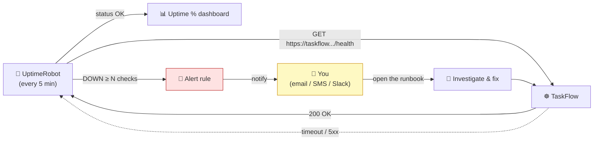

# Level 4 — Monitoring & Alerts

| | |
|---|---|
| 🎚️ **Difficulty** | 🟡 Medium |
| ⏱️ **Estimated time** | 25 minutes |
| ⭐ **XP reward** | 100 (Quest) + 25 (Quiz) |

[← Prev: Health Checks & Probes](03-health-checks-and-probes.md) · [↑ Phase Home](../README.md) · [→ Next: The Production README & Runbook](05-production-readme-and-runbook.md)

---

## 📖 Story

> *"Last Saturday TaskFlow was down for two hours and you know how we found out? A user tweeted at the CEO. That can never happen again. I want **us** to know within minutes — a phone buzz, an email, something. Set up monitoring before launch. Free tier is fine. — Priya"*

The worst way to learn your app is down is from an angry customer. Today you become the first to know.

---

## 🎯 Goal

By the end of this lesson you will:
- Tell apart the three pillars: **metrics**, **logs**, and **alerts**
- Set up **free uptime monitoring** (UptimeRobot free tier) against your HTTPS domain
- Configure an **alert** that notifies you when TaskFlow goes down — and recovers
- Add **structured (JSON) logging** so failures are searchable, not buried

---

## 🧠 Concepts

Three different tools answer three different questions:

| Pillar | Answers | Example for TaskFlow |
|--------|---------|----------------------|
| **Metrics** | "How is it behaving over time?" (numbers) | requests/sec, p95 latency, error rate, % uptime |
| **Logs** | "What exactly happened, and when?" (events) | `{"level":"error","msg":"DB timeout","reqId":"abc"}` |
| **Alerts** | "Do I need to act *right now*?" (notifications) | "TaskFlow has been DOWN for 3 minutes" → 📱 |

The monitoring loop: something watches your app, compares reality to a threshold, and **pages a human** when reality is wrong.



### Why this exists

You can't fix what you can't see, and you can't react to what nobody told you about. **Metrics** show trends (errors creeping up before a full outage). **Logs** let you reconstruct exactly what broke. **Alerts** turn a silent failure into a buzz in your pocket. The single highest-leverage thing for a small team is the simplest: an **uptime check that pings your real URL and alerts you when it stops answering.** It's free, takes 10 minutes, and means you — not a customer — are first to know. That's the difference between a 2-hour outage and a 5-minute one.

---

## 🛠️ Hands-on Lab

### Step 1 — Sign up for UptimeRobot (free tier)

1. Create a free account at [uptimerobot.com](https://uptimerobot.com) (see [RESOURCES.md](../../../RESOURCES.md) → World 10). No credit card.
2. The free plan gives you 50 monitors at 5-minute intervals — plenty for TaskFlow.

### Step 2 — Create an HTTP(S) monitor

Point it at the **health endpoint** you built in Lesson 3, over your **HTTPS domain** from Lessons 1–2:

```text
Monitor Type:      HTTP(s)
Friendly Name:     TaskFlow Production
URL:               https://taskflow.yourname.dev/health
Monitoring Interval: 5 minutes
Keyword (optional): "ok"          # only "up" if the body contains "ok"
```

> 💡 Using `/health` (not just `/`) means a `200` only happens when the app is genuinely responsive. Adding a **keyword** check (`"ok"`) catches the case where the server returns a 200 page that's actually an error.

### Step 3 — Add an alert contact

In **My Settings → Alert Contacts**, add how you want to be reached and attach it to the monitor:

- **Email** (always free)
- **Slack / Discord webhook** (free; great for a team channel)
- SMS / mobile push (often free tier or low limits)

Set the alert to fire after **2 failed checks** (avoids paging you for a single network blip) and to also notify you **on recovery**.

### Step 4 — Test the alert (the part everyone skips)

An untested alert is not an alert. Prove it actually fires:

```bash
# Scale TaskFlow to zero to simulate a full outage:
kubectl scale deployment/taskflow --replicas=0

# Wait ~10 minutes (a couple of UptimeRobot intervals).
# You SHOULD receive a "TaskFlow Production is DOWN" notification.

# Bring it back:
kubectl scale deployment/taskflow --replicas=3

# You should then get a "is UP (recovered)" notification.
```

If you got both messages — your monitoring works. This is the single most reassuring test you'll run before launch.

### Step 5 — Add structured logging

Plain `console.log("error!")` is unsearchable. **Structured logs** are JSON — every log line is a queryable record. Add `pino` (tiny, fast) to TaskFlow:

```bash
npm install pino pino-http
```

```javascript
// src/logger.js
const pino = require('pino');
const logger = pino({ level: process.env.LOG_LEVEL || 'info' });
module.exports = logger;

// src/app.js
const logger = require('./logger');
const pinoHttp = require('pino-http')({ logger });
app.use(pinoHttp);                       // logs every request as JSON

// Now logs look like:
// {"level":30,"time":...,"msg":"request completed","req":{"method":"GET","url":"/api/tasks"},"res":{"statusCode":200},"responseTime":4}
logger.error({ err, reqId: req.id }, 'failed to fetch tasks');
```

```bash
# View structured logs from the cluster:
kubectl logs -l app=taskflow --tail=50 -f
```

> 🔎 Now an outage is debuggable: filter for `"level":50` (errors) or grep a `reqId` to follow one request end-to-end. In a bigger setup you'd ship these to a log aggregator (e.g. Loki/CloudWatch); the JSON format is what makes that trivial later.

---

## 🎮 Mini Challenge

Your UptimeRobot monitor points at `https://taskflow.yourname.dev/` and checks only that the status code is `200`. TaskFlow's database dies, but the homepage still returns a friendly "Something went wrong" page with a `200` status. Will you get alerted? How do you fix the monitor?

<details>
<summary>💡 Reveal answer</summary>

**No alert fires** — the monitor only checks for a `200`, and the error page *is* a 200. This is a classic false-negative.

**Two fixes, ideally both:**
1. Monitor a **real health endpoint** (`/health/ready`) that returns **503** when the DB is down (you built exactly this in Lesson 3). A 503 trips the monitor.
2. Add a **keyword check** — alert unless the body contains `"ready"` (or `"ok"`). The error page won't contain it, so the monitor flips to DOWN.

Lesson: a monitor is only as good as *what* it checks. "Returns 200" is the weakest possible signal; tie monitoring to a health endpoint that tells the truth.
</details>

---

## 📦 Project Mission

Make sure *you* are the first to know.

1. Create an UptimeRobot HTTPS monitor against `https://YOUR-DOMAIN/health`.
2. Add at least one alert contact and configure down + recovery notifications.
3. **Test it** by scaling to 0 and confirming you receive both DOWN and UP alerts.
4. Add `pino` structured logging and confirm JSON logs appear via `kubectl logs`.

🎯 **Mission complete when:** you have received a real "DOWN" alert and a real "UP/recovered" alert from your monitor, and `kubectl logs` shows structured JSON log lines for requests.

---

## ⚠️ Common Mistakes

| Mistake | What happens | Fix |
|---------|--------------|-----|
| Monitoring `/` for `200` only | Error pages return 200 → no alert | Monitor `/health/ready` + a keyword check |
| Never testing the alert | "Monitoring" that never pages anyone in a real outage | Scale to 0 and confirm the alert actually arrives |
| Alerting on a single failed check | Pages you for every transient blip → alert fatigue | Require 2+ consecutive failures before alerting |
| Unstructured `console.log` everywhere | Logs are unsearchable during an incident | Use JSON logging (pino) with levels and request IDs |
| No recovery notification | You don't know when it's back | Enable "notify on recovery" too |

---

## 🤔 Reflection Questions

1. Metrics, logs, and alerts each answer a different question. Which one would you reach for first during a live outage, and why?
2. Why is "the monitor returned 200" sometimes a dangerous signal to trust?
3. What's the cost of alerting too *aggressively* (every blip), and how do you balance it against missing a real outage?

---

## 📝 Quiz

1. **Which pillar tells you "do I need to act right now?"**
   - a) Metrics
   - b) Logs
   - c) Alerts
2. **The most robust thing to point an uptime monitor at is…**
   - a) the homepage, checking for status 200
   - b) a `/health/ready` endpoint that returns 503 when a dependency is down
   - c) the database directly
3. **Structured (JSON) logs are valuable because…**
   - a) they're shorter
   - b) they're queryable/filterable by level, request ID, etc.
   - c) they're encrypted by default

<details>
<summary>✅ Answers</summary>

1: **c** · 2: **b** · 3: **b**
</details>

---

## ✅ Completion Checklist

- [ ] An UptimeRobot monitor checks `https://YOUR-DOMAIN/health`
- [ ] At least one alert contact is configured (down + recovery)
- [ ] I tested the alert by scaling to 0 and received both DOWN and UP notifications
- [ ] TaskFlow emits structured JSON logs (pino) visible via `kubectl logs`
- [ ] I passed the quiz
- [ ] I added **+125 XP** to [PROGRESS.md](../../../PROGRESS.md)

---

[← Prev: Health Checks & Probes](03-health-checks-and-probes.md) · [↑ Phase Home](../README.md) · [→ Next: The Production README & Runbook](05-production-readme-and-runbook.md)
