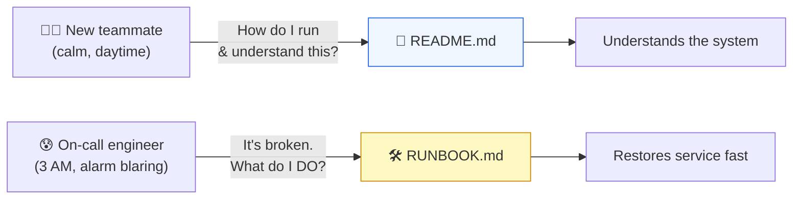
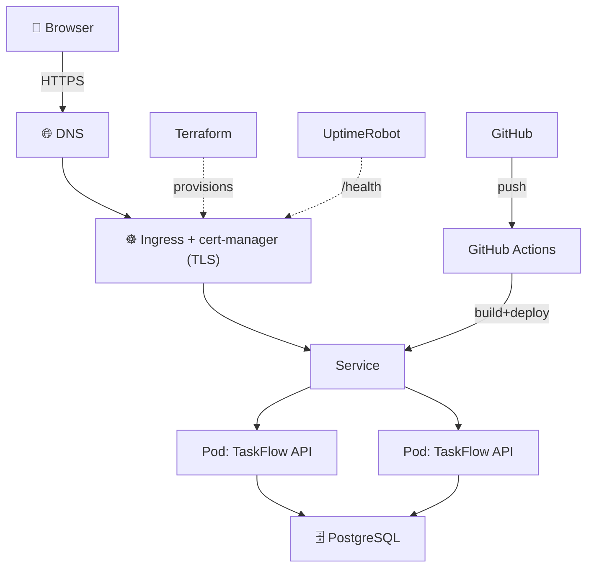

# Level 5 — The Production README & Runbook

| | |
|---|---|
| 🎚️ **Difficulty** | 🟢 Easy |
| ⏱️ **Estimated time** | 20 minutes |
| ⭐ **XP reward** | 100 (Quest) + 25 (Quiz) |

[← Prev: Monitoring & Alerts](04-monitoring-and-alerts.md) · [↑ Phase Home](../README.md) · [→ Next: Boss Battle — Launch Day](../boss-battle.md)

---

## 📖 Story

> *"You're going on holiday next week. If TaskFlow falls over Tuesday at 3 AM, Marcus is on call — and right now everything lives in your head. Write it down. A README so a new hire can run it, and a runbook so whoever's on call can fix it without phoning you. This is the difference between a hobby and a product. — Priya"*

The last thing you build isn't code. It's the document that lets *someone else* operate what you built. This is your **portfolio capstone**.

---

## 🎯 Goal

By the end of this lesson you will:
- Know the difference between a **README** (how to understand & run it) and a **runbook** (how to operate & fix it)
- Write a real, recruiter-grade **README** for TaskFlow with an architecture diagram
- Write a **runbook** covering restart, rollback, scaling, and "who to call"
- Commit both to your repo — the artifact you'll point interviewers at

---

## 🧠 Concepts

These are two different documents for two different moments:



| Document | Reader | Mood | Answers |
|----------|--------|------|---------|
| **README** | new dev, recruiter, future-you | calm | What is it? How do I run/deploy it? How's it built? |
| **Runbook** | on-call engineer | stressed | It's on fire — what are the exact steps to fix common incidents? |

A good runbook is **copy-pasteable under stress**. No prose to decode at 3 AM — just "symptom → exact commands → expected result."

### Why this exists

Software that only one person can operate isn't production software — it's a liability. The moment you go on holiday, get sick, or change jobs, an undocumented system becomes a time bomb. Docs turn private knowledge into team capability. And for *you* specifically: a clean README with an architecture diagram is the single most effective thing you can show a recruiter. It proves you don't just write code — you ship and operate systems. This document is the trophy at the end of the whole bootcamp.

---

## 🛠️ Hands-on Lab

### Step 1 — Write `README.md`

In your `~/projects/taskflow` repo, write (or upgrade) `README.md`. Use this proven structure:

````markdown
# TaskFlow — Task Manager Platform

A production-grade task manager: a Node.js/Express REST API on Kubernetes,
deployed via CI/CD, infrastructure as code with Terraform, served over HTTPS.

🔗 **Live:** https://taskflow.yourname.dev

## Architecture



## Tech stack
- **API:** Node.js + Express   **DB:** PostgreSQL
- **Container:** Docker         **Orchestration:** Kubernetes
- **CI/CD:** GitHub Actions      **IaC:** Terraform
- **TLS:** Let's Encrypt via cert-manager   **Monitoring:** UptimeRobot

## Run locally
```bash
git clone https://github.com/you/taskflow.git && cd taskflow
cp .env.example .env
docker compose up         # API on http://localhost:3000
curl localhost:3000/api/tasks
```

## Deploy
Pushing to `main` triggers GitHub Actions: build image → push to registry →
`kubectl apply`. Infra changes go through `terraform plan` / `apply`.

## Health & monitoring
- `GET /health/live`  — liveness   `GET /health/ready` — readiness (checks DB)
- Uptime + alerts: UptimeRobot against `/health`

## API
| Method | Path | Description |
|--------|------|-------------|
| GET | /api/tasks | List tasks |
| POST | /api/tasks | Create a task |
| PUT | /api/tasks/:id | Update a task |
| DELETE | /api/tasks/:id | Delete a task |

## Operating it
See **[RUNBOOK.md](RUNBOOK.md)** for restart, rollback, scaling, and on-call.
````

### Step 2 — Write `RUNBOOK.md`

Now the 3 AM document. Keep each entry as **Symptom → Commands → Expected result**:

````markdown
# TaskFlow Runbook

> For the on-call engineer. Each section: symptom → exact steps → expected result.

## 📞 Who to call
| Role | Name | Contact |
|------|------|---------|
| Primary on-call | You | @you / phone |
| Secondary | Marcus | @marcus |
| Escalation | Priya (DevOps lead) | @priya |

## 🚨 "Monitoring says TaskFlow is DOWN"
1. Confirm it's real: `curl -I https://taskflow.yourname.dev/health`
2. Check pods: `kubectl get pods -l app=taskflow`
   - Pods `CrashLoopBackOff` → see "Bad deploy" below.
   - Pods `READY 0/1` → readiness failing → check the DB (next section).
3. Check recent events: `kubectl get events --sort-by=.lastTimestamp | tail -20`

## 🔄 Restart the app
```bash
kubectl rollout restart deployment/taskflow
kubectl rollout status deployment/taskflow
```
Expected: pods recreate and return to `READY 1/1`.

## ⏪ Roll back a bad deploy
```bash
kubectl rollout history deployment/taskflow
kubectl rollout undo deployment/taskflow        # to previous version
# or: kubectl rollout undo deployment/taskflow --to-revision=N
```
Expected: previous image redeploys; `/health` returns 200.

## 🗄️ Database unreachable (readiness failing)
1. `kubectl logs -l app=taskflow --tail=50` → look for connection errors.
2. Check the DB pod/instance and the connection secret:
   `kubectl get secret taskflow-db -o yaml`
3. If RDS/managed: check it's running and the security group allows the cluster.
Expected: readiness flips back to ready once the DB is reachable — no app restart needed.

## 📈 Sudden traffic spike / slow
```bash
kubectl get hpa taskflow              # is autoscaling engaged?
kubectl scale deployment/taskflow --replicas=6   # manual bump if needed
```

## 🔒 Certificate problems / browser TLS warning
```bash
kubectl get certificate
kubectl describe certificate taskflow-tls
```
Expected: `READY=True`. If expired/failing, see Lesson 2 (cert-manager).

## ✅ All-clear
Confirm: monitor shows UP, `curl https://.../health` = 200, pods `READY 1/1`.
````

### Step 3 — Commit them

```bash
cd ~/projects/taskflow
git add README.md RUNBOOK.md
git commit -m "docs: production README and runbook for launch"
git push
```

Open the repo on GitHub — the README renders with the architecture diagram. That's the page a recruiter sees first. 🎓

---

## 🎮 Mini Challenge

A teammate's runbook entry for an outage reads: *"If the app is down, investigate the cause and resolve it, then verify the system is healthy again."* Why is this useless at 3 AM, and how would you rewrite one such entry?

<details>
<summary>💡 Reveal answer</summary>

It's useless because it's **prose, not procedure** — it tells a stressed, possibly-junior on-call engineer *what to achieve* but not *what to type*. Under pressure people need exact, copy-pasteable steps, not "investigate the cause."

A rewrite uses **Symptom → Commands → Expected result**:

> **Symptom:** Monitor reports DOWN.
> 1. `curl -I https://taskflow.yourname.dev/health` — is it really down?
> 2. `kubectl get pods -l app=taskflow` — any CrashLoopBackOff?
> 3. If a recent deploy: `kubectl rollout undo deployment/taskflow`
> 4. **Expected:** pods `READY 1/1`, `/health` returns 200.

The test of a good runbook: could someone who has *never seen this system* follow it and restore service?
</details>

---

## 📦 Project Mission

Write the documents that make TaskFlow operable by anyone.

1. Write a recruiter-grade `README.md` with a live URL, architecture Mermaid diagram, run/deploy steps, and an API table.
2. Write a `RUNBOOK.md` covering: down-triage, restart, rollback, DB issues, scaling, cert issues, and a "who to call" table.
3. Commit and push both; confirm the README renders with its diagram on GitHub.

🎯 **Mission complete when:** your repo has a `README.md` (with architecture diagram + how to run/deploy) and a `RUNBOOK.md` (with restart, rollback, and on-call steps) committed and rendering on GitHub.

---

## ⚠️ Common Mistakes

| Mistake | What happens | Fix |
|---------|--------------|-----|
| Runbook written as prose | Useless under stress | Symptom → exact commands → expected result |
| README has no "how to run" | Reader is stuck immediately | Always include clone → run → verify steps |
| No architecture diagram | System is a black box | Add a Mermaid diagram (it renders on GitHub) |
| Docs drift from reality | On-call follows steps that fail | Update docs in the same PR as the change |
| No "who to call" | On-call panics with no escalation | List primary/secondary/escalation contacts |

---

## 🤔 Reflection Questions

1. Why are the README and runbook two separate documents instead of one?
2. What's the single test of whether your runbook is good enough?
3. Why is a clean README with a diagram more persuasive to a recruiter than another feature in the app?

---

## 📝 Quiz

1. **The runbook is primarily written for…**
   - a) a recruiter browsing your repo
   - b) the on-call engineer during an incident
   - c) the compiler
2. **A good runbook entry is structured as…**
   - a) a paragraph describing the goal
   - b) symptom → exact commands → expected result
   - c) a list of error codes
3. **An architecture diagram in the README mainly helps because…**
   - a) it makes the file longer
   - b) it lets a reader grasp the whole system at a glance (and renders on GitHub)
   - c) it replaces the need for code

<details>
<summary>✅ Answers</summary>

1: **b** · 2: **b** · 3: **b**
</details>

---

## ✅ Completion Checklist

- [ ] `README.md` has a live URL, architecture diagram, run/deploy steps, and API table
- [ ] `RUNBOOK.md` covers restart, rollback, DB issues, scaling, certs, and who to call
- [ ] Runbook entries are copy-pasteable (symptom → commands → expected result)
- [ ] Both are committed, pushed, and render on GitHub
- [ ] I passed the quiz
- [ ] I added **+125 XP** to [PROGRESS.md](../../../PROGRESS.md)

---

[← Prev: Monitoring & Alerts](04-monitoring-and-alerts.md) · [↑ Phase Home](../README.md) · [→ Boss Battle: Launch Day](../boss-battle.md)
