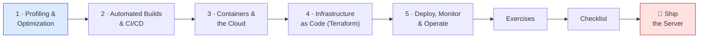
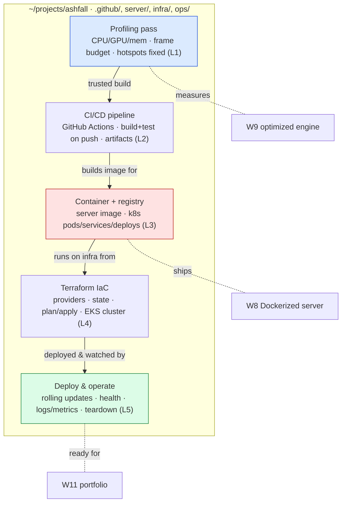

# 🚀 World 10 — Production Engineering & Cloud

> Ashfall is fast now (World 9): a data-oriented, ECS-lite engine that holds a thousand entities at a locked 60 FPS, with a Dockerized dedicated server running on your laptop. It plays — but only *for you*. Every build is hand-cranked, the server lives on one machine, and the moment you close the lid the game is gone. This world turns *outward* and makes Ashfall a thing the world can actually reach: you'll **profile and optimize** the build you trust, wire **CI/CD** so every push builds and tests itself, **containerize** the dedicated server and push it to a registry, stand up real **cloud infrastructure** on AWS with **Kubernetes** and **Terraform** (codified, reproducible, version-controlled), then **deploy, monitor, and operate** it — health checks, logs, metrics, and a teardown that protects your wallet. Same game, finally *shipped*.

[↑ Home](../../README.md) · [🗺️ Roadmap](../../ROADMAP.md) · [📊 Progress](../../PROGRESS.md)

---

## 📨 Your ticket

```
From:    Priya <priya@pixelforge.studio>
To:      You <new-hire@pixelforge.studio>
Cc:      Theo <theo@pixelforge.studio>, Kenji <kenji@pixelforge.studio>

Subject: [W10-PROD] Co-op works on your laptop. Now make it live, automated, and able to scale — without blowing our budget.

I've been watching the co-op build come together and it's genuinely good.
Kenji's engine work means it doesn't fall over under load anymore. But here's
the uncomfortable truth, and Theo said it out loud in standup: right now
"the server" is a Docker container on YOUR laptop. That's not a product.
That's a demo that ends when you go to lunch.

We need to ship it. Properly. And "properly" has a specific meaning in
production engineering — let me spell it out, in order:

  - PROFILE BEFORE YOU SHIP. We trust this build because Kenji measured it.
    Keep that habit: profiler open, CPU/GPU/memory, find the real hotspots,
    fix the ones that matter, and lock in a frame budget. We automate the
    build we trust — so earn the trust first.
  - AUTOMATE THE BUILD. No more "it builds on my machine." Every push to the
    repo should build Ashfall and run the tests, by itself, in CI. GitHub
    Actions, green check or red X, artifacts out the other end. If a commit
    breaks the build, we find out in minutes, not at launch.
  - CONTAINERIZE FOR THE CLOUD. The W8 dedicated-server image is the unit we
    ship. Push it to a registry, learn the cloud model (AWS free tier — watch
    the meter), and run it on Kubernetes: pods, services, deployments. The
    same container, anywhere.
  - CODIFY THE INFRA. We do NOT click around the AWS console and pray we can
    rebuild it. The cluster, the networking, all of it — written as Terraform.
    plan, apply, version-controlled, reproducible. Infrastructure you can
    delete and recreate from a file.
  - DEPLOY, MONITOR, OPERATE. Roll the server out to the cluster, give it
    health checks, watch its logs and metrics, set an alert. And — this is
    non-negotiable — write down how to tear it ALL down. We are on a free
    tier and an indie budget. A forgotten cluster is a four-figure surprise.

Keep the billing alarm from World 8 armed the entire time. Everything we
touch is free-tier-friendly, and every cloud lab ends with a teardown step.
Cheap to learn, zero to leave running.

Boss check ("Ship the Server"): a green CI/CD pipeline that builds, tests,
and containerizes the Ashfall dedicated server and deploys it to cloud infra
you defined in Terraform — with health checks, monitoring, a runbook, and a
documented cost teardown. No tutorial — you'll have all five lessons.

Land this and World 11 — your portfolio — is next.

— Priya
```

This is World 10 of 13. Everything you build advances the **one growing Ashfall project** in `~/projects/ashfall`. You arrive with a **fast, optimized game and a Dockerized server running on your laptop** (W9/W8); you leave with **profiling, a green CI/CD pipeline, and the dedicated server deployed to the cloud via Terraform — monitored, operable, and teardownable**.

---

## 🎯 What you'll achieve in this world

- 📊 **Profile and optimize** Ashfall from first principles — CPU/GPU/memory, the **frame budget**, finding the *real* hotspots and fixing the ones that matter — and lock in the measured build you'll automate
- 🤖 Build a **CI/CD pipeline** with **GitHub Actions** that builds Ashfall and runs the tests on **every push**, producing artifacts — a green check or red X, automatically, no "works on my machine"
- 📦 **Containerize** the W8 dedicated server, push the image to a **registry**, learn the **cloud model** (AWS free tier), and run it on **Kubernetes** — pods, services, deployments
- 🏗️ **Codify the infrastructure** with **Terraform** — providers, state, `plan`/`apply` — provisioning an AWS Kubernetes (EKS) cluster that is reproducible, version-controlled, and deletable
- 📡 **Deploy, monitor, and operate** the live server — rolling updates, health checks, logs/metrics/alerts — and write a **runbook + cost teardown** so it's cheap to learn and zero to leave running

---

## 🗺️ Level map

| Level | Lesson | Difficulty | XP |
|------:|--------|:----------:|---:|
| 1 | [Profiling & Optimization](lessons/01-profiling-and-optimization.md) | 🟡 Medium | 125 |
| 2 | [Automated Builds & CI/CD](lessons/02-automated-builds-and-ci-cd.md) | 🟡 Medium | 125 |
| 3 | [Containers & the Cloud](lessons/03-containers-and-the-cloud.md) | 🔴 Hard | 125 |
| 4 | [Infrastructure as Code with Terraform](lessons/04-infrastructure-as-code-with-terraform.md) | 🔴 Hard | 125 |
| 5 | [Deploy, Monitor & Operate](lessons/05-deploy-monitor-and-operate.md) | 🔴 Hard | 125 |
| 🚀 | [Boss Battle — Ship the Server](boss-battle.md) | 🔴 Hard | 500 |

➕ Extra reps: [exercises.md](exercises.md) · ✅ Ready to advance? [checklist.md](checklist.md)

---

## 🧭 Recommended order



Go in order — this world is a **pipeline**, and each lesson is the next stage of it. **Profiling** (L1) comes first because you only automate a build you *trust*: measure CPU/GPU/memory, fix the real hotspots, lock the frame budget. **CI/CD** (L2) is next because once the build is trustworthy, you make it *automatic* — every push builds and tests itself and spits out an artifact. **Containers & the cloud** (L3) takes that artifact's server cousin — the W8 Docker image — pushes it to a registry, and runs it on Kubernetes, because a container is the unit the cloud deploys. **Terraform** (L4) comes after you've run k8s by hand, so you understand *what* you're codifying when you write the infra as code — the cluster, reproducible from a file. **Deploy, monitor & operate** (L5) is last because it ties the whole chain together: CI → image → cluster → a live, watched, operable server with a teardown. The boss is the entire pipeline running end to end on one push.

---

## 📦 Ashfall project status

**Entering World 10:** a *fast, optimized* co-op action-roguelite. World 9 rebuilt the engine — data-oriented hot paths, an ECS-lite core, object pooling that allocates nothing per frame — so it holds 1000+ entities at a locked 60 FPS. World 8 gave it a **Dockerized dedicated server** for 2-player co-op. It runs beautifully — *on your laptop*. But there is no automation: builds are hand-cranked, the tests run when you remember, the "server" is a container on one machine, and there's no way to deploy it, watch it, or rebuild it that doesn't involve you, in person, at that laptop. It's optimized but **un-shipped**.

**Leaving World 10:** the *same game*, finally shipped. Ashfall has a **profiling pass** with a locked frame budget; a **green CI/CD pipeline** (GitHub Actions) that builds and tests on every push and produces artifacts; the dedicated server **containerized and pushed to a registry**; an AWS **Kubernetes** cluster stood up reproducibly by **Terraform** (`plan`/`apply`, version-controlled); and the server **deployed, health-checked, and monitored** — logs, metrics, an alert — with a **runbook and a cost teardown** so the whole thing is cheap to run and safe to delete. Ashfall went from "runs on my machine" to "runs in the cloud, on every push."



You hand this to **World 11 — Portfolio Projects**, where you stop growing Ashfall and start *showing what you can do*: a clutch of small, other-genre prototypes that prove range — backed by the fact that you can not only build a game, but **ship and operate** one.

---

## 💸 Free-tier & cost safety (read this first)

This world touches **real cloud infrastructure**, and real infrastructure has a meter. The rules, non-negotiable:

- **AWS free tier only.** Every lab is designed to fit inside it. EKS itself has an hourly control-plane cost, so we run cloud clusters **briefly and tear them down** — most learning happens on a *local* Kubernetes (Docker Desktop, kind, or minikube), which is free.
- **Keep the World 8 billing alarm armed.** A budget alert that emails you the moment spend crosses a few dollars is your seatbelt. If you removed it, put it back before Lesson 3.
- **Every cloud lab ends with `terraform destroy`** (or its equivalent). A forgotten EKS cluster or load balancer is the classic "I left it running over the weekend" four-figure surprise. The teardown step is part of the lab, not optional cleanup.
- **The runbook documents the teardown.** Knowing how to delete it all, fast, is a production engineering skill — not an afterthought.

Cheap to learn, zero to leave running.

---

## 🚀 Boss teaser

**"Ship the Server"** — Theo wants the demo to outlive your lunch break. Build a **green CI/CD pipeline** that, on push, **builds, tests, and containerizes** the Ashfall dedicated server and **deploys it to cloud infrastructure you defined in Terraform** — with **health checks and monitoring**, a **documented runbook**, and a **cost teardown** that takes it all down cleanly. No tutorial — you'll fuse all five lessons into one shipped server: a trusted build, automated; a container in a registry; a Terraform-defined cluster; and a live, watched, operable game server reachable by a client. Win to earn the **🚀 Ship Engineer** badge, a +250 world-complete bonus, and unlock World 11.

---

## 📚 Resources

Don't go link-hunting — the curated free list lives in [RESOURCES.md](../../RESOURCES.md). For this world, the standouts are Unity's **Profiler** and **Frame Debugger** docs (your truth-teller for L1 — measure before you ship), the official **GitHub Actions** docs and the free **game-ci/unity-builder** action for automated Unity builds and tests (L2), **Docker** docs plus the **Kubernetes** "Concepts" pages (pods/services/deployments) and a local cluster via **Docker Desktop / kind / minikube** to learn k8s for free (L3), the **Terraform** "Get Started — AWS" tutorial and the **terraform-aws-modules/eks** module as a readable reference for standing up a cluster (L4), and AWS's own **free-tier**, **Billing/Budgets alarm**, and **CloudWatch** logs/metrics docs for L5. Above all, internalize the one idea this whole world turns on: **shipping isn't a finale you do once — it's a repeatable, automated, version-controlled pipeline, and infrastructure you can't recreate from a file (or tear down on command) isn't infrastructure, it's a liability.**

---

[↑ Home](../../README.md) · [🗺️ Roadmap](../../ROADMAP.md) · [📊 Progress](../../PROGRESS.md) · [➡️ Next World: Portfolio Projects](../phase-11-portfolio-projects/README.md) · [▶️ Start Level 1 →](lessons/01-profiling-and-optimization.md)
