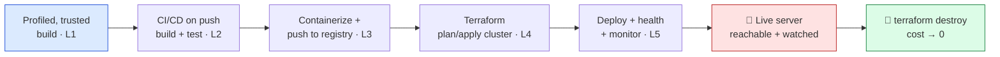
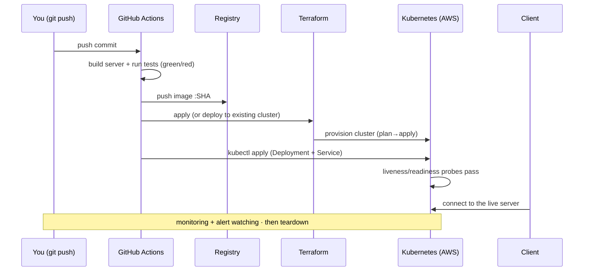

# 🚀 Boss Battle — Ship the Server

| | |
|---|---|
| 🎚️ **Difficulty** | 🔴 Hard |
| ⏱️ **Estimated time** | 180 minutes |
| ⭐ **XP reward** | 500 |
| 🔓 **Unlocks** | World 11 — Portfolio Projects |

[← Checklist](checklist.md) · [↑ Phase Home](README.md) · [↑ Home](../../README.md)

---

## 📨 The incident

```
From:    Priya <priya@pixelforge.studio>
To:      You <new-hire@pixelforge.studio>
Cc:      Theo <theo@pixelforge.studio>, Kenji <kenji@pixelforge.studio>

Subject: [W10-BOSS] Ship the server. Green pipeline, cloud deploy, runbook, teardown. For real this time.

Theo wants to show co-op to a publisher next week — and he wants to send them
a link, not invite them to my desk. That means the dedicated server has to be
LIVE: in the cloud, reachable by a client, and not dependent on anyone's
laptop being open. And it has to be reproducible — if a node dies or we need
to redeploy, it's one push, not a panicked afternoon.

This is your boss. No tutorial — you've got all five lessons. Here's the bar,
and it is not negotiable:

  - A GREEN PIPELINE. Push to the repo and CI/CD takes over by itself: it
    BUILDS the dedicated server, RUNS the tests, and CONTAINERIZES it into an
    image — green check, end to end, no manual steps. Red on a broken commit.
  - THE IMAGE IN A REGISTRY. The pipeline pushes the server image, tagged
    (commit SHA or version), to a registry. That tagged image is what the
    cloud runs — same bytes everywhere.
  - INFRA AS CODE. The cluster it deploys to is defined in TERRAFORM. Not
    clicked together in the console — written down, `plan`/`apply`, version-
    controlled, reproducible from the file. I want to be able to destroy it
    and stand it back up from your repo.
  - DEPLOYED AND ALIVE. The server runs on the cluster (Deployment + Service),
    a client can reach it, and it has HEALTH CHECKS — liveness/readiness — so
    the orchestrator restarts it if it wedges and only routes traffic when
    it's ready.
  - WATCHED. Monitoring: logs and metrics I can look at, plus at least one
    ALERT that fires on trouble. If it falls over at 2 a.m., something tells us.
  - A RUNBOOK + A TEARDOWN. Write down how to deploy, how to roll back, how to
    check health — and how to TEAR IT ALL DOWN. We are on a free tier and an
    indie budget. The teardown is part of shipping, not cleanup. Billing alarm
    stays armed the whole time.

Do it with the real tools: GitHub Actions, Docker + a registry, Kubernetes,
Terraform, CloudWatch (or equivalent). The pipeline you built IS the product
here — wire it together and prove it ships.

Cost note: keep cloud time SHORT. Stand it up, prove it, capture the evidence,
then `terraform destroy`. Most of this you can rehearse on a LOCAL cluster for
free before you ever touch AWS. Leave nothing running.

Land this and World 11 — your portfolio — is yours.

— Priya
```

> 🚀 **Boss Battle rules:** No tutorials, no copying lesson files wholesale. **Apply** World 10: profile and trust the build, automate it through CI/CD so a push builds + tests + containerizes the server, push the tagged image to a registry, define the cloud cluster in Terraform (`plan`/`apply`), deploy the server with health checks, watch it with logs/metrics/an alert, and write the runbook + teardown. You win when every victory condition is met **and you can explain which stage owns which job** (CI → trusted build · registry → portable image · Terraform → reproducible infra · k8s → running + healthy · monitoring → you'll know when it breaks · teardown → it costs nothing to leave) **and you can stand the whole thing up — and tear it down — from your repo.**

---

## 🎯 Your mission

Build a **green CI/CD pipeline that, on push, builds + tests + containerizes the Ashfall dedicated server and deploys it to Terraform-defined cloud infrastructure — health-checked, monitored, documented in a runbook, and torn down cleanly.** This is the capstone that fuses every lesson:





Build it from these pieces (at minimum):

1. **Trusted build (L1):** the server build you automate is one you've **profiled** — you know its budget and its hotspots are handled. You automate the build you trust.
2. **CI/CD on push (L2):** a **GitHub Actions** workflow triggers on push, **builds** the dedicated server, **runs the tests**, and goes green/red automatically — no manual steps.
3. **Containerize + registry (L3):** the pipeline builds the server **image** and **pushes it tagged** (commit SHA / version) to a **registry**. That image is the deploy unit.
4. **Infra as code (L4):** the cluster is defined in **Terraform** — `plan`/`apply`, state managed, version-controlled, reproducible. (Rehearse on a local k8s; stand up the cloud cluster briefly to prove it.)
5. **Deploy + health (L5):** the server runs on the cluster as a **Deployment + Service** with **liveness/readiness** probes, **reachable by a client**.
6. **Monitor + runbook + teardown (L5):** **logs/metrics + at least one alert**; a **runbook** (deploy / roll back / health-check) and a **documented `terraform destroy` teardown**, billing alarm armed.

---

## 🏆 Victory conditions

- [ ] A **push triggers CI/CD** that **builds** the dedicated server and **runs the tests** automatically — green on success, red on a broken commit, no manual steps
- [ ] The pipeline **containerizes** the server and **pushes the tagged image** to a **registry** (commit SHA or version tag)
- [ ] The **cloud infrastructure is defined in Terraform** — `plan`/`apply` is clean, state is managed, and the cluster is reproducible from the repo
- [ ] The server is **deployed to Kubernetes** (Deployment + Service) and **reachable by a client** — co-op connects to the cloud server, not a laptop
- [ ] The deployment has **liveness/readiness health checks** — the orchestrator restarts it if it wedges and only routes traffic when it's ready
- [ ] **Monitoring is live**: logs and metrics I can view, plus **at least one alert** that fires on trouble
- [ ] A **runbook** documents deploy / rollback / health-check, and a **documented teardown** (`terraform destroy` + any manual leftovers) takes cost to **zero** — billing alarm armed throughout
- [ ] I can name which stage owns which job (CI → trusted build · registry → portable image · Terraform → reproducible infra · k8s → running + healthy · monitoring → you'll know when it breaks · teardown → costs nothing to leave) and stand the whole thing up *and* tear it down from the repo

---

## 🧪 How you'll know you won

```bash
cd ~/projects/ashfall
ls .github/workflows infra ops server
# → ci.yml/deploy.yml, Terraform (main.tf, variables.tf, eks...),
#   runbook.md + teardown.md, Dockerfile + k8s manifests ...
```

Then run the real test — **push a commit and watch it ship:**
- **`git push`** — GitHub Actions kicks off on its own: the server **builds**, the **tests run**, the check goes **green**. Break a test on purpose and the next push goes **red** and **nothing deploys** — that's CI doing its job.
- **Check the registry** — a new image appears, **tagged with the commit SHA**. That exact image is what the cluster will pull.
- **`terraform plan`** — the diff is clean and matches what's deployed; you can `apply` to stand the cluster up and (the real proof) `destroy` to take it back to nothing.
- **`kubectl get deploy,svc,pods`** — the Deployment is at desired replicas, the Service has an address, the Pods are **Ready** (readiness probe green). **Connect a client** — co-op works against the cloud server.
- **Kill a Pod on purpose** (`kubectl delete pod ...`) and watch the Deployment **replace it** and the readiness probe gate traffic until the new one is up — that's the orchestrator + health checks doing their job.
- **Open the dashboard** — logs are flowing, metrics are graphing, and your **alert** is configured to fire on trouble. Trip its condition and confirm it fires.
- **Run the teardown** — `terraform destroy` (plus any documented manual leftovers) removes everything; the billing dashboard returns to free-tier baseline. **Leave nothing running.**

If a push builds, tests, containerizes, and deploys the server to a Terraform-defined cluster that a client can reach — health-checked, monitored, and torn down cleanly afterward — and you can explain *why each stage exists*, you've won.

<details>
<summary>🔎 Reference solution — only after you've tried! (high-level sketch + key code)</summary>

**The shape of it (each stage owns one job):**

| Stage | Owns | Lesson |
|---|---|---|
| Profiled build | a build worth automating (known budget, hotspots handled) | L1 |
| CI/CD on push | the trusted build, automated — green/red on every commit | L2 |
| Image + registry | a portable, tagged unit the cloud runs identically everywhere | L3 |
| Terraform | reproducible infra — stand up *and* tear down from a file | L4 |
| k8s Deployment/Service + probes | the server running, reachable, and self-healing | L5 |
| Monitoring + runbook + teardown | you'll know when it breaks; cost goes to zero on demand | L5 |

**CI/CD: build, test, containerize, push (L2/L3):**

```yaml
# .github/workflows/deploy.yml
on: { push: { branches: [ main ] } }
jobs:
  build-test-publish:
    runs-on: ubuntu-latest
    steps:
      - uses: actions/checkout@v4
      - run: ./server/build.sh           # build the dedicated server
      - run: ./server/test.sh            # tests — red here stops everything
      - run: |                            # containerize + push tagged image
          docker build -t $REGISTRY/ashfall-server:${{ github.sha }} ./server
          docker push  $REGISTRY/ashfall-server:${{ github.sha }}
  deploy:
    needs: build-test-publish             # only after green
    runs-on: ubuntu-latest
    environment: production               # (optional gate — see Side Quest 1)
    steps:
      - uses: actions/checkout@v4
      - run: kubectl set image deployment/ashfall-server \
               server=$REGISTRY/ashfall-server:${{ github.sha }}  # rolling update
```

**Terraform: the cluster, reproducible (L4):**

```hcl
# infra/main.tf — an EKS cluster from a file. plan → apply → (later) destroy.
module "eks" {
  source          = "terraform-aws-modules/eks/aws"
  cluster_name    = "ashfall"
  cluster_version = "1.30"
  # vpc/subnets, a small managed node group (free-tier-minded), etc.
}
# terraform plan   → review the diff (what it will create/change/destroy)
# terraform apply  → stand it up
# terraform destroy→ take it ALL down (this is the teardown — part of shipping)
```

**Kubernetes: Deployment + Service + health checks (L3/L5):**

```yaml
# server/k8s.yaml — running, reachable, self-healing.
kind: Deployment
spec:
  replicas: 2
  template:
    spec:
      containers:
        - name: server
          image: $REGISTRY/ashfall-server:GIT_SHA
          ports: [{ containerPort: 7777 }]
          livenessProbe:  { httpGet: { path: /healthz, port: 7777 } }  # restart if wedged
          readinessProbe: { httpGet: { path: /ready,   port: 7777 } }  # route only when ready
---
kind: Service           # stable address for the churning Pods → client connects here
spec: { selector: { app: ashfall-server }, ports: [{ port: 7777 }] }
```

**Monitoring + runbook + teardown (L5):**

```
ops/runbook.md   → Deploy: push to main (CI does the rest).
                   Roll back: kubectl rollout undo deployment/ashfall-server.
                   Health: kubectl get pods; check /healthz, /ready.
                   Logs/metrics: CloudWatch dashboard <link>. Alert: CPU>80% / pod crashloop.
ops/teardown.md  → terraform destroy  (removes cluster, nodes, LB).
                   Verify: no EKS cluster, no orphaned LoadBalancer/EBS, billing → baseline.
                   Billing alarm: armed (W8) the entire time.
```

**Why each stage is the right tool:**
- **CI/CD (L2)** removes the human from the *toil* of building and testing — the same steps, every push, deterministic, green or red. You can't ship reliably what you build by hand.
- **Image + registry (L3)** make the server a portable unit: build once, run the identical bytes on any node — the cure for "works on my machine."
- **Terraform (L4)** makes the cloud reproducible and *deletable*: `plan` shows the diff before anything changes, `apply` builds it, `destroy` takes it to zero. Click-ops can do none of those safely.
- **k8s Deployment/Service + probes (L5)** keep the server *alive and reachable* without you watching — it restarts wedged Pods, gates traffic on readiness, and rolls updates.
- **Monitoring + teardown (L5)** are the operate half of "deploy and operate": you find out when it breaks, and it costs nothing to leave because you can take it down on command.

A push that builds, tests, containerizes, deploys, and is watched — then torn down cleanly — is all of World 10 in a single shipped server.
</details>

---

## 🎁 Rewards

- 🏆 **+500 XP**
- 🏅 Achievement unlocked: **🚀 Ship Engineer** — you turned Ashfall from "runs on my laptop" into "runs in the cloud, on every push": a profiled build, a green CI/CD pipeline, a containerized server in a registry, a Terraform-defined Kubernetes cluster, and a live, health-checked, monitored server with a runbook and a clean teardown
- 🔓 **World 11 — Portfolio Projects** unlocks
- 📈 Update [PROGRESS.md](../../PROGRESS.md): mark World 10 ✅ and add the **+250 World Complete bonus**

> 🗒️ Reflection: shipping wasn't a finale you do once by hand — it was a **pipeline**. The server didn't reach the cloud because you uploaded it; it reached the cloud because a push *built it, tested it, packaged it, and deployed it* through machinery you wrote once and can run forever. And notice the two things that make it production engineering rather than a stunt: it's **reproducible** (Terraform stands the whole cluster up — and back down — from a file) and it's **operable** (health checks heal it, monitoring warns you, the runbook tells the next person what to do, and the teardown means it never costs you a cent you didn't intend). That's the difference between *making* a game and *running* one. World 11 turns to your **portfolio** — small prototypes that show range — backed now by the rare proof that you can ship and operate, not just build. The server is live. Time to show what else you've got.

---

[← Checklist](checklist.md) · [↑ Phase Home](README.md) · [↑ Home](../../README.md) · [🎨 Enter World 11 →](../phase-11-portfolio-projects/README.md)
