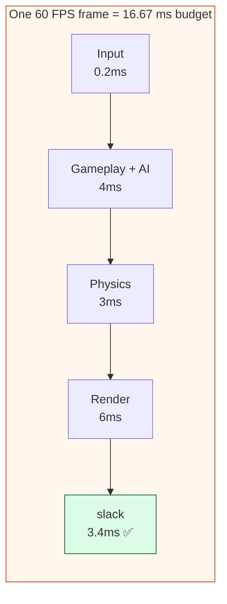

# Level 1 — Profiling & Optimization

| | |
|---|---|
| 🎚️ **Difficulty** | 🟡 Medium |
| ⏱️ **Estimated time** | 30 minutes |
| ⭐ **XP reward** | 100 (Quest) + 25 (Quiz) |

[← Prev](../README.md) · [↑ Phase Home](../README.md) · [→ Next](02-automated-builds-and-ci-cd.md)

---

## 📖 Story

> *"Maya filed a bug: 'Ashfall stutters when a wave spawns.' Three engineers already 'optimized' it — one cached a transform, one swapped a `List` for an array, one disabled a particle system. The stutter is still there, and now the code is uglier. You know why? Nobody **measured**. They guessed, changed something that felt slow, and shipped vibes. That's not engineering, that's superstition. My rule, the only rule that matters today: **measure, don't guess.** A profiler tells you exactly where the milliseconds go — which function, which frame, how much memory it allocated. You find the *one* line that costs 14 ms, fix that, and the stutter's gone — without touching the 200 lines that were innocent. Today I'll show you the Unity Profiler and the Frame Debugger, how to tell if you're **CPU-bound or GPU-bound**, how to hunt a spike and a **GC** allocation, and a workflow you'll use for the rest of your career. Then we fix Maya's real spike. Let me show you. — Kenji"*

---

## 🎯 Goal

- Internalize the one law of performance work: **measure first, optimize second**
- Read the **Unity Profiler** (CPU/GPU/Memory/Rendering) and the **Frame Debugger**
- Tell whether a frame is **CPU-bound** or **GPU-bound** — and why the fix differs
- Find a **frame-time spike** and a **GC allocation** (the usual cause of stutter)
- Follow a repeatable **profiling workflow**: measure → find the hotspot → fix → re-measure
- Profile and fix a real **Ashfall** hotspot, proving it with before/after numbers

---

## 🧠 Concepts

### Measure, don't guess

Your intuition about what's slow is almost always wrong. Modern CPUs, caches, and engines are too complex to reason about by eye. The professional loop is a feedback loop driven by **data**, not hunches:


Two corollaries you must obey:
- **Profile a real build, not just the Editor.** The Editor adds overhead the player doesn't have, and a `Development Build` on the target device tells the truth. (Profiling in-Editor is fine for *finding* a hotspot, but confirm wins in a build.)
- **Change one thing, then re-measure.** If you change five things at once you'll never know which one helped — or which one made it worse.

### The frame budget

A game has a hard deadline every single frame. At **60 FPS** you have **16.67 ms** per frame to do *everything* — input, AI, physics, gameplay, rendering. At **30 FPS** (a sensible target for a server-driven game) it's **33.3 ms**. Miss the budget and the frame is late: that's a **stutter** or a dropped frame. "Optimization" just means **getting the per-frame work back under budget.**



### CPU-bound vs GPU-bound

The CPU (your game logic) and the GPU (drawing pixels) run in **parallel**. The frame takes as long as the **slower** of the two — whichever is the bottleneck. Fixing the *other* one buys you nothing.

- **CPU-bound:** the CPU is the long pole — too much gameplay/AI/physics/script work, too many `Update()`s, or GC. The GPU is idle waiting. ➜ Fix the *code* (fewer allocations, better algorithms, batch work).
- **GPU-bound:** the GPU is the long pole — too many draw calls, overdraw, expensive shaders, huge textures. The CPU finishes early and waits. ➜ Fix the *rendering* (batch draw calls, simpler shaders, fewer overlapping transparent sprites).

The Profiler's CPU and GPU tracks show you which one is wider. **Always identify which you are before optimizing** — optimizing GPU work when you're CPU-bound is the classic wasted week.

### GC spikes: the #1 cause of stutter

In C# (and most managed runtimes), short-lived heap allocations pile up until the **garbage collector** runs to reclaim them. When the GC runs, it can **pause your game** — and that pause lands on one unlucky frame as a **spike**. A method that allocates a little every frame (a `new` in `Update`, a LINQ query, a boxed struct, a string concatenation) is fine on average but produces periodic hitches. That's almost certainly Maya's "stutter when a wave spawns": spawning allocates, the GC fires, a frame blows its budget. The Profiler's **GC Alloc** column points right at it.

### Why this exists

Profiling exists because **performance is invisible to reading code.** You cannot look at a function and know it costs 14 ms — caches, branch prediction, allocation patterns, and the GPU pipeline make cost wildly counter-intuitive. So pros refuse to optimize on faith: they instrument the program, let it *tell* them where time and memory actually go, fix the largest cost, and verify the fix with numbers. This kills two failure modes at once — wasting days speeding up code that was never the bottleneck, and "fixes" that quietly make things worse. The frame-budget framing exists because games are **soft-real-time**: unlike a web request that can be 50 ms or 200 ms unnoticed, a game has a non-negotiable per-frame deadline, so "fast enough" is a precise number, not a feeling.

This is **engine-agnostic.** Every engine and platform ships a profiler built on the same ideas — Unity Profiler + Frame Debugger, Unreal Insights + `stat unit`/`ProfileGPU`, Godot's monitors and debugger, and platform tools like RenderDoc, Tracy, perf, and Xcode Instruments. The concepts — frame budget, CPU-vs-GPU bound, hotspots, allocation spikes, measure-fix-remeasure — are universal. "Measure, don't guess" predates games entirely (Knuth: *premature optimization is the root of all evil*). See **RESOURCES.md** for this world (the Google SRE book and the official profiler docs).

---

## 🛠️ Hands-on Lab

> 💻 Uses the **Unity Profiler** (built in, free) on your Ashfall project from World 9. No installs. We'll find a hotspot, read CPU vs GPU, catch a GC spike, then fix it.

### Step 1 — Open the Profiler and capture a session

1. **Window → Analysis → Profiler** (or `Ctrl/Cmd + 7`). Dock it next to the Game view.
2. Press **Play**. The Profiler starts recording per-frame data across modules: **CPU Usage**, **GPU Usage**, **Rendering**, **Memory**, and more.
3. Play normally for ~10 seconds, then trigger the symptom — **spawn a wave** in Ashfall. Watch the **CPU Usage** graph: you'll see a tall **spike** on the frame the wave spawns.
4. Click that spike in the graph to **freeze the timeline on that frame**. Everything below now describes *that one bad frame*.

### Step 2 — Identify CPU-bound vs GPU-bound

1. Look at the top **CPU Usage** track height vs the **GPU Usage** track height for the spike frame.
2. If the **CPU** track is the tall one (gameplay/scripts dominate), you're **CPU-bound** — fix code. If the **GPU/Rendering** track dominates, you're **GPU-bound** — fix rendering.
3. For Ashfall's wave-spawn spike, it's CPU-bound: the spike is in **scripts**, not drawing. Confirm in the next step.

### Step 3 — Drill into the hotspot (Hierarchy + GC Alloc)

1. With the spike frame selected, open the **CPU Usage** module's bottom panel and switch the dropdown to **Hierarchy**.
2. Sort by **Time ms** (descending) — the **biggest cost is at the top**. That's your hotspot. Expand it to see the call stack.
3. Now sort by **GC Alloc** — bytes allocated this frame. A wave-spawn frame allocating hundreds of KB is your smoking gun: those allocations trigger the GC pause.
4. You'll typically find the cost in your spawner — e.g. allocating new lists/arrays per enemy, `GetComponent` in a loop, or `Instantiate` without pooling. **Write down the numbers** (e.g. "WaveSpawner.SpawnWave: 14.2 ms, 312 KB GC Alloc").

### Step 4 — Catch the GC explicitly

1. Open the **Memory** module (or the **GC Alloc** column above). Frames that allocate spike; the GC runs and you'll see a periodic **`GC.Collect`** entry in the CPU Hierarchy on a later frame — *that's* the stutter, paid one frame after the allocation party.
2. The lesson: **don't allocate in hot paths.** Allocation is cheap; the *collection* it forces is what hitches.

### Step 5 — Find a typical Ashfall hotspot in code

A spawner like this looks innocent and is a classic offender:

```csharp
// ❌ BEFORE: allocates every wave (and per enemy) → GC spike on spawn
public class WaveSpawner : MonoBehaviour
{
    public GameObject enemyPrefab;

    public void SpawnWave(int count)
    {
        // new list every call → heap garbage
        var spawned = new System.Collections.Generic.List<GameObject>();
        for (int i = 0; i < count; i++)
        {
            // Instantiate allocates a fresh object + components every time
            var e = Instantiate(enemyPrefab, RandomPoint(), Quaternion.identity);
            // GetComponent inside the loop = repeated lookups
            e.GetComponent<Enemy>().Init(stats: "fast");   // string arg also allocs
            spawned.Add(e);
        }
    }
}
```

### Step 6 — Fix the hotspot (then RE-MEASURE)

Pool the enemies (reuse, don't `Instantiate`), hoist allocations out of the loop, and avoid per-call garbage. (This builds directly on World 9's object pooling.)

```csharp
// ✅ AFTER: reuse from a pool, no per-frame garbage → spike gone
public class WaveSpawner : MonoBehaviour
{
    public EnemyPool pool;                     // World 9 object pool: pre-allocated, reused
    private readonly List<Enemy> _active = new(64);   // allocated ONCE, reused each wave

    public void SpawnWave(int count)
    {
        _active.Clear();                       // reuse the same list (no new garbage)
        for (int i = 0; i < count; i++)
        {
            Enemy e = pool.Get();              // pull a recycled enemy — no Instantiate
            e.transform.position = RandomPoint();
            e.Init(EnemyArchetype.Fast);       // enum, not a string → zero alloc
            _active.Add(e);
        }
    }
}
```

Now **re-profile** exactly as in Steps 1–3: Play, spawn a wave, click the frame. The CPU spike and the **GC Alloc** for `SpawnWave` should drop to near zero, and the stutter is gone. Record the after-numbers next to the before-numbers — **the diff is your proof.**

> 💡 **Frame Debugger:** if you'd been *GPU*-bound, you'd open **Window → Analysis → Frame Debugger**, click **Enable**, and step through every draw call in the frame to see overdraw and batching. We're CPU-bound here, so the Profiler Hierarchy was the right tool — *use the tool that matches your bottleneck.*

---

## 🎮 Mini Challenge

A teammate says, "I sped up our enemy shader and rewrote the AI to use a fancier data structure, but the wave-spawn stutter is exactly the same." From today's lesson, what almost certainly went wrong — and what should they have done first?

<details>
<summary>💡 Reveal answer</summary>

They **optimized without measuring**, and optimized the **wrong bottleneck**. The stutter is a one-frame **GC spike** from allocations at spawn time (CPU-bound, memory-driven). A faster *shader* fixes GPU work — irrelevant if you're CPU-bound, so it changes nothing. A "fancier data structure" might even allocate *more*. The correct first move: open the Profiler, click the spike frame, sort the CPU Hierarchy by **GC Alloc**, and find the allocating line. Fix *that* (pool/reuse to remove the allocation), then re-measure. **Measure → find the hotspot → fix that one thing → re-measure.** Speeding up code that isn't the bottleneck is, by definition, zero improvement.

</details>

---

## 📦 Project Mission

Do a real profiling pass on Ashfall and fix one measured hotspot — with before/after numbers to prove it.

1. Open the **Profiler**, Play, and reproduce a perf symptom (the **wave-spawn spike**, or sustained low FPS in a busy room).
2. Determine **CPU-bound vs GPU-bound** from the CPU/GPU track heights. Record which.
3. Select the worst frame, open the **CPU Hierarchy**, and sort by **Time ms** and **GC Alloc**. Identify the **single biggest hotspot** and write down its `ms` and `GC Alloc` bytes — your **before** numbers.
4. Fix exactly that hotspot (e.g. pool spawns, hoist allocations out of the loop, replace string args with enums, cache a `GetComponent`). **Change one thing.**
5. **Re-profile** the same scenario and record the **after** numbers. Keep a short note: hotspot, cause, fix, before → after.
6. Commit:
   ```bash
   cd ~/projects/ashfall
   git switch -c feature/profiling-pass
   git add Assets/Scripts/ docs/perf-notes.md
   git commit -m "perf: fix measured wave-spawn GC spike (312KB→~0, 14ms→<1ms)"
   git switch main && git merge feature/profiling-pass && git push
   ```

🎯 **Mission complete when:** you have **measured** Ashfall in the Profiler, identified whether you were **CPU- or GPU-bound**, fixed the **single largest measured hotspot**, and can show **before/after numbers** (ms and GC Alloc) proving the frame is back under budget — no guessing, just data.

---

## ⚠️ Common Mistakes

| Mistake | What happens | Fix |
|--------|--------------|-----|
| Optimizing by intuition, not measurement | Weeks spent speeding up code that wasn't the bottleneck | **Profile first**; fix the biggest measured cost |
| Profiling only in the Editor | Editor overhead lies; the build behaves differently | Confirm wins in a **Development Build** on target |
| Optimizing the wrong side (GPU when CPU-bound) | Zero improvement; the bottleneck is untouched | Identify **CPU- vs GPU-bound** before changing anything |
| Changing many things at once | Can't tell what helped or hurt | Change **one thing**, then re-measure |
| Ignoring `GC Alloc` | Periodic stutters from GC pauses persist | Remove per-frame allocations (pool/reuse, no `new` in hot paths) |
| `Instantiate`/`Destroy` per spawn | Allocation + GC churn → spikes | **Pool** objects (World 9): reuse, don't allocate |
| No before/after numbers | Can't prove the fix or stop confidently | Record metrics; **re-measure** to confirm, then stop |

---

## 🤔 Reflection Questions

1. "Measure, don't guess." Explain, with the wave-spawn stutter, why three intuition-driven "optimizations" left it unchanged — and what one measurement would have revealed.
2. The CPU and GPU run in parallel and the frame is as slow as the bottleneck. Why does this mean you must identify CPU- vs GPU-bound *before* optimizing, not after?
3. Allocation itself is fast, yet allocations cause stutter. Walk through *why* — what actually pauses the frame, and when relative to the allocation?

---

## 📝 Quiz

1. **The single most important rule when optimizing is…**
   - a) rewrite the slowest-*looking* code first
   - b) measure with a profiler before changing anything, and re-measure after
   - c) always optimize the GPU first
2. **At 60 FPS, the per-frame budget for all work is about…**
   - a) 1 second
   - b) 16.67 ms
   - c) 100 ms
3. **A periodic one-frame stutter when many objects spawn is most likely caused by…**
   - a) the monitor's refresh rate
   - b) heap allocations triggering a garbage-collection pause
   - c) the shader being too simple

<details>
<summary>✅ Answers</summary>

1: **b** · 2: **b** · 3: **b**

</details>

---

## ✅ Completion Checklist

- [ ] I captured a Profiler session and froze the worst frame
- [ ] I determined whether Ashfall was **CPU-bound or GPU-bound**
- [ ] I found the biggest hotspot via the **CPU Hierarchy** (Time ms + GC Alloc)
- [ ] I fixed exactly one measured hotspot (pooling/no per-frame allocations)
- [ ] I **re-measured** and recorded before → after numbers
- [ ] I passed the quiz
- [ ] Added **+125 XP** to [PROGRESS.md](../../../PROGRESS.md)

---

[← Prev](../README.md) · [↑ Phase Home](../README.md) · [→ Next](02-automated-builds-and-ci-cd.md)
