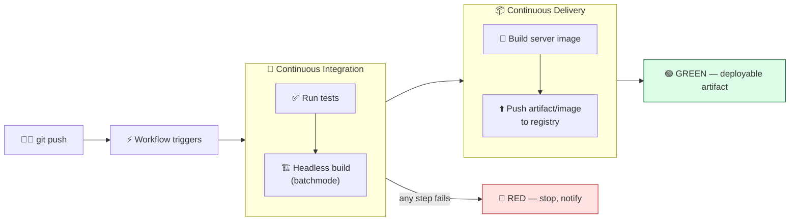

# Level 2 — Automated Builds & CI/CD

| | |
|---|---|
| 🎚️ **Difficulty** | 🟡 Medium |
| ⏱️ **Estimated time** | 35 minutes |
| ⭐ **XP reward** | 100 (Quest) + 25 (Quiz) |

[← Prev](01-profiling-and-optimization.md) · [↑ Phase Home](../README.md) · [→ Next](03-containers-and-the-cloud.md)

---

## 📖 Story

> *"Confession from last sprint: I shipped a server build at 2 a.m., forgot to switch the platform target, and pushed a **Windows** binary as our 'Linux dedicated server.' It didn't even start. We lost a day. That's not a *me* problem — it's a **process** problem. A human running build steps by hand, half-asleep, will eventually get one wrong. The fix is **CI/CD**: a robot that, on **every push**, checks out the code, runs the tests, makes the build the *same way every time*, and bundles the server image — and goes **red** the instant anything breaks, before it ever reaches a player. **CI** = Continuous Integration (merge + test constantly so bugs surface in minutes, not at 2 a.m.). **CD** = Continuous Delivery (every green build produces a deployable artifact, ready to ship). Today we wire up **GitHub Actions** — free for your repo — to run Ashfall's tests on push, do a **headless batchmode** Unity build, and build the dedicated-server **image** from World 8 automatically. After this, 'it builds on my machine' stops being a sentence anyone says. Let me show you. — Priya"*

---

## 🎯 Goal

- Understand **why CI/CD exists**: kill manual, irreproducible, error-prone build/release steps
- Distinguish **CI** (integrate + test on every push) from **CD** (every green build is deployable)
- Write a real **GitHub Actions** workflow (`.github/workflows/*.yml`): triggers, jobs, steps
- Run Ashfall's **automated tests** on push (the gate)
- Do a **headless Unity batchmode** build in CI (no Editor, no clicking)
- Build the **dedicated-server image** (World 8 Dockerfile) in the same pipeline
- Make the pipeline go **red** on failure and **green** with an artifact on success

---

## 🧠 Concepts

### CI vs CD



- **Continuous Integration (CI):** every push is automatically built and **tested**. Integration problems show up in *minutes*, on the exact change that caused them — not in a giant painful merge later. The test suite is the **gate**: red means stop.
- **Continuous Delivery (CD):** every green build automatically produces a **deployable artifact** (here: the Ashfall dedicated-server **image**), so shipping is a button, not a 2 a.m. ritual. (Continuous *Deployment* goes one step further and auto-releases it — that's Lesson 5.)

### Headless / batchmode builds

You normally build a game by clicking **Build** in the Unity Editor. A robot has no mouse. Unity supports **batchmode**: launching the Editor from the command line with no GUI, pointed at a C# **build method** that performs the build. This is the *same* idea as the headless dedicated server from World 8 — the engine running with **no window, no rendering, no human**:

```bash
# How CI invokes Unity with no GUI (conceptually):
Unity -batchmode -nographics -quit \
  -projectPath . \
  -buildTarget StandaloneLinux64 \
  -executeMethod BuildScript.BuildDedicatedServer \
  -logFile -
```

`-executeMethod` calls a static C# method you write (Lab Step 4) that drives `BuildPipeline`. Reproducible, scriptable, no clicking — exactly what a robot needs.

### The runner, the workflow, and the trigger

A **workflow** is a YAML file in `.github/workflows/`. It says **when** to run (`on:`), and **what** to run (`jobs:` → `steps:`). GitHub spins up a fresh **runner** (a clean `ubuntu-latest` VM) for each job — a pristine machine every time, which is *why* CI catches "works on my machine" bugs: there is no "my machine." **Actions** (`uses: actions/checkout@v4`) are reusable pre-built steps. Jobs can declare `needs:` to run in order (test → build → image).

### Why this exists

CI/CD exists because **humans are unreliable at repetitive, multi-step processes** — and building/releasing software is exactly that. A manual release is a checklist someone eventually fumbles (wrong platform target, skipped test, forgotten env var), and the failure surfaces *late*, where it's expensive — in front of a player, or at 2 a.m. CI moves the moment-of-truth **forward**: it integrates and tests on every push, on a **clean machine**, so a break is caught in minutes, attached to the one commit that caused it, before it spreads. CD makes the output of every green run an **immutable, deployable artifact**, so "release" stops being a fragile ceremony and becomes a repeatable, auditable, one-click event. The whole point is to make the path from *commit* to *running software* **automatic, identical every time, and impossible to do half-asleep.**

This is **engine- and language-agnostic.** GitHub Actions, GitLab CI, Jenkins, CircleCI all share the model: triggers → a clean runner → ordered jobs of steps → artifacts, with a red/green gate. Unity, Unreal, and Godot all support headless command-line builds for exactly this. The pattern — *test the change, build it reproducibly, produce a deployable artifact, fail loud and early* — is universal. See **RESOURCES.md** for this world (the GitHub Actions docs and the Actions security-hardening guide before you store secrets).

---

## 🛠️ Hands-on Lab

> 💻 Uses your Ashfall git repo on GitHub + **GitHub Actions** (free for your repo) and the World 8 `Dockerfile`. Workflows live in `.github/workflows/`. No paid runners — `ubuntu-latest` is free-tier.

### Step 1 — Create the workflow file

In your repo, create `.github/workflows/ci.yml`. The skeleton — *when* and *what*:

```yaml
name: Ashfall CI

on:
  push:
  pull_request:

jobs:
  test:
    name: Run tests
    runs-on: ubuntu-latest
    steps:
      - uses: actions/checkout@v4   # pull the repo onto the clean runner
```

`on: push` runs it on every push; `pull_request` also gates PRs. Each job gets a fresh `ubuntu-latest` VM.

### Step 2 — Run Ashfall's automated tests (the gate)

Unity tests run in CI via the community **GameCI** action (free). Add steps to the `test` job:

```yaml
      - uses: actions/checkout@v4
        with:
          lfs: true                 # Unity projects often use Git LFS for assets
      - name: Cache Library         # cache Unity's Library/ to speed up runs
        uses: actions/cache@v4
        with:
          path: Library
          key: Library-${{ hashFiles('Assets/**', 'Packages/**', 'ProjectSettings/**') }}
      - name: Run EditMode + PlayMode tests
        uses: game-ci/unity-test-runner@v4
        env:
          UNITY_LICENSE: ${{ secrets.UNITY_LICENSE }}   # free Personal license, stored as a secret
        with:
          testMode: all
```

> 🔑 `UNITY_LICENSE` is a **GitHub Secret** (repo → **Settings → Secrets and variables → Actions**). You generate a free Personal license activation file once and paste it in — never commit it. See GameCI's "activation" docs (RESOURCES.md).

### Step 3 — Build the dedicated server headlessly (batchmode)

Add a **second job** that only runs if tests pass (`needs: test`), doing the headless Linux server build:

```yaml
  build-server:
    name: Headless Linux server build
    runs-on: ubuntu-latest
    needs: test                     # gate: only build if tests are green
    steps:
      - uses: actions/checkout@v4
        with: { lfs: true }
      - uses: actions/cache@v4
        with:
          path: Library
          key: Library-${{ hashFiles('Assets/**', 'Packages/**', 'ProjectSettings/**') }}
      - name: Build (batchmode, Dedicated Server / Linux)
        uses: game-ci/unity-builder@v4
        env:
          UNITY_LICENSE: ${{ secrets.UNITY_LICENSE }}
        with:
          targetPlatform: StandaloneLinux64   # the headless server target
          buildMethod: BuildScript.BuildDedicatedServer
      - name: Upload server build artifact
        uses: actions/upload-artifact@v4
        with:
          name: ashfall-server-build
          path: build/StandaloneLinux64       # → reused by the image job
```

### Step 4 — The build method (`-executeMethod` target)

GameCI calls a static C# method. Put this in an **Editor** folder so it isn't compiled into the game (`Assets/Editor/BuildScript.cs`):

```csharp
using UnityEditor;
using UnityEditor.Build.Reporting;

// Called by CI via -executeMethod. Builds the headless Linux dedicated server.
public static class BuildScript
{
    public static void BuildDedicatedServer()
    {
        var opts = new BuildPlayerOptions
        {
            scenes = new[] { "Assets/Scenes/Game.unity" },
            locationPathName = "build/StandaloneLinux64/AshfallServer.x86_64",
            target = BuildTarget.StandaloneLinux64,
            subtarget = (int)StandaloneBuildSubtarget.Server, // ← Dedicated Server, not a normal player
            options = BuildOptions.None
        };

        BuildReport report = BuildPipeline.BuildPlayer(opts);
        if (report.summary.result != BuildResult.Succeeded)
            EditorApplication.Exit(1);   // non-zero exit → CI turns RED
    }
}
```

> 💡 `EditorApplication.Exit(1)` is how a build failure makes the **pipeline go red** — CI judges success by the **exit code**.

### Step 5 — Build the dedicated-server image in CI (CD)

Add a third job that takes the build artifact and builds + pushes the **World 8 server image** to GHCR (GitHub's free registry):

```yaml
  build-image:
    name: Build & push server image
    runs-on: ubuntu-latest
    needs: build-server
    if: github.ref == 'refs/heads/main'   # only publish from main
    permissions:
      contents: read
      packages: write                      # allow pushing to GHCR
    steps:
      - uses: actions/checkout@v4
      - name: Download the server build
        uses: actions/download-artifact@v4
        with:
          name: ashfall-server-build
          path: server-build               # matches the World 8 Dockerfile's COPY
      - name: Log in to GHCR
        uses: docker/login-action@v3
        with:
          registry: ghcr.io
          username: ${{ github.actor }}
          password: ${{ secrets.GITHUB_TOKEN }}   # auto-provided per run, no setup
      - name: Build & push image
        uses: docker/build-push-action@v6
        with:
          context: .
          push: true
          tags: |
            ghcr.io/${{ github.repository_owner }}/ashfall-server:${{ github.sha }}
            ghcr.io/${{ github.repository_owner }}/ashfall-server:latest
```

`GITHUB_TOKEN` is provided automatically — no secret to create. Tagging with `${{ github.sha }}` gives every image an **immutable, traceable** tag (which commit produced it) plus a moving `latest`.

### Step 6 — Push and watch it go green

```bash
cd ~/projects/ashfall
git switch -c feature/ci-pipeline
git add .github/workflows/ci.yml Assets/Editor/BuildScript.cs
git commit -m "ci: test + headless server build + image on push (GitHub Actions)"
git push -u origin feature/ci-pipeline
```

Open your repo's **Actions** tab. Watch `test → build-server → build-image` run on the fresh runner. Break a test on purpose and push again — the pipeline goes **red** and won't build. That red gate is the whole point.

---

## 🎮 Mini Challenge

Your `build-image` job sometimes runs *before* tests finish, occasionally publishing an image from code that **failed its tests**. The jobs are all defined, but the image still leaks out. What's missing, and what one-line additions fix it?

<details>
<summary>💡 Reveal answer</summary>

The jobs are missing a **dependency chain** (`needs:`). By default, jobs in a workflow run **in parallel**, so `build-image` doesn't wait for `test`. Fixes: make `build-server` declare `needs: test`, and `build-image` declare `needs: build-server` (it already should). That forces the order **test → build-server → build-image**, so the image is only ever built from code that passed the tests. The `if: github.ref == 'refs/heads/main'` further ensures only `main` publishes. The principle: **the test job is the gate; nothing deployable should run unless it's green and in order.**

</details>

---

## 📦 Project Mission

Give Ashfall a real CI/CD pipeline that tests, builds the server headlessly, and produces the deployable server image on push.

1. Add `.github/workflows/ci.yml` with three ordered jobs: **`test`** (GameCI test runner), **`build-server`** (batchmode `StandaloneLinux64` / Dedicated Server via `buildMethod`), **`build-image`** (download artifact → build + push the World 8 image to GHCR).
2. Add `Assets/Editor/BuildScript.cs` with `BuildDedicatedServer` (Dedicated Server subtarget; exit non-zero on failure).
3. Store the free **`UNITY_LICENSE`** Personal activation as a repo **Secret** (never commit it). Use the auto-provided `GITHUB_TOKEN` for GHCR.
4. Wire the gate: `build-server` `needs: test`, `build-image` `needs: build-server` + `if:` main only. Tag images with `${{ github.sha }}` **and** `latest`.
5. Push a branch, watch **Actions** go green, then **deliberately break a test** and confirm the pipeline goes **red** and skips the image. Restore it to green.
6. Commit + merge:
   ```bash
   cd ~/projects/ashfall
   git add .github/workflows/ci.yml Assets/Editor/BuildScript.cs
   git commit -m "ci: green pipeline — test, headless server build, server image to GHCR"
   git switch main && git merge feature/ci-pipeline && git push   # main run publishes the image
   ```

🎯 **Mission complete when:** every push runs **tests → headless server build → server image**, a broken test turns the pipeline **red** and **blocks** the image, and a green run on `main` publishes `ghcr.io/<you>/ashfall-server:<sha>` (and `:latest`) — the deployable artifact Lessons 3–5 ship to the cloud.

---

## ⚠️ Common Mistakes

| Mistake | What happens | Fix |
|--------|--------------|-----|
| Building by hand / on a dev machine | Irreproducible, "works on my machine," wrong-target builds | Build in CI on a **clean runner**, every push |
| Jobs without `needs:` | Build/publish run before tests (or in parallel) | Chain with `needs:` so **tests gate** the build |
| Committing the Unity license or tokens | Secret leak; license abuse | Store as **GitHub Secrets**; use auto `GITHUB_TOKEN` for GHCR |
| Building a normal player as the "server" | Needs GPU/display; wrong artifact | Dedicated Server **subtarget**, `StandaloneLinux64` |
| Ignoring the build exit code | Failed builds still go "green" | `EditorApplication.Exit(1)` on failure → red |
| Mutable `latest`-only tags | Can't tell which commit shipped | Also tag with the immutable **`${{ github.sha }}`** |
| No `Library/` cache | Every run re-imports assets; minutes wasted | `actions/cache@v4` on `Library/` |

---

## 🤔 Reflection Questions

1. CI runs on a fresh `ubuntu-latest` runner every time. Explain precisely how "there is no *my machine*" is what makes CI catch the bugs a local build hides.
2. Distinguish CI from CD using Ashfall: what does the *test* job guarantee, and what does the *image* job guarantee, and why must one gate the other?
3. The image is tagged with both `${{ github.sha }}` and `latest`. What does each tag buy you, and why is shipping only `latest` dangerous for debugging a bad release?

---

## 📝 Quiz

1. **Continuous Integration's core promise is that…**
   - a) it deploys straight to players with no checks
   - b) every push is automatically built and tested on a clean machine, failing early
   - c) it replaces the need for any tests
2. **A Unity "batchmode" build is used in CI because…**
   - a) it renders at higher quality
   - b) it runs the Editor headlessly from the command line with no GUI, so a robot can build it
   - c) it only works on the developer's laptop
3. **Putting `needs: test` on the build job ensures…**
   - a) the build runs faster
   - b) the build only runs after tests pass, so failing code is never built/shipped
   - c) tests are skipped

<details>
<summary>✅ Answers</summary>

1: **b** · 2: **b** · 3: **b**

</details>

---

## ✅ Completion Checklist

- [ ] I wrote a `.github/workflows/ci.yml` triggered on push/PR
- [ ] Ashfall's **tests run** on a clean runner as the gate
- [ ] A **headless batchmode** Dedicated Server (Linux) build runs in CI
- [ ] The **server image** is built + pushed to GHCR on `main`
- [ ] A broken test turns the pipeline **red** and blocks the image
- [ ] Images are tagged with `${{ github.sha }}` and `latest`
- [ ] I passed the quiz
- [ ] Added **+125 XP** to [PROGRESS.md](../../../PROGRESS.md)

---

[← Prev](01-profiling-and-optimization.md) · [↑ Phase Home](../README.md) · [→ Next](03-containers-and-the-cloud.md)
