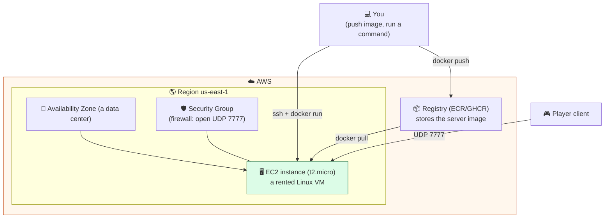
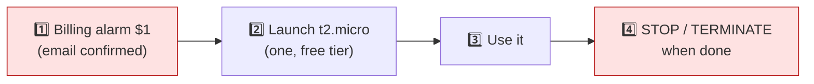

# Level 3 — Containers & the Cloud

| | |
|---|---|
| 🎚️ **Difficulty** | 🔴 Hard |
| ⏱️ **Estimated time** | 35 minutes |
| ⭐ **XP reward** | 100 (Quest) + 25 (Quiz) |

[← Prev](02-automated-builds-and-ci-cd.md) · [↑ Phase Home](../README.md) · [→ Next](04-infrastructure-as-code-with-terraform.md)

---

## 📖 Story

> *"You've got a server image and a pipeline that builds it. But it only runs on **your laptop** — close the lid, the match dies. Time to put it on a computer that never sleeps: **the cloud.** The cloud is just someone else's computers, rented by the minute, reachable over the internet — and AWS will rent us a Linux box (an **EC2** instance) on the **free tier** so it costs **$0** if we behave. But hear me on this, because it's the most important sentence in this world: **set a billing alarm BEFORE you launch anything.** I have personally seen an engineer leave a big instance running over a weekend and come back to a four-figure bill. Not on my watch. So: alarm first, then we push the Ashfall server image to a **registry**, pull it onto a free-tier EC2 box, run it, and connect a client to a server living in the cloud. Then I'll show you the *concept* of **Kubernetes** — how you'd run not one match server but a hundred, scaling up and down with players. We do the real k8s on AWS in Lessons 4–5. Today: one server, in the cloud, safely. Let me show you. — Priya"*

---

## 🎯 Goal

- Understand cloud fundamentals: **regions/AZs**, **compute** (a rented VM), and basic **networking** (ports, security groups)
- **AWS free tier** + the non-negotiable **billing-alarm / cost-safety** discipline
- Push the **World 8 server image** to a **container registry**
- Run that image on a **free-tier EC2** Linux VM and connect a client to it
- Grasp the *concept* of **orchestration / Kubernetes** for scaling many match servers (deep dive in L4–L5)

---

## 🧠 Concepts

### What the cloud actually is

The cloud is **someone else's computers, rented by the minute, reachable over the internet.** Instead of buying a server, you rent a slice of Amazon's data centers and give it back when done. Three ideas you need today:



- **Region & AZ:** a **Region** (`us-east-1`) is a geographic area; inside it are **Availability Zones** (separate data centers). Pick **one region and stay in it** — a forgotten instance in another region is a classic surprise-bill.
- **Compute:** **EC2** = Elastic Compute Cloud = a rented virtual machine. `t2.micro`/`t3.micro` are **free-tier eligible** (750 hours/month for 12 months ≈ one instance running 24/7).
- **Networking:** a **Security Group** is a stateful firewall around your instance. Inbound is **blocked by default** — you must explicitly open the game port (UDP 7777) and SSH (TCP 22, *your IP only*).

### 🚨 Cost safety — the rule that comes before everything

> **Before you launch a single billable thing, set a billing alarm.** This is Lesson 1 of the cloud, not the last.

Free is only free if you stay inside the limits. The discipline:
- Set a **$1 CloudWatch billing alarm** with an email you **confirm** (it can't warn you until you click the confirmation link). Alarms live in `us-east-1`.
- Use **only `t2.micro`/`t3.micro`**, **one instance at a time** (two burns past 750 hrs/month).
- **Stop or terminate** the instance the moment you're done. *Stopped* = compute meter paused (disk kept). *Terminated* = gone for good.
- Enable **MFA** on the root account; do daily work as an IAM user.



### Registries: where images live

You can't `docker run` a laptop image on a remote server — the server has to **fetch** it. A **registry** is the shared store for images (like GitHub is for code): you `docker push` from CI/your laptop, the cloud VM does `docker pull`. We used **GHCR** (`ghcr.io`) in Lesson 2 (free, integrated with Actions); AWS's own is **ECR**. Either way: *build once, push to the registry, pull anywhere.*

### Orchestration & Kubernetes (the concept)

One EC2 box running one container is fine for one match. But a real game has **thousands of concurrent matches**, each needing its own server, spun up and torn down constantly. Doing that by hand on VMs is impossible. **Orchestration** automates it: you declare "I want N match servers running," and the orchestrator places them on machines, **restarts** crashed ones (self-healing), and **scales** the count up/down with demand. **Kubernetes (k8s)** is the industry-standard orchestrator. Its core nouns:

- **Pod** — the smallest unit; a wrapper around your container(s).
- **Deployment** — says "keep N identical Pods running" and replaces dead ones (self-healing).
- **Service** — a stable network endpoint in front of those Pods (load balancing).

You declare a **desired state** in YAML; k8s's control loop continuously makes reality match it. We provision a real cluster with Terraform in **Lesson 4** and operate it in **Lesson 5** — today, just hold the mental model.

### Why this exists

The cloud exists because **owning servers is slow, expensive, and rigid**: you buy hardware, wait for shipping, rack it, and pay for it even while idle — and you can't conjure 100 more on launch night. The cloud turns a **capital purchase into a utility bill** (pay for what you use, provisioned in seconds) — which is exactly what a game with spiky, unpredictable player counts needs. That same instant-provisioning is the danger, which is why **cost safety is a first-class engineering practice**, not an afterthought: it is just as easy to leave ten instances running as one. **Registries** exist because the artifact has to live somewhere both your build pipeline and every server can reach — decoupling *build* from *run*. **Orchestration** exists because once you have *many* identical, disposable servers, no human can place, monitor, restart, and scale them by hand; you must declare intent and let a control loop enforce it.

This is **engine- and vendor-agnostic.** "Rented VMs," registries, and orchestration exist on AWS (EC2, ECR, EKS), GCP (Compute Engine, Artifact Registry, GKE), and Azure (VMs, ACR, AKS) with the same shapes. Kubernetes itself is an open standard that runs anywhere. Game-server fleets (Agones, AWS GameLift) are built on exactly this. See **RESOURCES.md** for this world (AWS Free Tier — read the limits *first* — and the Kubernetes concepts docs).

---

## 🛠️ Hands-on Lab

> 💻 Needs the World 8 `ashfall-server` image (or the GHCR image from Lesson 2), a **free-tier AWS account**, and an SSH key. **Do Step 0 before anything billable.** Local k8s (Step 6) uses free **minikube**/**kind**.

### Step 0 — 🚨 Cost safety FIRST (do not skip)

1. Sign in, set the region selector (top-right) to **`us-east-1`** and keep it there.
2. **CloudWatch → Alarms → Create alarm → Billing → Total Estimated Charge (USD)**, threshold **Static > $1**. Create an SNS topic with your email.
3. **Check your email and click "Confirm subscription"** — the alarm is mute until you do.
4. Enable **MFA** on the root user. (Full walkthrough in RESOURCES.md / the World 6 cost guide.)

### Step 1 — Push the server image to a registry

If you didn't already push it via CI in Lesson 2, push it now (GHCR shown):

```bash
# Log in to GitHub Container Registry with a Personal Access Token (write:packages scope)
echo "$GHCR_TOKEN" | docker login ghcr.io -u YOUR_GH_USERNAME --password-stdin

# Tag the World 8 image for the registry, then push
docker tag ashfall-server:v1 ghcr.io/YOUR_GH_USERNAME/ashfall-server:v1
docker push ghcr.io/YOUR_GH_USERNAME/ashfall-server:v1
```

### Step 2 — Launch a free-tier EC2 instance

In the EC2 console → **Launch instance**:
- **AMI:** Ubuntu Server 22.04 LTS
- **Instance type:** **`t2.micro`** (free-tier eligible — the label says so)
- **Key pair:** create/select an RSA `.pem` key (e.g. `ashfall-key.pem`) — you SSH with this
- **Security group (inbound rules):**

| Type | Protocol | Port | Source | Why |
|------|----------|------|--------|-----|
| SSH | TCP | 22 | **My IP** | admin login (never `0.0.0.0/0`) |
| Custom UDP | UDP | 7777 | 0.0.0.0/0 | the game server port (UDP — World 8) |

Launch. Note the **Public IP**.

### Step 3 — SSH in and install Docker

```bash
chmod 400 ~/.ssh/ashfall-key.pem        # SSH refuses a too-open key
ssh -i ~/.ssh/ashfall-key.pem ubuntu@<PUBLIC_IP>

# On the EC2 box:
sudo apt update && sudo apt install -y docker.io
sudo systemctl enable --now docker
sudo usermod -aG docker ubuntu          # run docker without sudo (re-login to apply)
exit
```

### Step 4 — Pull and run the server in the cloud

```bash
ssh -i ~/.ssh/ashfall-key.pem ubuntu@<PUBLIC_IP>

# Log in to the registry (or make the GHCR package public to skip auth)
echo "$GHCR_TOKEN" | docker login ghcr.io -u YOUR_GH_USERNAME --password-stdin

# Pull the image you pushed in Step 1
docker pull ghcr.io/YOUR_GH_USERNAME/ashfall-server:v1

# Run it, publishing the UDP game port (restart if it crashes / on reboot)
docker run -d --name ashfall --restart unless-stopped \
  -p 7777:7777/udp ghcr.io/YOUR_GH_USERNAME/ashfall-server:v1

docker ps             # confirm it's up
docker logs ashfall   # see "Ashfall dedicated server started."
```

### Step 5 — Connect a client to the cloud server

In your Unity client's **Unity Transport**, set the address to the EC2 **Public IP** and port **7777**, then **Start Client**. You're now playing against an Ashfall dedicated server **running in the cloud** — no laptop required. Run a second client for cloud co-op.

### Step 6 — See orchestration locally (concept → hands-on)

Get a feel for k8s without paying for a cluster — run one locally:

```bash
minikube start                          # free single-node cluster (or: kind create cluster)
kubectl create deployment ashfall \
  --image=ghcr.io/YOUR_GH_USERNAME/ashfall-server:v1
kubectl get pods                        # one Pod running your server
kubectl scale deployment/ashfall --replicas=3   # now THREE match servers, declaratively
kubectl get pods                        # k8s created two more to match desired state
kubectl delete pod <one-pod-name>       # kill one...
kubectl get pods                        # ...k8s self-heals it back to 3
```

That `--replicas=3` and self-healing is the whole pitch: **declare how many servers you want; the orchestrator keeps exactly that many alive.** Lessons 4–5 do this for real on AWS.

### Step 7 — 🚨 STOP the instance (cost safety)

```bash
# from the console: EC2 → Instances → select → Instance state → Stop (or Terminate when fully done)
minikube delete                         # free the local cluster too
```

> 🚨 A running instance bills against your 750 free hours. **Stop it when you finish a session; terminate it when the world is done.** Confirm EC2 → Instances is empty.

---

## 🎮 Mini Challenge

A teammate launches a `t2.micro`, runs the server, connects fine, and logs off for the weekend without stopping it. They also opened SSH (port 22) to `0.0.0.0/0` and never set a billing alarm. Name the **three** problems and the fix for each.

<details>
<summary>💡 Reveal answer</summary>

1. **Instance left running all weekend** — it bills the entire time against the 750 free-tier hours (and a second instance would push *past* free). Fix: **Stop** (or Terminate) the instance when done; one micro instance at a time.
2. **SSH open to `0.0.0.0/0`** — the whole internet can hammer port 22 with brute-force attempts. Fix: set the SSH inbound source to **My IP** only. The game port (UDP 7777) can be public; SSH must not be.
3. **No billing alarm** — if anything *does* start charging, they won't know until the bill arrives. Fix: a **$1 CloudWatch billing alarm** with a **confirmed** email — *before* launching anything. Alarm first, always.

</details>

---

## 📦 Project Mission

Run the Ashfall dedicated server in the cloud on free-tier AWS — safely — and see orchestration locally.

1. **Cost safety first:** region `us-east-1`, **$1 billing alarm with confirmed email**, root MFA on.
2. **Push** the World 8 `ashfall-server` image to a registry (GHCR/ECR) — or reuse the image CI pushed in Lesson 2.
3. **Launch a `t2.micro`** Ubuntu instance; security group opens **UDP 7777** (game) and **TCP 22 to My IP** (SSH). Install Docker.
4. **Pull and run** the image with `-p 7777:7777/udp`; confirm `docker logs` shows the server started.
5. **Connect a client** (and a second) to the EC2 **public IP:7777** and play co-op against the cloud server.
6. **Orchestration taste:** locally `minikube start`, deploy the image, `scale --replicas=3`, delete a Pod, watch it self-heal back to 3.
7. **🚨 STOP/terminate** the EC2 instance and `minikube delete` when done. Note the public IP + image ref in `docs/cloud-notes.md` and commit it.

🎯 **Mission complete when:** the Ashfall server image is in a **registry**, runs on a **free-tier `t2.micro`** with the **UDP port open**, a **client connects to it in the cloud**, you've watched a local k8s Deployment **self-heal/scale**, and you've **stopped the instance** with a **confirmed $1 billing alarm** in place — cloud server up, bill at $0.00.

---

## ⚠️ Common Mistakes

| Mistake | What happens | Fix |
|--------|--------------|-----|
| Launching before the billing alarm | A forgotten resource bills silently | **$1 alarm + confirmed email FIRST**, always |
| Leaving the instance running | Burns free hours; risks charges | **Stop/terminate** when done; one micro at a time |
| SSH open to `0.0.0.0/0` | Internet-wide brute-force on port 22 | SSH source = **My IP**; game port can be public |
| Forgetting `/udp` on the port | Clients can't reach the UDP server | `-p 7777:7777/udp` and a **UDP** SG rule |
| Resources scattered across regions | A "lost" instance bills where you never look | Pick **one region** (`us-east-1`), always verify |
| Expecting the VM to have your local image | `docker run` fails — image isn't there | **Push to a registry**, `docker pull` on the VM |
| Thinking one VM scales to many matches | Manual per-match VMs don't scale | That's what **orchestration / k8s** is for (L4–L5) |

---

## 🤔 Reflection Questions

1. The cloud turns a capital purchase into a utility bill. Why does that model fit a game's spiky, unpredictable player counts better than buying servers — and why does the same flexibility make cost discipline essential?
2. Why must the server image go through a **registry** instead of just copying it to the EC2 box? What does decoupling *build* from *run* buy you across CI, your laptop, and many servers?
3. In your own words, what problem does **orchestration** solve that one EC2 box plus `docker run` cannot, once Ashfall has a thousand concurrent matches?

---

## 📝 Quiz

1. **The single most important first action in a new AWS account is to…**
   - a) launch the largest instance available
   - b) set a billing alarm and enable MFA before launching anything billable
   - c) open SSH to the whole internet
2. **A container registry (e.g. GHCR/ECR) exists to…**
   - a) run your containers for you
   - b) store images so any machine (CI, your laptop, a cloud VM) can pull the same artifact
   - c) replace your security group
3. **A Kubernetes Deployment with `replicas: 3` will…**
   - a) run exactly once and stop
   - b) keep three identical Pods running and recreate any that die (self-healing)
   - c) delete your cluster

<details>
<summary>✅ Answers</summary>

1: **b** · 2: **b** · 3: **b**

</details>

---

## ✅ Completion Checklist

- [ ] **Cost safety:** `us-east-1`, **$1 alarm (email confirmed)**, root MFA on
- [ ] I **pushed** the Ashfall server image to a registry
- [ ] I launched a **free-tier `t2.micro`** with UDP 7777 open and SSH to My IP
- [ ] I **pulled + ran** the image and a client connected to the **cloud** server
- [ ] I saw a local k8s Deployment **scale and self-heal**
- [ ] I **stopped/terminated** the instance (bill stays $0.00)
- [ ] I passed the quiz
- [ ] Added **+125 XP** to [PROGRESS.md](../../../PROGRESS.md)

---

[← Prev](02-automated-builds-and-ci-cd.md) · [↑ Phase Home](../README.md) · [→ Next](04-infrastructure-as-code-with-terraform.md)
