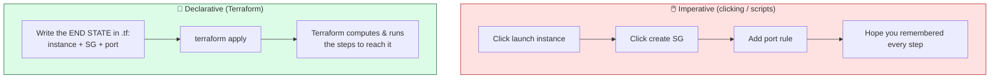
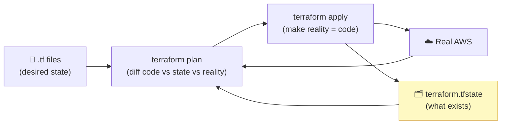

# Level 4 — Infrastructure as Code with Terraform

| | |
|---|---|
| 🎚️ **Difficulty** | 🔴 Hard |
| ⏱️ **Estimated time** | 35 minutes |
| ⭐ **XP reward** | 100 (Quest) + 25 (Quiz) |

[← Prev](03-containers-and-the-cloud.md) · [↑ Phase Home](../README.md) · [→ Next](05-deploy-monitor-and-operate.md)

---

## 📖 Story

> *"In Lesson 3 you clicked your way through the AWS console to launch that server — instance type here, security group there, a port rule, a key pair. It worked. Now tell me: could you do it **exactly the same** again next week? Could a teammate? Could you tear it all down and prove **nothing** is left billing you? Clicking is **un-reproducible**. Nobody remembers every checkbox, the console changes, and 'I think I opened that port?' is how you get drift and surprise bills. The fix is **Infrastructure as Code**: you write the infrastructure in a file — `instance type = t2.micro`, `open UDP 7777` — commit it to git, and a tool builds *exactly that*, every time. We use **Terraform**. You **declare** the end state; Terraform figures out the steps. `terraform apply` to create it, `terraform destroy` to wipe every byte of it (your best friend for keeping the bill at zero). It tracks what it made in a **state** file so it never double-creates or loses track. Today you'll provision Ashfall's whole server box — instance, firewall, key — from code you can review, repeat, and destroy. Let me show you. — Priya"*

---

## 🎯 Goal

- Understand **why IaC** beats clicking: reproducible, reviewable, version-controlled, destroyable infra
- The core distinction: **declarative** (say *what*) vs **imperative** (say *how*)
- Terraform's model: **providers**, **resources**, and **state**
- The workflow: `init` → `fmt`/`validate` → `plan` → `apply` → `destroy`
- Write real **`.tf`** to provision the Ashfall server infra (EC2 + security group + key) reproducibly
- **Cost safety:** free-tier guardrails in code + **always `terraform destroy`** when done

---

## 🧠 Concepts

### Declarative vs imperative



- **Imperative:** you specify the **steps** ("do this, then this"). Clicking the console or a shell script. Re-running is fragile — order matters, partial failures leave a mess, and *you* must remember the full sequence.
- **Declarative:** you specify the **desired end state** ("one `t2.micro`, this firewall, this port"). Terraform diffs that against what already exists and does only what's needed to converge. Re-running an unchanged file is a **no-op** — safe and idempotent. (This is the same "declare desired state, let a controller reconcile" idea as Kubernetes in Lesson 3.)

### Providers, resources, state

- **Provider** — the plugin that knows how to talk to a platform's API (`aws`, plus `google`, `azurerm`, `kubernetes`, …). You configure it once (which region).
- **Resource** — one piece of infrastructure you want to exist: an `aws_instance`, an `aws_security_group`. The building block of every `.tf` file.
- **State** (`terraform.tfstate`) — Terraform's **memory**: a JSON map from your code to the **real** resources it created (their IDs). This is how `apply` knows whether to *create*, *update*, or *do nothing*, and how `destroy` knows *exactly* what to remove. **Never edit it by hand**, and **git-ignore it** (it can contain secrets).



### The workflow

```bash
terraform init       # download the provider plugin (once per project)
terraform fmt        # auto-format the .tf files
terraform validate   # check syntax/types before touching the cloud
terraform plan       # PREVIEW: shows + create / ~ change / - destroy (creates nothing)
terraform apply      # execute the plan (type 'yes'); updates state
terraform destroy    # remove everything in state (type 'yes') — cost safety!
```

`plan` first, **always** — it's a dry run that shows precisely what will change before anything happens.

### Why this exists

IaC exists because **infrastructure built by hand is invisible, un-reviewable, and irreproducible.** A console-clicked server has no record of *why* a port is open or *what* exactly is running — that knowledge lives in someone's memory, drifts over time, and can't be code-reviewed, diffed, or rebuilt identically after a disaster. Writing infra as code turns the *environment itself* into a versioned artifact in git: every change is a reviewable diff, every environment (dev/staging/prod) is the same file with different variables, and rebuilding is `terraform apply`, not an afternoon of clicking and guessing. **Declarative** beats **imperative** because you can't safely re-run a list of steps against a half-built system, but you *can* always re-converge to a described end state. **State** exists because Terraform must remember the mapping between your abstract code and the concrete cloud resources to update or delete them precisely — without it, it couldn't tell "create a new server" from "this one already exists." And `destroy` is what makes free-tier learning safe: one command provably removes everything, so nothing lingers on the meter.

This is **vendor- and engine-agnostic.** Terraform speaks to AWS, GCP, Azure, Kubernetes, and dozens more through providers, with the same `plan/apply/destroy` workflow; competing tools (CloudFormation, Pulumi, Bicep) share the declarative-state model. The ideas — declare desired state, diff against reality, track state, review the plan — are the foundation of all modern operations, game servers included. See **RESOURCES.md** for this world (the Terraform docs and the "state explained" page — read it; state confuses everyone at first).

---

## 🛠️ Hands-on Lab

> 💻 Needs **Terraform** installed and AWS credentials configured (`aws configure`, or env vars). **Cost safety:** the **$1 billing alarm from Lesson 3 must already exist and be confirmed.** Everything here is `t2.micro` free-tier, and you'll `destroy` at the end. Work in a new folder `~/projects/ashfall/infra/`.

### Step 1 — Provider + variables (free-tier guardrails in code)

`main.tf`:

```hcl
terraform {
  required_providers {
    aws = { source = "hashicorp/aws", version = "~> 5.0" }
  }
}

provider "aws" {
  region = var.region
}

variable "region" {
  description = "AWS region for the Ashfall server"
  type        = string
  default     = "us-east-1"
}

variable "instance_type" {
  description = "EC2 size — FREE TIER ONLY"
  type        = string
  default     = "t2.micro"

  # Guardrail: refuse to apply anything that isn't free-tier eligible.
  validation {
    condition     = contains(["t2.micro", "t3.micro"], var.instance_type)
    error_message = "Free tier only: instance_type must be t2.micro or t3.micro."
  }
}
```

### Step 2 — The latest Ubuntu AMI (data source) + key pair

```hcl
# Look up the newest official Ubuntu 22.04 image (don't hardcode an AMI id).
data "aws_ami" "ubuntu" {
  most_recent = true
  owners      = ["099720109477"] # Canonical's official AWS account

  filter {
    name   = "name"
    values = ["ubuntu/images/hvm-ssd/ubuntu-jammy-22.04-amd64-server-*"]
  }
}

# Register your SSH public key so you can log into the instance.
resource "aws_key_pair" "ashfall" {
  key_name   = "ashfall-key"
  public_key = file("~/.ssh/id_ed25519.pub")
}
```

### Step 3 — Security group (the firewall, in code)

```hcl
resource "aws_security_group" "ashfall" {
  name        = "ashfall-sg"
  description = "Ashfall dedicated server: SSH (admin) + UDP game port"

  ingress {
    description = "SSH (restrict to your IP in real use)"
    from_port   = 22
    to_port     = 22
    protocol    = "tcp"
    cidr_blocks = ["0.0.0.0/0"]   # ⚠️ tighten to ["YOUR.IP.HERE/32"]
  }

  ingress {
    description = "Ashfall game server (UDP — World 8)"
    from_port   = 7777
    to_port     = 7777
    protocol    = "udp"
    cidr_blocks = ["0.0.0.0/0"]
  }

  egress {
    description = "All outbound (pull the image, etc.)"
    from_port   = 0
    to_port     = 0
    protocol    = "-1"            # -1 = all protocols
    cidr_blocks = ["0.0.0.0/0"]
  }

  tags = { Project = "Ashfall", ManagedBy = "Terraform" }
}
```

### Step 4 — The EC2 instance (the server box)

```hcl
resource "aws_instance" "ashfall_server" {
  ami                    = data.aws_ami.ubuntu.id
  instance_type          = var.instance_type           # validated free-tier
  key_name               = aws_key_pair.ashfall.key_name
  vpc_security_group_ids = [aws_security_group.ashfall.id]

  # Install Docker on first boot so the box is ready to run the server image.
  user_data = <<-EOF
    #!/bin/bash
    apt-get update && apt-get install -y docker.io
    systemctl enable --now docker
    usermod -aG docker ubuntu
  EOF

  tags = { Name = "ashfall-server", Project = "Ashfall", ManagedBy = "Terraform" }
}
```

### Step 5 — Outputs (what you need after apply)

`outputs.tf`:

```hcl
output "public_ip" {
  description = "Public IP of the Ashfall server"
  value       = aws_instance.ashfall_server.public_ip
}

output "connect_hint" {
  description = "Where clients connect"
  value       = "Client → ${aws_instance.ashfall_server.public_ip}:7777/udp"
}
```

### Step 6 — Run the workflow

```bash
cd ~/projects/ashfall/infra
terraform init                  # download the AWS provider
terraform fmt && terraform validate
terraform plan                  # PREVIEW — read it: should show "3 to add" (key, SG, instance)
terraform apply                 # type 'yes' → creates the infra; prints public_ip
```

Terraform prints the `public_ip`. SSH in (Docker is already installed via `user_data`), `docker pull` your Lesson 2/3 image, and `docker run -d -p 7777:7777/udp ...` — the **same server, on infra you can now rebuild from a file.**

### Step 7 — 🚨 Destroy when done (cost safety)

```bash
terraform plan -destroy         # preview what will be removed
terraform destroy               # type 'yes' → removes the instance, SG, key — bill back to $0
```

> 🚨 `terraform destroy` is your free-tier safety net: it removes **exactly** what's in state, so nothing is left running. Run it at the end of every session. Add to `.gitignore`: `.terraform/`, `*.tfstate`, `*.tfstate.*` (state can hold secrets and must not be committed).

---

## 🎮 Mini Challenge

A teammate sets `instance_type = "m5.large"` (NOT free tier), runs `terraform apply` without looking at the plan, and later deletes their `.tf` files to "clean up" — then is confused when AWS keeps billing them. Identify the **three** mistakes and the fix for each.

<details>
<summary>💡 Reveal answer</summary>

1. **`m5.large` is not free-tier** — it bills immediately. Fix: the `validation` block in Step 1 would have **blocked the apply** with "Free tier only." Keep `t2.micro`/`t3.micro` and let the guardrail enforce it.
2. **Skipping `terraform plan`** — they applied blind. `plan` is a dry run that would have shown the large, billable instance *before* creating it. Fix: **always `plan` and read it** before `apply`.
3. **Deleting the `.tf` files to clean up** — that does **not** remove the real AWS resources; they keep running (and billing), and now Terraform's **state** still references infra you can no longer easily destroy via code. Fix: tear down with **`terraform destroy`** (which uses state to remove the real resources), *then* delete files. Deleting code ≠ deleting infrastructure.

</details>

---

## 📦 Project Mission

Provision Ashfall's server infrastructure entirely from Terraform — reproducible, reviewable, destroyable.

1. In `~/projects/ashfall/infra/`, write `main.tf` (provider + variables with a **free-tier `validation`**), the **Ubuntu AMI** data source + **key pair**, a **security group** (SSH + **UDP 7777**), an **`aws_instance`** (`t2.micro`, `user_data` installs Docker), and `outputs.tf` (public IP).
2. `terraform init → fmt → validate → plan` — **read the plan** (should be ~3 to add), then `apply`.
3. SSH to the output IP, `docker pull` your Ashfall server image, run it with `-p 7777:7777/udp`, and connect a client to the **Terraform-provisioned** server.
4. Add `.terraform/`, `*.tfstate*` to `.gitignore`; commit the **`.tf` files** (infra is now code in the repo):
   ```bash
   cd ~/projects/ashfall
   printf ".terraform/\n*.tfstate\n*.tfstate.*\n" >> .gitignore
   git add infra/*.tf .gitignore
   git commit -m "infra: Terraform for Ashfall server (EC2 + SG + key, free-tier guardrails)"
   git switch main && git merge feature/terraform-infra 2>/dev/null; git push
   ```
5. **🚨 `terraform destroy`** when done and confirm the EC2 console is empty.

🎯 **Mission complete when:** `terraform apply` stands up the Ashfall server box (instance + UDP firewall + key) from committed `.tf`, a client connects to the provisioned server, the `instance_type` **validation** blocks anything non-free-tier, and **`terraform destroy`** cleanly removes everything (bill back to $0) — your infrastructure is now reproducible code, not console clicks.

---

## ⚠️ Common Mistakes

| Mistake | What happens | Fix |
|--------|--------------|-----|
| Clicking infra in the console | Un-reproducible, no review, drift | Declare it in **`.tf`**, commit, `apply` |
| `apply` without reading `plan` | Surprise (billable) resources created | **Always `plan` and read it** first |
| Non-free-tier instance type | Immediate charges | `validation` block restricting to `t2.micro`/`t3.micro` |
| Deleting `.tf` files to "clean up" | Real resources keep running + billing | Use **`terraform destroy`**, not file deletion |
| Committing `terraform.tfstate` | Leaks secrets; merge conflicts | `.gitignore` `*.tfstate*` and `.terraform/` |
| Editing state by hand | Corrupts the code↔reality map | Never; change `.tf` and `apply` |
| Forgetting to destroy after a session | Free hours burn overnight | `terraform destroy` at the end, every time |

---

## 🤔 Reflection Questions

1. Explain declarative vs imperative using your Lesson 3 clicking vs this Terraform file. Why is re-running a declarative description safe while re-running imperative steps is fragile?
2. What is the **state** file, and why can Terraform neither correctly *update* nor *destroy* your infrastructure without it? Why must it never be committed or hand-edited?
3. Deleting your `.tf` files does not stop AWS billing you. Explain precisely why, and what the correct teardown is — tie it to how state works.

---

## 📝 Quiz

1. **Terraform is "declarative," meaning you…**
   - a) write the exact ordered steps to run
   - b) describe the desired end state and Terraform figures out how to reach it
   - c) click through the console faster
2. **The `terraform.tfstate` file is…**
   - a) your source code
   - b) Terraform's record mapping your code to the real resources it created
   - c) a log file you can safely delete anytime
3. **The safest way to remove free-tier infrastructure you created is…**
   - a) delete the `.tf` files
   - b) `terraform destroy` (which uses state to remove exactly what was created)
   - c) just stop paying

<details>
<summary>✅ Answers</summary>

1: **b** · 2: **b** · 3: **b**

</details>

---

## ✅ Completion Checklist

- [ ] I wrote `.tf` for provider + variables with a **free-tier `validation`**
- [ ] I defined the AMI data source, key pair, **security group (UDP 7777)**, and `aws_instance`
- [ ] I ran `init → fmt → validate → plan` and **read the plan** before `apply`
- [ ] A client connected to the **Terraform-provisioned** Ashfall server
- [ ] `terraform.tfstate*` and `.terraform/` are **git-ignored**; `.tf` committed
- [ ] I ran **`terraform destroy`** and confirmed nothing is left running
- [ ] I passed the quiz
- [ ] Added **+125 XP** to [PROGRESS.md](../../../PROGRESS.md)

---

[← Prev](03-containers-and-the-cloud.md) · [↑ Phase Home](../README.md) · [→ Next](05-deploy-monitor-and-operate.md)
