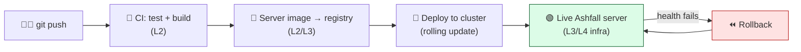
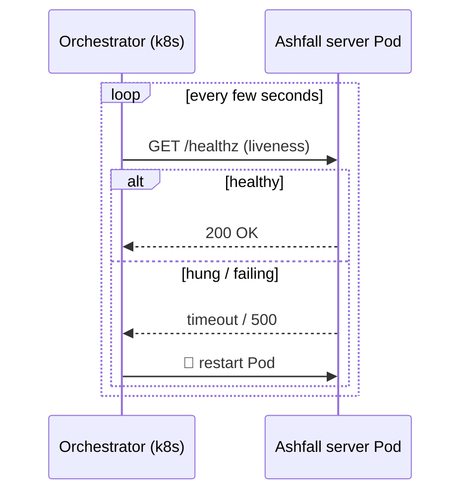
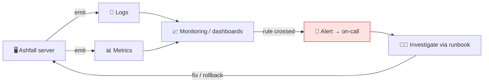

# Level 5 — Deploy, Monitor & Operate

| | |
|---|---|
| 🎚️ **Difficulty** | 🔴 Hard |
| ⏱️ **Estimated time** | 35 minutes |
| ⭐ **XP reward** | 100 (Quest) + 25 (Quiz) |

[← Prev](04-infrastructure-as-code-with-terraform.md) · [↑ Phase Home](../README.md) · [→ Next](../boss-battle.md)

---

## 📖 Story

> *"Last one — and it's the difference between *making* a game and *running a service.* You can profile, build in CI, push an image, provision with Terraform. Now tie it into one **pipeline** — push code, and it flows all the way to a live Ashfall server — and then **operate** it. Because here's the thing nobody tells junior engineers: deploying is the **easy** 10%. The other 90% is the months *after*, when the server is live at 3 a.m. and a player pings me 'co-op is down.' That's why we add **health checks** (so the system knows when a server is sick), **logs and metrics** (so I can see what happened without guessing), **alerts** (so I find out before the players do), **rollbacks** (so a bad deploy is undone in seconds, not a frantic hour), and a **runbook** (so the on-call person — maybe you — fixes it calmly instead of panicking). This is the **operate** mindset: assume things *will* break, and build the feedback loops that let you notice and recover fast. Today you ship the full Ashfall server pipeline and stand up the monitoring around it. Finish this and you've gone from gameplay programmer to someone who can keep a game *alive.* Then — the boss battle. Let me show you. — Priya"*

---

## 🎯 Goal

- Tie the world together into one **deploy pipeline**: push → CI → image → cluster → live server
- Add **health checks** (liveness/readiness) so the platform knows a server's state
- Set up **logging, metrics, and monitoring** — the feedback loop
- Configure **alerts** so you learn of problems before players do
- Do safe **rolling updates** and fast **rollbacks**
- Adopt an **incident-response / runbook** mindset (assume failure; recover fast)

---

## 🧠 Concepts

### The full deploy pipeline

Everything from Lessons 1–4 becomes one automatic flow from a `git push` to a running server:



This is **Continuous Deployment**: a green pipeline releases automatically. The rollback arrow is what makes that safe.

### Health checks: how the platform knows a server is OK

A process being "up" isn't the same as it being **healthy** (it might be deadlocked, or still loading). So the server exposes a tiny **health endpoint**, and the orchestrator probes it:

- **Liveness probe** — "are you alive?" If it fails, the platform **restarts** the Pod (cures a hang).
- **Readiness probe** — "are you ready for traffic?" If it fails, the platform **stops sending players** to that Pod (but doesn't kill it) until it recovers.



### Logs, metrics, monitoring, alerts — the feedback loop

You cannot fix what you cannot see. Three distinct things, often confused:

- **Logs** — discrete events with context ("match 42 started", "player X disconnected", an error + stack). *What happened.*
- **Metrics** — numbers over time (CPU %, RAM, tick rate, players online, frame time). *How much / how often.*
- **Monitoring** — collecting metrics/logs and **watching** them, usually on dashboards.
- **Alerts** — a rule on a metric that **notifies a human** when something's wrong (CPU > 90% for 5 min, tick rate < 20, server down). The goal: **you find out before the players do.**



### Rolling updates and rollbacks

A **rolling update** replaces old server Pods with new ones **a few at a time**, so the game never fully goes down — new Pods must pass their **readiness** probe before old ones are removed. If the new version is bad, a **rollback** instantly returns to the previous known-good image. Because every image is tagged with its commit SHA (Lesson 2), rollback is exact and fast — seconds, not a panicked rebuild.

### The runbook / incident mindset

Things *will* break. The professional stance is to assume it and prepare: a **runbook** is a short, written "when X alarm fires, do Y" guide — how to check health, read logs, roll back, who to escalate to — so whoever is on-call (maybe you, at 3 a.m.) acts **calmly from a checklist** instead of improvising under pressure. This is the heart of **SRE** (Site Reliability Engineering).

### Why this exists

All of this exists because **shipping is the beginning, not the end** — software spends almost all of its life *running*, and running software fails in ways you didn't predict. **Health checks** exist because "the process is running" is a lie the OS tells you; only the application knows if it's actually serving, so it must report that and the platform must act on it automatically (restart, drain) faster than a human could. **Logs and metrics** exist because production is opaque — without emitted evidence, every incident is a guess, and "it works on my machine" is useless when *its* machine is on fire. **Alerts** exist to compress the time between *broken* and *known*, because the worst way to learn your server is down is from angry players. **Rollbacks** exist because the fastest cure for a bad deploy is to *stop deploying it*, and **runbooks** exist because human memory and judgment degrade under stress — a checklist doesn't. Together they form a **feedback loop** that turns inevitable failure from a catastrophe into a brief, recoverable blip.

This is **engine- and platform-agnostic** and is the core of modern operations/SRE. Health probes (k8s liveness/readiness, load-balancer health checks), the logs/metrics/traces "three pillars of observability," alerting (CloudWatch, Prometheus + Alertmanager, Grafana), rolling deploys + rollbacks, and runbooks exist for *every* service — web app or game server. The ideas come straight from Google's SRE practice. See **RESOURCES.md** for this world (the Google SRE book's monitoring/SLO chapters and a free uptime-monitor for your live server).

---

## 🛠️ Hands-on Lab

> 💻 Builds on your Lessons 2–4 pipeline + image + cluster (local minikube/kind is fine and free; the same YAML applies on AWS EKS). **Cost safety:** if you use real AWS, keep the **$1 alarm** and `terraform destroy` / stop instances when done.

### Step 1 — Add a health endpoint to the server

Expose a tiny health check the orchestrator can probe (a minimal HTTP listener inside the headless server):

```csharp
using System.Net;
using UnityEngine;

// Serves GET /healthz → 200 while the server tick is running. Probed by k8s.
public class HealthEndpoint : MonoBehaviour
{
    private HttpListener _listener;

    void Start()
    {
#if UNITY_SERVER
        _listener = new HttpListener();
        _listener.Prefixes.Add("http://*:8080/");   // health port (separate from game UDP 7777)
        _listener.Start();
        _listener.BeginGetContext(OnRequest, null);
        Debug.Log("Health endpoint on :8080/healthz");
#endif
    }

    void OnRequest(System.IAsyncResult ar)
    {
        var ctx = _listener.EndGetContext(ar);
        bool ok = ctx.Request.Url.AbsolutePath == "/healthz";
        ctx.Response.StatusCode = ok ? 200 : 404;       // healthy → 200
        ctx.Response.Close();
        _listener.BeginGetContext(OnRequest, null);     // keep listening
    }
}
```

### Step 2 — Deployment with probes (liveness + readiness)

`k8s/ashfall-deployment.yaml` — the server, with health checks and resource requests:

```yaml
apiVersion: apps/v1
kind: Deployment
metadata:
  name: ashfall-server
  labels: { app: ashfall-server }
spec:
  replicas: 2
  selector:
    matchLabels: { app: ashfall-server }
  template:
    metadata:
      labels: { app: ashfall-server }
    spec:
      containers:
        - name: ashfall-server
          image: ghcr.io/YOUR_USER/ashfall-server:latest
          ports:
            - { name: game, containerPort: 7777, protocol: UDP }
            - { name: health, containerPort: 8080 }
          resources:
            requests: { cpu: "100m", memory: "128Mi" }
            limits:   { cpu: "500m", memory: "256Mi" }
          readinessProbe:           # don't send players until ready
            httpGet: { path: /healthz, port: 8080 }
            initialDelaySeconds: 5
            periodSeconds: 5
          livenessProbe:            # restart if it hangs
            httpGet: { path: /healthz, port: 8080 }
            initialDelaySeconds: 10
            periodSeconds: 10
```

### Step 3 — Deploy it

```bash
kubectl apply -f k8s/ashfall-deployment.yaml
kubectl get pods -w                  # watch them go Pending → Running → Ready
kubectl describe pod <pod>           # see probe results under "Events"
```

### Step 4 — Logs and metrics (monitoring)

```bash
kubectl logs -f deployment/ashfall-server   # live logs — "what happened"
kubectl top pods                            # live CPU/memory metrics (needs metrics-server)
kubectl top nodes                           # node-level resource use
```

> 💡 In production you'd ship logs/metrics to a stack (CloudWatch, or Prometheus + Grafana) for **dashboards and history**, not just live tailing. `kubectl logs`/`top` are the same data, viewed live.

### Step 5 — Test self-healing (liveness in action)

```bash
kubectl delete pod <one-pod-name>    # simulate a crash
kubectl get pods                     # the Deployment recreates it automatically
```

The liveness probe + Deployment controller mean a hung or dead server is **restarted without you** — the system is operating itself.

### Step 6 — Rolling update, then rollback

```bash
# Roll out a new image version (replaces Pods gradually; readiness-gated, no full downtime)
kubectl set image deployment/ashfall-server ashfall-server=ghcr.io/YOUR_USER/ashfall-server:<new-sha>
kubectl rollout status deployment/ashfall-server   # watch it converge

# Oops, the new build is bad — roll back to the previous version in seconds:
kubectl rollout undo deployment/ashfall-server
kubectl rollout status deployment/ashfall-server
```

### Step 7 — An alert + a runbook

Set one real alert (free): point a free uptime monitor (RESOURCES.md) at your server's public health URL, or set a **CloudWatch alarm** on instance CPU. Then write a tiny runbook — `docs/RUNBOOK.md`:

```markdown
# Ashfall Server Runbook
## Alert: "Server down / /healthz failing"
1. `kubectl get pods` — are Pods Running & Ready?
2. `kubectl logs deployment/ashfall-server --tail=100` — any errors/stack traces?
3. `kubectl describe pod <pod>` — probe failures? OOMKilled? (raise memory limit)
4. If a recent deploy caused it: `kubectl rollout undo deployment/ashfall-server`
5. Still down? Escalate to #ashfall-ops and page Priya.
## Alert: "High CPU (>90% / low tick rate)"
1. `kubectl top pods` — which Pod? 2. Scale out: `kubectl scale deployment/ashfall-server --replicas=4`
3. Profile (Lesson 1) if it's a code hotspot, not load.
```

---

## 🎮 Mini Challenge

After a deploy, players report "matches keep dropping every minute." `kubectl get pods` shows the Pods cycling **Running → Restarting** in a loop. The new build has a startup bug that makes `/healthz` hang. Using today's tools, what's happening, how do you confirm it, and what's the *fastest* recovery?

<details>
<summary>💡 Reveal answer</summary>

**What's happening:** the new build's `/healthz` hangs, so the **liveness probe** fails every cycle. The Deployment dutifully **restarts** the Pod (that's liveness doing its job) — but the new code is broken, so it fails again: a **crash/restart loop**, dropping every match each restart.

**Confirm it:** `kubectl describe pod <pod>` shows liveness probe failures and restart count climbing under **Events**; `kubectl logs deployment/ashfall-server` shows the startup bug. This is exactly the feedback loop (logs + describe) the lesson sets up.

**Fastest recovery:** don't debug live — **roll back** to the last known-good image: `kubectl rollout undo deployment/ashfall-server`. Because images are SHA-tagged (Lesson 2), the previous version is exact and comes back in seconds. *Then* fix the bug offline and redeploy. The runbook says exactly this: "if a recent deploy caused it, roll back first." **Restore service first, root-cause second.**

</details>

---

## 📦 Project Mission

Ship the full Ashfall server pipeline and stand up the monitoring/operations around it — the live, operable service.

1. Add a **`/healthz`** endpoint to the headless server (Step 1).
2. Write `k8s/ashfall-deployment.yaml` with **readiness + liveness probes**, resource requests/limits, and the game (UDP 7777) + health (8080) ports. `kubectl apply` it (local cluster is fine).
3. **Monitor:** tail `kubectl logs`, view `kubectl top pods`; set **one real alert** (free uptime monitor on the health URL, or CloudWatch CPU alarm).
4. **Prove self-healing:** delete a Pod and watch it return.
5. **Rolling update + rollback:** `kubectl set image` to a new SHA, then `kubectl rollout undo` back to the previous one.
6. Write **`docs/RUNBOOK.md`** (server-down + high-CPU procedures, including the rollback command).
7. Commit + 🚨 tear down any paid AWS infra (`terraform destroy` / stop instances):
   ```bash
   cd ~/projects/ashfall
   git switch -c feature/deploy-operate
   git add k8s/ashfall-deployment.yaml docs/RUNBOOK.md Assets/Scripts/Net/HealthEndpoint.cs
   git commit -m "ops: health probes, rolling deploy/rollback, monitoring + runbook"
   git switch main && git merge feature/deploy-operate && git push
   ```

🎯 **Mission complete when:** a `git push` flows through CI to a deployed Ashfall server with **working health probes**, you can **see logs + metrics**, **one alert** is configured, the Deployment **self-heals** a killed Pod, you've done a **rolling update and a rollback**, and a **`RUNBOOK.md`** exists — Ashfall is now a live service you can *operate*, not just deploy. (And any paid infra is **torn down** — bill at $0.)

---

## ⚠️ Common Mistakes

| Mistake | What happens | Fix |
|--------|--------------|-----|
| "Process is up" = healthy | A hung server keeps getting traffic | **Health probes**; the app reports real readiness/liveness |
| No logs/metrics | Every incident is a blind guess | Emit logs + metrics; **monitor** them |
| No alerts | You learn of outages from players | **Alert** on key metrics — find out first |
| Debugging a bad deploy live | Long outage while you investigate | **Roll back first** (SHA-tagged image), root-cause after |
| "Big bang" deploy (all at once) | Full downtime; risky | **Rolling update**, readiness-gated |
| No runbook | Panic, improvisation at 3 a.m. | A written **runbook**: check → log → rollback → escalate |
| Leaving paid infra up "to monitor" | Free hours/charges accrue | `terraform destroy` / stop instances; keep the **$1 alarm** |

---

## 🤔 Reflection Questions

1. Distinguish **liveness** and **readiness** probes with Ashfall examples. What does the platform do differently when each fails, and why would using only one cause problems?
2. "Deploying is the easy 10%." Argue why monitoring, alerts, rollbacks, and a runbook are the *other 90%* — what failure does each one specifically prevent or shorten?
3. When a deploy breaks production, the lesson says "restore service first, root-cause second." Why is rolling back before debugging the professional move, and how do SHA-tagged images make it safe?

---

## 📝 Quiz

1. **A liveness probe failing causes the orchestrator to…**
   - a) ignore it
   - b) restart the Pod (it's considered hung/dead)
   - c) delete the whole cluster
2. **The fastest safe recovery from a bad deploy is usually to…**
   - a) debug it live in production while players wait
   - b) roll back to the previous known-good image, then investigate offline
   - c) restart your laptop
3. **The point of alerts is to…**
   - a) generate more logs
   - b) notify a human of a problem before players are the ones reporting it
   - c) replace health checks

<details>
<summary>✅ Answers</summary>

1: **b** · 2: **b** · 3: **b**

</details>

---

## ✅ Completion Checklist

- [ ] The server exposes a **`/healthz`** endpoint
- [ ] My Deployment has **readiness + liveness** probes and resource requests
- [ ] I can view **logs and metrics**, and I set **one real alert**
- [ ] I proved **self-healing** (killed a Pod, it returned)
- [ ] I did a **rolling update** and a **rollback**
- [ ] I wrote a **`RUNBOOK.md`**
- [ ] Any paid AWS infra is **torn down** (bill at $0)
- [ ] I passed the quiz
- [ ] Added **+125 XP** to [PROGRESS.md](../../../PROGRESS.md)

---

[← Prev](04-infrastructure-as-code-with-terraform.md) · [↑ Phase Home](../README.md) · [→ Next](../boss-battle.md)
