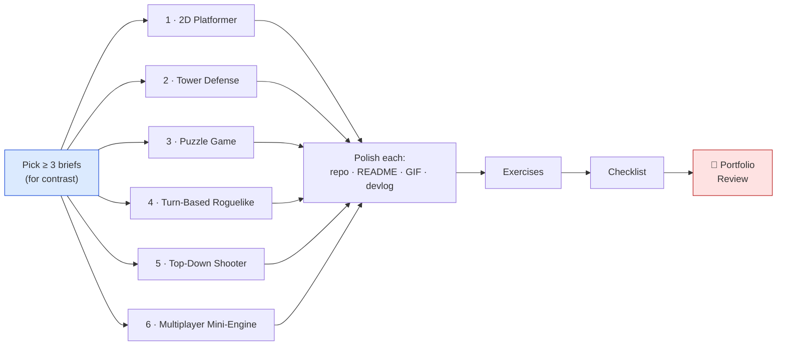
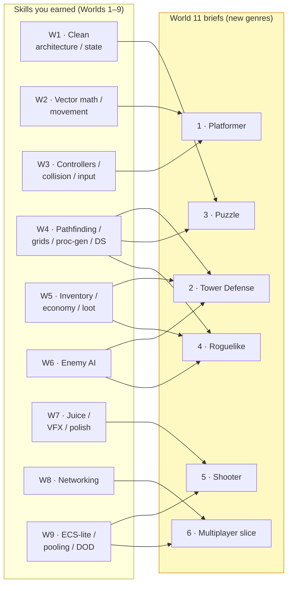
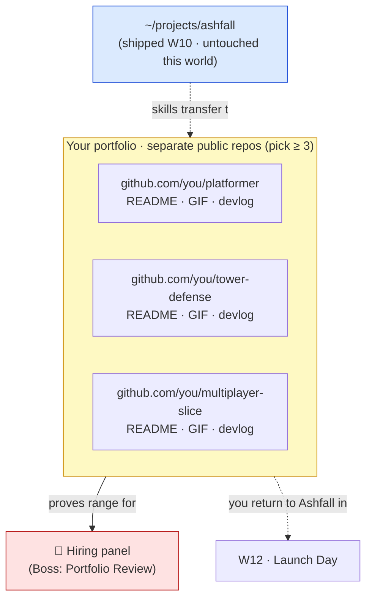

# 📦 World 11 — Portfolio Projects

> Ashfall is shipped (World 10): profiled, automated through CI/CD, containerized, and running in the cloud on every push. You can *build* a game and you can *operate* one — rare proof. But a hiring manager looking at a single project, however good, can't tell whether you have **range** or just got lucky once. This world turns outward in a different way: instead of growing Ashfall, you build a **clutch of small, sharp prototypes in other genres** — each one re-applying skills you already earned, in a deliberately different shape — and you package them like a professional: clean repos, READMEs with screenshots and GIFs, and a short devlog per project. Same engineer, six new proofs. This is the portfolio you hand a hiring panel.

[↑ Home](../../README.md) · [🗺️ Roadmap](../../ROADMAP.md) · [📊 Progress](../../PROGRESS.md)

---

## 📨 Your ticket

```
From:    Theo <theo@pixelforge.studio>
To:      You <new-hire@pixelforge.studio>
Cc:      Kenji <kenji@pixelforge.studio>, Maya <maya@pixelforge.studio>

Subject: [W11-PORT] Before launch — build your portfolio. Prove range to a hiring manager.

You shipped the server. Genuinely — Priya doesn't hand out "it's good" easily,
and she did. Ashfall is profiled, automated, in the cloud. That's a real
engineer's résumé line.

But here's the thing I want you to internalize before we do Launch Day, and
it's the same advice I'd give you if you ever leave us: one great project
proves you can build ONE thing. It doesn't prove RANGE. A hiring manager
flipping through your GitHub has thirty seconds and a question in their head —
"can this person apply what they know to a problem they haven't seen?"

So before we ship Ashfall, you're going to answer that question. Build a set
of small, sharp prototypes in OTHER genres. Not sequels to Ashfall — different
shapes. A precise platformer. A tower defense. A puzzle. A turn-based
roguelike. A bullet-hell shooter. A tiny multiplayer engine slice. Each one
re-uses skills you already have — the math, the pathfinding, the architecture,
the netcode, the pooling — but in a context that LOOKS different. That contrast
is the whole point. It says: "I don't know one game, I know how to make games."

Two rules:
  - THESE ARE STANDALONE. Each is its own public GitHub repo. NOT part of
    Ashfall, not in ~/projects/ashfall. A portfolio is a shelf of separate
    things a reviewer can open one at a time.
  - POLISH IS THE PRODUCT. The prototype matters less than how you PRESENT it.
    Clean architecture, a README a stranger can understand, a screenshot or
    GIF so they see it move without cloning, and a short devlog on what you
    learned. An undocumented repo is invisible.

You do NOT have to build all six. Pick at least THREE — choose the ones that
show the WIDEST range and the skills you're proudest of — and build them to a
polished, presentable bar. Quality over quantity, always.

Boss check ("Portfolio Review"): present at least three polished portfolio
projects, as if to a hiring panel, and defend the engineering. No tutorials —
this is you applying everything thirteen worlds of work taught you.

Do this and there's only one world left: Launch Day.

— Theo
```

This is World 11 of 13. Unlike every world before it, **you do not grow Ashfall here** — Ashfall is shipped and waiting for its Launch Day in World 12. Instead you build **standalone prototypes** that prove you can apply your skills to genres you haven't touched. You arrive with a **shipped, operable game** (W10); you leave with a **portfolio** — at least three polished, documented, separate-repo projects — that proves *range* to anyone who opens it.

---

## 🎯 What you'll achieve in this world

- 🎨 Pick **at least three** of six genre briefs and build each as a **standalone, public GitHub repo** — clean architecture, runnable, distinct from Ashfall
- 🔁 **Re-apply earned skills in new shapes** — movement math, pathfinding, economy, procedural gen, AI, pooling, netcode — proving the skills transfer, not just the one game
- 📖 Write a **README a stranger can understand** for each project, with a **screenshot or GIF** so reviewers see it move without cloning
- 📝 Keep a **short devlog** per project — what you built, what was hard, what you learned — the story behind the code
- 🧑‍💼 **Present the portfolio as if to a hiring panel** — defend the architecture, name the trade-offs, show the range

---

## 🗺️ Level map — the six briefs

These six "lessons" are standalone project **briefs**, not Ashfall additions. **Pick at least three** to fully build to a polished bar.

| # | Brief | Genre | Difficulty | XP | Key skills (re-applied) |
|--:|-------|-------|:----------:|---:|-------------------------|
| 1 | [Brief: 2D Platformer](lessons/01-brief-2d-platformer.md) | Precision platformer | 🟡 Medium | 125 | W2 vector math · W3 controllers/collision · coyote time, jump buffering, variable jump |
| 2 | [Brief: Tower Defense](lessons/02-brief-tower-defense.md) | Tower defense | 🔴 Hard | 125 | W4 pathfinding/grids · W5 economy/waves · W6 simple AI |
| 3 | [Brief: Puzzle Game](lessons/03-brief-puzzle-game.md) | Grid/logic puzzle | 🟡 Medium | 125 | W4 data structures · W1 clean state + undo |
| 4 | [Brief: Turn-Based Roguelike](lessons/04-brief-turn-based-roguelike.md) | Turn-based roguelike | 🔴 Hard | 125 | W4 procedural gen · W6 AI · W5 items, in a turn loop |
| 5 | [Brief: Top-Down Shooter](lessons/05-brief-top-down-shooter.md) | Bullet-heavy shooter | 🔴 Hard | 125 | W9 pooling/DOD · W7 juice · performance under load |
| 6 | [Brief: Multiplayer Mini-Engine](lessons/06-brief-multiplayer-mini-engine.md) | Multiplayer slice | 🔴 Hard | 125 | W8 networking · W9 architecture, from scratch |
| 👔 | [Boss Battle — Portfolio Review](boss-battle.md) | — | 🔴 Hard | 500 | Present & defend the whole portfolio |

➕ Extra reps: [exercises.md](exercises.md) · ✅ Ready to advance? [checklist.md](checklist.md)

---

## 🧭 How to choose (and why these six)

There's no required order — these are independent projects, so build the ones that show **your** widest range. But the set is designed so that, between any three, you cover very different problem shapes: tight real-time feel, systems/economy depth, pure logic, turn-based loops, raw performance, and networked architecture. Pick to **contrast**, not to repeat. If two briefs lean on the same muscle, swap one for a brief that flexes a different one — a reviewer learns more from "platformer + tower defense + multiplayer slice" than from three real-time action games.



---

## 🔁 How each brief maps back to prior worlds

The whole pitch of this world is that **you already have the skills** — each brief just re-points them at a new genre. Nothing here is from scratch; it's your earned toolkit, re-applied.



If you can read that diagram and say "yes — I built each of those skills, and I can see how it re-shapes into a new genre," you understand exactly why this world exists. The portfolio isn't six new things to learn. It's six new *proofs* of what you already learned.

---

## 📦 Project status — a different shape this world

**Entering World 11:** a single, deep, shipped project — Ashfall — that runs in the cloud on every push. It proves depth. It does not, by itself, prove breadth.

**Leaving World 11:** Ashfall is untouched (it waits for Launch Day in World 12), and beside it now sits a **portfolio**: at least three standalone, public, polished prototypes in different genres, each its own repo with a README, a screenshot/GIF, and a devlog — proof that the skills behind Ashfall transfer to *any* game. You can hand a hiring manager a shelf, not a single book.



> ⚠️ **Standalone, not Ashfall.** Each brief is its **own public GitHub repo** — not a folder in `~/projects/ashfall`, not a branch, not a scene inside the game. A portfolio is a shelf of separate things a reviewer opens one at a time. Keep them clean and independent.

You hand this to **World 12 — Launch Day**, where you return to Ashfall one last time and ship the vertical slice — now backed by a portfolio that proves you didn't just build one game, you can build *games*.

---

## 👔 Boss teaser

**"Portfolio Review"** — Theo has assembled a mock hiring panel, and you're presenting. Ship **at least three polished portfolio projects** to **public GitHub repos** — each with clean architecture, a README with screenshots/GIF, and a short devlog — then **present them as if to a hiring manager**: walk the panel through what each proves, defend the architecture, and name the trade-offs you made. No tutorials — this is you applying thirteen worlds of skill to genres you chose yourself. Win to earn the **👔 Portfolio Engineer** badge, a +250 world-complete bonus, and unlock World 12.

---

## 📚 Resources

Don't go link-hunting — the curated free list lives in [RESOURCES.md](../../RESOURCES.md). For this world the standouts are free art/audio to make prototypes *look* finished (**Kenney.nl**, **OpenGameArt**, **freesound**), a GIF capture tool so your READMEs *move* (**ScreenToGif** on Windows, **Kap** / **Peek** elsewhere — a 5-second loop is worth a thousand screenshots), GitHub's own docs on a good **README** and repo presentation, and any free static host (**GitHub Pages**, **itch.io**'s free tier) if you want a playable WebGL build behind a link. Above all, internalize the one idea this world turns on: **a hiring manager judges what they can see in thirty seconds — so the README, the GIF, and the clean repo aren't decoration around the project, they *are* the project as far as a reviewer is concerned. Range, documented, beats depth, hidden.**

---

[↑ Home](../../README.md) · [🗺️ Roadmap](../../ROADMAP.md) · [📊 Progress](../../PROGRESS.md) · [➡️ Next World: Final Boss — Ship Ashfall](../phase-12-final-boss/README.md) · [▶️ Start with Brief 1 →](lessons/01-brief-2d-platformer.md)
