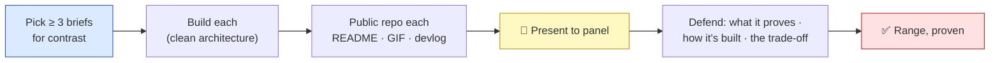
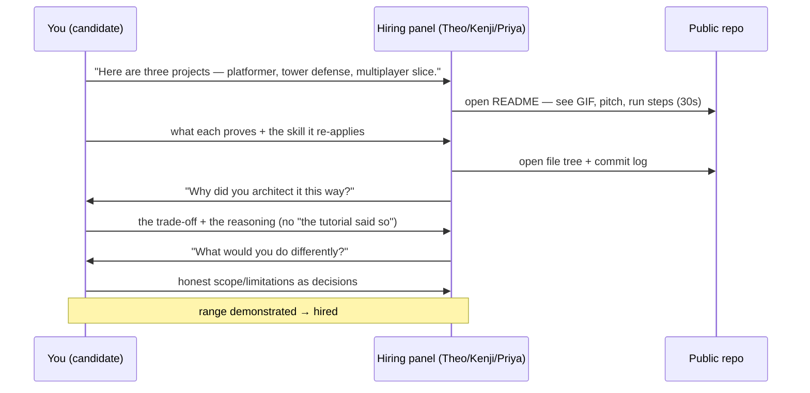

# 👔 Boss Battle — Portfolio Review

| | |
|---|---|
| 🎚️ **Difficulty** | 🔴 Hard |
| ⏱️ **Estimated time** | 180+ minutes (the projects themselves take longer — this is the presentation) |
| ⭐ **XP reward** | 500 |
| 🔓 **Unlocks** | World 12 — Final Boss: Ship Ashfall |

[← Checklist](checklist.md) · [↑ Phase Home](README.md) · [↑ Home](../../README.md)

---

## 📨 The review

```
From:    Theo <theo@pixelforge.studio>
To:      You <new-hire@pixelforge.studio>
Cc:      Kenji <kenji@pixelforge.studio>, Maya <maya@pixelforge.studio>, Priya <priya@pixelforge.studio>

Subject: [W11-BOSS] Portfolio Review — present to the panel. As if you were getting hired.

Okay. Here's the exercise, and I want you to take it dead seriously because
it's the closest thing to the real moment that matters.

Tomorrow, three of us — me, Kenji, Priya — are going to sit across a table from
you and play a hiring panel. Pretend you don't work here. Pretend we've never
seen your code. You have your portfolio open on a screen, and you have to
convince a room that you can build games, not just one game.

This is your boss. No tutorials, no hand-holding — this is you defending work
you chose and built. Here's the bar, and it's the bar a real panel uses:

  - AT LEAST THREE PROJECTS, PUBLIC, POLISHED. Three (or more) standalone
    prototypes, each its own public GitHub repo. Picked for RANGE — don't show
    me three of the same game. Show me you can do different shapes.
  - EACH ONE PRESENTABLE COLD. Clean architecture a stranger can read. A README
    with a screenshot or GIF up top so we see it move without cloning. A short
    devlog so we see how you THINK. If I can't understand it in thirty seconds
    of looking at the repo, it doesn't count — because a real reviewer won't
    give you more than that.
  - PRESENT IT. Walk us through each project: what it is, what skill it proves,
    how it's built, and the one trade-off you made and why. We will ask "why
    did you do it this way?" Have an answer. "It's how the tutorial did it" is
    a failing answer — there were no tutorials.
  - DEFEND THE ENGINEERING. We'll open your file tree and your commit log. We'll
    ask what you'd do differently. The projects prove you can build; this
    conversation proves you can reason about what you built.

I'm not looking for finished commercial games. I'm looking for THREE small,
sharp, well-presented proofs that you can apply what you know to a problem you
haven't seen — and talk about it like an engineer.

Land this and there's one world left. Launch Day.

— Theo
```

> 👔 **Boss Battle rules:** No tutorials, no copying a brief's solution wholesale. **Apply** everything thirteen worlds taught you to genres you chose: build at least three standalone, polished, public projects that prove *range*, document each so a cold reviewer gets it in thirty seconds, and **present and defend** them as if to a hiring panel. You win when every victory condition is met **and you can stand in front of the panel and say, for each project, what it proves, how it's built, and why you made the trade-off you made** — without reaching for "the tutorial said so," because there wasn't one.

---

## 🎯 Your mission

**Ship at least three polished portfolio projects to public GitHub repos — each with clean architecture, a README with screenshots/GIF, and a short devlog — then present them to a hiring panel and defend the engineering.** This is the capstone of breadth: not one deep thing, but several sharp things that together prove range.





Build and present from these pieces (at minimum):

1. **At least three projects, picked for contrast (W11 briefs):** different genres flexing different muscles — feel, systems, logic, turn-loops, performance, or netcode. Not three of the same shape.
2. **Standalone public repos (W0 git habits):** each its own public GitHub repo — runnable by a stranger, real `.gitignore`, tidy commit history, no committed cruft or secrets.
3. **Clean architecture (W1):** sensible structure a reviewer can read; no single mega-file. The engineering is legible.
4. **README + GIF (presentation):** each README led by a screenshot/GIF, with a one-line pitch, run steps, and a short how-it-works section — legible cold in thirty seconds.
5. **A devlog each (your reasoning):** the story/decision/trade-off behind each project, linked from its README.
6. **The presentation (defense):** walk the panel through each project — what it proves, how it's built, the trade-off — and answer "why this way?" and "what would you change?"

---

## 🏆 Victory conditions

- [ ] **At least three** portfolio projects are shipped to **public GitHub repos**, each a **standalone** repo (not part of Ashfall)
- [ ] The three are picked for **contrast** — they prove *range*, flexing genuinely different skills, not three variations of one genre
- [ ] Each repo has **clean, readable architecture** — sensible structure, no mega-file — and **runs for a stranger** (documented setup, real `.gitignore`, no committed cruft/secrets)
- [ ] Each repo's **README is led by a screenshot or GIF**, with a one-line pitch, run steps, and a short how-it-works/architecture section — legible cold in **thirty seconds**
- [ ] Each project has a **short devlog** — the decision/trade-off/story behind it — linked from its README
- [ ] You **present each project to the panel**: what it proves, the skill it re-applies, how it's built, and **the one trade-off you made and why**
- [ ] You can **defend the engineering** — answer "why this way?" and "what would you change?" from your own reasoning, not from a tutorial
- [ ] You can map each project back to the **prior-world skills it re-applies** and articulate why the set proves range

---

## 🧪 How you'll know you won

```bash
# Three (or more) separate public repos, each clean and self-contained:
gh repo list --limit 20            # the portfolio is visible on your GitHub
# Open each one cold and check the front page tells the whole story:
#   README → GIF/screenshot at top · pitch · run steps · how-it-works · devlog link
```

Then run the real test — **the cold-reviewer pass, then the panel:**
- **Hand a stranger only the repo links** — no demo, no explanation from you. Within thirty seconds per repo they can say what each game is, that it works (they saw the GIF), and roughly how it's built. If they can't, it's not ready.
- **Open each file tree and commit log** the way a reviewer would. Meaningful commits, clean structure, no secrets or build artifacts, ideally green CI. It reads like a professional's repo.
- **Stand and present** — for each project, in two minutes: what it is, what skill it proves, how it's architected, the trade-off you chose. Then take the questions: "why this way?" and "what would you do differently?" Answer from *your* reasoning.
- **The range check** — line the three up and name the contrast out loud: this one proves *feel*, this one proves *systems*, this one proves *architecture/netcode*. Three muscles, not one.

If at least three polished, public, well-documented projects exist — each legible to a cold reviewer in thirty seconds — and you can present and defend them to the panel as proof of range, you've won.

<details>
<summary>🔎 What reviewers actually look for — only after you've tried! (sketch)</summary>

**The shape of a passing review (what each thing signals):**

| What they check | What they're really asking | What a "yes" looks like |
|---|---|---|
| README front page | "Can I understand this in 30s?" | GIF up top, one-line pitch, run steps — legible without cloning |
| Project spread | "Range, or one trick?" | Three contrasting genres → different muscles |
| File tree | "Do they structure code?" | Clean folders, no 2000-line mega-file |
| Commit log | "Do they work like a pro?" | Meaningful messages, no committed cruft/secrets |
| Devlog | "How do they think?" | A real decision + trade-off, honestly told |
| "Why this way?" answer | "Can they reason, or just follow?" | Their own trade-off reasoning, not "the tutorial" |
| "What would you change?" | "Self-awareness + judgment?" | Scope framed as decisions, clear next steps |

**Why this is the bar (not finished commercial games):**
- A hiring panel is hiring **judgment and transferable skill**, not a shipped title. Three small, sharp, *well-presented* proofs answer "can you apply what you know to something new?" far better than one sprawling project.
- **Presentation is part of the engineering.** A reviewer judges what they can see in seconds; an undocumented repo is an invisible one. The README and GIF aren't decoration — they're how the work gets evaluated at all.
- **The defense separates builders from followers.** Anyone can finish a tutorial. The ability to say "I chose X over Y because Z, and here's what I'd change" is the thing the panel can't get from the code — and the thing they're really buying.
- **Range is the product.** Depth you already proved with Ashfall (you shipped it to the cloud). World 11 exists to add the other axis: that the skills *transfer*. The portfolio is breadth, documented.

**A passing portfolio, in one line:** three contrasting prototypes, each a clean public repo a stranger groks in thirty seconds, each with a devlog that shows your reasoning — and a candidate who can stand up and defend every choice.
</details>

---

## 🎁 Rewards

- 🏆 **+500 XP**
- 🏅 Achievement unlocked: **👔 Portfolio Engineer** — you proved *range*: at least three polished, public, well-documented prototypes in contrasting genres, each legible to a cold reviewer in thirty seconds, presented and defended to a hiring panel. You don't just build one game — you build games, and you can talk about how
- 🔓 **World 12 — Final Boss: Ship Ashfall** unlocks
- 📈 Update [PROGRESS.md](../../PROGRESS.md): mark World 11 ✅ and add the **+250 World Complete bonus**

> 🗒️ Reflection: depth and breadth are different proofs, and a hiring manager wants both. World 10 proved you could take one game all the way — profiled, automated, shipped, operated. World 11 proved the other half: that the skills behind it *transfer* — that you can point your toolkit at a genre you've never built and produce something clean, runnable, and presentable. And notice what made the portfolio *work*: not the prototypes alone, but the **presentation** — the GIF that made them legible, the README that made them runnable, the devlog that made your reasoning visible, the defense that made your judgment audible. The code was always necessary; it was never sufficient. That's the lesson to carry into the last world: shipping isn't just building the thing — it's making the world able to see it, run it, and trust it. One world remains. Time to take Ashfall all the way and ship it.

---

[← Checklist](checklist.md) · [↑ Phase Home](README.md) · [↑ Home](../../README.md) · [👑 Enter World 12 →](../phase-12-final-boss/README.md)
