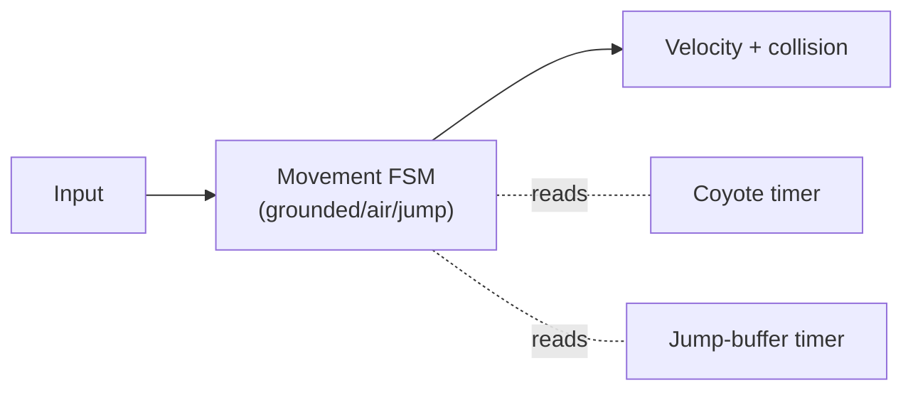

# 🏋️ World 11 — Exercises

Extra reps to make the *portfolio-craft* skills automatic before the boss battle. None are required to advance, but each is exactly the kind of work "Portfolio Review" demands — presenting your engineering so a stranger gets it in thirty seconds, telling the story behind the code, and judging your own repos the way a hiring manager will. The projects prove you can *build*; these reps prove you can *show*. Each **Side Quest** awards **+50 XP**.

[↑ Phase Home](README.md) · [↑ Home](../../README.md) · [✅ Checklist](checklist.md) · [👔 Boss Battle](boss-battle.md)

---

## Warm-ups (presenting, documenting, choosing)

1. A reviewer has **thirty seconds** on your repo and won't clone it. What three things must they be able to see *without running the code*?
   <details><summary>Hint</summary>(1) <strong>What it is and that it works</strong> — a one-line description and a <strong>GIF or screenshot</strong> at the top of the README, so they see it move without cloning. (2) <strong>How it's built</strong> — a short architecture note or folder map that shows you made deliberate structural choices, not a single 2000-line file. (3) <strong>That you can run it</strong> — clear "how to run" steps. If those three are missing, a great project is <em>invisible</em>: the reviewer bounces before they ever see the gameplay you're proud of.</details>
2. Why **at least three** projects, and why pick for **contrast** rather than just doing the three easiest?
   <details><summary>Hint</summary>One project proves you can build <em>one</em> thing; three proves <strong>range</strong> — that your skills transfer to problems you haven't seen. But three <em>similar</em> projects (three real-time action games) prove range about as well as one. Picking for contrast — say a precision platformer, a systems-heavy tower defense, and a networked slice — shows different muscles: feel, systems, and architecture/netcode. A reviewer learns far more from the spread than from the count.</details>
3. What makes a **good project README** for a game prototype, top to bottom?
   <details><summary>Hint</summary>Title + one-line pitch → an animated <strong>GIF</strong> (or screenshot) of gameplay → a 2–3 sentence "what this is / why I built it" → "how to run" → a short <strong>architecture / how it works</strong> section (the interesting engineering, with a diagram if it earns one) → "what I'd do next." Lead with the visual and the pitch; a reviewer decides whether to keep reading in the first screenful. Keep it skimmable — headers and bullets, not walls of prose.</details>
4. What's the difference between a README and a **devlog**, and why does a portfolio want both?
   <details><summary>Hint</summary>The <strong>README</strong> documents the <em>finished thing</em> — what it is, how to run it, how it's built. The <strong>devlog</strong> tells the <em>story</em> — what you set out to do, what surprised you, the bug that ate a day, the trade-off you chose and why. The README proves the project exists and works; the devlog proves there's a thinking engineer behind it. Hiring managers read devlogs to see <em>how you reason</em>, which is the thing they actually can't get from the code alone.</details>
5. Why **standalone public repos** instead of folders inside Ashfall or one big "portfolio" mono-repo?
   <details><summary>Hint</summary>A reviewer wants to open <em>one thing at a time</em> and see a focused, clean repo with its own README, its own commit history, its own green tests. Burying prototypes inside Ashfall hides them and muddies that project's story; cramming six into one mono-repo makes none of them skimmable. Separate public repos each get their own front page, their own star count, their own clear "this is a complete small project" signal. The shelf metaphor is literal: distinct books, not chapters.</details>
6. Your repo runs perfectly on your machine but a reviewer can't get it to build. What did you most likely forget, and why does it sink the whole project?
   <details><summary>Hint</summary>Almost always: <strong>documented setup</strong> (Unity version, dependencies, "open this scene first") and/or committed-but-shouldn't-be cruft vs. a missing <code>.gitignore</code>. It sinks the project because a reviewer who can't run it assumes it <em>doesn't</em> run — and you don't get a second chance to explain. "Works on my machine" is the exact failure you learned to kill in World 10, now applied to your portfolio: the repo has to be self-explanatory and reproducible by a stranger.</details>
7. How do you talk about a prototype's **trade-offs and limitations** without making it look unfinished?
   <details><summary>Hint</summary>Frame them as <em>decisions</em>, not apologies. "Scoped to one level to focus on nailing the jump feel" reads as judgment; "I didn't have time for more levels" reads as incomplete. A short "Scope & next steps" section that names what you deliberately left out — and what you'd build next — signals that you understand product scope and can reason about priorities. Reviewers <em>respect</em> a clearly-scoped, polished small thing far more than a sprawling, half-finished big one.</details>
8. What should your **commit history and repo structure** say about you to a reviewer who skims them?
   <details><summary>Hint</summary>That you work like a professional: meaningful commit messages (not "stuff" / "fix"), a sensible folder structure, a real <code>.gitignore</code>, no committed build artifacts or secrets, and ideally green CI on the repo. Reviewers absolutely open the commit log and the file tree — they're reading for craft and habits, the same things you'd judge in a teammate's PR. A tidy repo says "I'd be low-friction to work with" before you've said a word.</details>

---

## 🌟 Side Quest 1 — Ship a Great README + GIF (+50 XP)

Prove you can make a project **legible in thirty seconds**. Take one of your portfolio prototypes and give it a README that a stranger — who will *not* clone it — can fully understand, fronted by a GIF that shows the game *moving*.

**Requirements:**
1. Capture a short (3–8 second) **looping GIF** of actual gameplay (ScreenToGif / Kap / Peek — all free) and place it at the **top** of the README, right under the title.
2. Write the README in this shape: title + one-line pitch → GIF → "what this is / why I built it" (2–3 sentences) → **how to run** (exact steps + Unity version) → a short **how it works / architecture** section (with a Mermaid diagram if the structure earns one) → "scope & what's next."
3. Make it **skimmable** — headers, bullets, no walls of text. A reviewer should grasp what the project is and that it works before scrolling once.
4. The acid test: hand the README (link only, no demo from you) to someone who's never seen the project and ask them to explain back what it is and how to run it. If they can't, fix it until they can.

```
Test: a friend opens ONLY the repo's front page — no clone, no help from you.
Within thirty seconds they can tell you what the game is, that it works (they
saw the GIF), and roughly how it's built. They could run it from your steps if
they wanted to. That's a README doing its job.
```

<details>
<summary>💡 Reference shape (try first!)</summary>

```markdown
# Coyote — a precision 2D platformer

> A tight little platformer about *feel*: coyote time, jump buffering, and
> variable jump height. Built to prove movement game-feel from first principles.

   <!-- the GIF leads. always. -->

## What this is
A single hand-crafted level focused entirely on nailing responsive jumping.
I built it to isolate the movement-feel techniques from a larger action game.

## How to run
Unity 2022.3 LTS · open `Scenes/Level01.unity` · press Play. (WASD + Space.)

## How it works
Movement is a small state machine; jump forgiveness is two timers...
```


- The **GIF is non-negotiable** — it's the single highest-leverage thing on the page. Reviewers watch before they read.
- Keep prose tight. Every section earns its place or it's cut.
- Engine-agnostic point: this is exactly how open-source projects present themselves. A great README is a portable skill, not a games-only one.

🎯 **Side quest complete when:** one portfolio repo has a skimmable README led by a looping gameplay GIF, with run steps and a short architecture section, and a person who's never seen it can explain back what it is and how to run it from the front page alone. Add **+50 XP** to PROGRESS.md.
</details>

---

## 🌟 Side Quest 2 — Write a Devlog Post (+50 XP)

Prove there's a **thinking engineer** behind the code. Write one short devlog post for a portfolio project — the *story* of building it, not just the *what*. This is the artifact hiring managers read to see how you reason.

**Requirements:**
1. Pick one prototype and write a **400–700 word** devlog (a `DEVLOG.md` in the repo, or a post on itch.io / dev.to / your blog — all free) covering: what you set out to build, the **one hard problem** you hit, how you reasoned through it, the **trade-off** you chose and *why*, and what you'd do next.
2. Center it on a **real decision or bug**, not a feature tour. "How I made jump buffering feel right" beats "here are my features."
3. Be honest about a **limitation or a thing that went wrong** — framed as a decision or a lesson, not an apology. This is what makes it credible.
4. Link the devlog from the project's README so a reviewer can find it.

```
Test: someone reads your devlog and comes away knowing something about HOW YOU
THINK — what you weighed, what you cut, what you learned — not just what the
game does. If it reads like a feature list, it's not a devlog yet; if it reads
like "here's the interesting decision I made and why," it is.
```

<details>
<summary>💡 Reference approach (try first!)</summary>

A strong games devlog usually has this arc:

1. **The goal in one line** — "I wanted jumps that feel forgiving without feeling floaty."
2. **The problem** — the specific thing that didn't work at first (jumps felt unfair right at platform edges).
3. **The reasoning** — what you tried, what you measured/felt, why the naive fix was wrong.
4. **The decision + trade-off** — "I added coyote time (a ~0.1s grace window after leaving a ledge) and jump buffering; I tuned by feel rather than copying numbers, accepting it's level-specific."
5. **The honest bit** — what you'd change, what you scoped out and why.

- The **trade-off** section is the most valuable — it shows you make engineering *decisions*, the thing a teammate or interviewer most wants to see.
- Short and specific beats long and general. One real story, told well, outperforms a tour of every system.
- Engine-agnostic point: writing about your decisions is a senior habit (RFCs, design docs, post-mortems). The devlog is that muscle, in miniature.

🎯 **Side quest complete when:** a portfolio project has a 400–700 word devlog centered on a real decision or bug — with the reasoning and trade-off made explicit and an honest limitation noted — linked from its README, such that a reader comes away understanding *how you think*. Add **+50 XP** to PROGRESS.md.
</details>

---

[↑ Phase Home](README.md) · [↑ Home](../../README.md) · [✅ Checklist →](checklist.md)
