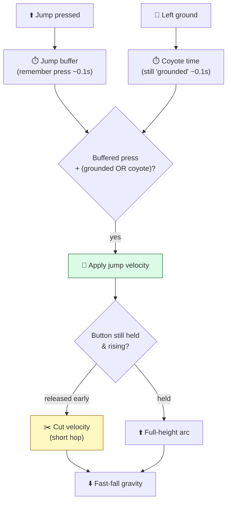

# Level 1 — Brief: 2D Platformer

| | |
|---|---|
| 🎚️ **Difficulty** | 🟡 Medium |
| ⏱️ **Estimated time** | Self-paced (1–2 days) |
| ⭐ **XP reward** | 100 (Quest) + 25 (Quiz) |

[← Prev](../README.md) · [↑ Phase Home](../README.md) · [→ Next](02-brief-tower-defense.md)

---

## 📖 Story

> *"Different genre, same you. Ashfall is top-down — so the first thing a platformer interviewer notices is whether your **jump feels good**. Not 'does it jump' — *feels good.* That's coyote time, jump buffering, variable height, a little squash on landing. Players can't name those things, but they feel their absence as 'floaty' or 'unresponsive.' This brief is a small, sharp platformer that proves you can re-tune your W3 movement math + W7 juice for a totally different feel. Keep the scope tiny: one tight level, three hazards, a goal flag. Make the **30 seconds of moving around** feel so good a stranger keeps playing past the demo. That's the whole portfolio pitch. Let me show you the shape of it. — Kenji"*

---

## 🎯 Goal

- Ship a **small, polished 2D platformer prototype** that proves *movement feel* — not feature count.
- Implement the four pillars of good jump feel: **coyote time, jump buffering, variable jump height, fast-fall/gravity tuning**.
- Build levels from a **tilemap** with **hazards** (spikes, moving platforms, a kill plane) and a goal.
- Apply **W2 vector math + W3 input/collision** in a new movement model, and **W7 juice** (squash/stretch, particles, screen shake, camera follow).
- Produce a **portfolio-grade repo**: clean architecture, a tuning config, a README with a GIF.

---

## 🧠 Concepts

### What makes a jump "feel" right

A real jump in code is a few forgiving fudges layered on top of raw physics. None are realistic; all are invisible-but-felt:



- **Coyote time** — you can still jump for ~0.1s *after* walking off a ledge. Cures "I pressed jump but it didn't!"
- **Jump buffering** — a press ~0.1s *before* landing is remembered and fires on touchdown. Cures the same complaint from the other side.
- **Variable jump height** — releasing the button mid-rise cuts upward velocity → tap = hop, hold = full jump.
- **Asymmetric gravity** — falling uses *higher* gravity than rising, so the apex feels snappy, not floaty.

### Which prior-world skills this exercises

| System | From | How it's re-used here |
|---|---|---|
| Vectors, dot product, lerp | W2 | Velocity integration, camera smoothing, aim of moving platforms |
| Input, collision, controllers | W3 | A *kinematic* controller (move-and-slide), not Ashfall's top-down rigidbody |
| Tilemaps & data | W5 | Level authored as tile data, hazards as components |
| Juice: squash, shake, particles | W7 | Landing squash, dust puffs, hit-stop on death, camera follow |

### Why this exists

Movement feel exists because games are a **conversation of inputs and responses measured in milliseconds**, and the human brain notices a 100ms mismatch even when it can't name it. Coyote time and jump buffering exist because *perception of fairness* matters more than physical accuracy — players blame the game, never their own timing, so you forgive their timing for them. Variable jump height exists because one button must express *intent* (a careful hop vs. a committed leap) without a second input. Asymmetric gravity exists because a parabola that's symmetric *looks* right but *feels* floaty — the apex is where control matters, so you shorten the time spent there. This is **engine-agnostic**: Celeste, Mario, and Hollow Knight all do these exact fudges; the values differ, the techniques don't. A kinematic move-and-slide controller (cast the body, resolve overlaps, slide along surfaces) is how every 2D platformer in every engine handles collision precisely — Unity, Godot (`move_and_slide` is literally built in), or a custom loop. See **RESOURCES.md** for free tilesets (Kenney), the classic GDC "platformer toolkit" talk, and a juice reference.

---

## 🛠️ Build Plan

> This is a **brief, not a tutorial.** Below is a milestone path plus code sketches for the two trickiest parts (the controller state and the forgiveness timers). Architect the rest yourself; that's the portfolio signal.

**Milestone 1 — Kinematic controller.** Horizontal move with accel/decel, ground check via a short downward cast/overlap. No jump yet. Get walking to feel crisp (snappy accel, slightly slower decel).

**Milestone 2 — Jump with all four feel pillars.** Coyote + buffer timers, variable height, asymmetric gravity. Expose every number in a `MovementTuning` ScriptableObject/config so you can tweak without recompiling.

**Milestone 3 — Tilemap level + hazards.** One handcrafted level. Spikes (kill), a moving platform (carries the player), a kill plane (fall = respawn at last checkpoint), a goal flag (win).

**Milestone 4 — Juice pass.** Landing squash/stretch, jump dust, death hit-stop + particles, a camera that leads in the move direction and uses a small look-ahead. This is where it goes from "works" to "portfolio."

**Milestone 5 — Polish & ship.** Title → play → win/lose loop. README with an animated GIF and a "feel knobs" section. Tag a release build.

Forgiveness timers — the heart of the feel:

```csharp
// Per FixedUpdate. dt = Time.fixedDeltaTime.
_coyote   = _grounded ? tuning.coyoteTime  : _coyote - dt;     // top up while grounded, drain in air
_buffer   = _jumpPressedThisFrame ? tuning.bufferTime : _buffer - dt;

bool canJump = _buffer > 0f && _coyote > 0f;
if (canJump)
{
    _vel.y = tuning.jumpVelocity;   // sqrt(2 * gravity * desiredHeight) if you want exact height
    _buffer = 0f;                   // consume the buffered press
    _coyote = 0f;                   // consume coyote so you can't double-jump off it
}
```

Variable height + asymmetric gravity:

```csharp
// Cut the jump short if the player releases while still rising → short hop.
if (_jumpReleasedThisFrame && _vel.y > 0f)
    _vel.y *= tuning.jumpCutMultiplier;     // e.g. 0.5

// Fall faster than you rise: snappy apex, no floatiness.
float g = (_vel.y < 0f) ? tuning.fallGravity : tuning.riseGravity;  // fall > rise
_vel.y -= g * dt;
_vel.y  = Mathf.Max(_vel.y, -tuning.maxFallSpeed);                  // terminal velocity
```

> 💡 **Engine-agnostic note:** in Godot this is `velocity` + `move_and_slide()`; in a custom engine it's "integrate velocity, sweep the AABB, resolve per axis." The timer logic above is identical everywhere.

---

## 🎮 Mini Challenge

Add **wall mechanics**: wall-slide (capped downward speed while pressed against a wall in air) and a **wall-jump** (push off at an angle, briefly locking horizontal input so the player commits to the arc).

<details>
<summary>💡 Reveal approach</summary>

Detect a wall with a horizontal cast in the facing direction while airborne. **Wall-slide:** when touching a wall and falling, clamp `_vel.y` to a small negative `wallSlideSpeed`. **Wall-jump:** on jump-press while wall-sliding, set `_vel = new Vector2(-wallDir * wallJumpX, wallJumpY)` and start a short *input-lock timer* (~0.15s) during which horizontal input is ignored — otherwise the player instantly steers back into the wall and the jump feels mushy. Reset coyote/buffer so it reads as a fresh jump. The input lock is the part most people miss; it's what makes wall-jumps feel decisive.

</details>

---

## 📦 Project Mission

Build and ship **Vertical Slice: a 2D Platformer** to your portfolio. Definition of done:

1. A **kinematic controller** with crisp walk (accel/decel).
2. All **four jump-feel pillars** present and tunable from a config asset (no hard-coded magic numbers in the controller).
3. One **tilemap level** with at least **three hazard types** + checkpoint/respawn + a win condition.
4. A **juice pass**: landing squash, jump/death particles, hit-stop, look-ahead camera.
5. Full **game loop**: title → play → win/lose → restart.
6. **Portfolio polish**: clean repo (separated controller / level / juice), a `README.md` with an **animated GIF**, a "feel tuning" section, controls, and a one-paragraph "what this demonstrates."
7. At least **one automated test** (e.g. a play-mode test that buffered-jump fires within the buffer window).

| Criterion | 🟢 Excellent | 🟡 Adequate | 🔴 Missing |
|---|---|---|---|
| **Jump feel** | All 4 pillars, tuned, feels great to a stranger | Pillars present, slightly off | Floaty / unresponsive |
| **Architecture** | Controller / level / juice cleanly separated, config-driven | Mostly separated | One giant script, magic numbers |
| **Level & hazards** | 3+ hazards, checkpoints, satisfying flow | Basic level + hazards | Empty box |
| **Juice** | Squash, particles, hit-stop, camera all read | Some juice | None |
| **Portfolio polish** | README + GIF + case-study blurb + a test | README only | No README |

🎯 **Mission complete when:** a stranger can play your slice, the jump feels *good* (they keep moving around for fun), every feel number lives in a config, the repo is clean and documented with a GIF, and you can explain in one paragraph which Ashfall skills it re-uses.

---

## ⚠️ Common Mistakes

| Mistake | What happens | Fix |
|---|---|---|
| No coyote/buffer | "I pressed jump and nothing happened!" | Add both forgiveness timers (~0.1s each) |
| Symmetric gravity | Jump feels floaty at the apex | Fall gravity > rise gravity |
| Fixed jump height only | Feels robotic; no expression | Cut velocity on early release |
| Magic numbers in the controller | Can't tune feel without recompiling | Move all knobs to a config asset |
| Reading input in `FixedUpdate` | Dropped presses | Poll presses in `Update`, *consume* in `FixedUpdate` |
| Shipping "it works" with no juice | Reads as a student exercise | Squash, particles, camera — the portfolio is the polish |

---

## 🤔 Reflection Questions

1. Coyote time and jump buffering both fix "the jump didn't fire." How are the two situations they fix *opposite in time*, and why do you need both?
2. Why does an experienced player feel asymmetric gravity as "good" while a physicist would call it wrong? What does that say about designing *feel* vs. simulating reality?
3. Ashfall is top-down with a rigidbody; this is side-on and kinematic. What transferred unchanged from W3, and what did you have to re-think?

---

## 📝 Quiz

1. **Coyote time lets the player jump…**
   - a) twice in mid-air
   - b) for a brief window *after* leaving a ledge
   - c) higher when holding the button
2. **Asymmetric (fall > rise) gravity exists to…**
   - a) save CPU
   - b) make the apex snappy instead of floaty
   - c) prevent wall-jumps
3. **The cleanest place for jump-feel numbers is…**
   - a) hard-coded in the controller
   - b) a config/ScriptableObject asset you can tune live
   - c) a comment

<details>
<summary>✅ Answers</summary>

1: **b** · 2: **b** · 3: **b**

</details>

---

## ✅ Completion Checklist

- [ ] Kinematic controller with crisp walk
- [ ] **Coyote time, jump buffering, variable height, asymmetric gravity** — all present and tunable
- [ ] Tilemap level with **3+ hazards**, checkpoints, win condition
- [ ] **Juice pass** (squash, particles, hit-stop, look-ahead camera)
- [ ] Full game loop (title → play → win/lose → restart)
- [ ] Clean repo + `README.md` with **GIF** + at least one test
- [ ] I passed the quiz
- [ ] Added **+125 XP** to [PROGRESS.md](../../../PROGRESS.md)

---

[← Prev](../README.md) · [↑ Phase Home](../README.md) · [→ Next](02-brief-tower-defense.md)
