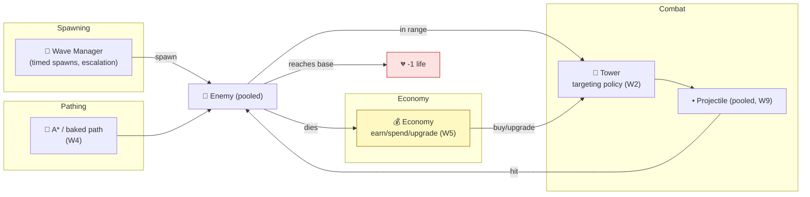

# Level 2 — Brief: Tower Defense

| | |
|---|---|
| 🎚️ **Difficulty** | 🟡 Medium |
| ⏱️ **Estimated time** | Self-paced (1–2 days) |
| ⭐ **XP reward** | 100 (Quest) + 25 (Quiz) |

[← Prev](01-brief-2d-platformer.md) · [↑ Phase Home](../README.md) · [→ Next](03-brief-puzzle-game.md)

---

## 📖 Story

> *"The platformer proved *feel*. This one proves **systems** — and that's the half of interviews where people fall apart. A tower defense is a tiny economy simulator with a clock: enemies path along a route, towers pick targets and shoot, you spend a currency to place and upgrade, and waves escalate. Every piece is something you already built for Ashfall — A* pathing (W4), targeting math (W2), an economy/upgrade loop (W5), and object pooling so a hundred projectiles don't tank your frame rate (W9). The trick is wiring them into one readable system instead of spaghetti. Build one map, four wave types, three towers. Make the **numbers feel fair** — that's balance, and it's a skill hiring managers love. Let me show you the architecture. — Kenji"*

---

## 🎯 Goal

- Ship a **tower-defense prototype** that proves *systems design*: pathing, targeting, economy, escalation.
- Implement **enemy pathing** (A* on a grid, or a baked path) with waves that spawn over time.
- Build **towers** with a **targeting policy** (first / closest / strongest) and projectiles.
- Build an **economy**: earn currency from kills, spend on placement + **upgrades**.
- Use **object pooling** for projectiles and enemies so performance holds under load.
- Produce a **portfolio-grade repo**: data-driven waves/towers, clean systems split, README + GIF.

---

## 🧠 Concepts

### The four systems and how they connect



### Targeting policies (W2 math)

A tower each frame collects enemies in range, then picks one by a **policy**:
- **First** — furthest along the path (default; stops leaks).
- **Closest** — least distance to the tower.
- **Strongest / weakest** — by current HP.

Then it **leads the shot** if projectiles travel (aim where the enemy *will be*, not where it is) — a classic dot-product/quadratic intercept, straight from W2.

### Which prior-world skills this exercises

| System | From | How it's re-used here |
|---|---|---|
| A* / grids | W4 | Enemy route; recompute if the player can block tiles |
| Vector math, intercept, range checks | W2 | Targeting, projectile lead, squared-distance range tests |
| Economy, upgrades, data-driven config | W5 | Currency, tower/wave stats as data assets |
| Object pooling | W9 | Reuse projectile & enemy instances; no GC spikes mid-wave |
| State machine | W6 | Game phase: Build → Wave → Win/Lose |

### Why this exists

A tower defense exists as a portfolio piece because it is the smallest game that forces **many systems to cooperate in real time** — and "can you make systems cooperate without it becoming spaghetti?" is the actual interview question. **Pathing** is decoupled from combat so enemies don't care what shoots them. **Targeting policy** is a strategy object so a new behavior is a new class, not an `if`-ladder edit. **The economy** is the feedback loop that turns the whole thing into a *game* instead of a screensaver: risk (let an enemy live to save money) vs. reward. **Pooling** exists because spawning/destroying hundreds of projectiles per second is exactly the allocation pattern that causes frame hitches — the W9 lesson made real. This is **engine-agnostic**: the separation of spawner / pather / targeter / economy is how every TD (and most RTS) is structured anywhere. Use **squared distance** for range tests (skip the square root) — a universal perf habit. See **RESOURCES.md** for free tower/enemy art (Kenney TD pack) and an A* refresher.

---

## 🛠️ Build Plan

> A **brief**, not a tutorial. Milestone path + sketches for the two trickiest parts: a swappable targeting policy and data-driven waves.

**Milestone 1 — Path + one enemy.** Bake or A*-compute a route across a grid. One enemy walks start→base, deals 1 life on arrival. Get the path solid first.

**Milestone 2 — One tower that shoots.** Range check (squared distance), a targeting policy, a *pooled* projectile that homes/leads and applies damage.

**Milestone 3 — Economy + placement.** Click empty tiles to place (cost currency); kills pay out; upgrade a tower (more range/damage/fire-rate). A HUD shows money + lives.

**Milestone 4 — Waves, data-driven.** Define waves as **data** (count, enemy type, spacing, delay). Add 3–4 enemy types (fast/tanky/swarm) and a Build→Wave→Win/Lose state machine.

**Milestone 5 — Balance & polish.** Tune so a careful player wins and a sloppy one loses. Juice: muzzle flash, hit pops, death particles, a "wave incoming" banner. README + GIF + a short "balance notes" section.

Swappable targeting policy (strategy pattern — keeps combat clean):

```csharp
public enum Targeting { First, Closest, Strongest }

// Pick a target from the enemies currently in range. No if-ladder bloat in the Tower itself.
Enemy SelectTarget(IReadOnlyList<Enemy> inRange, Vector2 pos, Targeting policy) => policy switch
{
    Targeting.First     => inRange.MaxBy(e => e.PathProgress),                 // furthest along
    Targeting.Closest   => inRange.MinBy(e => (e.Pos - pos).sqrMagnitude),     // squared dist!
    Targeting.Strongest => inRange.MaxBy(e => e.Hp),
    _ => null
};
```

Data-driven waves (designers tune without touching code):

```csharp
[System.Serializable]
public class Spawn { public EnemyType type; public int count; public float spacing; }

[CreateAssetMenu]                 // a Wave is a data asset, not hard-coded
public class Wave : ScriptableObject { public Spawn[] groups; public float startDelay; }

// WaveManager coroutine: foreach group, spawn `count` of `type` every `spacing` seconds (from the pool).
```

> 💡 **Engine-agnostic note:** "wave = data, spawner = code that reads data" is the same in Godot (`Resource`), Unreal (`DataAsset`), or a JSON file in a custom engine. Strategy-pattern targeting is universal.

---

## 🎮 Mini Challenge

Add a **maze-mode** twist: let the player place towers on *path* tiles, blocking them, so the enemy route must **A*-recompute** around the new obstacle — but **forbid fully walling off the base** (no valid path = illegal placement, refund + warning).

<details>
<summary>💡 Reveal approach</summary>

On placement, mark the tile blocked and re-run A* from spawn to base. If it returns **no path**, the placement is illegal: revert the tile, refund the cost, flash a warning. If a path *does* exist, update every in-flight enemy's route (re-path from their current cell). The "is there still a path?" check is just A*'s failure case — you already have it from W4. The subtle bug to avoid: recompute the path *before* committing currency, so an illegal placement never charges the player.

</details>

---

## 📦 Project Mission

Build and ship **Vertical Slice: a Tower Defense** to your portfolio. Definition of done:

1. **Pathing**: enemies follow an A* (or baked) route; reaching base costs a life.
2. **Towers**: at least **3 types** with a selectable **targeting policy** and **pooled** projectiles (leading/homing).
3. **Economy**: earn on kill, spend to place + **upgrade**; HUD shows money & lives.
4. **Waves**: at least **4 waves**, defined as **data**, with escalation and 3+ enemy types; Build→Wave→Win/Lose state machine.
5. **Performance**: enemies *and* projectiles pooled — no GC hitches during a heavy wave (verify with the profiler).
6. **Balance**: tuned so skill decides the outcome; a short "balance notes" in the README.
7. **Portfolio polish**: systems cleanly separated (spawner / pather / tower / economy), README + **GIF**, "what this demonstrates."

| Criterion | 🟢 Excellent | 🟡 Adequate | 🔴 Missing |
|---|---|---|---|
| **Systems separation** | Spawner/path/tower/economy decoupled, data-driven | Mostly split | One mega-class |
| **Pathing** | A* with re-path on block | Baked path works | Enemies clip/stall |
| **Targeting** | Multiple policies + projectile lead | One policy works | Hits only on contact |
| **Economy & waves** | Data-driven, escalating, balanced | Functional | Static/unbalanced |
| **Performance** | Pooled, profiled, no hitches | Pooled | `Instantiate`/`Destroy` spam |
| **Polish** | README + GIF + balance notes | README | None |

🎯 **Mission complete when:** waves escalate and feel fair, towers path/target/shoot correctly, the economy creates real decisions, everything is pooled (profiler-clean under load), the systems are cleanly separated and data-driven, and the repo has a README + GIF explaining the W2/W4/W5/W9 skills it proves.

---

## ⚠️ Common Mistakes

| Mistake | What happens | Fix |
|---|---|---|
| `Instantiate`/`Destroy` per shot | GC hitches mid-wave | **Pool** projectiles & enemies (W9) |
| `Vector.Distance` for range | Needless `sqrt` every frame ×N | Compare **squared** distances |
| Targeting as an `if`-ladder | Adding a policy edits everything | **Strategy pattern** (one class per policy) |
| Hard-coded waves | Can't balance without recompiling | Waves/towers as **data assets** |
| No "still a path?" check | Player walls off the base, softlock | Re-run A*; reject if no path |
| Shipping unbalanced | Trivial or impossible; reads as unfinished | **Tune**; note it in the README |

---

## 🤔 Reflection Questions

1. Why is keeping **pathing** ignorant of **combat** (and vice versa) worth the extra interface? What breaks if you fuse them?
2. The economy is what turns this from a simulation into a *game*. What specific decision does spending currency create, and how does upgrade-vs-build tension drive replay?
3. Pooling mattered in Ashfall's combat and again here. Generalize: which spawn patterns *always* demand a pool, and how would you spot one in an unfamiliar codebase?

---

## 📝 Quiz

1. **A "first" targeting policy shoots the enemy that is…**
   - a) closest to the tower
   - b) furthest along the path
   - c) lowest HP
2. **Object pooling is used here mainly to…**
   - a) make towers stronger
   - b) avoid per-shot allocation/GC hitches under load
   - c) compute paths faster
3. **Waves and tower stats are best stored as…**
   - a) hard-coded constants
   - b) data assets you can tune without recompiling
   - c) comments in the code

<details>
<summary>✅ Answers</summary>

1: **b** · 2: **b** · 3: **b**

</details>

---

## ✅ Completion Checklist

- [ ] Enemy **pathing** (A* or baked) + life loss at base
- [ ] **3+ tower types** with selectable targeting + **pooled** projectiles
- [ ] **Economy**: earn/spend/**upgrade** + HUD
- [ ] **4+ data-driven waves**, 3+ enemy types, Build→Wave→Win/Lose FSM
- [ ] **Pooled** enemies & projectiles, profiled clean under load
- [ ] **Balanced** + balance notes; clean systems split
- [ ] `README.md` with **GIF**; I passed the quiz
- [ ] Added **+125 XP** to [PROGRESS.md](../../../PROGRESS.md)

---

[← Prev](01-brief-2d-platformer.md) · [↑ Phase Home](../README.md) · [→ Next](03-brief-puzzle-game.md)
