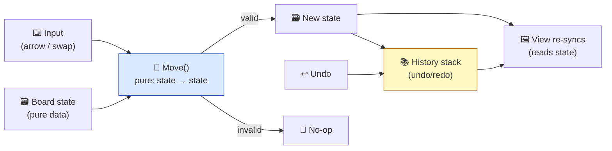
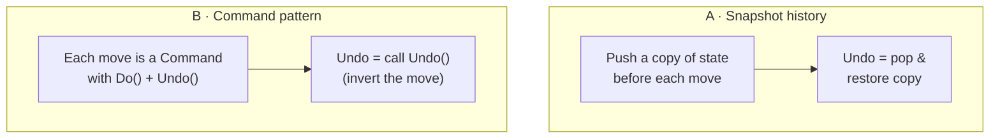

# Level 3 — Brief: Puzzle Game

| | |
|---|---|
| 🎚️ **Difficulty** | 🟡 Medium |
| ⏱️ **Estimated time** | Self-paced (1–2 days) |
| ⭐ **XP reward** | 100 (Quest) + 25 (Quiz) |

[← Prev](02-brief-tower-defense.md) · [↑ Phase Home](../README.md) · [→ Next](04-brief-turn-based-roguelike.md)

---

## 📖 Story

> *"This one's deceptive. A puzzle game looks tiny — a grid, some pieces — but it's the **purest test of clean state you'll build.** No frame timing to hide behind, no juice to distract: if your game state is a mess, an **undo button** will expose it instantly, because undo only works if your state is honest and your moves are pure. Build a Sokoban-style pusher or a match grid — your choice — with proper **undo/redo**, **data-driven levels** (levels are files, not code), and a win check. The W1 architecture lessons and W5 data-driven design carry this whole brief. Get the state model right and undo is ten lines; get it wrong and it's a nightmare. That contrast is exactly what a reviewer reads. Let me show you the model. — Kenji"*

---

## 🎯 Goal

- Ship a **grid/logic puzzle** (Sokoban-style pusher *or* a match/swap grid) that proves **clean state**.
- Model the board as **pure data**; make every move a **pure transformation** of that data.
- Implement **undo/redo** the right way (history of states or invertible commands).
- Make levels **data-driven** — authored as text/JSON files, loaded at runtime, not hard-coded.
- Add a **win condition** + a level-select/progression loop.
- Produce a **portfolio-grade repo**: separated model/view, **unit-tested move logic**, README + GIF.

---

## 🧠 Concepts

### Model–View separation is the whole game

The board is **data**. Rendering reads it; input proposes a move; the model validates and applies it; the view re-syncs. Undo is just "restore a previous model."



### Two clean ways to do undo



- **Snapshot** — simplest; great for small boards. Undo can never be wrong because it restores a real prior state.
- **Command** — memory-light for big boards; each move knows how to invert itself. Powers undo *and* redo *and* replays.

### Which prior-world skills this exercises

| System | From | How it's re-used here |
|---|---|---|
| Clean architecture, separation of concerns | W1 | Model (data) vs. view (render) vs. controller (input) |
| Data structures & grids | W4 | 2D grid, flood-fill for matches, BFS for reachability |
| Data-driven design | W5 | Levels as files; piece/rule definitions as data |
| Determinism & testing | W1 | Pure `Move()` → trivially unit-testable, no engine needed |

### Why this exists

A puzzle game exists in a portfolio to prove the thing that's invisible in flashier genres: **state discipline**. Undo is the litmus test — it is *impossible* to bolt onto messy state, so a working undo is hard proof that your model is pure and your moves are honest (no hidden side effects, no mutation leaking into the view). **Model–view separation** exists because the moment rendering can mutate game state, undo, replays, networking, and tests all become unreliable — the puzzle just makes the failure obvious early. **Data-driven levels** exist because content should not be code: a level designer (or you, next week) must add puzzles without recompiling, and "levels are files" is the same instinct as Ashfall's loot tables. **Pure move functions** exist because a function with no side effects is the only kind you can test without launching the engine — `Move(state, dir)` returning a new state is a unit test in one line. This is **engine-agnostic and language-agnostic**: it's functional-core/imperative-shell, the architecture behind chess engines, spreadsheets, and Redux. See **RESOURCES.md** for free puzzle art and the Sokoban level-format (`.sok` text) reference.

---

## 🛠️ Build Plan

> A **brief**, not a tutorial. Milestone path + sketches for the two trickiest parts: the pure move and undo history.

**Milestone 1 — State + render.** Define the board as plain data (a 2D array / cell list). Render reads it. No input yet. Prove the view is a *pure function of state*.

**Milestone 2 — Pure move.** Implement `Move(state, input) → newState` with full validation (Sokoban: can't push two boxes / into a wall; match: only valid swaps). Crucially: it **returns a new state**, never mutates the live one in place.

**Milestone 3 — Undo/redo.** Wrap moves in a history. Pick snapshot or command. Redo = the forward stack. Bind keys; test edge cases (undo at start = no-op).

**Milestone 4 — Data-driven levels + win.** Levels load from text/JSON files. A win check (all targets covered / board cleared). Level select + "next level" progression.

**Milestone 5 — Polish & ship.** Move animations (the *view* tweens toward the new state; state is already final), an undo SFX, a win celebration. README + GIF + a short note on your state model. Ship with a small **level pack**.

The pure move — the heart of the brief:

```csharp
// Pure: same input → same output, no side effects, no mutation of `s`. This is what makes undo & tests trivial.
public static BoardState Move(BoardState s, Vector2Int dir)
{
    var p = s.PlayerPos + dir;
    if (s.IsWall(p)) return s;                       // blocked → unchanged (no-op move)

    if (s.HasBox(p))                                 // pushing a box?
    {
        var beyond = p + dir;
        if (s.IsWall(beyond) || s.HasBox(beyond)) return s;  // can't push → unchanged
        return s.With(player: p, boxMoved: (from: p, to: beyond));   // returns a NEW state
    }
    return s.With(player: p);
}
```

Undo via snapshot history (ten honest lines, only because the move is pure):

```csharp
readonly Stack<BoardState> _undo = new();
readonly Stack<BoardState> _redo = new();

void Apply(Vector2Int dir)
{
    var next = Move(Current, dir);
    if (next.Equals(Current)) return;     // no-op → don't pollute history
    _undo.Push(Current);                  // remember where we were
    _redo.Clear();                        // a new move invalidates the redo branch
    Current = next;
}
void Undo() { if (_undo.Count > 0) { _redo.Push(Current); Current = _undo.Pop(); } }
void Redo() { if (_redo.Count > 0) { _undo.Push(Current); Current = _redo.Pop(); } }
```

> 💡 **Engine-agnostic note:** this is functional-core/imperative-shell — the same shape as Redux, a chess engine, or any undoable editor in any language. The engine only *draws* the state.

---

## 🎮 Mini Challenge

Add a **move counter + par** and a **"solved-in" replay**: record the sequence of inputs, and add a button that **replays the solution** from the initial state by re-applying the recorded moves through your pure `Move()`.

<details>
<summary>💡 Reveal approach</summary>

Because `Move()` is pure and deterministic, a "replay" is just the **list of inputs** plus the initial state — you don't store any frames. Record each applied direction into a `List<Vector2Int>`. To replay: reset to the level's initial state and re-apply the list with a small delay between steps, letting the view tween each time. This is the *exact same property* that makes networking and undo work: **deterministic state from inputs**. Par is just `recordedMoves.Count` vs. the level's authored target — store par in the level file.

</details>

---

## 📦 Project Mission

Build and ship **Vertical Slice: a Puzzle Game** to your portfolio. Definition of done:

1. **Model–view split**: board is pure data; the view is a function of state and never mutates it.
2. **Pure `Move()`**: validated, side-effect-free, returns a new state.
3. **Undo *and* redo** that work for arbitrary depth, with correct edge cases (no-op at boundaries).
4. **Data-driven levels**: a pack of **5+ levels** loaded from files; a win condition; level progression.
5. **Unit tests** on move logic (valid move, blocked move, push chain, win detection) — runnable without the engine where possible.
6. **Polish**: move tweening, undo/win feedback, clean level select.
7. **Portfolio polish**: clean repo, `README.md` with a **GIF** + a short "state model" explanation + "what this demonstrates."

| Criterion | 🟢 Excellent | 🟡 Adequate | 🔴 Missing |
|---|---|---|---|
| **State model** | Pure data, view is a function of it | Mostly separated | View mutates state |
| **Move logic** | Pure, fully validated, returns new state | Works, some mutation | Buggy edge cases |
| **Undo/redo** | Both, deep, correct edges | Undo only | Absent/broken |
| **Levels** | 5+ data-driven, progression | A few, file-loaded | Hard-coded |
| **Tests** | Move + win covered | One or two | None |
| **Polish** | README + GIF + model note | README | None |

🎯 **Mission complete when:** moves are pure and tested, undo/redo work flawlessly to any depth, levels are files you can add without recompiling, the model and view are cleanly separated, and the repo's README explains your state model and the W1/W5 skills it proves.

---

## ⚠️ Common Mistakes

| Mistake | What happens | Fix |
|---|---|---|
| View mutates game state | Undo corrupts; tests flake | Model is the truth; view only **reads** it |
| Move mutates state in place | Snapshot undo restores garbage | `Move()` **returns a new** state |
| Pushing a no-op onto history | Undo "does nothing" repeatedly | Skip history when state is unchanged |
| Levels hard-coded in scenes | Can't add content without recompiling | Levels as **files**, loaded at runtime |
| No tests on move logic | Edge-case bugs ship | Unit-test valid/blocked/push/win |
| Forgetting to clear redo on a new move | Redo replays a stale branch | Clear redo stack on each fresh move |

---

## 🤔 Reflection Questions

1. Why is a working **undo** strong evidence that your state model is clean? What would a broken undo reveal about hidden mutation?
2. Snapshot vs. command undo: when does each win? How would board size or a need for *replays* change your choice?
3. "Levels are data, not code." What does that unlock beyond convenience (think tools, testing, community content, and how it mirrored Ashfall's loot tables)?

---

## 📝 Quiz

1. **A pure `Move()` function…**
   - a) mutates the board and updates the UI directly
   - b) takes a state, returns a new state, no side effects
   - c) requires the engine to run
2. **Snapshot-based undo works by…**
   - a) re-simulating from the start each time
   - b) restoring a stored copy of a previous state
   - c) reversing the renderer
3. **Storing levels as files (not code) primarily lets you…**
   - a) render faster
   - b) add/edit content without recompiling, and test logic in isolation
   - c) skip the win check

<details>
<summary>✅ Answers</summary>

1: **b** · 2: **b** · 3: **b**

</details>

---

## ✅ Completion Checklist

- [ ] Board is **pure data**; view is a function of it
- [ ] **Pure, validated `Move()`** returning a new state
- [ ] **Undo *and* redo**, deep, correct edges
- [ ] **5+ data-driven levels** + win condition + progression
- [ ] **Unit tests** on move + win logic
- [ ] Polish (tweening, feedback, level select)
- [ ] `README.md` with **GIF** + state-model note; passed the quiz
- [ ] Added **+125 XP** to [PROGRESS.md](../../../PROGRESS.md)

---

[← Prev](02-brief-tower-defense.md) · [↑ Phase Home](../README.md) · [→ Next](04-brief-turn-based-roguelike.md)
