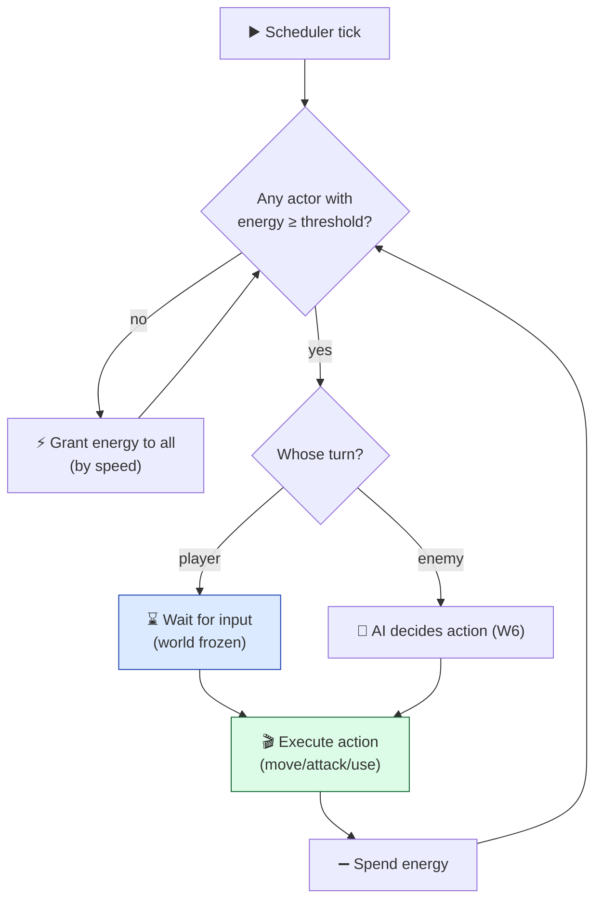
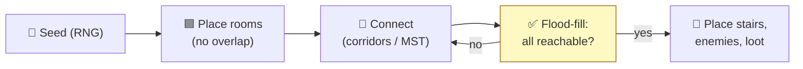

# Level 4 — Brief: Turn-Based Roguelike

| | |
|---|---|
| 🎚️ **Difficulty** | 🔴 Hard |
| ⏱️ **Estimated time** | Self-paced (2–3 days) |
| ⭐ **XP reward** | 100 (Quest) + 25 (Quiz) |

[← Prev](03-brief-puzzle-game.md) · [↑ Phase Home](../README.md) · [→ Next](05-brief-top-down-shooter.md)

---

## 📖 Story

> *"Ashfall is real-time. This is its mirror image: **turn-based**, where time only moves when the player acts. That flips your whole mental model — no `Update` loop driving the world, but a **turn scheduler** deciding who acts next. Build a small roguelike: a procedurally generated dungeon (W4), enemies that take their turn via a state machine / behavior tree (W6), and items & abilities you pick up and use (W5). The hard, beautiful part is the **turn system** — get that clean and everything (player, monsters, traps) plugs into the same loop. This is the densest brief and the one that most impresses reviewers, because a clean turn engine is genuinely tricky. Let me show you the scheduler. — Kenji"*

---

## 🎯 Goal

- Ship a **turn-based roguelike** that proves a clean **turn engine** + procgen + AI + items.
- Build a **turn scheduler** (energy/speed-based) where the world advances only on actions.
- **Procedurally generate** a dungeon each run (rooms + corridors, guaranteed connectivity).
- Give enemies turns driven by a **state machine / behavior tree** (W6) sharing the player's action API.
- Add **items & abilities** (pick up, use, equip) and **field-of-view** so the dungeon reveals as you explore.
- Produce a **portfolio-grade repo**: deterministic, seeded runs, tested turn logic, README + GIF.

---

## 🧠 Concepts

### The turn engine: an energy scheduler

Real-time games tick every frame. A roguelike ticks per **action**. The classic model gives each actor **energy**; an actor acts when it has enough, and acting costs energy — so a "fast" actor (gains more per tick) acts more often. The world is a loop that keeps finding the next actor ready to move.



The key insight: **player and enemies use the same `Action` interface.** Move, Attack, UseItem — each is an action with a cost. The scheduler doesn't care who's acting.

### Procgen: rooms, corridors, connectivity

Generate rooms, connect them, *guarantee* the player can reach the exit:



### Which prior-world skills this exercises

| System | From | How it's re-used here |
|---|---|---|
| Procedural generation, grids, flood-fill, A* | W4 | Dungeon layout, connectivity check, enemy pathing to player |
| State machine / behavior tree | W6 | Enemy turn logic (idle → chase → attack → flee) |
| Items, abilities, data-driven stats | W5 | Inventory, equip, consumables, ability effects as data |
| Determinism & save/load | W1/W3 | Seeded RNG → reproducible runs; serialize run state |

### Why this exists

A turn-based roguelike exists in a portfolio to prove you can build a game where **the loop itself is a design decision**, not a given. Most engines hand you a per-frame `Update`; a roguelike makes you *throw that away* and write a scheduler, which forces you to understand control flow at a deeper level — and "wrote their own turn engine" reads loudly to a reviewer. The **shared `Action` interface** exists because the alternative (separate code paths for player and enemies) duplicates every rule and rots immediately; one interface means a new ability works for monsters and players alike. **Energy/speed scheduling** exists because "everyone takes one turn each" can't express a fast monster or a slow hit — energy makes speed a first-class, data-driven stat. **Seeded procgen** exists because a roguelike *is* its replayability, and a seed makes runs reproducible (for debugging, daily challenges, and sharing). This is **engine-agnostic**: Brogue, DCSS, and Cogmind all run an energy scheduler with no per-frame world tick; it's a model, not an engine feature. Determinism here is the same property that powered undo (W11 puzzle) and will power networking (next brief). See **RESOURCES.md** for the RoguelikeDev tutorial series and free roguelike tilesets.

---

## 🛠️ Build Plan

> A **brief**, not a tutorial — this is the densest one. Milestone path + sketches for the trickiest parts: the action interface and the scheduler.

**Milestone 1 — Grid world + player turn.** A tile grid; the player moves on input; nothing else acts yet. Establish that the world is frozen until the player acts.

**Milestone 2 — Action interface + scheduler.** Define `IAction { int Cost; Result Perform(); }`. Build the energy scheduler. Add one dummy enemy that "passes" its turn. Prove turn order is correct.

**Milestone 3 — Procgen dungeon.** Rooms + corridors, flood-fill connectivity check, place stairs/enemies/loot. Reroll on disconnected layouts. Seed the RNG.

**Milestone 4 — Enemy AI + FOV.** Enemies use a state machine/BT (idle until they see you → chase via A* → attack adjacent). Field-of-view so the map reveals as you move (and enemies "wake" on sight).

**Milestone 5 — Items, abilities, run loop.** Inventory, equip, consumables, 1–2 abilities (data-driven). Descend stairs → new floor. Death → game over + seed shown. README + GIF + a "systems" diagram.

The shared action interface — player and enemy both produce these:

```csharp
public interface IAction
{
    int Cost { get; }                 // energy this action consumes
    ActionResult Perform(Actor self, World world);   // mutate world, return success/alternate
}

public class MoveAction : IAction
{
    readonly Vector2Int _dir;
    public int Cost => 100;
    public MoveAction(Vector2Int dir) => _dir = dir;
    public ActionResult Perform(Actor self, World world)
    {
        var dest = self.Pos + _dir;
        if (world.IsBlocked(dest)) return ActionResult.Failure;     // wall → no time passes
        if (world.ActorAt(dest) is Actor target)                    // bump-to-attack
            return new AttackAction(target).Perform(self, world);   // actions can delegate
        self.Pos = dest;
        return ActionResult.Success;
    }
}
```

The energy scheduler — the heart of the engine:

```csharp
// Advance until SOMEONE acts. Player actions come from input; enemy actions from AI.
public IEnumerator RunLoop(World world)
{
    while (!world.Over)
    {
        var actor = NextReady(world);               // first actor with energy >= 100
        if (actor == null) { GrantEnergy(world); continue; }   // tick: everyone gains speed

        IAction action = actor.IsPlayer
            ? yield return WaitForPlayerInput()     // world frozen until input
            : actor.Brain.DecideAction(actor, world);  // W6 state machine / BT

        var result = action.Perform(actor, world);
        if (result != ActionResult.Failure)         // failed actions cost no time (re-prompt player)
            actor.Energy -= action.Cost;
    }
}
```

> 💡 **Engine-agnostic note:** nothing here touches `Update`. The same scheduler runs in any engine or a pure console app — that's why roguelikes port so easily. The `IAction` pattern is the command pattern again (you saw it power undo in the puzzle brief).

---

## 🎮 Mini Challenge

Add **daily-run determinism**: seed the RNG from a date string so everyone playing "today" gets the *identical* dungeon, enemy placement, and loot — and add a **seed input box** so a player can paste a seed to replay a specific run.

<details>
<summary>💡 Reveal approach</summary>

The only requirement is that **every** random decision flows through one seeded RNG instance (dungeon layout, placements, loot rolls, AI tie-breaks) — no calls to global/unseeded random anywhere. Seed it from `hash(dateString)` for daily runs, or from the user's pasted seed. Because procgen + the scheduler are deterministic functions of the seed + inputs, identical seed + identical play = identical run. The bug to hunt: a single stray `Random.value` outside your seeded source silently desyncs everyone's dungeon. This is the same determinism discipline that made undo and replays work — and it's the foundation the multiplayer brief builds on.

</details>

---

## 📦 Project Mission

Build and ship **Vertical Slice: a Turn-Based Roguelike** to your portfolio. Definition of done:

1. **Turn engine**: an energy/speed scheduler; the world advances only on actions; player & enemies share an `IAction` interface.
2. **Procgen**: seeded dungeon (rooms + corridors) with a **guaranteed-reachable** exit; rerolls if disconnected.
3. **Enemy AI**: a state machine/BT (idle → chase via A* → attack), gated by **field-of-view**.
4. **Items & abilities**: inventory, equip, consumables, and 1–2 abilities — **data-driven**.
5. **Run loop**: descend floors, death → game over showing the seed.
6. **Determinism**: same seed → same run; tested.
7. **Portfolio polish**: clean repo, tests on turn/action logic, `README.md` with a **GIF**, a systems diagram, and "what this demonstrates."

| Criterion | 🟢 Excellent | 🟡 Adequate | 🔴 Missing |
|---|---|---|---|
| **Turn engine** | Energy scheduler, shared `IAction`, no per-frame world tick | One turn each, works | Player & enemies on separate ad-hoc paths |
| **Procgen** | Seeded, connectivity-verified, varied | Rooms + corridors connect | Static/disconnected |
| **AI** | FSM/BT + FOV + A* chase | Basic chase | Random/none |
| **Items** | Data-driven inventory + abilities | A few items | None |
| **Determinism** | Seed reproduces full run, tested | Mostly | Unseeded |
| **Polish** | README + GIF + diagram + tests | README | None |

🎯 **Mission complete when:** the world only moves when actors act, player and enemies run through one action API, dungeons generate seeded and always-completable, enemies chase intelligently within their FOV, items/abilities work, the same seed reproduces a run, and the README explains the W4/W5/W6 skills it proves.

---

## ⚠️ Common Mistakes

| Mistake | What happens | Fix |
|---|---|---|
| Driving the world from `Update` | No real turns; timing-dependent bugs | A **scheduler**; world advances per action |
| Separate code for player vs. enemy actions | Rule duplication, instant rot | One shared **`IAction`** interface |
| Failed actions still cost a turn | Player loses a turn for bumping a wall | Only spend energy on success |
| No connectivity check | Unwinnable dungeons | Flood-fill verify; reroll if disconnected |
| Stray unseeded random calls | Daily/seed runs desync | Route **all** RNG through one seeded source |
| AI with no FOV | Enemies omnisciently swarm | Gate aggression on field-of-view |

---

## 🤔 Reflection Questions

1. Ashfall ticks every frame; this game ticks per action. What did removing the per-frame world loop force you to make explicit that the frame loop hid?
2. Why is a single shared `IAction` interface for player and enemies worth more than it costs? What new ability becomes "free" for monsters because of it?
3. Seeded determinism powered procgen here, undo in the puzzle brief, and will power networking next. State the general principle in one sentence — why is "state as a function of seed + inputs" so powerful?

---

## 📝 Quiz

1. **In an energy-based turn scheduler, a "fast" actor…**
   - a) renders at a higher frame rate
   - b) gains energy faster, so it acts more often
   - c) ignores walls
2. **Player and enemies sharing one `IAction` interface mainly prevents…**
   - a) the need for a scheduler
   - b) duplicated rules across separate code paths
   - c) procedural generation
3. **To guarantee a generated dungeon is completable, you…**
   - a) make rooms bigger
   - b) flood-fill to verify the exit is reachable, and reroll if not
   - c) remove all enemies

<details>
<summary>✅ Answers</summary>

1: **b** · 2: **b** · 3: **b**

</details>

---

## ✅ Completion Checklist

- [ ] **Energy scheduler**; world advances only on actions; shared `IAction`
- [ ] **Seeded procgen** dungeon with verified connectivity
- [ ] Enemy **FSM/BT + FOV + A\*** chase
- [ ] **Data-driven** items & abilities; floor descent + game over
- [ ] **Determinism**: same seed → same run (tested)
- [ ] Clean repo, tests, `README.md` with **GIF** + systems diagram
- [ ] I passed the quiz
- [ ] Added **+125 XP** to [PROGRESS.md](../../../PROGRESS.md)

---

[← Prev](03-brief-puzzle-game.md) · [↑ Phase Home](../README.md) · [→ Next](05-brief-top-down-shooter.md)
