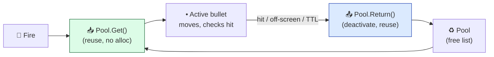
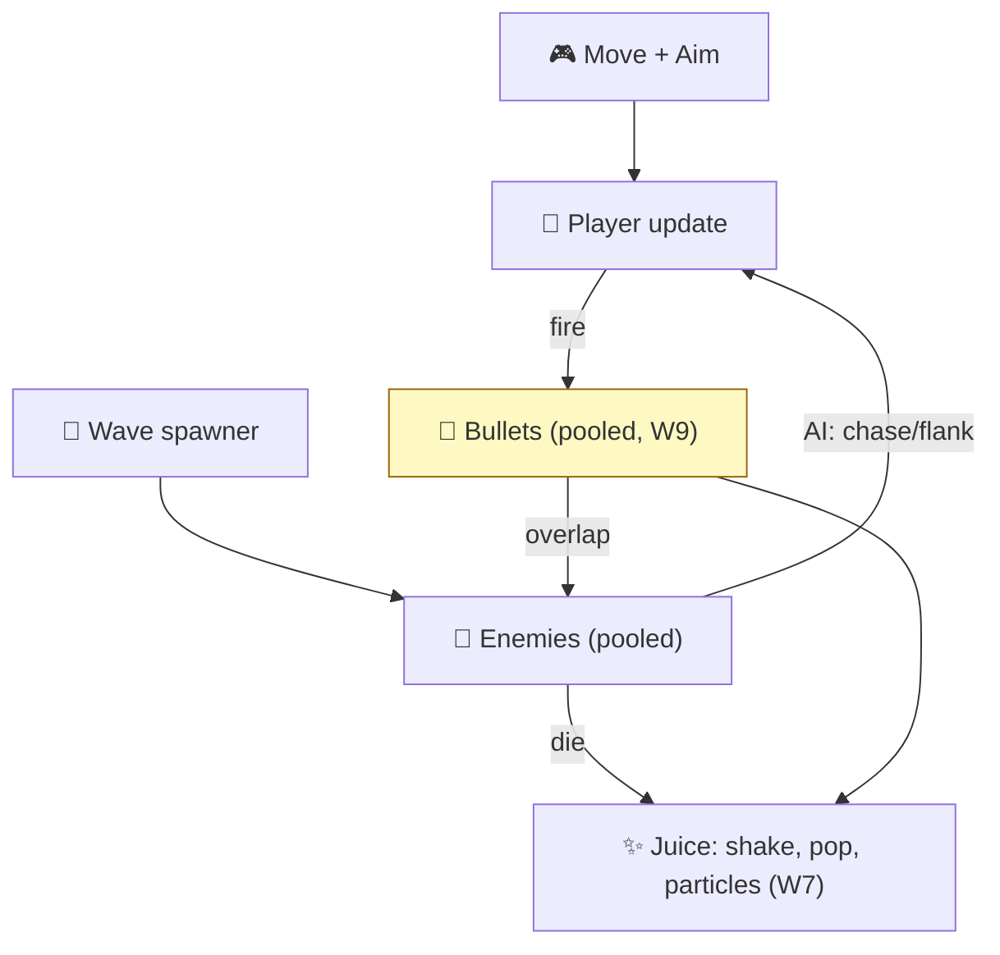

# Level 5 — Brief: Top-Down Shooter

| | |
|---|---|
| 🎚️ **Difficulty** | 🔴 Hard |
| ⏱️ **Estimated time** | Self-paced (2 days) |
| ⭐ **XP reward** | 100 (Quest) + 25 (Quiz) |

[← Prev](04-brief-turn-based-roguelike.md) · [↑ Phase Home](../README.md) · [→ Next](06-brief-multiplayer-mini-engine.md)

---

## 📖 Story

> *"Back to real-time, and this time we crank the **count.** A twin-stick top-down shooter is closest to Ashfall, so it's your showcase: it has to *run fast under load* and *feel incredible.* That means twin-stick aim (W2 math), enemy AI waves that swarm and flank (W6), and — the headline — **bullet pooling at scale** so hundreds of projectiles never cause a GC hitch (W9). Then the W7 juice that makes shooting feel meaty: screen shake, hit-stop, muzzle flash, knockback. Profile it. If you can show a clean frame graph with 500 bullets on screen and it still feels punchy, that single GIF is worth more than a paragraph of resume. Let me show you the architecture for scale. — Kenji"*

---

## 🎯 Goal

- Ship a **twin-stick top-down shooter** that proves **performance under load** + **game feel**.
- Implement **twin-stick aiming** (move + aim independently) and weapons with spread/fire-rate.
- Spawn **enemy waves** with AI that chases/swarms/flanks (W6).
- **Pool everything that spawns at scale** — bullets, enemies, particles, pickups (W9) — for a steady frame budget.
- Add a heavy **juice pass** (W7): shake, hit-stop, muzzle flash, knockback, death pops.
- Produce a **portfolio-grade repo**: profiled (a frame-graph screenshot), clean architecture, README + GIF.

---

## 🧠 Concepts

### Twin-stick aim (W2 math)

Movement and facing are **independent**: left stick / WASD moves; right stick / mouse aims. Aim is a vector from the player to the cursor (or the right-stick direction); facing = `atan2`. Firing spawns a bullet along that aim vector, optionally with random spread.

### Pooling at scale — the performance spine



`Instantiate`/`Destroy` per bullet allocates and triggers garbage collection — the GC pause is a frame hitch you can *see*. A pool reuses a fixed set of objects: zero allocation in the hot loop, flat frame time.

### The full real-time loop



### Which prior-world skills this exercises

| System | From | How it's re-used here |
|---|---|---|
| Vectors, `atan2`, spread, normalization | W2 | Twin-stick aim, bullet directions, knockback vectors |
| Enemy AI, state machines, steering | W6 | Chase, swarm, flank; wave director |
| Object pooling, data-oriented thinking | W9 | Bullets/enemies/particles pooled; flat frame budget under load |
| Juice: shake, hit-stop, particles, feedback | W7 | The "meaty" shooting feel |

### Why this exists

A top-down shooter exists in a portfolio to prove the two things that separate a hobby project from a shippable one: **it stays fast when there's a lot on screen**, and **it feels good to do the core verb thousands of times**. **Pooling** exists because the naive `Instantiate`/`Destroy` per bullet is the single most common cause of frame hitches in beginner games — at 500 bullets/second the GC pauses become visible stutter, and a pool turns that into a flat line. Showing a **profiler frame-graph** that stays flat under load is hard, credible proof you understand performance, which most juniors only *claim*. **Twin-stick aim** exists because decoupling move from aim is what makes the genre expressive (strafe while shooting). The **juice** exists because firing is the verb you'll perform 10,000 times — if it doesn't feel meaty, nothing else matters; shake/hit-stop/knockback are cheap and transformative. This is **engine-agnostic**: pooling, fixed-budget hot loops, and decoupled aim are universal (Vampire Survivors lives or dies on pooling thousands of entities). This is also the most direct rehearsal for Ashfall's own combat. See **RESOURCES.md** for free shooter art, a juice talk ("Juice it or lose it"), and a pooling reference.

---

## 🛠️ Build Plan

> A **brief**, not a tutorial. Milestone path + sketches for the two trickiest parts: the generic pool and the bullet hot loop.

**Milestone 1 — Twin-stick player.** Move (WASD/left stick), aim (mouse/right stick), a weapon that fires on a cooldown with spread. Get the *aim and strafe* feeling right.

**Milestone 2 — Generic object pool.** A reusable `Pool<T>` with `Get`/`Return`. Route bullets through it. Verify in the profiler: firing causes **no allocations**.

**Milestone 3 — Enemies + waves.** Pooled enemies; a wave director that escalates count/types. AI: chase, plus one swarm/flank behavior (W6 FSM/steering).

**Milestone 4 — Combat at scale.** Bullet↔enemy overlap (spatial check or layers), damage, death. Push to **hundreds of bullets** on screen and profile — frame time must stay flat.

**Milestone 5 — Juice + ship.** Screen shake, hit-stop on kill, muzzle flash, knockback, death particles, scaling difficulty. README + GIF + **a frame-graph screenshot** under load.

A generic pool — reuse anything that spawns at scale:

```csharp
public class Pool<T> where T : Component
{
    readonly T _prefab; readonly Stack<T> _free = new();
    public Pool(T prefab, int prewarm) { _prefab = prefab; for (int i=0;i<prewarm;i++) _free.Push(Make()); }

    T Make() { var o = Object.Instantiate(_prefab); o.gameObject.SetActive(false); return o; }

    public T Get()              // reuse if available, else grow — never per-frame Instantiate in the hot path
    {
        var o = _free.Count > 0 ? _free.Pop() : Make();
        o.gameObject.SetActive(true);
        return o;
    }
    public void Return(T o) { o.gameObject.SetActive(false); _free.Push(o); }  // recycle, don't Destroy
}
```

Bullet hot loop — the part that must be allocation-free:

```csharp
// Called every frame for every live bullet. No new allocations here — that's the whole point.
void Tick(float dt)
{
    Pos += Dir * Speed * dt;
    _life -= dt;
    if (_life <= 0f || OffScreen(Pos)) { _pool.Return(this); return; }   // recycle, never Destroy

    if (Physics2D.OverlapCircle(Pos, Radius, _enemyMask) is Collider2D hit)
    {
        hit.GetComponent<Enemy>().TakeDamage(Damage);                    // apply hit
        Juice.HitStop(0.04f); Juice.Shake(0.2f);                         // feel (W7)
        _pool.Return(this);                                              // recycle the bullet
    }
}
```

> 💡 **Engine-agnostic note:** the pool + flat hot loop is universal — Godot, Unreal, or a custom engine all hitch on per-entity create/destroy at scale. "Prewarm a pool, recycle, never allocate in the hot loop" is the rule everywhere.

---

## 🎮 Mini Challenge

Add a **bullet-hell boss** that fires patterned waves (spiral, radial burst, aimed fan) — proving your pool holds under *thousands* of simultaneous bullets — and show the profiler staying flat while it does.

<details>
<summary>💡 Reveal approach</summary>

Drive patterns from a small data structure: each pattern is a function of `time → list of (angle, speed)`. A spiral is `baseAngle += spin * dt` firing one bullet per tick; a radial burst fires N bullets at `360/N` spacing; an aimed fan centers on the player ± spread. Every bullet comes from the **same pool** — that's the point: if your pool is correct, going from 50 to 2,000 bullets changes the GIF, not the frame graph. Prewarm the pool large enough that it never grows mid-fight (growth is the one place a hitch can sneak back in). Cap lifetime/off-screen returns aggressively so bullets recycle fast.

</details>

---

## 📦 Project Mission

Build and ship **Vertical Slice: a Top-Down Shooter** to your portfolio. Definition of done:

1. **Twin-stick** movement + independent aim; a weapon with fire-rate and spread.
2. A **generic object pool** used for bullets, enemies, and particles — **no allocations** in the firing hot loop (profiler-verified).
3. **Enemy waves** with escalating count/types and AI that chases + at least one swarm/flank behavior.
4. **Scale**: hundreds of bullets on screen with a **flat frame budget** (include a profiler frame-graph screenshot).
5. **Juice**: screen shake, hit-stop, muzzle flash, knockback, death particles.
6. **Game loop**: waves → score/survive → death → restart.
7. **Portfolio polish**: clean architecture (player / weapon / pool / spawner / juice), `README.md` with a **GIF** + the frame-graph + "what this demonstrates."

| Criterion | 🟢 Excellent | 🟡 Adequate | 🔴 Missing |
|---|---|---|---|
| **Performance** | Pooled, flat under hundreds of bullets, profiler shown | Pooled, mostly flat | `Instantiate`/`Destroy` hitches |
| **Aim/weapons** | Twin-stick, spread, multiple weapons | Twin-stick works | Aim glued to movement |
| **Enemy AI/waves** | Chase + swarm/flank, escalating | Chase + waves | Static enemies |
| **Juice** | Shake, hit-stop, flash, knockback all read | Some | None |
| **Architecture** | Cleanly separated systems | Mostly | One mega-script |
| **Polish** | README + GIF + frame-graph | README | None |

🎯 **Mission complete when:** it feels meaty, runs flat with hundreds of bullets (proven in the profiler), aim is twin-stick, enemies swarm intelligently, everything that spawns at scale is pooled, and the README shows a GIF + a frame-graph and names the W2/W6/W7/W9 skills it proves.

---

## ⚠️ Common Mistakes

| Mistake | What happens | Fix |
|---|---|---|
| `Instantiate`/`Destroy` per bullet | GC hitches under load | A **pool**; recycle, never destroy in the hot loop |
| Allocating in the bullet `Tick` | Death-by-a-thousand-allocs | Zero `new` in the hot path; reuse buffers |
| Aim locked to movement | Loses the genre's feel | **Decouple** move and aim |
| `Vector.Distance`/per-pair checks naively | O(n²) at scale | Layers/masks or spatial partition for overlaps |
| No juice | Shooting feels limp | Shake, hit-stop, flash, knockback |
| "Looks fine on my machine" | Hitches on weaker HW | **Profile**; show a flat frame graph |

---

## 🤔 Reflection Questions

1. Why does `Instantiate`/`Destroy` per bullet specifically cause *frame hitches* (not just slowness)? What does a pool change about the memory pattern?
2. Pooling appeared in the tower-defense brief and Ashfall too. Generalize the rule: which spawn patterns *always* need a pool, and how would you spot one when profiling an unfamiliar game?
3. The juice here (shake, hit-stop) changes nothing in the simulation. Why does it so strongly change how good the game *feels*, and what does that imply about where to spend polish time?

---

## 📝 Quiz

1. **Object pooling avoids frame hitches by…**
   - a) rendering fewer bullets
   - b) reusing objects so the hot loop makes no allocations (no GC pauses)
   - c) lowering the resolution
2. **Twin-stick aiming means…**
   - a) two players share one stick
   - b) movement and aiming are controlled independently
   - c) you can only shoot where you move
3. **Hit-stop and screen shake primarily improve…**
   - a) raw performance
   - b) how impactful/"meaty" actions feel (game feel)
   - c) pathfinding accuracy

<details>
<summary>✅ Answers</summary>

1: **b** · 2: **b** · 3: **b**

</details>

---

## ✅ Completion Checklist

- [ ] **Twin-stick** move + aim; weapon with fire-rate/spread
- [ ] **Generic pool** for bullets/enemies/particles; **no allocs** in the hot loop (profiled)
- [ ] **Enemy waves** + chase/swarm AI, escalating
- [ ] **Hundreds of bullets**, flat frame budget — **frame-graph screenshot**
- [ ] **Juice**: shake, hit-stop, flash, knockback, particles
- [ ] Game loop + clean architecture; `README.md` with **GIF** + frame-graph
- [ ] I passed the quiz
- [ ] Added **+125 XP** to [PROGRESS.md](../../../PROGRESS.md)

---

[← Prev](04-brief-turn-based-roguelike.md) · [↑ Phase Home](../README.md) · [→ Next](06-brief-multiplayer-mini-engine.md)
