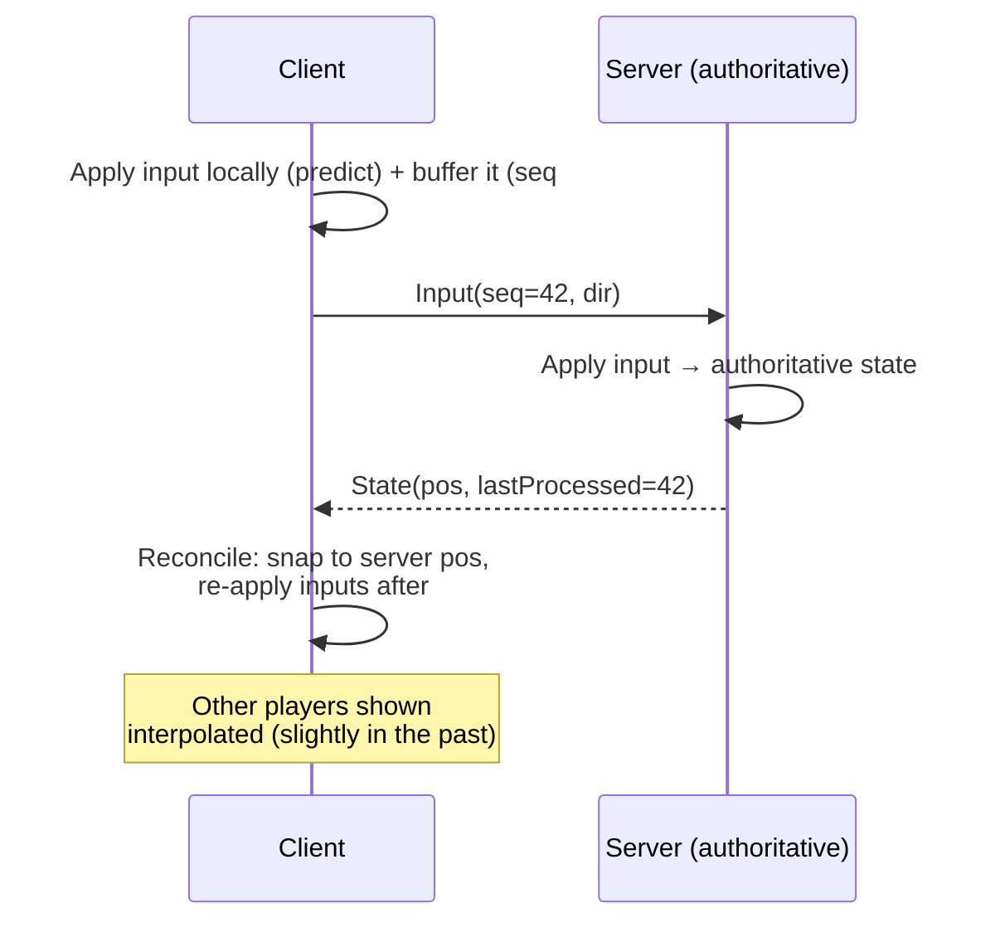
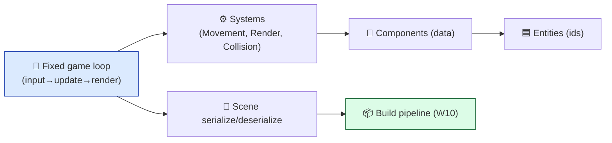

# Level 6 — Brief: Multiplayer Mini-Engine

| | |
|---|---|
| 🎚️ **Difficulty** | 🔴 Hard |
| ⏱️ **Estimated time** | Self-paced (2–3 days) |
| ⭐ **XP reward** | 100 (Quest) + 25 (Quiz) |

[← Prev](05-brief-top-down-shooter.md) · [↑ Phase Home](../README.md) · [→ Next](../boss-battle.md)

---

## 📖 Story

> *"Last brief, and it's the one that proves **depth.** Two roads, pick one. Road A: a tiny **networked prototype** — two clients, a server, authoritative state, client prediction so movement feels instant despite latency. Road B: a small **reusable mini game-engine** — your own loop, ECS-lite, scene/serialization, a build pipeline — and ship a tiny game *on top of it* to prove it works. Either way you're showing you understand games from **first principles**, not just as a Unity user. This is the capstone of your breadth: W8 networking + W9 engine architecture + W10 build pipeline, built from scratch. Whichever road, document the architecture like you'd hand it to a teammate. This is the piece that makes a reviewer say 'oh, they actually *get it*.' Let me show you both shapes. — Kenji"*

---

## 🎯 Goal

Pick **one** road and ship it to portfolio quality:

- **Road A — Networked prototype:** authoritative server, 2+ clients, **client-side prediction + server reconciliation**, basic interpolation; movement feels instant under simulated latency.
- **Road B — Mini game-engine:** your own **game loop**, **ECS-lite** (entities/components/systems), **scene serialization** (save/load), and a **build pipeline**; ship a tiny game *on it*.
- Either way: prove **first-principles** understanding (W8 net / W9 architecture / W10 builds), with deep **architecture docs**, tests, and a README + GIF.

---

## 🧠 Concepts

### Road A — Authoritative netcode (the core loop)

The server owns truth. Clients send **inputs**, not positions. To hide latency, the client **predicts** locally and **reconciles** when the server's authoritative state arrives.



- **Authoritative server** — clients can't cheat; the server's state wins.
- **Prediction** — the local player moves *now*, not after a round-trip.
- **Reconciliation** — when the server's state arrives, snap to it and **replay** unacknowledged inputs, so prediction errors self-correct invisibly.
- **Interpolation** — remote players are rendered a little in the past, smoothing jitter.

### Road B — A mini engine (ECS-lite)



- **Entities** are ids; **components** are plain data; **systems** are functions over components. (You met ECS-lite refactoring Ashfall in W9.)
- **A real game loop** — fixed-timestep update + render, the thing every engine hides from you.
- **Serialization** — save/load a scene to disk = your data model is clean.
- **Build pipeline** — a script/CI that produces a runnable artifact (W10).

### Which prior-world skills this exercises

| System | From | How it's re-used here |
|---|---|---|
| Networking, authority, prediction, serialization | W8 | Road A core; the wire format on both roads |
| Engine architecture, ECS, the game loop | W9 | Road B core; clean data model on both roads |
| Determinism | W3/W4/W11 | Prediction replay (A) & reproducible sim (B) depend on it |
| Build pipeline, CI/CD | W10 | Ship a runnable artifact; reproducible builds |

### Why this exists

This brief exists to prove you understand games **from first principles**, not as someone who only fills in `MonoBehaviour` callbacks — and that is the single strongest signal a senior reviewer looks for. **Road A** exists because real-time multiplayer is where naive thinking ("just send positions") collapses: it teaches that you send *inputs* to an *authoritative* server and hide the round-trip with *prediction + reconciliation* — the techniques behind every responsive online game (this is the Gaffer-on-Games / Valve model, made small). **Reconciliation** depends on **determinism** (replaying inputs must reproduce the same result) — the exact property that powered undo, roguelike seeds, and replays in earlier briefs, now load-bearing. **Road B** exists because writing your own loop + ECS + serialization strips away the engine's magic: once you've built the thing Unity does for you, you understand *why* it does it, and you can reason about any engine. Both roads end in a **build pipeline** because an engine or a netcode demo that can't be built and run by someone else isn't a portfolio piece, it's a screenshot. This is the most **engine-agnostic** brief by design — much of it can be written in plain C# with no engine at all. See **RESOURCES.md** for Gaffer-on-Games networking articles, the Valve source-multiplayer doc, and an ECS primer.

---

## 🛠️ Build Plan

> A **brief**, not a tutorial. Pick a road; milestone path + a sketch of each road's trickiest part.

### Road A — Networked prototype

**M1 — Transport + echo.** A server and 2 clients over UDP/WebSocket (or a free relay). Send a ping, get it back. Define a tiny message format.
**M2 — Authoritative movement.** Clients send inputs (with sequence numbers); server applies them and broadcasts state. Render naively first (laggy on purpose — *feel* the problem).
**M3 — Prediction + reconciliation.** Predict locally; buffer unacked inputs; on each server state, snap + replay inputs after `lastProcessed`. Movement now feels instant.
**M4 — Interpolation + polish.** Render remote players interpolated in the past. Add a **latency simulator** to prove it holds at 100–200ms. README + GIF (side-by-side: prediction on vs. off).

Reconciliation — the part that makes latency disappear:

```csharp
// On each authoritative snapshot from the server:
void OnServerState(PlayerState srv)
{
    transform.position = srv.Pos;                       // 1. snap to authoritative truth
    _pending.RemoveAll(i => i.Seq <= srv.LastProcessed);// 2. drop inputs the server already applied
    foreach (var input in _pending)                     // 3. re-apply everything still in flight
        transform.position = Simulate(transform.position, input);  // deterministic step!
    // Result: corrected to server truth, yet still showing the player's latest predicted moves.
}
```

### Road B — Mini engine

**M1 — Fixed game loop.** Your own loop: accumulate time, step the sim at a fixed dt, render with interpolation. No engine `Update`.
**M2 — ECS-lite.** Entities (ids), components (data structs), systems (iterate matching components). One Movement system, one Render system.
**M3 — Serialization.** Save/load a scene (entities+components) to JSON. Round-trip must be lossless.
**M4 — Build pipeline + a game.** A build script/CI (W10) that produces a runnable artifact. Ship a *tiny* game on the engine (e.g. Pong/Asteroids) to prove it works. README + GIF + architecture doc.

The fixed-timestep loop — the thing engines hide:

```csharp
// Decouples simulation rate from frame rate: deterministic sim, smooth render. Universal.
double acc = 0, prev = Now();
const double DT = 1.0 / 60.0;
while (running)
{
    double now = Now(); acc += now - prev; prev = now;
    while (acc >= DT) { Step(DT); acc -= DT; }   // fixed sim steps (may run 0..N times)
    Render(acc / DT);                            // interpolate between last two states
}
```

> 💡 **Engine-agnostic note:** the fixed-timestep loop (Road B) is *the* canonical game loop — Gaffer's "Fix Your Timestep." Input-not-position + prediction/reconciliation (Road A) is *the* canonical netcode. You're building what every engine builds.

---

## 🎮 Mini Challenge

- **Road A:** add **lag compensation** for a hit/interaction — when the server validates an action, rewind other entities to where they *were* on the acting client's screen (using timestamps), so shots that looked like hits *count*.
- **Road B:** make the sim **fully deterministic** and add a **record/replay** — store only inputs + seed, then reproduce an entire session frame-for-frame from that log.

<details>
<summary>💡 Reveal approach</summary>

**Road A (lag comp):** the server keeps a short ring buffer of past entity positions with timestamps. When client C fires at time T (T ≈ now − C's latency), the server rewinds targets to their position at T, tests the hit, then restores. This is exactly how competitive shooters make "I clearly hit them" feel fair — it trades a little server-side "shooting the past" for client-side fairness.

**Road B (record/replay):** if the sim is a pure function of `(seed, inputs)` with a fixed timestep, a replay is just the input log + seed — no stored frames. Re-run the loop feeding recorded inputs; it reproduces bit-for-bit. The bug to hunt is any non-determinism: unseeded RNG, frame-rate-dependent math, or iteration-order dependence. This is the *same determinism principle* from the roguelike seeds and the puzzle replay — here it's the foundation of the whole engine's testability.

</details>

---

## 📦 Project Mission

Build and ship **Vertical Slice: a Multiplayer Mini-Engine** (pick one road) to your portfolio. Definition of done:

**Road A — Networked prototype**
1. **Authoritative server** + 2+ clients; clients send **inputs** (sequenced), not positions.
2. **Client prediction + server reconciliation** (snap + replay unacked inputs).
3. **Interpolation** of remote players; a **latency simulator** proving it feels good at 100–200ms.
4. A GIF showing prediction **on vs. off**.

**Road B — Mini engine**
1. Your own **fixed-timestep game loop** (no engine `Update`).
2. **ECS-lite** (entities/components/systems) with ≥2 systems.
3. **Scene serialization** (lossless save/load round-trip).
4. A **build pipeline** (script/CI, W10) and a **tiny game shipped on the engine**.

**Both roads**
5. **Determinism** where the design needs it (replay/reconciliation), tested.
6. **Architecture docs**: a README + a design doc / diagram you could hand a teammate, with a **GIF** and "what this demonstrates."

| Criterion | 🟢 Excellent | 🟡 Adequate | 🔴 Missing |
|---|---|---|---|
| **Core depth** | (A) prediction+reconciliation works under sim-latency / (B) loop+ECS+serialize+build all real | Core works, rough edges | Sends positions / engine does the work |
| **First-principles** | Clearly built from scratch, well-reasoned | Mostly from scratch | Wrapper over engine magic |
| **Determinism** | Replay/reconcile correct, tested | Mostly | Non-deterministic |
| **Build/run** | One-command build of a runnable artifact | Builds with steps | Won't build for others |
| **Docs** | Architecture doc + diagram + GIF | README | None |

🎯 **Mission complete when:** (Road A) inputs flow to an authoritative server and prediction + reconciliation make movement feel instant under simulated latency; or (Road B) your own loop + ECS + serialization run a tiny game built by a pipeline — and either way a teammate could read your architecture doc, build it, and understand exactly which W8/W9/W10 first-principles skills it proves.

---

## ⚠️ Common Mistakes

| Mistake | What happens | Fix |
|---|---|---|
| Sending positions, not inputs | Cheatable; no clean reconciliation | Clients send **inputs**; server is authoritative |
| Prediction without reconciliation | Local & server drift apart | Snap to server state, **replay** unacked inputs |
| Non-deterministic sim | Reconciliation/replay diverge | Fixed timestep, seeded RNG, order-independent |
| (B) Driving sim off frame rate | Physics changes with FPS | **Fixed-timestep** loop; interpolate render |
| ECS "in name only" (logic in components) | No real benefit | Components = **data**, systems = **logic** |
| No build pipeline | "Works on my machine," unshippable | A script/CI that builds a runnable artifact (W10) |

---

## 🤔 Reflection Questions

1. Why must clients send **inputs** to an authoritative server rather than positions? What two problems (cheating *and* correction) does that single decision solve?
2. Determinism has now powered undo, roguelike seeds, replays, and (here) reconciliation/replay. State the unifying principle and explain why prediction-reconciliation literally cannot work without it.
3. Whichever road you took: name one thing the engine normally does *for* you that you had to build yourself, and what understanding it gave you that a pure Unity user lacks.

---

## 📝 Quiz

1. **In authoritative netcode, clients should send the server…**
   - a) their final positions
   - b) their inputs (the server computes authoritative state)
   - c) screenshots
2. **Server reconciliation corrects a mispredicted client by…**
   - a) disconnecting it
   - b) snapping to the server state and re-applying unacknowledged inputs
   - c) lowering its frame rate
3. **A fixed-timestep game loop exists to…**
   - a) cap the frame rate to 60
   - b) make the simulation deterministic and independent of render frame rate
   - c) reduce memory use

<details>
<summary>✅ Answers</summary>

1: **b** · 2: **b** · 3: **b**

</details>

---

## ✅ Completion Checklist

- [ ] Chose a road (A networked prototype **or** B mini-engine)
- [ ] **Road A:** authoritative server + inputs + **prediction & reconciliation** + interpolation + latency sim
- [ ] **Road B:** **fixed-timestep loop** + **ECS-lite** + **serialization** + **build pipeline** + a tiny game on it
- [ ] **Determinism** where needed, tested
- [ ] **Architecture doc** + diagram + `README.md` with **GIF**
- [ ] One-command/clear **build** of a runnable artifact
- [ ] I passed the quiz
- [ ] Added **+125 XP** to [PROGRESS.md](../../../PROGRESS.md)

---

[← Prev](05-brief-top-down-shooter.md) · [↑ Phase Home](../README.md) · [→ Next](../boss-battle.md)
