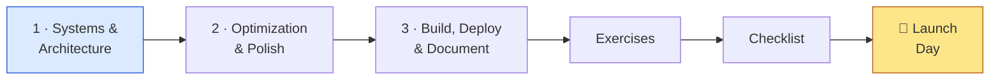
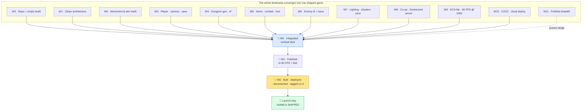

# 👑 World 12 — Final Boss: Ship Ashfall

> This is it. The last world. Twelve worlds ago you were a new hire with an empty Unity project and a `.gitignore`; now you have a fast, networked, cloud-deployable action-roguelite and the skills of a real game engineer. There is nothing left to *learn* here — World 12 is where you **put it all together and ship**. Three capstone **milestones** take Ashfall from "a pile of good systems" to a single, cohesive, commercial-quality **vertical slice**: every system integrated under one clean architecture, profiled and polished to a locked frame budget with real game feel, then built through CI/CD, deployed live to the cloud, documented for the world, and tagged `v1.0`. No new tutorials. No safety net. Just you, the whole bootcamp in your hands, and a game to launch. **We ship Ashfall.**

[↑ Home](../../README.md) · [🗺️ Roadmap](../../ROADMAP.md) · [📊 Progress](../../PROGRESS.md)

---

## 📨 All-hands from Theo

```
From:    Theo <theo@pixelforge.studio>
To:      The whole studio <all@pixelforge.studio>
Cc:      You <new-hire@pixelforge.studio>

Subject: [W12-LAUNCH] This is it. We ship Ashfall.

Everyone — pens down for two minutes and read this.

When this person walked in on day one, "Ashfall" was a folder name and an
empty scene. Maya had ideas, Kenji had a mentor's patience, Lena had a mood
board, Priya had a server she swore she could put in the cloud. And our new
hire had... a .gitignore.

Look at it now.

It moves and aims like butter (W2). It's a real playable character with a
camera and saves (W3). It generates dungeons and the enemies actually PATH to
you (W4). It has items, abilities, combat, loot, an economy (W5). The Ashen
Warden has PHASES (W6). It's LIT — shaders, particles, juice (W7). Two people
play it together, over the network, on a server in a CONTAINER (W8). It holds
a thousand entities at a locked 60 (W9). And it ships itself: a green pipeline
builds it, a Terraform cluster runs it, monitoring watches it (W10). You even
proved range with a whole portfolio of other genres (W11).

That's not a prototype anymore. That's a GAME. And a game that nobody can play
isn't shipped — it's a secret. So we're going to fix that. This world is three
milestones and one launch:

  - MILESTONE 1 — SYSTEMS & ARCHITECTURE. Stop adding. Start INTEGRATING.
    Every system you've built, assembled into ONE cohesive vertical slice
    under one clean architecture. Lock the feature set. No loose wires.
  - MILESTONE 2 — OPTIMIZATION & POLISH. Make it FEEL finished. Profile to a
    rock-solid frame budget, add the game feel and UX and audio that separate
    "a demo" from "a game," and kill the bugs. Shippable quality. No excuses.
  - MILESTONE 3 — BUILD, DEPLOY & DOCUMENT. Final builds through CI/CD. Server
    live in the cloud. A real release page, a README, a trailer, a case study.
    Then you tag v1.0 and you PUSH THE BUTTON.

The boss is called "Launch Day." It is exactly what it sounds like. No
tutorials — you have everything you need, you've had it for a while now. The
whole studio is watching, and we're watching because we're proud.

Ship it. Then we celebrate.

— Theo
```

This is **World 12 of 13 — the final world.** Everything converges on the **one growing Ashfall project** in `~/projects/ashfall`. You arrive with twelve worlds of systems, optimization, networking, and cloud deployment skills; you leave with a **shipped, tagged, documented, commercial-quality vertical slice** — and the title **Master Game Developer**.

---

## 🎯 What you'll achieve in this world

- 🧩 **Integrate every system** — architecture, math, gameplay, AI, rendering, networking — into **one cohesive vertical slice** under a single clean architecture, with the feature set **locked**
- 💎 **Polish to shippable quality** — profile to a stable **60 FPS** frame budget, add game feel / UX / audio, and fix the bugs that separate a demo from a *game*
- 🚀 **Build, deploy, and document the release** — final builds via CI/CD, the **co-op server live in the cloud**, a **public release page**, full **docs** (README + case study + trailer), and a **tagged `v1.0` GitHub release**
- 🏆 **Ship Ashfall** — and graduate as a **Master Game Developer**

---

## 🗺️ Level map

| Milestone | Capstone | Difficulty | XP |
|----------:|----------|:----------:|---:|
| 1 | [Milestone: Systems & Architecture](lessons/01-milestone-systems-and-architecture.md) | 🔴 Hard | 125 |
| 2 | [Milestone: Optimization & Polish](lessons/02-milestone-optimization-and-polish.md) | 🔴 Hard | 125 |
| 3 | [Milestone: Build, Deploy & Document](lessons/03-milestone-build-deploy-and-document.md) | 🔴 Hard | 125 |
| 👑 | [Boss Battle — Launch Day](boss-battle.md) | 🔴🔴 Hard | 500 |

➕ Extra reps: [exercises.md](exercises.md) · ✅ Ready to ship? [checklist.md](checklist.md)

---

## 🧭 Recommended order



Go in order — this world is a **release process**, and you cannot skip a stage of it. **Integrate first** (M1): you can only polish and ship a game whose systems actually fit together, so you assemble the whole thing into one cohesive slice and *lock the scope* — no new features past this point. **Polish second** (M2): once the slice is whole, you profile it to a stable frame budget and add the game feel, UX, and audio that make it read as finished — you polish what's built, not what's planned. **Release last** (M3): final builds through the CI/CD pipeline you already trust, the server deployed to the cloud, the docs and release page written, and the `v1.0` tag cut. The boss, **Launch Day**, is all three milestones fired at once: a finished game, shipped to the public.

---

## 📦 Ashfall project status

**Entering World 12:** twelve worlds of compounding work — a clean, event-driven architecture (W1); movement and aiming math (W2); a playable, saving character with a follow camera (W3); procedural dungeons with A* pathfinding (W4); items, abilities, combat, loot, and an economy (W5); FSM/BT/utility-AI enemies and a multi-phase boss (W6); dynamic lighting, shaders, particles, and juice (W7); server-authoritative 2-player co-op on a Dockerized server (W8); a data-oriented, ECS-lite engine holding 1000+ entities at 60 FPS (W9); and a green CI/CD pipeline deploying that server to a Terraform-defined Kubernetes cluster on AWS, monitored and teardownable (W10). All of it works — but as *parts*. The slice isn't locked, the feel isn't finished, and it has never been **released to anyone**.

**Leaving World 12:** the *same game*, **shipped**. A single cohesive **vertical slice** — every system integrated under one clean architecture, feature set locked — **polished to a stable 60 FPS** with real game feel, UX, and audio. Final builds flow through CI/CD; the **co-op server is live in the cloud**; there's a **public release page**, a complete **README**, a **case study**, and a **trailer**; and the repo carries a **tagged `v1.0` GitHub release** anyone can play. Ashfall went from "a folder name" to "a finished game people can download." That's the whole job.



The finished **Ashfall** is a commercial-quality vertical slice: a polished co-op action-roguelite run — enter a generated dungeon, fight smart enemies and the Ashen Warden through its phases, loot and grow, all lit and juiced at a locked 60 FPS — playable solo or with a friend against a server **live in the cloud**, with a public release page and a `v1.0` tag. The thing you've been building since day one, *finished*.

---

## 👑 Boss teaser

**"Launch Day"** — the capstone of the entire bootcamp. No tutorial; you've had every skill you need for a while now. You'll fuse all three milestones into a single shipped game: a **polished vertical slice** at a **stable 60 FPS**, the **co-op server live in the cloud**, a **public release page**, **full documentation**, and a **tagged `v1.0` GitHub release** the world can actually play. Win it to earn **+500 XP**, a **+250 world-complete bonus**, the **🏆 Master Game Developer** title — and **🎉 Graduation**. This is the last fight. Make it count.

---

## 📚 Resources

Don't go link-hunting — the curated free list lives in [RESOURCES.md](../../RESOURCES.md). For this world you're not learning new tools; you're using the ones you already have to *finish*. The standouts: Unity's **Build Settings / Player Settings** docs and the free **game-ci** action you wired up in W10 for the final builds; the **Profiler** and **Frame Debugger** (W7/W9/W10) to hold your 60 FPS budget; free audio (**freesound**, **Kenney.nl**) and Unity's **Audio Mixer** for the polish pass; **OBS Studio** (free) to capture footage for the trailer; and **GitHub Releases** + **itch.io** (free) for the public release page and the `v1.0` tag. Above all, internalize the one idea this final world turns on: **a game isn't done when there's nothing left to add — it's done when it's been integrated, polished, deployed, documented, and shipped to someone who isn't you.**

---

> 🏁 **This is the final world.** There is no World 13 to enter — beyond Launch Day is **graduation**. Ship Ashfall, then take a victory lap back to the [↑ Home](../../README.md) page and look at how far you've come.

[↑ Home](../../README.md) · [🗺️ Roadmap](../../ROADMAP.md) · [📊 Progress](../../PROGRESS.md) · [▶️ Start Milestone 1 →](lessons/01-milestone-systems-and-architecture.md)
